# Codex 源码之书

从一次请求到可协作的编码代理

源码提交：e4568a3538c9cab6627d64ff8cdfc7d98b79b7db
研究日期：2026-10-20

---

<a id="preface"></a>

<a id="preface--前言如何阅读这本源码之书"></a>

# 前言：如何阅读这本源码之书

一本源码之书需要先说明：我们读的是哪个版本，想回答什么问题，以及每个结论能够被什么证据支持。

本书研究 OpenAI Codex 的公开仓库，固定提交为 [`e4568a3538c9cab6627d64ff8cdfc7d98b79b7db`](https://github.com/openai/codex/tree/e4568a3538c9cab6627d64ff8cdfc7d98b79b7db)，提交时间为 2026 年 10 月 19 日。研究记录日期为 2026 年 10 月 20 日。正文源码链接都指向这份快照；路径、符号、默认行为和实验条件不与其他年代的版本混用。后续源码可能变化，阅读新版本时应重新核对。

我们关注一个工程问题：模型产生的开放式行动，怎样进入有身份、有生命周期、可取消、可恢复并且受授权边界约束的运行时。目标读者已经有一定软件工程经验，能够阅读类型、异步流程和测试；本书不会逐行翻译所有文件，也不要求你预先熟悉整个 Rust workspace。

<a id="preface--一条贯穿案例"></a>

## 一条贯穿案例

全书反复使用“为一个仓库修复边界条件”的任务。用户提出修复分页函数的空输入行为，模型可能需要定位源码、阅读约定、修改文件并检查结果；用户也可能中途补充、拒绝某次动作或终止回合。这个例子帮助不同章节讨论同一条行动链。

它是教学设定。正文中的模型回答、命令与补丁轨迹不表示本书已经运行真实模型或修改了一个案例仓库。需要具体伪代码时，会明确标为教学伪代码，并尽量保留边界条件，而不伪装成可直接调用的 Codex API。

<a id="preface--三条阅读路线"></a>

## 三条阅读路线

**先建立全景。** 按 [第一章](#ch01-architecture)到[第三章](#ch03-session)理解入口、配置与状态寿命，再读[第四章](#ch04-model-io)到[第六章](#ch06-tools)跟随一次模型请求与工具反馈。随后选择自己关心的部分，最后用[第十九章](#ch19-engineering)和[第二十章](#ch20-epilogue)整理验证方法与设计取舍。

**准备构建自己的运行时。** 从[核心循环](#ch05-agent-loop)和[工具契约](#ch06-tools)开始，继续读[并发](#ch07-concurrency)、[执行](#ch08-execution)、[审批与沙箱](#ch09-safety)，再补[持久化](#ch11-persistence)与[工程验证](#ch19-engineering)。遇到术语或状态归属不清时，回到[线程与回合](#ch03-session)，不要直接复制某个 handler 就期待完整生命周期自行成立。

**已有系统，需要解决一个缺口。** 输入越来越长，读[上下文](#ch10-context)与[记忆](#ch12-memory)；需要扩展能力，读[技能与插件](#ch13-extensions)、[MCP](#ch14-mcp)与[多 agent](#ch15-multi-agent)；需要交付终端或程序接口，读[TUI](#ch16-tui)、[App Server](#ch17-app-server)与[SDK](#ch18-sdk)。每章结尾的五条经验都带着适用问题与代价，帮助你判断机制是否值得引入。

<a id="preface--怎样看待图代码和证据"></a>

## 怎样看待图、代码和证据

正文先解释问题与正常路径，再给出失败、取消或边界场景。Mermaid 图表达真实的控制、状态或数据关系；教学状态图可能归纳多个字段，不表示源码必定存在同名枚举。交互演示同样是简化解释，不承担实际调度或安全判定。

就近源码链接用于支持核心结论；每章末尾的“源码导读”给出进一步进入代码的顺序。一个引用范围存在，不自动证明整段叙述正确：它仍需与对应分支、调用方、配置条件和测试一起阅读。全书优先引用拥有该行为的一手实现，不用目录结构替代调用链证据。

源码测试在本书中有两种身份。阅读到某个断言，说明这条行为有被覆盖的意图；实际运行测试，才得到该环境下的执行结果。本书的 Codex 研究以只读源码分析为主，没有运行 Codex 测试或性能基准，没有真实模型修复的成功率数据。书籍自身的链接、图解、HTML 与 EPUB 检查另见交付记录，不能与 Codex 程序测试混为一谈。

涉及 feature、平台、provider 与实验能力时，条件是结论的一部分。公开客户端能说明请求如何准备、工具如何执行以及事件如何恢复，无法揭示全部远端模型内部与服务端实现。推断的动机将以“本书的解读”或“从这些边界可以推断”标明；没有测量的优化只讨论机制，不补写效果数字。

<a id="preface--术语与主讲位置"></a>

## 术语与主讲位置

thread 译为“线程”或“会话线程”，区别于操作系统线程；turn 译为“回合”，一次回合可以包含多个模型步骤；step 译为“模型步骤”；rollout 译为“回放日志”；approval、sandbox 分别译为“审批”“沙箱”。[术语与源码导航](#appendix-glossary)集中给出定义与主讲章节。

同一个机制尽量只在一章完整展开。其他章节会说明它在当前链路的位置，并链接到主讲章节。这样，读者既能顺序阅读，也能带着一个具体问题跳转，而不用在二十章中寻找几段互相漂移的重复定义。

<a id="preface--参考方法与原创边界"></a>

## 参考方法与原创边界

本书借鉴了 [Claude Code from Source](https://github.com/alejandrobalderas/claude-code-from-source/tree/a6d5e452a8e0dd925c22c407c84611b1994562eb) 的组织方法：先研究、再规划与独立写作，用问题组织章节，结合图解、教学伪代码、可迁移经验和源码导读。参考版本固定为 `a6d5e452a8e0dd925c22c407c84611b1994562eb`。

这种借鉴限于研究与编排方式。Codex 的机制结论来自本书固定快照；中文正文、图解和阅读器围绕新的研究对象独立创作，没有把参考书正文、代码、封面或网站组件作为素材复制。参考项目的历史制作时间、人员数量和审批提示也不是本项目的完成记录或执行规则。

读完之后，你未必要采用 Codex 的全部结构。只要能更准确地说明自己的系统在哪里接纳工作、在哪里产生副作用、失败之后保存了什么，以及如何验证一个完成声明，这次源码阅读就已经成为可以继续使用的工程知识。

---

<a id="ch01-architecture"></a>

<a id="ch01-architecture--第-1-章-从一个请求看清-codex"></a>

# 第 1 章　从一个请求看清 Codex

假设你把一个仓库交给 Codex，输入：“修复分页函数在空输入时的边界条件，先解释原因，再修改代码并检查结果。”这句话没有给出文件名、命令和补丁。接下来可能需要查找入口、阅读约定、运行命令、修改文件，也可能发现权限不足、依赖缺失，或者你中途补充“先别动公共接口”。一个能完成这件事的程序，必须同时处理开放的行动选择和严格的执行秩序。

模型提供了选择下一步的能力，运行时负责把选择变成可追踪的工作。请求属于哪个会话线程？新输入应当开启一个回合，还是加入正在进行的回合？工具声明和实际执行是否使用同一份能力目录？中断之后还有谁拥有后台进程和日志 writer？这些问题没有因为使用语言模型而消失，反而被放到了每一轮交互的中心。

本书以这个修复任务作为贯穿例子，沿公开源码解释这些边界。它是一条教学线索，书中的命令、模型回答和补丁均不表示我们已经实际运行过该案例。所有源码结论固定在提交 [`e4568a3`](https://github.com/openai/codex/tree/e4568a3538c9cab6627d64ff8cdfc7d98b79b7db)，提交日期为 2026 年 10 月 19 日；后端内部和该快照之外的产品行为不在证据范围内。

<a id="ch01-architecture--先找清程序的边界"></a>

## 先找清程序的边界

从终端看，`codex` 像一个程序；从源码看，它首先是一个分发器。`main` 把工作交给 `arg0_dispatch_or_else`，正常调用再进入 `cli_main`。没有子命令时运行交互界面；`exec` 分支进入非交互入口；其他子命令还有自己的用途。因此，“运行 Codex”不是唯一固定的调用栈。[CLI 分发入口](https://github.com/openai/codex/blob/e4568a3538c9cab6627d64ff8cdfc7d98b79b7db/codex-rs/cli/src/main.rs#L1035-L1170)是读全书前最值得看清的一次分岔。

这个快照还有一个容易被旧版印象遮住的变化：`exec` 创建的是 `InProcessAppServerClient`。交互界面也通过 App Server 客户端连接后端，目标可以是进程内服务、本地 daemon 或远程服务。App Server 因而是一条逻辑协议边界；进程内模式并不需要为它启动独立的操作系统进程。把它画成无条件的网络微服务会误导读者，把所有界面都画成直接调用 core 同样不准确。[exec 的服务启动](https://github.com/openai/codex/blob/e4568a3538c9cab6627d64ff8cdfc7d98b79b7db/codex-rs/exec/src/lib.rs#L1021-L1026)与 [TUI 的后端类型](https://github.com/openai/codex/blob/e4568a3538c9cab6627d64ff8cdfc7d98b79b7db/codex-rs/tui/src/lib.rs#L331-L341)共同给出了这条边界。

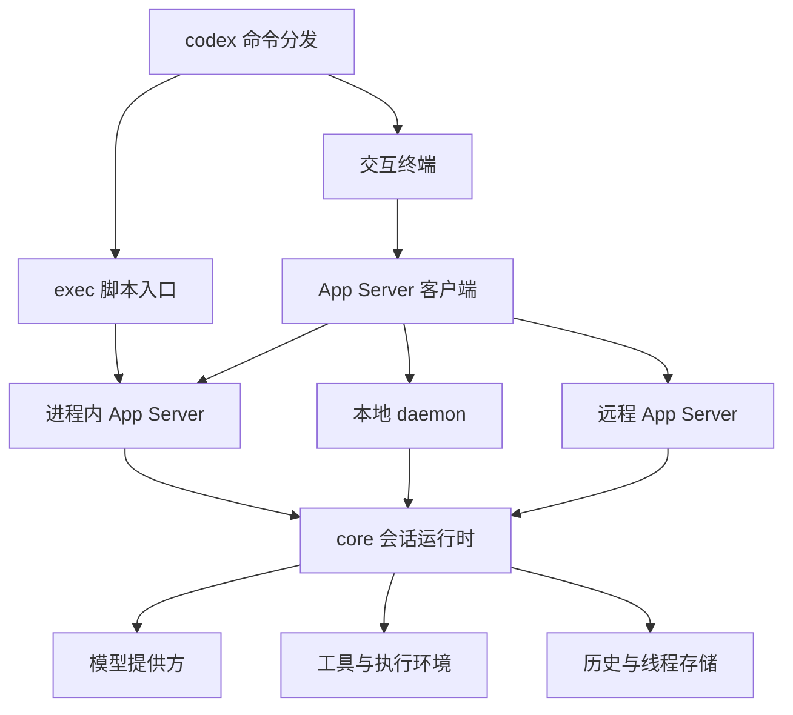

图中三条服务路径表示可选的部署位置，没有要求它们同时存在。它也没有把远程模型放进本地 core。公开客户端能证明请求如何构造、事件如何解释、动作怎样被约束，却不能说明服务端模型为什么作出某个决定。阅读时始终保留这条证据边界，才能避免把一段客户端分支解释成模型能力承诺。

<a id="ch01-architecture--用职责阅读-crate"></a>

## 用职责阅读 crate

Rust workspace 把代码分成许多 crate。crate 是编译与依赖组织单位，不自动对应产品功能或独立进程。对第一次进入仓库的读者，逐一记住名称的收益很低；更有效的方法是问：这一层接收什么、拥有何种状态、把什么交给下一层。

`cli` 选择运行方式；`tui` 和 `exec` 决定输入与输出的使用方式；`app-server` 把外部请求变成对核心对象的操作。`core` 接住会话生命周期、回合调度、模型步骤与工具反馈；`protocol` 和 `app-server-protocol` 分别表达相关的内部消息与外部接口类型。模型传输继续落到 client/API 代码，动作则经过工具路由、执行环境、策略和沙箱，历史通过持久化边界保存。这里是一张职责地图，并不是说每个职责都只在一个目录里实现。

一个很小的约束说明了这种分工怎样落到代码里：`core` crate 顶部禁止库代码直接向标准输出和标准错误打印，用户可见信息应该经过界面或 tracing 抽象。这使“发生了什么”和“如何展示”在依赖方向上保持距离。同一个工具结果可以被终端渲染，也可以被程序接口消费，而不要求底层执行代码知道终端布局。[core 的输出约束](https://github.com/openai/codex/blob/e4568a3538c9cab6627d64ff8cdfc7d98b79b7db/codex-rs/core/src/lib.rs#L1-L6)比一张宏大的分层图更能说明模块边界的实际含义。

这种分层有成本。一个用户输入会跨越数个类型与适配层，调试时需要分清协议请求 ID、核心 submission ID 和模型 response ID。它的收益是，每层可以对自己的完成条件负责；界面不用猜测模型流已经读完是否就意味着整个修复任务结束。

<a id="ch01-architecture--四种寿命支撑同一件工作"></a>

## 四种寿命，支撑同一件工作

进入核心后，先记住四种寿命。线程（thread，会话线程）是有身份、可查找的交互单元；它不是操作系统线程。`ThreadManager` 负责创建线程并在内存中维护它们，`CodexThread` 则是调用方拿到的句柄。句柄包含会话对象、输入输出端点、启动元数据和可选的回放日志路径。[ThreadManager](https://github.com/openai/codex/blob/e4568a3538c9cab6627d64ff8cdfc7d98b79b7db/codex-rs/core/src/thread_manager.rs#L251-L255)和 [CodexThread](https://github.com/openai/codex/blob/e4568a3538c9cab6627d64ff8cdfc7d98b79b7db/codex-rs/core/src/codex_thread.rs#L208-L219)定义的是管理与访问边界。

`Session` 是这个活线程的运行时，持有状态、服务、输入队列以及活动回合。回合（turn）是一段被接纳的工作生命周期，从输入进入处理到正常结束或中止；一个回合可以向模型请求很多次。模型步骤（step）则对应一次模型采样请求使用的环境、模型设置和能力快照。给分页函数定位问题、执行一次读取、看到工具结果后再次询问模型，可能都发生在同一个回合中。

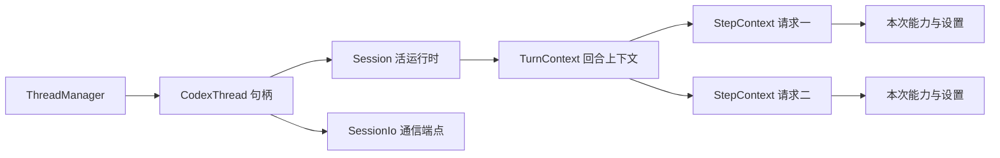

不要把图里的箭头全部理解为结构体直接拥有关系，它表达的是管理和捕获关系。尤其是 `StepContext`，它保存一次请求的设置版本、环境、MCP binding、最终工具路由和所见 AGENTS.md。于是，模型看到的工具与这次调用执行的工具能够绑定在同一请求边界上。部分授权仍会从所属回合的 grant store 查询，因此“捕获快照”也不等于所有关联对象从此永远不变。[StepContext 的字段](https://github.com/openai/codex/blob/e4568a3538c9cab6627d64ff8cdfc7d98b79b7db/codex-rs/core/src/session/step_context.rs#L24-L73)明确体现了这种区别。

本书的解读是：按寿命拆分状态，首先是在限制变化的影响范围。线程偏好可以服务于未来回合；当前回合保留自己的身份与输出约束；已经发出的模型请求应当知道自己使用的是哪一版工具与环境。代价是更新设置时必须明确“立即影响谁”，不能只改一个全局变量就期待所有工作同步改变。[第三章](#ch03-session)会展开这个问题。

<a id="ch01-architecture--跟随一次修复请求"></a>

## 跟随一次修复请求

把贯穿例子放进这张地图。输入最初由界面或脚本收集，转换为带结构的用户内容。外部服务接口把输入、线程设置和本次启动选项装成 `TurnInputRequest`，调用 `start_or_steer_turn`。这不是直接调用模型：核心先决定请求能否进入回合，以及它应当加入哪个回合。[App Server 的这次映射](https://github.com/openai/codex/blob/e4568a3538c9cab6627d64ff8cdfc7d98b79b7db/codex-rs/app-server/src/request_processors/turn_processor.rs#L661-L679)是界面与 agent 生命周期的交接点。

通信本身也有形状。`SessionIo` 里有 submission sender、event receiver、状态观察端点和共享的结束 future。启动代码创建有界的提交队列与无界的事件队列，然后启动后台 `submission_loop`。操作进入队列后，由循环按类型分发：用户输入、中断、审批回复、设置更新和关闭都有不同处理入口。这条队列保证的是核心操作被分派的秩序，不意味着模型请求与工具工作全部在这一个循环里同步执行。[端点定义与后台循环](https://github.com/openai/codex/blob/e4568a3538c9cab6627d64ff8cdfc7d98b79b7db/codex-rs/core/src/session/mod.rs#L420-L434)是后面理解并发的基础。

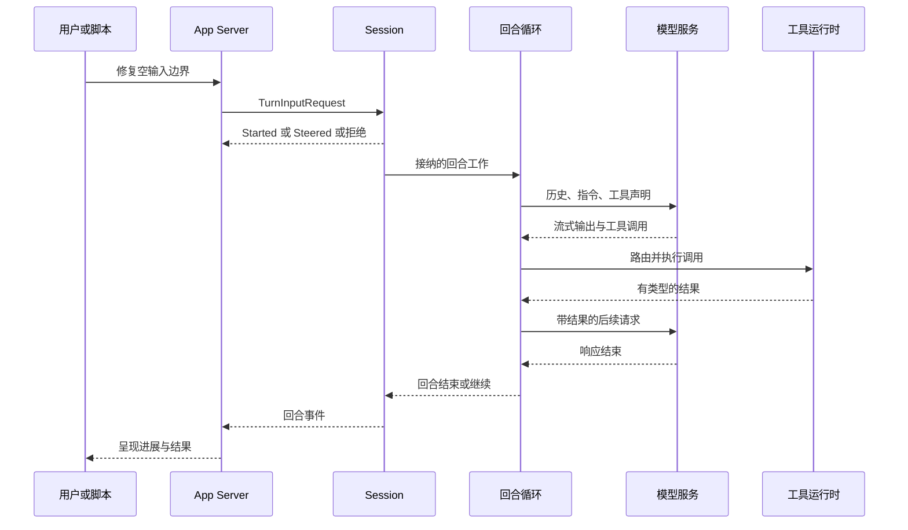

图里的第一次回执只说明核心作出了路由决定。源码对 `Started` 和 `Steered` 的说明非常直接：它们不等待用户 prompt hook、内存上下文更新、回放日志持久化或模型采样。因此，客户端收到 Started 后可以确认“工作已经被接纳”，却不能宣布“用户输入已经安全落盘”或者“模型已经看到这句话”。[回执契约](https://github.com/openai/codex/blob/e4568a3538c9cab6627d64ff8cdfc7d98b79b7db/codex-rs/protocol/src/turn_input.rs#L238-L260)把这些确认点分开了。

下面的教学伪代码只保留这几个边界，不对应可直接调用的真实 API：

```text
# 教学伪代码：从输入到回合
request = 收集用户内容与设置()
decision = 核心接纳并路由(request)
显示接纳结果(decision)
若 decision 为拒绝：返回
持续读取事件：
    更新当前回合的显示状态(event)
    若 event 表示回合终止：结束等待
```

回合开始后，运行时把当前历史整形成模型输入，捕获本次模型步骤，再发出流式请求。模型可以返回文本，也可以产生工具调用。工具结果回到上下文，成为下一次请求的输入。核心检查的不只是“这次有没有工具调用”，还包括是否存在待处理输入、预算与停止 hook 等条件；`run_turn` 中的 `needs_follow_up` 明确把模型要求后续和待输入合并起来。[后续工作判断](https://github.com/openai/codex/blob/e4568a3538c9cab6627d64ff8cdfc7d98b79b7db/codex-rs/core/src/session/turn.rs#L560-L611)解释了为什么一次模型响应结束后，整个回合仍可能继续。

这也是“模型在循环中”的工程含义。模型决定下一步提议什么；运行时决定提议如何编码、能否执行、结果怎样回到历史、何时允许结束。工具的真实修改路径将在[第八章](#ch08-execution)展开，审批和沙箱在[第九章](#ch09-safety)展开，不能把这些机制简化成一句系统提示词。

<a id="ch01-architecture--三条消息路径三种解释方式"></a>

## 三条消息路径，三种解释方式

端到端图有很多箭头，但它们没有承载同一种消息。第一条是使用方到运行时的操作：提交用户输入、回复审批、请求中断。第二条是运行时与模型之间的请求和流事件：模型输入、工具声明、输出项、文本增量、调用参数和用量。第三条是运行时向使用方报告的事件：回合开始、工具进展、警告、错误与回合终止。实现中还有更多子协议，先区分这三条，就能避免大量误读。

比如，用户写“保持函数签名”属于第一条路径；模型输出“我先查找调用者”可能以第二条路径中的文本增量到达；界面看到的文字和当前工作状态，则由第三条路径及其适配逻辑组织出来。模型的一段文字不会因为读起来像完成声明，就替代核心回合的终止通知。反过来，核心也不必等到收到完整的大段文字，才向界面展示流式进展。

模型流的类型尤其能说明问题。`ResponseEvent` 同时包含 `OutputTextDelta`、`OutputItemDone` 和 `Completed`：文本增量负责逐步呈现，输出项完成提供可处理的结构，响应完成还携带用量与可选的 `end_turn`。这些字段没有被压成一串“模型说了什么”。[ResponseEvent 定义](https://github.com/openai/codex/blob/e4568a3538c9cab6627d64ff8cdfc7d98b79b7db/codex-rs/codex-api/src/common.rs#L81-L132)让消费者能够分别处理展示、执行和控制信息。

这个区分对排错很实用。如果终端没有显示文字，先问模型流有没有增量，还是增量已到而界面未投影；如果补丁没有产生，先问是否有完整调用项，是否成功路由，是否被权限边界阻止；如果响应已经结束而界面仍在忙，先问回合是否还有待输入或后续工具。每个问题指向一个具体所有者，调查无需从“模型是不是不够聪明”这种无法直接检验的判断开始。

配置和指令也要分开观察。贯穿例子中的仓库可以通过 AGENTS.md 告诉模型“公共接口保持稳定”，运行时配置则决定所选模型、环境与权限等实际参数。前者改变模型可见的工作约定，后者参与构造可执行的运行时条件。把二者都称为“上下文”虽然方便，却会掩盖拒绝某次操作的真正位置。更具体地说，项目配置即使因信任而获准生效，也仍有敏感键过滤；一句项目指令无法代替这套过滤规则。[项目配置限制](https://github.com/openai/codex/blob/e4568a3538c9cab6627d64ff8cdfc7d98b79b7db/codex-rs/config/src/loader/mod.rs#L85-L102)会在下一章详细解释。

<a id="ch01-architecture--故障会从边界上显形"></a>

## 故障会从边界上显形

让例子稍微偏离顺利路径：模型正在读取分页函数，你又输入“保持函数签名”。这句话不一定创建第二个回合。`StartOrSteer` 可以把它加入活动的普通回合；显式 steer 还可以要求目标回合 ID，目标不匹配时得到有类型的拒绝。这样，迟到的 UI 操作就不必悄悄落到下一项工作中。

另一个变化是按下中断。中断不能只停止界面动画，运行时必须取消活动任务，并让等待审批、用户输入或工具结果的工作退出。源码甚至安排了一个细微顺序：先让任务观察到取消，再清掉待输入与等待者，避免一个审批发送端的消失先被解释成模型可见的拒绝。这种顺序说明，取消也会产生需要解释的数据，而不只是删除一个对象。[取消顺序](https://github.com/openai/codex/blob/e4568a3538c9cab6627d64ff8cdfc7d98b79b7db/codex-rs/core/src/tasks/mod.rs#L563-L590)将在并发章节继续出现。

还有更早的故障：线程尚在初始化，已经取得日志 writer，却还卡在扩展启动；此时调用方放弃了启动 future。源码用 `SessionStartupGuard` 保留清理责任，根据控制权是否已交给 session loop，选择正常 shutdown 或清理部分初始化的持久化资源。没有这条路径，后续恢复可能碰到上一次启动留下的资源占用。[启动清理分支](https://github.com/openai/codex/blob/e4568a3538c9cab6627d64ff8cdfc7d98b79b7db/codex-rs/core/src/session/startup.rs#L65-L105)让“尚未成功启动”也成为完整生命周期的一部分。

```text
# 教学伪代码：每个阶段只确认自己的事实
接纳回执 != 输入持久化完成
模型响应完成 != 回合完成
回合中断 != 会话关闭
若只初始化了一部分：
    按当前资源所有者执行清理
    等清理交接结束后释放生命周期责任
```

这里的失败路径带来一个实际阅读方法：看完正常调用，立刻找取消、拒绝和关闭。一个名字听起来像“完成”的事件，也需要检查负载。此快照的 `TurnComplete` 可以携带 terminal error；`TurnAborted` 则明确表达中止原因。客户端如果只凭枚举名字宣布业务成功，就会丢失运行时已经提供的事实。

<a id="ch01-architecture--用证据继续深入"></a>

## 用证据继续深入

本书后续章节会不断放大这条链。先研究启动如何形成可信的配置与指令，再研究回合如何拥有状态；随后进入模型 I/O、工具、执行和上下文；最后回到接口与验证。每一章都应回答“这个边界保护了什么”，而不只是“这里有多少文件”。

测试也能帮助读者识别边界。核心的并发输入测试用可阻塞的假 SSE 服务，刻意让两条输入同时到达，断言它们得到一个 Started、一个 Steered，且共享同一回合 ID。测试还检查后续请求体包含两条消息。这个例子把路由、时间次序和实际模型输入连了起来；我们在这里阅读的是测试设计与断言，没有执行该测试，也不把它扩写成生产环境的并发性能结论。

阅读大型源码时还要分清“存在”和“启用”。仓库里某个工具 handler 的存在，不保证当前模型请求会声明该工具；某个 feature 分支被编译进来，也不保证会话配置启用它。TUI 代码包含远程连接，不意味着每次终端启动都访问远端 App Server。本书提到实验、平台或 provider 分支时，会把条件放在结论附近，而不会让读者从仓库目录推导产品默认行为。

同样，类型中的兼容别名可能属于历史包袱。core 仍导出已废弃的 `ConversationManager`、`NewConversation`、`CodexConversation`，它们分别映射到新的 Thread 术语。搜索旧名可能帮助追踪调用者，却不能据此再创造一套并行的“Conversation 运行时”。固定提交的作用也在这里：我们讨论的是可复核的一组代码关系，而不是把多个年代的名字拼成一幅看似完整的图。

可以把阅读过程视作不断补充一份事件时间线：谁取得了资源，谁接纳了工作，谁发出了请求，谁观察到结果，谁最终释放责任。这条时间线一旦清楚，庞大的 workspace 就会逐步变成一组可以追问、可以验证的契约。

<a id="ch01-architecture--带回你的系统"></a>

## 带回你的系统

1. **为不同寿命的状态命名。** 如果用户偏好、活动任务和单次请求共享一个对象，先分出线程、回合与请求快照；代价是更新设置需要明确生效范围，小型一次性脚本未必需要完整层次。
2. **为接纳与完成分别建模。** 如果 API 迅速返回而工作仍在继续，提供路由回执和后续终止事件；代价是调用方必须处理两个确认阶段，不能把接纳回执当持久化证明。
3. **让界面消费事件。** 如果同一内核要服务终端和程序接口，让核心发有类型的事实，由适配层渲染；代价是需要维护事件兼容性和消费积压策略。
4. **在初始化时就安排清理。** 如果启动会依次取得 writer、连接和后台任务，为部分完成的状态设置资源所有者；代价是失败路径更长，却能避免“启动没成功，所以没有东西可清理”的误判。
5. **用受控时间线检查契约。** 如果并发输入或中断难以复现，用 gate 和假事件制造指定顺序，再检查最终请求或存储结果；代价是测试基础设施需要维护，单纯快照文本不足以验证生命周期。

<a id="ch01-architecture--源码导读"></a>

## 源码导读

- [cli/main.rs：main 与子命令分发](https://github.com/openai/codex/blob/e4568a3538c9cab6627d64ff8cdfc7d98b79b7db/codex-rs/cli/src/main.rs#L1035-L1170)，先确认当前运行的是哪一种入口。
- [tui/lib.rs：AppServerTarget 与连接回退](https://github.com/openai/codex/blob/e4568a3538c9cab6627d64ff8cdfc7d98b79b7db/codex-rs/tui/src/lib.rs#L577-L635)，核对进程内、本地与远程路径的条件。
- [exec/lib.rs：进程内客户端启动](https://github.com/openai/codex/blob/e4568a3538c9cab6627d64ff8cdfc7d98b79b7db/codex-rs/exec/src/lib.rs#L1021-L1026)，识别非交互入口也经过的服务边界。
- [codex_thread.rs：CodexThread](https://github.com/openai/codex/blob/e4568a3538c9cab6627d64ff8cdfc7d98b79b7db/codex-rs/core/src/codex_thread.rs#L208-L219)，把公开句柄与内部运行时分开。
- [session/mod.rs：SessionIo](https://github.com/openai/codex/blob/e4568a3538c9cab6627d64ff8cdfc7d98b79b7db/codex-rs/core/src/session/mod.rs#L420-L434)，看输入、输出、状态与结束通知的形状。
- [protocol/turn_input.rs：TurnInputSubmission](https://github.com/openai/codex/blob/e4568a3538c9cab6627d64ff8cdfc7d98b79b7db/codex-rs/protocol/src/turn_input.rs#L238-L319)，阅读每种回执的保证与拒绝原因。
- [session/turn.rs：后续步骤判断](https://github.com/openai/codex/blob/e4568a3538c9cab6627d64ff8cdfc7d98b79b7db/codex-rs/core/src/session/turn.rs#L560-L611)，区分一次模型响应与一个完整回合。
- [turn_input_submission.rs：并发输入测试](https://github.com/openai/codex/blob/e4568a3538c9cab6627d64ff8cdfc7d98b79b7db/codex-rs/core/tests/suite/turn_input_submission.rs#L1122-L1227)，观察假流如何把并发行为变成可断言的请求体。

---

<a id="ch02-bootstrap"></a>

<a id="ch02-bootstrap--第-2-章-启动配置与信任的建立"></a>

# 第 2 章　启动、配置与信任的建立

上一章把请求从界面送到了会话运行时，但那条链有一个前提：运行时已经知道自己在哪里工作，使用哪种模型，哪些环境可访问，以及哪些仓库约定可以交给模型。对于分页函数的修复，选错工作目录可能意味着阅读错误的 AGENTS.md，选错配置来源可能改变模型与权限；这些都发生在第一次模型请求之前。

启动的任务，是把磁盘文件、命令行参数、管理员要求、认证状态和用户选择，解释成一份可以执行的配置。它也要保留足够证据，回答“这个值为什么是这样”。Codex 没有把这件事压成读取一个 TOML 文件：源码同时保留层级、来源、版本、禁用原因和独立的约束。读懂这些机制，才能理解为什么改了一个配置文件，运行行为却可能没有变化。

本章仍围绕同一个教学案例展开。我们假设工作目录是仓库中的 `packages/pager`，并且希望修复空输入边界；这些路径只为说明发现规则，不表示书中创建或运行了该项目。下面的启动链以本地配置装配为主，涉及远程工作区、企业配置、平台能力的地方会明确条件。

<a id="ch02-bootstrap--进程首先要认出自己"></a>

## 进程首先要认出自己

CLI 的 `main` 先进入 `arg0_dispatch_or_else`。这层检查可执行文件名和特殊参数：同一可执行程序可以作为 Linux sandbox helper、补丁工具或其他执行 helper 被调用。命中特殊身份就转入对应入口；普通调用才建立 runtime 并执行 CLI 主逻辑。Linux、Unix 或 Windows 专属分支由相应条件约束，不能推导为每个平台都走同一套 helper。[身份分发](https://github.com/openai/codex/blob/e4568a3538c9cab6627d64ff8cdfc7d98b79b7db/codex-rs/arg0/src/lib.rs#L61-L88)解释了为什么可执行路径本身属于运行环境的一部分。

普通入口还会在名为 `codex-main` 的操作系统线程里建立 Tokio runtime，为顶层异步工作安排栈预算。这里的 OS 线程和全书所说的会话线程是两个概念。`Arg0DispatchPaths` 带着自身与相关 helper 的路径继续向下；临时别名目录的 guard 活到入口 future 完成，防止后续执行引用一个已经被删除的路径。[正常启动与路径保活](https://github.com/openai/codex/blob/e4568a3538c9cab6627d64ff8cdfc7d98b79b7db/codex-rs/arg0/src/lib.rs#L194-L248)展示了一个普通却关键的资源寿命问题。

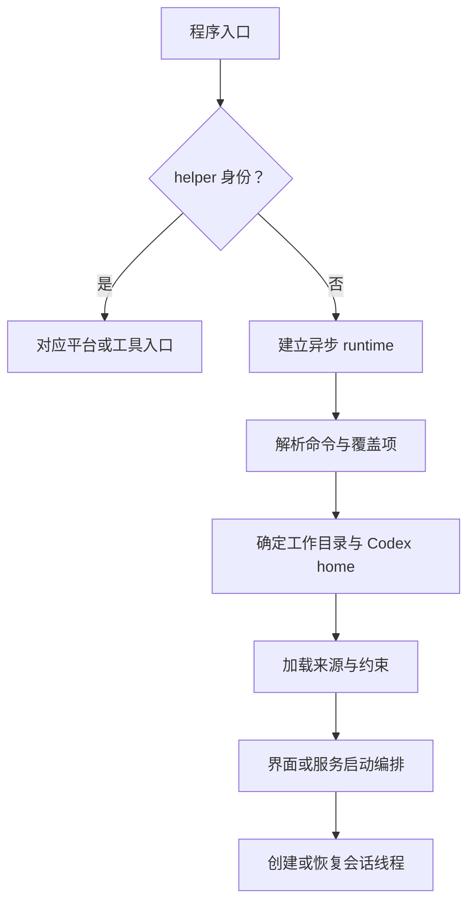

进入 `cli_main` 后，feature 的 enable/disable 参数会折入配置覆盖项，并继续传递给具体子命令。这是一个值得借鉴的接口选择：启动选项尽早转换为下游已经认识的表示，避免每一层都重新发明 feature 优先级。但它不意味着“所有命令行参数都只是 TOML 字符串”；核心 builder 还接收有类型的 harness overrides 和 loader options，它们承担不同的适配职责。

<a id="ch02-bootstrap--配置值需要携带来历"></a>

## 配置值需要携带来历

`ConfigBuilder::build_inner` 先确定 Codex home，再把显式 cwd 或 fallback cwd 解析为绝对路径，随后加载配置层，最后构造 `Config`。cwd 在这里已经参与项目发现，并非等工具执行时才临时读取进程当前目录。[builder 的装配顺序](https://github.com/openai/codex/blob/e4568a3538c9cab6627d64ff8cdfc7d98b79b7db/codex-rs/core/src/config/mod.rs#L1547-L1595)说明，工作目录是配置解释的输入。

这个快照的普通配置优先级，可以从 `ConfigLayerSource::precedence` 读出。下表按从低到高排列；来源是否存在，还取决于平台、安装方式与当前选项。

| 顺序 | 配置来源 | 需要保留的限定 |
| --- | --- | --- |
| 低 | 包内默认配置 | 可由安装包提供，也有嵌入默认值 |
| ↑ | MDM、系统配置 | MDM 分支限相应平台能力 |
| ↑ | 企业云配置 | 需要有对应 bundle 来源 |
| ↑ | 用户配置、选中的用户 profile | profile 层高于基础用户层 |
| ↑ | 项目配置 | 经过信任筛选与敏感键过滤 |
| ↑ | SessionFlags | CLI/UI 等当前会话覆盖 |
| 高 | legacy managed file、legacy managed MDM | 兼容旧管理格式，仍有更高优先级 |

所以，“命令行永远覆盖一切”在此快照并不成立。旧 managed 层仍高于 SessionFlags。另一方面，管理员要求还存在独立的 requirements 通道；它不仅是普通值再覆盖一次，还会参与可选值限制及 provider 定义等处理。`effective_config` 合并有效配置层后，仍可能应用必要的 provider 定义；随后构造最终配置时继续应用选择与其他要求。[优先级定义](https://github.com/openai/codex/blob/e4568a3538c9cab6627d64ff8cdfc7d98b79b7db/codex-rs/config/src/config_layer_source.rs#L30-L50)与[有效配置计算](https://github.com/openai/codex/blob/e4568a3538c9cab6627d64ff8cdfc7d98b79b7db/codex-rs/config/src/state.rs#L544-L568)需要一起阅读。

每层 `ConfigLayerEntry` 都保留来源、内容版本和可选的 `disabled_reason`。有效配置与 per-key origins 根据未禁用的层计算；被禁用的层仍可用于解释界面中的“看到了文件，却没有使用”。origins 也明确不包含独立 requirements 的来源，不能拿一份字段来源表当成所有政策的最终说明。这些元数据没有直接帮助模型生成代码，却直接帮助人解释系统。

```text
# 教学伪代码：值与来源一起前进
layers = 读取适用的配置来源()
对每个项目层：
    标记信任决定与禁用原因()
    移除项目不允许提供的键()
effective = 按优先级合并未禁用层(layers)
config = 结合有类型覆盖与独立约束(effective)
返回 config 和 layers 的来源记录
```

把分页修复放回来看：如果用户配置选择了某个模型，可信项目层又提供了另一个模型，最终值要看更高的覆盖与约束。若项目层被禁用，文件中的设置存在也不会参与合并。排错时应当沿着“文件是否发现、层是否启用、键是否保留、谁最后覆盖、要求是否允许”逐步前进，直接反复修改同一行可能一直碰不到真正的决定点。

配置合并也没有等同于简单的整文件替换。通用分支对 TOML table 递归合并，对其他值采用覆盖；特定结构还有专门处理。例如某些 feature 可以同时支持布尔开关和带参数的 table，合并代码在这两种表示之间保留 `enabled` 语义。网络域名、shell filter 等路径还有自己的规范化规则。因此，“上一层值覆盖下一层”是解释优先级的起点，具体字段仍要看其表示与合并规则。[合并实现](https://github.com/openai/codex/blob/e4568a3538c9cab6627d64ff8cdfc7d98b79b7db/codex-rs/config/src/merge.rs#L77-L150)把这些例外集中在明确的路径上。

这件事对配置接口的演进有实际意义。如果旧版本把某个 feature 写成布尔值，新版本要增加参数，粗暴替换会让“只改一个子参数”意外抹掉启用状态。源码通过字段特定语义协调这类表示；代价是配置系统已经拥有自己的领域规则，不能再把它当作完全通用的字典合并器来维护。写管理界面或配置编辑器时，也必须使用相同语义，不能凭 JSON 看起来相似就自行合并。

最终值与允许值之间也有区别。源码在没有显式审批策略时，会先选默认，再检查 requirements 是否允许；默认不被允许时，记录警告并使用要求提供的默认。这不是所有无效显式值都静默修正的承诺，只证明这个默认选择分支有回退行为。公开配置里已经退役的 `approval_policy="untrusted"` 则会被明确拒绝，不能因为内部仍有兼容枚举就当成推荐配置值。[默认与约束的协调](https://github.com/openai/codex/blob/e4568a3538c9cab6627d64ff8cdfc7d98b79b7db/codex-rs/core/src/config/mod.rs#L3866-L3906)说明，类型兼容和用户配置契约也需要分别阅读。

<a id="ch02-bootstrap--项目不能决定自己的信任"></a>

## 项目不能决定自己的信任

项目配置的发现有一个先后关系：先使用适用的非项目来源确定项目根与信任，再读取项目层。managed 来源也以其适用优先级参与这个发现过程。这样，仓库内容不会先改写根标记或信任依据，再用自己安排的范围解释自己。[发现与加载的先后关系](https://github.com/openai/codex/blob/e4568a3538c9cab6627d64ff8cdfc7d98b79b7db/codex-rs/config/src/loader/mod.rs#L350-L420)比单独列出配置路径更能说明机制。

发现代码从 cwd 向项目根收集祖先目录，再反转为从根到 cwd 的顺序，逐目录查看 `.codex`。信任查找考虑当前目录、项目根和仓库根等规范化键；明确 Trusted 才使这一项目层通过相应门槛。显式 Untrusted 和尚无决定都有禁用原因，但原因文字区分了“已有不信任决定”和“尚需建立信任”。这也表明“没有设置”和“明确拒绝”不应被压成同一个布尔值。

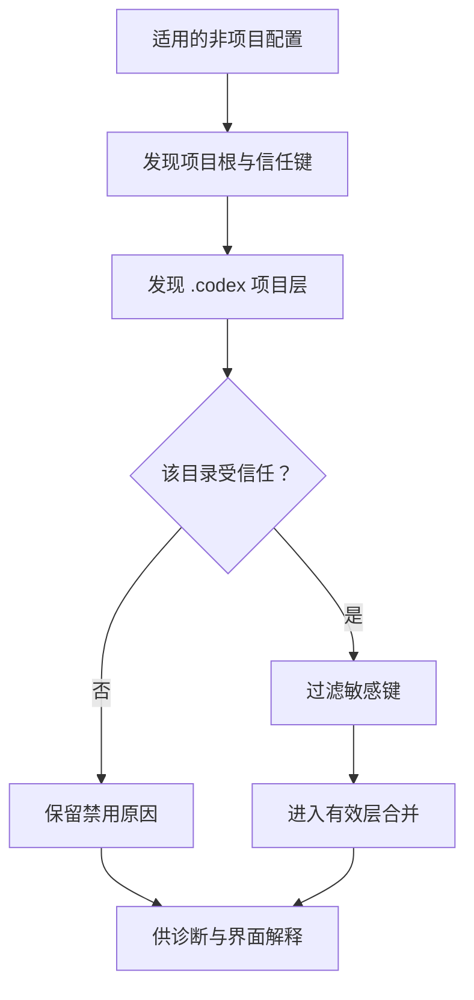

信任通过之后还有第二道筛选。项目 denylist 包含模型 provider、相关 base URL、notify、profile、otel 等配置。源码注释明确指出，项目文件不应决定用户凭据发往哪里，也不应选择任意本地命令。具体的过滤还处理一些嵌套字段；credential broker 相关环境变量规则则有额外启用条件，不能概括成“项目永远不能设置任何环境变量”。[敏感键入口](https://github.com/openai/codex/blob/e4568a3538c9cab6627d64ff8cdfc7d98b79b7db/codex-rs/config/src/loader/mod.rs#L85-L102)和实际 `sanitize_project_config` 共同定义了限制。

这两道边界解决的是不同问题。信任记录表达是否允许读取该来源所提供的项目能力；键过滤表达这个来源即使受信任，也不拥有某类控制权。从这些边界可以推断，系统希望把“仓库可提供工作习惯”与“仓库可重新配置认证去向”分开。这个推断来自权限分配的结果，不能扩写为源码作者未说明的全部设计动机。

配置的失败处理同样依赖信任。项目 TOML 解析失败时，如果该层受信任，就返回错误；没有获得信任的层则可以以空的禁用层保留，使一个尚未启用的坏文件不会先破坏启动。至于未知字段，必须看校验模式：CLI 覆盖的严格检查在 `strict_config` 为真时执行，不能把严格分支的报错描述成所有默认加载的共同结果。[解析分支](https://github.com/openai/codex/blob/e4568a3538c9cab6627d64ff8cdfc7d98b79b7db/codex-rs/config/src/loader/mod.rs#L1731-L1762)与[strict 条件](https://github.com/openai/codex/blob/e4568a3538c9cab6627d64ff8cdfc7d98b79b7db/codex-rs/config/src/loader/mod.rs#L253-L263)各自约束了结论。

<a id="ch02-bootstrap--登录与信任可能要求重新装配"></a>

## 登录与信任可能要求重新装配

启动不是始终只向前走一遍的流水线。交互界面可以先拿到初始配置和服务连接，随后处理登录、选择目标线程，再在实际目标目录上处理信任。源码把 folder consent 放在 picker 已确定目的地之后；这能避免对一个目录确认信任，最终却在另一个目录开始工作。

本地登录发生后，TUI 会在适用条件下刷新云配置 bundle，再重建配置，以免遗漏登录后才能取得的企业政策。目录信任持久化改变时，也会重新加载配置。远程工作区走自己的服务与认证政策，不能把本地文件的变化当成远端执行环境已经变化。更细的一条分支是：如果重载改变 provider，且当前服务为 Embedded，代码会关闭旧服务并按新配置启动服务。[登录后的重建](https://github.com/openai/codex/blob/e4568a3538c9cab6627d64ff8cdfc7d98b79b7db/codex-rs/tui/src/lib.rs#L1418-L1448)和[目标目录信任后的处理](https://github.com/openai/codex/blob/e4568a3538c9cab6627d64ff8cdfc7d98b79b7db/codex-rs/tui/src/lib.rs#L1928-L1984)说明了这种反馈关系。

认证本身由 `AuthManager` 这样的服务对象管理。它保存缓存、存储模式、管理员限制、外部认证 provider 和刷新同步机制，并能通知认证及 owner revision 的变化。`auth_cached()` 只读缓存；`auth()` 可能重新解析外部认证，或者为需要主动刷新的凭据执行受保护的刷新。不能把两者都理解成“读出一段 API key”。[认证状态与读取契约](https://github.com/openai/codex/blob/e4568a3538c9cab6627d64ff8cdfc7d98b79b7db/codex-rs/login/src/auth/manager.rs#L2366-L2419)也让登录过程延伸到了后续请求阶段。

认证状态还会影响连接复用。模型客户端开始新的回合 session 时，会比较 auth owner generation；所有者变化则清掉旧的 WebSocket 缓存。它保护的是账户与连接路由的关联，而不只是 token 字符串是否过期。不同 provider 的鉴权路径并不相同，后续模型通信章节会讨论恢复；本章只需记住，配置完成、已有认证和某次模型请求成功是三个不同事实。

<a id="ch02-bootstrap--agentsmd-沿目录链进入工作约定"></a>

## AGENTS.md 沿目录链进入工作约定

回到 `packages/pager`。仓库根的 AGENTS.md 可以写全仓约定，子目录里的文件可以补充当前包的工作要求。核心发现从项目根到 cwd 的目录链，不会为初始化递归读取所有子目录；未找到根标记时仅考虑 cwd，空根标记列表也会关闭父级遍历。默认根标记是 `.git`，可由适用配置调整。[发现规则](https://github.com/openai/codex/blob/e4568a3538c9cab6627d64ff8cdfc7d98b79b7db/codex-rs/core/src/agents_md.rs#L1-L18)规定了扫描范围。

同一目录只选择第一个存在的候选文件：`AGENTS.override.md`、`AGENTS.md`，再到配置的 fallback 文件名。所以 override 不是与同目录普通文件再拼接一遍；父目录已选择的文件仍可以和子目录文件按顺序组成指令。fallback 也只能是文件名，带不适用路径语法的候选会被跳过，路径约定按执行环境识别。[候选与选择逻辑](https://github.com/openai/codex/blob/e4568a3538c9cab6627d64ff8cdfc7d98b79b7db/codex-rs/core/src/agents_md.rs#L242-L295)避免把可配置名称变成任意路径探测。

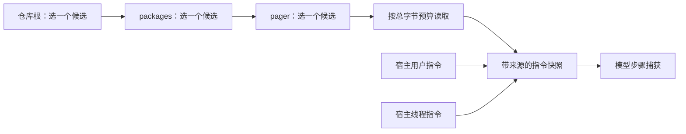

读取并非无上限。`project_doc_max_bytes` 作为共享的剩余预算，按选定环境与文件顺序消耗；文件过大则截断，转换为文本时使用 UTF-8 lossy 解码，并保留来源文件及环境身份。显式 Untrusted 项目会跳过项目文档，但宿主提供的用户指令仍可留下。这里的项目指令门槛不能与项目配置的 Trusted 门槛混为一句话：二者是分别实现的条件。[读取与预算](https://github.com/openai/codex/blob/e4568a3538c9cab6627d64ff8cdfc7d98b79b7db/codex-rs/core/src/agents_md.rs#L56-L178)给出了差别。

预算也带来真实取舍。根文档先被读取，过长的根约定可能挤掉更贴近 `pager` 的内容；截断边界也不保证恰好落在完整段落。于是“把全部知识都写进根文件”会改变指令实际可见的范围。文档应当提供必要约束和可继续查找的入口，技能与扩展的按需机制则留到[第十三章](#ch13-extensions)详谈。

<a id="ch02-bootstrap--缓存必须知道何时失效"></a>

## 缓存必须知道何时失效

不能从“启动加载指令”推导出“每个进程只读一次”。`AgentsMdManager::refresh` 在启动或请求边界解析一致快照；宿主 provider 负责自己的获取与缓存，仓库指令缓存则根据环境 selection 和项目 trust level 的变化判断是否重建。这个机制也不等于每次模型请求都把磁盘全部重读。[refresh 的缓存条件](https://github.com/openai/codex/blob/e4568a3538c9cab6627d64ff8cdfc7d98b79b7db/codex-rs/core/src/agents_md_manager.rs#L64-L148)是精确表述的依据。

一个值得仔细看的失败场景是权限收紧。环境选择变化后，旧指令可能来自新权限已经不能读取的位置。manager 在需要重新发现时先清掉缓存，即使新发现失败或被取消，也不能继续暴露失效的旧内容。这是安全状态与普通性能缓存的区别：普通缓存倾向于“失败时保留旧值”，访问边界变化时这个策略可能违背新的限制。

```text
# 教学伪代码：指令刷新
若 环境选择变化 或 项目信任变化：
    立即撤掉旧仓库缓存
加载宿主提供的用户与线程指令
校验新指令
若需要仓库发现：按当前环境与权限读取
仅把通过校验的结果发布为新快照
把警告交给调用方处理
```

文件读取错误还有条件区别。没有受限 sandbox 读取上下文时，加载错误可以被记录并继续；受限读取路径中的错误会向上传递。它们解决不同的可用性与权限语义，不能用“AGENTS.md 出错总是忽略”概括。对于我们的修复案例，这意味着缺失文档、超过预算和无法在当前权限下确认文档，是三种需要分别解释的情况。

<a id="ch02-bootstrap--用启动失败检验装配契约"></a>

## 用启动失败检验装配契约

假设仓库刚被克隆下来，某个 `.codex/config.toml` 中有半截 TOML。一个把所有文件一律先解析、一律报错的 loader，会让尚未授权使用的项目内容决定程序能否启动；一个把所有错误一律忽略的 loader，又会让已经受信任的配置错误变得难以发现。Codex 的分支把这两种情况分开：有效来源的错误应被修复，被禁用来源的内容则不应先取得控制权。

相关测试没有停在函数返回成功。`invalid_project_config_ignored_when_untrusted_or_unknown` 分别构造 Untrusted 和未知信任两种情况，写入损坏的项目 TOML，再检查项目层仍存在、带 disabled_reason、内容为空，并且有效值来自用户层。它同时验证了可用性、来源解释和最终结果。这是本章阅读过的测试断言，未在本轮执行。[对应测试](https://github.com/openai/codex/blob/e4568a3538c9cab6627d64ff8cdfc7d98b79b7db/codex-rs/core/src/config/config_loader_tests.rs#L4258-L4336)也提醒我们，启动测试应验证最终装配结果，而不只验证“没有抛异常”。

启动的结束条件同样需要谨慎。拿到 Config 只表示配置解析完成；服务连接可能失败，线程存储可能打不开，扩展初始化还可能被取消。对于分页修复而言，此时最准确的反馈是具体哪一个阶段无法建立，而不是让模型猜一个仓库故障原因。第一章提到的启动 guard 在这里接过责任，保证未完整交接的资源仍有清理路径。

本章没有要求你记住所有配置字段。更有价值的是启动留下的一串可追问关系：哪个位置建立工作范围，哪个来源拥有控制权，哪个变化要求重建，哪个失败允许继续，以及谁负责把警告交给使用方。完成这些装配之后，下一章才能讨论一个线程如何接纳和管理真正的工作。

<a id="ch02-bootstrap--带回你的系统"></a>

## 带回你的系统

1. **让配置带着出处。** 如果多层设置经常产生“改了没生效”，保存字段来源、层版本与禁用原因；代价是配置模型更复杂，诊断接口也必须跟随最终解析逻辑维护。
2. **把信任与可配置权限分开。** 如果仓库可提供本地设置，先判断来源可否使用，再限制该来源能控制哪些键；代价是需要维护键过滤规则，简单的 trusted 布尔值无法替代它。
3. **把 cwd 当解析输入。** 如果配置和指令依赖目录层级，先确定绝对工作范围，再进行发现；代价是切换目录时必须重新计算，不能继续使用旧缓存。
4. **允许启动重新装配。** 如果登录、目标选择或信任会改变政策，显式重建相关配置与服务；代价是资源交接需要完整清理，不能只替换一个指针。
5. **给指令设置范围与预算。** 如果项目文档会进入模型输入，明确目录顺序、候选优先级与总量上限；代价是内容可能被截断，需要把最关键的规则写得短而清楚。

<a id="ch02-bootstrap--源码导读"></a>

## 源码导读

- [arg0/lib.rs：身份分发与 runtime](https://github.com/openai/codex/blob/e4568a3538c9cab6627d64ff8cdfc7d98b79b7db/codex-rs/arg0/src/lib.rs#L194-L248)，理解辅助路径为何必须活过整个入口调用。
- [core/config/mod.rs：ConfigBuilder](https://github.com/openai/codex/blob/e4568a3538c9cab6627d64ff8cdfc7d98b79b7db/codex-rs/core/src/config/mod.rs#L1547-L1595)，追踪 cwd、层栈与最终 Config 的装配。
- [config_layer_source.rs：来源优先级](https://github.com/openai/codex/blob/e4568a3538c9cab6627d64ff8cdfc7d98b79b7db/codex-rs/config/src/config_layer_source.rs#L6-L50)，核对 SessionFlags 与 legacy managed 的相对位置。
- [loader/mod.rs：项目发现前的配置](https://github.com/openai/codex/blob/e4568a3538c9cab6627d64ff8cdfc7d98b79b7db/codex-rs/config/src/loader/mod.rs#L350-L420)，观察根与信任为什么先于项目层确定。
- [loader/mod.rs：项目解析和过滤](https://github.com/openai/codex/blob/e4568a3538c9cab6627d64ff8cdfc7d98b79b7db/codex-rs/config/src/loader/mod.rs#L1717-L1779)，比较可信与禁用层的失败路径。
- [state.rs：有效配置与字段来源](https://github.com/openai/codex/blob/e4568a3538c9cab6627d64ff8cdfc7d98b79b7db/codex-rs/config/src/state.rs#L544-L568)，注意 requirements 来源另有记录。
- [auth/manager.rs：认证读取](https://github.com/openai/codex/blob/e4568a3538c9cab6627d64ff8cdfc7d98b79b7db/codex-rs/login/src/auth/manager.rs#L2366-L2419)，区分读缓存、刷新与账户绑定的网络配置。
- [agents_md.rs：文档加载](https://github.com/openai/codex/blob/e4568a3538c9cab6627d64ff8cdfc7d98b79b7db/codex-rs/core/src/agents_md.rs#L56-L178)，检查信任、字节预算和读取错误。
- [agents_md_manager.rs：快照刷新](https://github.com/openai/codex/blob/e4568a3538c9cab6627d64ff8cdfc7d98b79b7db/codex-rs/core/src/agents_md_manager.rs#L64-L148)，观察缓存失效与发布新值的顺序。
- [agents_md 测试：override 与父子顺序](https://github.com/openai/codex/blob/e4568a3538c9cab6627d64ff8cdfc7d98b79b7db/codex-rs/core/tests/suite/agents_md.rs#L318-L353)，并继续阅读同文件 449 行后的目录链断言；此处仅引用测试设计，未声称运行结果。

---

<a id="ch03-session"></a>

<a id="ch03-session--第-3-章-会话线程与回合"></a>

# 第 3 章　会话、线程与回合

配置已经装配完成，模型也还没有开始修复分页函数。此时先问一个看似简单的问题：接下来这份工作到底属于谁？如果用户连续发来两条消息，系统应当排两个任务，还是把第二条作为当前工作的补充？如果界面在等待期间断线，线程身份是否也随之消失？如果用户更新模型设置，已经发出的请求应当看到新值吗？

这些问题都在要求系统明确状态的寿命。Codex 使用线程（thread，会话线程）、活的 Session、回合（turn）和模型步骤（step）分配这些责任。名字相近，但它们的完成条件、存储方式和访问入口并不相同。沿着这几个对象阅读，可以把“agent 正在运行”这句模糊描述，拆成可观察、可拒绝、可取消的状态。

本章继续使用空输入边界修复这个教学案例，关注任务怎样被接纳和拥有。模型内部如何流式生成、工具结果如何驱动下一步，将在[第四章](#ch04-model-io)与[第五章](#ch05-agent-loop)展开；本章先把承载这些动作的生命周期搭起来。

<a id="ch03-session--会话身份与活运行时"></a>

## 会话身份与活运行时

先用职责区分四个对象。

| 对象 | 主要回答的问题 | 典型内容 |
| --- | --- | --- |
| `ThreadManager` | 线程如何创建、查找与管理 | 活线程注册、共享服务、启动请求 |
| `CodexThread` | 外部调用方如何操作一个线程 | Session、SessionIo、启动元数据 |
| `Session` | 当前活线程拥有什么 | 状态、服务、活动回合、输入队列 |
| `TurnContext` / `StepContext` | 一回合与一次模型请求使用什么 | 身份、设置、环境、能力与授权关联 |

线程是一个可被命名和查找的会话身份，并非一条专门运行它的操作系统线程。`ThreadManager` 通过共享状态维护内存中的线程，`CodexThread` 则包住 `Arc<Session>` 和通信端点。调用者克隆句柄时是在共享访问同一个运行时，而不是复制出一份独立历史或第二个 agent。[句柄结构](https://github.com/openai/codex/blob/e4568a3538c9cab6627d64ff8cdfc7d98b79b7db/codex-rs/core/src/codex_thread.rs#L208-L219)使这件事能够直接从类型中读出。

`Session` 的字段进一步分出状态与服务。`SessionState` 保存配置、上下文管理器、用量和一些会话级记录；`active_turn` 单独用锁保护，输入队列也有自己的抽象；服务对象提供模型客户端、执行、扩展和持久化等能力。源码注释说一个 Session 至多有一个 running task，但进程仍会存在模型流、工具、预热和其他后台异步工作。这个约束针对会话任务所有权，不能读成“整个 agent 没有并发”。[Session 的边界](https://github.com/openai/codex/blob/e4568a3538c9cab6627d64ff8cdfc7d98b79b7db/codex-rs/core/src/session/session.rs#L57-L100)限定了这句话的含义。

<a id="ch03-session--创建线程不等于总是新建一切"></a>

## 创建线程不等于总是新建一切

普通启动通过 `start_thread(StartThreadOptions)` 进入 manager。options 包含 Config、初始历史、环境、动态工具、扩展初始化数据等；同一个入口还可以参与恢复与内部会话创建。manager 将这些输入整理成 spawn request，再装配 Session 所需的服务与历史。这样，新建、恢复和分叉可以共享底层生命周期，同时保留各自的输入规则。

一个具体边界是 warm resume。初始历史指向已在内存运行的线程时，manager 可以返回已有的 `CodexThread` 与启动信息；它还会拒绝不同回放日志路径等不一致请求，并对特殊内部 reviewer 做访问限制。冷恢复则需要重新建立运行时。于是，线程身份、活运行时和磁盘历史没有一一绑定为“每次恢复都从头复制一次”。[已有线程复用分支](https://github.com/openai/codex/blob/e4568a3538c9cab6627d64ff8cdfc7d98b79b7db/codex-rs/core/src/thread_manager.rs#L2179-L2214)是理解恢复语义的一个入口，存储细节留到[第十一章](#ch11-persistence)。

启动过程也可能还没完成。manager 负责把 Session 和 SessionIo 交接成可用句柄；如果中途失败，会调用 startup guard 清理。对调用方而言，拿到 `NewThread` 才是一次完整启动的返回结果，不能因为底层已经创建了 Session，就假定所有注册与资源交接均成功。前一章的配置完成，也只是更早的一个阶段。

<a id="ch03-session--通信端点为什么从状态中分出来"></a>

## 通信端点为什么从状态中分出来

`SessionIo` 保存提交 sender、事件 receiver、agent 状态的 watch receiver，以及后台 loop 的共享完成 future。它没有把这些端点直接藏在 Session 的互相引用中。源码注释明确给出目的：所有 submission sender 都被释放时，循环可以结束；共享完成 future 让多个调用者观察同一次关闭。[SessionIo](https://github.com/openai/codex/blob/e4568a3538c9cab6627d64ff8cdfc7d98b79b7db/codex-rs/core/src/session/mod.rs#L420-L434)表达了通信能力与运行时状态的不同寿命。

启动代码创建容量为 512 的有界提交队列和无界事件队列。有界队列意味着提交端可能等待接收方推进；无界事件队列则说明事件生产没有以同样方式等待消费端释放容量。不能把这对通道笼统称为完整的背压设计：它们有不同的积压风险，也要求使用方持续消费事件。[通道创建](https://github.com/openai/codex/blob/e4568a3538c9cab6627d64ff8cdfc7d98b79b7db/codex-rs/core/src/session/mod.rs#L647-L648)与容量常量共同给出了实际边界。

普通 `submit` 会生成 submission ID，包成 `Submission` 送入队列。除了 `Op`，包装还携带 trace、父回合与根回合等关联信息，部分内部路径还有维持接收线程驻留的 guard。这些元数据把跨异步边界的来源关系与生命周期责任一起移动，而不是只传一个闭包让目标“执行一下”。创建新回合时，App Server 会把相应 submission ID 暴露为 turn ID；每个提交都不必然创建新回合。[Submission](https://github.com/openai/codex/blob/e4568a3538c9cab6627d64ff8cdfc7d98b79b7db/codex-rs/core/src/session/submission.rs#L1-L20)和 [ID 约定](https://github.com/openai/codex/blob/e4568a3538c9cab6627d64ff8cdfc7d98b79b7db/codex-rs/core/src/session/mod.rs#L1186-L1192)值得配对阅读。

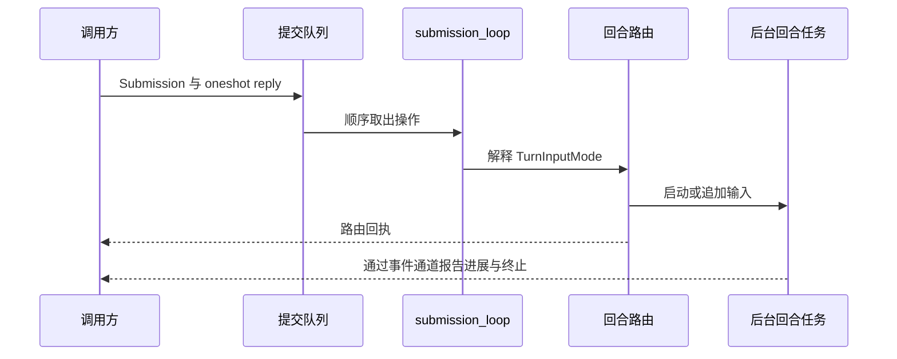

`submission_loop` 在后台接收操作并分发，同时关注 agent-tree shutdown 和 mailbox 通知。它等待路由处理器的决定，却不会等待整个模型回合结束后才继续接收中断或审批回复。否则模型等待用户审批，用户回复却排在模型任务之后，系统就会形成自己制造的等待环。回合的长工作由独立 task 承载，提交循环负责把新的控制操作送到正确位置。

<a id="ch03-session--请求接纳有四种路由语义"></a>

## 请求接纳有四种路由语义

对我们的修复请求，最常见入口是 `start_or_steer_turn`：空闲时启动普通回合，存在可接纳输入的活动普通回合时则 steer。用户中途补充“保持函数签名”，因此可以成为原回合的后续输入，不要求界面先猜一次当前状态，再决定调用两个不同 API。状态检查与决定在核心完成，缩小了读取状态与实际提交之间的竞态窗口。

其他入口把调用方意图表达得更窄。`start_turn_if_idle` 只愿意在空闲时启动，不能自动改变为 steer；`steer_turn` 要求一个确切的活动回合 ID，不能在目标已结束时偷偷创建新工作；`continue_turn_if_idle` 接受内部 response item，并要求此前回合没有被更新的任务取代。后者不把内部续接内容当作新的用户授权。[路由模式与公开方法](https://github.com/openai/codex/blob/e4568a3538c9cab6627d64ff8cdfc7d98b79b7db/codex-rs/core/src/codex_thread.rs#L412-L468)把这些差异写进了接口。

核心结果分为 Started、Steered、NotSubmitted。拒绝原因也有类型：不空闲、没有活动回合、目标 ID 不匹配、当前任务不可 steer、输出 schema 不匹配、服务器正在停止接纳新回合等。调用方可以据此保留用户草稿、提示目标已变或选择稍后重试；一个布尔值无法表达这些可行动的区别。[结果与拒绝原因](https://github.com/openai/codex/blob/e4568a3538c9cab6627d64ff8cdfc7d98b79b7db/codex-rs/protocol/src/turn_input.rs#L238-L319)同时定义了成功与失败路径。

有些条件还依赖输入类型。自动启动工作在 Plan 模式受到限制，而真正的用户输入可以启动回合；内部恢复有自己的入口和授权语义。服务器 draining 时通常停止接纳新普通回合，但某些已经在父任务中的委派工作有受限例外。这些都说明“可以提交消息”不是一种全局权限，应当问这是什么输入、试图进入什么生命周期。多 agent 的具体分支在[第十五章](#ch15-multi-agent)展开。

```text
# 教学伪代码：让核心解释意图
按模式提交(input)：
    若模式为仅 steer：检查目标回合仍匹配
    若模式为仅空闲启动：原子检查并预留空闲位置
    若模式为启动或 steer：先尝试加入活动回合
    检查输入类型、输出约束与接纳政策
    若拒绝：返回原因，保留原状态
    若接纳：应用适用设置，启动或追加工作
    返回所属回合的身份
```

路由回执仍有严格的知识边界。Started 与 Steered 表示输入已被核心接纳用于回合处理，不等待 prompt hook、模型上下文更新、回放日志写入或采样。提交入队又更早：`SessionIo::submit_turn_input` 用 oneshot 等待的是路由决定。调用方一旦入队后放弃等待，不会撤回已经提交的工作；如果 session loop 在回复前退出，等待方得到 `InternalAgentDied`。[入队后的责任](https://github.com/openai/codex/blob/e4568a3538c9cab6627d64ff8cdfc7d98b79b7db/codex-rs/core/src/session/mod.rs#L1102-L1132)是程序接口必须知道的取消语义。

还要区分 continuation 和 recovery。前者在空闲时以内部 response item 开启新的续接回合，并核对 expected previous turn，防止一个迟到的后台结果覆盖较新的工作。后者恢复已经中断的普通回合，保留先前记录的 turn ID，不额外制造一条用户输入。两条路径都可能让模型再次运行，但它们对身份和授权证据的处理不同，不能靠“再调用一次循环”替代。[恢复入口](https://github.com/openai/codex/blob/e4568a3538c9cab6627d64ff8cdfc7d98b79b7db/codex-rs/core/src/codex_thread.rs#L453-L477)直接记录了这个差别。

回合还可带 parent turn 与 root turn 关系，用来表达工作由谁发起、属于哪一条因果链。这些 ID 帮助关联消息、指标和委派结果，并不表示子回合自动获得父回合的所有执行权限。贯穿案例以后如果派生一个查找调用者的子任务，返回结果应当能够归回原修复工作；但任务在哪个环境执行、怎样继承配置和预算，仍要经过各自的创建规则。本章只建立身份坐标，多 agent 章节再解释实际继承与回收。

<a id="ch03-session--接纳必须和设置提交保持一致"></a>

## 接纳必须和设置提交保持一致

假设你向已经结束的修复回合发送 steer，同时附带“下一次使用另一个模型”。如果程序先修改设置，再发现目标不存在，用户会收到失败，却留下了意外的配置变化。Codex 在 `PreparedTurnInputSettings` 中先准备和预览更新，只有输入被接纳才应用相应设置。失败因此不会把附带变更偷偷留在线程上。[prepare 与 apply](https://github.com/openai/codex/blob/e4568a3538c9cab6627d64ff8cdfc7d98b79b7db/codex-rs/core/src/session/turn_input.rs#L91-L129)是一个很具体的事务边界。

启动新回合时，线程设置和启动选项共同参与 `TurnContext` 的创建。core 先验证并提交配置，再在不持有状态锁的情况下构造上下文；接纳条件使用当前与验证后的候选配置，在锁内作出快速、无副作用的决定。这既防止错误配置进入运行状态，也避免把慢速资源准备都塞进一个大锁里。[上下文创建](https://github.com/openai/codex/blob/e4568a3538c9cab6627d64ff8cdfc7d98b79b7db/codex-rs/core/src/session/turn_context.rs#L1180-L1229)将原子提交和后续装配分开了。

steer 的规则不同。成功 steer 后可以提交持久的线程设置，但当前回合继续持有原有 context，后续回合才看到这项更新；不会因为一次补充输入就重写当前回合的起始身份。输出 schema 则可以作为兼容要求：附带的 schema 必须与活动回合已经使用的 schema 相符。线程偏好、当前回合约束和输入来源因此没有被混成一个可随时覆盖的配置包。

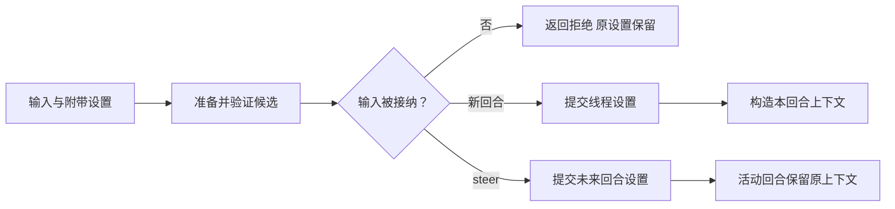

`TurnContext` 自己也不只是“配置副本”。它持有回合 ID、初始设置、下一模型步骤设置、起始环境、扩展状态、时间与终止错误等。`StepContext` 再从中捕获一次请求的设置与能力版本。于是“未来回合的模型偏好改变”和“当前回合的下一模型步骤切换设置”是两条需要分别实现的路径；本章描述的 steer 设置提交不能被扩大成所有设置变化都只能等下一回合。

<a id="ch03-session--空闲也需要预留与收尾"></a>

## 空闲也需要预留与收尾

检查没有活动回合之后，不能先释放锁做一大段准备，再无条件开始任务。另一个输入可能趁这段时间也看到空闲。`start_if_idle` 在锁内检查 `active_turn`，必要时核对 expected previous turn，然后放入一个预留的 `ActiveTurn`。准备失败或政策拒绝时，它再清掉这份预留。[空闲预留](https://github.com/openai/codex/blob/e4568a3538c9cab6627d64ff8cdfc7d98b79b7db/codex-rs/core/src/session/turn_input.rs#L516-L572)把“检查”与“占有下一回合”连在一起。

任务开始时，会话登记回合归属，建立 cancellation token、完成通知与 task handle。运行 future 完成后统一走 `on_task_finished`；它从活动回合取出任务，把状态转为 finishing，记录仍待处理的输入，再组织最终事件。`ActiveTurn` 因此不仅有 task，还能表示尚未启动的 reservation 或正在收尾的状态。[ActiveTurn 与 RunningTask](https://github.com/openai/codex/blob/e4568a3538c9cab6627d64ff8cdfc7d98b79b7db/codex-rs/core/src/state/turn.rs#L29-L105)解释了为什么 `task.is_none()` 不是通用的空闲判据。

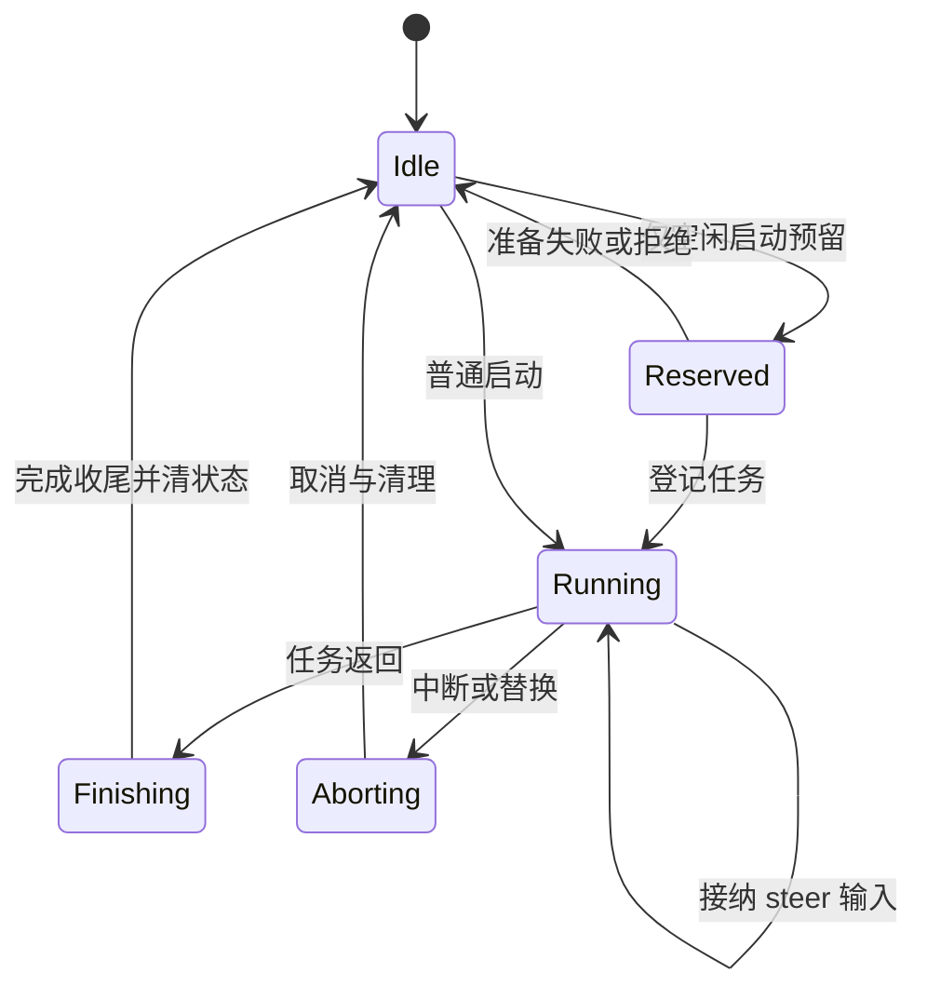

这是一张教学状态图，不是源码里另有同名枚举。它帮助我们理解，活回合所有权在不同阶段都有用途。特别是收尾期间，代码使用 `Arc::ptr_eq` 确认清掉的还是同一份 turn state，避免较晚结束的工作误清新的状态。普通回合的终止事件通常先交付，再按匹配条件清空 active slot，随后继续做日志 flush 与待工作检查；不能把终止事件当成所有后台清理已经无条件成功的证明。

<a id="ch03-session--中断回合与关闭会话"></a>

## 中断回合与关闭会话

按下中断时，核心会取消任务 token，给任务一段协作退出的机会，再必要时 abort handle，并调用任务的 abort 清理。对 Interrupted 分支，还可能记录中断标记并尝试 flush，再发 TurnAborted。flush 失败会留下警告，因此这里只能说代码安排了持久化屏障，不能宣称中断事件具有不受故障影响的落盘保证。[取消与终止事件](https://github.com/openai/codex/blob/e4568a3538c9cab6627d64ff8cdfc7d98b79b7db/codex-rs/core/src/tasks/mod.rs#L943-L1046)展示了完整的收束顺序。

清理等待者的顺序也很细。`abort_all_tasks` 先让正在等待审批等结果的任务观察到取消，再清掉 pending 输入与等待者。如果先丢 sender，任务可能把“没有收到答复”解释成一次业务拒绝，产生中断前不该出现的模型可见结果。对于分页修复，用户表达的是停止当前工作，系统不应额外编造一条“用户拒绝了某个补丁”的事实。

```text
# 教学伪代码：回合中断
取出当前活动任务
通知任务取消
等待协作退出 或 达到等待上限
停止任务 handle 并执行任务清理
记录适用的中断历史标记
发送带回合身份的中止事件
清理该回合的待输入与等待者
```

关闭 Session 的范围更大。它停止接纳、取消预热与活动工作、结束后台执行进程、关闭 hooks 和 MCP 等服务，再关闭线程持久化并报告 ShutdownComplete。`shutdown_and_wait` 等待后台 loop 的共享完成 future。即使提交端全部被释放、没有显式 Shutdown 操作，submission loop 退出后仍安排 teardown。中断回合以后可以继续使用同一个活线程；关闭则收束这个运行时。[关闭操作与通道关闭分支](https://github.com/openai/codex/blob/e4568a3538c9cab6627d64ff8cdfc7d98b79b7db/codex-rs/core/src/session/handlers.rs#L722-L758)防止资源寿命完全依赖某个界面是否正确发送最后一条命令。

<a id="ch03-session--从事件判断发生了什么"></a>

## 从事件判断发生了什么

核心 `Event` 包含关联 submission 的 ID 和 `EventMsg`。事件帮助消费者将进展归入某次工作，但消费者仍要阅读负载。正常收尾形成的 `TurnComplete` 可以携带 terminal error；中止则用 `TurnAborted` 记录原因、时间和回合身份。一个工程系统里的“工作已经结束”与“业务目标完成”应当由不同字段表达，不能让界面根据名字替用户做过度判断。

事件 receiver 还有消费所有权问题。`CodexThread::next_event` 从队列取下一项，多个 reader 并不是自动获得广播副本。源码提供用于交接的 `queued_event_count`，并要求在消费这批有限事件期间只有唯一 reader。状态 watch 与事件队列也有不同用途：前者提供最新状态，后者保留需要依次处理的事实。把它们混用，可能使一个新界面取得当前“空闲”状态，却遗漏先前的错误或工具记录。[消费端约定](https://github.com/openai/codex/blob/e4568a3538c9cab6627d64ff8cdfc7d98b79b7db/codex-rs/core/src/codex_thread.rs#L774-L787)说明，克隆通信端点并不等于订阅完整事件历史。

相关测试用 gate 控制假模型响应，让两条用户消息同时进入。它断言恰有一条 Started、一条 Steered，二者 turn ID 相同；随后第二次模型请求体中出现两条输入。另一测试在回合已结束后发送 steer，断言返回 NoActiveTurn，先前线程设置保持不变。这些断言没有依赖模型恰好说出某句话，验证的是接纳与状态的关系。我们阅读过测试实现，没有执行测试，也不据此宣称所有并发场景都已覆盖。

到这里，分页修复已经拥有一份明确的归属：一个线程身份，一个活 Session，一个可被 steer 或中止的回合，以及每次模型请求捕获的步骤上下文。下一章开始讨论请求如何离开这套本地边界；但无论传输怎样变化，接纳、所有权和终止仍然是判断系统正确性的坐标。

<a id="ch03-session--带回你的系统"></a>

## 带回你的系统

1. **把句柄与运行状态分开。** 如果多个界面或服务共享同一任务，句柄应提供受控访问，运行时持有真实状态；代价是克隆句柄的关闭与事件消费语义必须写清楚。
2. **在核心原子地决定输入去向。** 如果调用方先读状态再提交会发生竞态，提供 start、steer 与 idle-start 等明确意图；代价是结果类型更多，调用方需要处理有类型的拒绝。
3. **只在接纳后提交附带变更。** 如果一次失败输入还可能修改偏好，先验证候选，再把接纳与设置应用绑定；代价是需要预览或提交阶段，不能靠一个 setter 完成全部工作。
4. **显式表示预留与收尾。** 如果慢准备或末尾写入发生在任务之外，保留相应的所有权状态；代价是空闲判断更严格，直接检查 task 是否存在容易误用。
5. **把中断当成一段协议。** 如果任务会等待审批或持有进程，先取消、再清等待者、再报告终止，并单独定义会话关闭；代价是清理与持久化故障也需要可观察的结果。

<a id="ch03-session--源码导读"></a>

## 源码导读

- [thread_manager.rs：线程启动入口](https://github.com/openai/codex/blob/e4568a3538c9cab6627d64ff8cdfc7d98b79b7db/codex-rs/core/src/thread_manager.rs#L1097-L1102)，继续跟入 spawn request 与 warm resume 分支。
- [codex_thread.rs：输入路由方法](https://github.com/openai/codex/blob/e4568a3538c9cab6627d64ff8cdfc7d98b79b7db/codex-rs/core/src/codex_thread.rs#L412-L468)，比较 start-or-steer、idle-start 与内部 continuation。
- [session/mod.rs：SessionIo 提交与回执](https://github.com/openai/codex/blob/e4568a3538c9cab6627d64ff8cdfc7d98b79b7db/codex-rs/core/src/session/mod.rs#L1091-L1132)，确认入队和回执的两个失败点。
- [session/handlers.rs：submission_loop](https://github.com/openai/codex/blob/e4568a3538c9cab6627d64ff8cdfc7d98b79b7db/codex-rs/core/src/session/handlers.rs#L444-L502)，理解串行分发与后台回合工作的关系。
- [turn_input.rs：PreparedTurnInputSettings](https://github.com/openai/codex/blob/e4568a3538c9cab6627d64ff8cdfc7d98b79b7db/codex-rs/core/src/session/turn_input.rs#L91-L221)，跟踪设置的预览、启动提交与 steer 提交。
- [turn_input.rs：空闲预留与释放](https://github.com/openai/codex/blob/e4568a3538c9cab6627d64ff8cdfc7d98b79b7db/codex-rs/core/src/session/turn_input.rs#L516-L572)，看原子检查为何需要预留状态。
- [state/turn.rs：ActiveTurn 与等待者](https://github.com/openai/codex/blob/e4568a3538c9cab6627d64ff8cdfc7d98b79b7db/codex-rs/core/src/state/turn.rs#L29-L105)，把任务、取消和回合局部状态放在一起读。
- [tasks/mod.rs：统一收尾](https://github.com/openai/codex/blob/e4568a3538c9cab6627d64ff8cdfc7d98b79b7db/codex-rs/core/src/tasks/mod.rs#L645-L716)，并继续查看终止事件与 active state 清除。
- [tasks/mod.rs：中断路径](https://github.com/openai/codex/blob/e4568a3538c9cab6627d64ff8cdfc7d98b79b7db/codex-rs/core/src/tasks/mod.rs#L943-L1046)，识别取消、等待、abort、记录和通知各自的位置。
- [turn_input_submission.rs：接纳后才更新设置](https://github.com/openai/codex/blob/e4568a3538c9cab6627d64ff8cdfc7d98b79b7db/codex-rs/core/tests/suite/turn_input_submission.rs#L1232-L1339)，结合前一个并发测试检查状态契约；这里引用测试断言，未声称本轮执行。

---

<a id="ch04-model-io"></a>

<a id="ch04-model-io--第-4-章-与模型通信"></a>

# 第 4 章　与模型通信

修复分页函数的回合已经被接纳。运行时现在拥有用户输入、仓库约定和可用工具，但模型还没有看见它们。离开本地运行时之前，这些内容需要变成一个符合 provider 能力的请求；返回时，网络字节又要变成可展示、可执行、可判断完成的事件。模型通信层承担的正是这次往返。

把它理解成一个 HTTP POST 很容易低估问题。连接可以跨请求复用，路由状态却只能属于当前回合；工具声明和推理选项可能改变，先前的增量发送基线因而失效；文本已经到达，并不代表这次响应完整结束。还有最棘手的情况：连接在某个工具已经执行之后断开，此时“再请求一次”已经与真实世界的副作用相遇。

本章沿 `Prompt → ResponsesApiRequest → ResponseEvent` 展开，再解释连接复用、重试与认证恢复的边界。贯穿案例仍是假设性的修复流程；下面描述的是源码允许的控制路径，没有实际调用模型，也没有测量网络性能。

<a id="ch04-model-io--请求从有类型的工作集开始"></a>

## 请求从有类型的工作集开始

核心循环先从历史取得适合当前模型输入模态的内容，再进入 `run_sampling_request`。这一次模型步骤已经捕获设置、环境和工具路由。`Prompt` 不是一条拼好的大字符串：它包含 `Vec<ResponseItem>`、工具声明、是否允许并行调用、base instructions，以及可选的输出 schema 与严格校验选项。[Prompt 定义](https://github.com/openai/codex/blob/e4568a3538c9cab6627d64ff8cdfc7d98b79b7db/codex-rs/core/src/client_common.rs#L21-L54)保留了输入各部分的语义。

在分页案例中，第一份工作集可能含修复要求、项目约定和环境信息；后续工作集还会有查找文件的调用及结果。工具输出作为结构化 item 进入上下文，与 assistant 文本有不同角色。运行时因此不必用字符串搜索“这段是不是工具结果”，传输层也可以保留调用关联信息。如何裁剪和压缩历史，在[第十章](#ch10-context)进一步讨论。

`build_responses_request` 再把逻辑 Prompt 适配为实际请求。输入会根据模型能力做处理；某些不支持的配置更新项只从请求副本中过滤，持久历史保留原样。工具声明在普通 Responses 形式与 `use_responses_lite` 形式之间有不同编码，后者可以成为带 developer role 的 AdditionalTools item，且不使用普通并行 tool-call 设置。源码里存在的编码分支，必须和模型元数据条件一起描述。[请求构造](https://github.com/openai/codex/blob/e4568a3538c9cab6627d64ff8cdfc7d98b79b7db/codex-rs/core/src/client.rs#L956-L1007)说明，逻辑上下文与线上 payload 并非完全相同的对象。

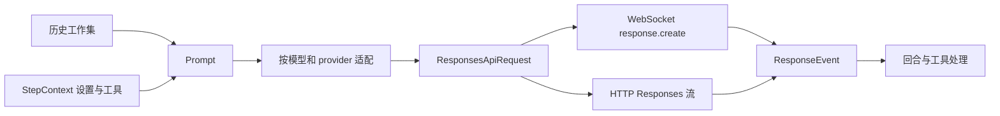

最终请求包含 model、input、tools、reasoning、service tier、text/output 配置和元数据等。此快照构造时设 `stream: true`、`store: false`，并根据 provider 与模型能力调整字段；这证明客户端发送了相应选项，不等于我们获得了服务端全部数据处理与保留政策。`ResponsesApiRequest` 还把路由字段放在结构体前面，源码注释说明 gateway 可能增量读取大请求体。即使只是字段次序，也体现了逻辑结构会进入真实传输成本。[wire 类型](https://github.com/openai/codex/blob/e4568a3538c9cab6627d64ff8cdfc7d98b79b7db/codex-rs/codex-api/src/common.rs#L278-L308)为这些结论提供了边界。

<a id="ch04-model-io--两种客户端寿命保护回合路由"></a>

## 两种客户端寿命，保护回合路由

`ModelClient` 在会话内共享认证、provider、线程身份与传输回退状态；`ModelClientSession` 则面向一个回合。后者在第一次 stream 时才按需建立连接，也保存先前请求、响应基线和本回合 sticky-routing token。把连接复用状态和回合路由状态放在同一对象里容易引发误会，所以源码注释专门要求每个回合建立新的 `ModelClientSession`。[两层寿命](https://github.com/openai/codex/blob/e4568a3538c9cab6627d64ff8cdfc7d98b79b7db/codex-rs/core/src/client.rs#L256-L309)延续了上一章的生命周期划分。

sticky token 来自响应头 `x-codex-turn-state`。它在同一回合的重试、追加和继续请求中保持一致，不能原封不动带进下一个回合。底层连接可以被缓存和重新取得，回合身份仍必须重新建立。这是“重用昂贵资源”和“复用业务状态”的不同边界；二者如果一起复制，最隐蔽的问题往往发生在连续两回合都正常、偶尔才路由错误时。

账户切换进一步收紧了复用条件。`new_session` 会比较 auth owner generation，变化则清掉旧连接缓存；`current_client_setup` 还在解析认证、API provider 和路由时检查 revision，凭据仅刷新时可以重新装配，所有者变化则不能用旧身份的设置继续标记新连接。这里比较的不仅是 bearer 字符串，而是整组认证与请求路由关系。

对分页案例而言，这些机制通常隐藏在用户看不见的地方。用户补充输入仍属于原回合，路由 token 应继续；用户完成修复后发起另一个任务，即使连接可复用，也不能带上上个回合的 token。模型通信层必须知道哪个状态是会话共享，哪个状态是回合局部，不能让“保持连接”替代这项判断。

<a id="ch04-model-io--什么时候可以只发送增量"></a>

## 什么时候可以只发送增量

WebSocket 路径能够把后续请求表示为 `previous_response_id` 加新增 item，但这需要证明新请求延续了旧上下文。`get_incremental_items` 先比较非输入属性，再核对“上次请求输入 + 服务端已返回输出”是否为当前输入的完整前缀，成功后才取出剩余部分。服务端自己产生的 item 已属于基线，无需再发送一次。[增量判断](https://github.com/openai/codex/blob/e4568a3538c9cab6627d64ff8cdfc7d98b79b7db/codex-rs/core/src/client.rs#L1508-L1542)是一项相等性证明，而不是按消息数量切片。

```text
# 教学伪代码：证明能够追加
若 没有完整的上一请求与响应：发送全量
若 模型、工具、推理或输出配置改变：发送全量
baseline = 上次请求输入 + 上次响应输出
若 当前输入不以 baseline 开头：发送全量
delta = 当前输入去掉 baseline
发送 previous_response_id 与 delta
```

请求属性比较使用穷尽解构。模型、工具、tool choice、并行设置、reasoning、include、service tier、缓存键或 text 配置不同，都有明确的不复用原因。input 和部分元数据另行处理。这个写法的工程价值在于：未来给请求结构增加字段时，开发者要明确决定它是否影响复用，而不是悄悄落入默认相等逻辑。[属性比较](https://github.com/openai/codex/blob/e4568a3538c9cab6627d64ff8cdfc7d98b79b7db/codex-rs/core/src/client.rs#L384-L455)把优化的正确性条件放在了类型演进路径上。

例如第一次请求让模型提出读取文件，第二次历史加入调用结果；只要前缀和其余属性匹配，就可只发送新增结果。若中间发生压缩、工具目录变化或某种输入重排，旧基线不成立，代码便应退回完整表示。增量是传输表示的优化，逻辑模型输入仍然是一份完整上下文；trace 也需要能够解释这份逻辑输入，不能只记录几项 delta 就声称完成了回放证据。

测试把这一契约落到实际请求体：先发用户消息，再发包含用户消息、assistant 输出和新增消息的 Prompt，断言第二个 `response.create` 的 `previous_response_id` 指向第一响应，而 input 只有新增后缀。这里阅读的是测试断言，没有执行它，也不把节省了多少字节扩写成未经测量的性能收益。

<a id="ch04-model-io--预热和元数据也必须服从请求边界"></a>

## 预热和元数据也必须服从请求边界

连接准备可以发生在用户真正提交之前。模型客户端支持预热请求，WebSocket payload 在 warmup 路径使用 `generate: false`；它的目的在于准备资源和建立可复用状态，不能把这次往返当作已经生成答案。下一次工作能否沿用，还要证明输入和请求属性兼容。于是预热并没有绕过上一节的前缀条件，只是为符合条件的请求提前支付部分成本。[预热 payload](https://github.com/openai/codex/blob/e4568a3538c9cab6627d64ff8cdfc7d98b79b7db/codex-rs/core/src/client.rs#L2133-L2167)给出了生成与准备的明确区别。

这项区别影响观测。若预热已经发送了基础输入，真正请求在线上可能只携带后缀；诊断记录仍需要表达模型最终看见的逻辑请求。源码在复用未被 trace 的 warmup response ID 时，专门记录逻辑 request，而不是只保存压缩后的 delta。否则一次故障回放可能看到一个工具输出，却找不到它所属的用户要求和声明，证据链就会被传输优化截断。

元数据也不是各层随意往请求里插字符串。模型请求 contributor 经过 `model_request::prepare` 取得扩展补充和 response interceptor，补充项先做过滤；对已有键采用不覆盖写入，`parent_response_id` 有单独保护。interceptor 再按组合顺序包装返回流。这里能确认的是请求扩展经过明确入口，并不能据此推断任意插件都能改写所有线上字段。[扩展装配](https://github.com/openai/codex/blob/e4568a3538c9cab6627d64ff8cdfc7d98b79b7db/codex-rs/core/src/model_request.rs#L10-L46)限定了各层参与的位置。

对自建系统而言，这些细节指向同一个问题：线上 payload、逻辑输入和观测记录分别承担什么责任。为了节约字节而省略的内容，不应从调试模型中消失；为了记录归属而加入的元数据，也不应轻易覆盖控制路由的字段。把三者混成一个可修改 map 最省代码，却让后续难以判断一个值究竟由谁授权。

<a id="ch04-model-io--字节流需要明确的完成证据"></a>

## 字节流需要明确的完成证据

HTTP 路径使用 SSE 解析，把网络 chunk 还原为 provider 事件，再映射到 `ResponseEvent`。网络 chunk 不是一条事件，文本增量也不是一个完整输出 item。`OutputItemAdded`、`OutputTextDelta`、`ToolCallInputDelta`、`OutputItemDone` 和 `Completed` 分别服务开始、展示、参数增量、结构完成与响应终止，不能互相替代。[事件类型](https://github.com/openai/codex/blob/e4568a3538c9cab6627d64ff8cdfc7d98b79b7db/codex-rs/codex-api/src/common.rs#L81-L132)让消费者可以按事实推进状态。

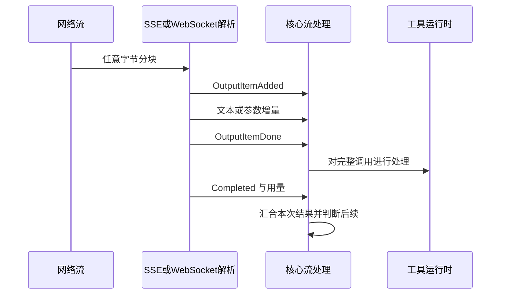

SSE 读取循环有 idle timeout，也关注接收端关闭。没有等到 `response.completed` 就遇到 EOF，会产生 stream error，而不会把“服务端不再说话”当成成功。某些格式不正确的事件会记录解析诊断并跳过；最终能否确认完成，仍由终止事件与解析规则决定。所以既不能说所有坏事件都立即失败，也不能说 parser 会无限宽容地返回成功。[EOF 与超时](https://github.com/openai/codex/blob/e4568a3538c9cab6627d64ff8cdfc7d98b79b7db/codex-rs/codex-api/src/sse/responses.rs#L548-L603)把这两种边界分开。

`response.incomplete` 也不统一视为 Completed。解析器会根据原因处理 content filter、interrupted 或其他不完整结果，并保留可用的 response ID 与用量信息。一份被截断的模型回答可能已经消耗 token，却没有形成正常响应；花费统计与控制成功必须分别表达。对案例中的修复而言，已经看到“我将修改……”的文字，不能证明修改调用完整到达，更不能证明检查成功。

回到核心，`Completed` 的负载还包含可选 `end_turn`；provider 可能不提供它，运行时有相应后备判断。它只结束一次模型响应。当前回合仍要汇合工具结果、待输入和停止条件，下一章会专门展开。通信层提供可解释的事实，不能代替上层定义业务完成。

<a id="ch04-model-io--重试的预算与传输回退"></a>

## 重试的预算与传输回退

正常 `stream` 优先使用 provider 支持的 Responses WebSocket，且会话尚未禁用它时才进入该路径；否则使用 HTTP Responses。发生特定连接失败或预算耗尽时，代码可以激活 HTTP 回退。回退状态属于 ModelClient 的会话寿命，一旦激活，后续回合也会继续使用 HTTP，而不是每回合重新试一次不健康的 WebSocket。[传输选择](https://github.com/openai/codex/blob/e4568a3538c9cab6627d64ff8cdfc7d98b79b7db/codex-rs/core/src/client.rs#L2360-L2438)是这项行为的直接证据。

重试至少要分清请求建立、流中断和认证恢复。这里的 `ResponsesStreamRetryState` 控制流错误后的请求重试；它先询问错误是否有可重试延迟，不可重试就返回。未超过预算时等待本地 backoff 或服务端 Retry-After；切换传输也不会绕过服务端给出的截止时间。达到预算且首次能够激活回退时，通知使用方并重置该阶段的计数，后续仍失败则保留耗尽状态并返回错误。[流重试策略](https://github.com/openai/codex/blob/e4568a3538c9cab6627d64ff8cdfc7d98b79b7db/codex-rs/core/src/responses_retry.rs#L83-L175)比一个无限 retry loop 更有明确边界。

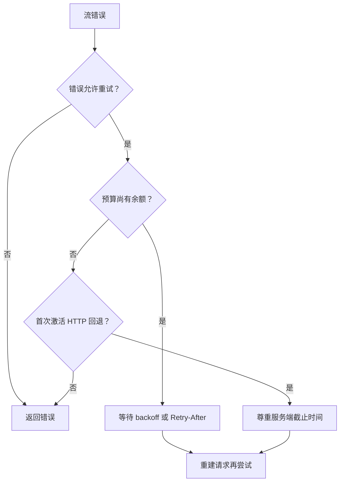

图只画普通有限流重试。源码还有 `UnboundedConnectionRetries` 条件分支，仅适用于采样中的特定 ConnectionFailed、非 internal session、且 provider 不是 Amazon Bedrock 等条件，并按设定延迟增长等待。不能因为看到这条分支就说所有故障都会永远重试。重试等待外层也接入 cancellation 与特定 preemption，用户中断不必等到下一次网络成功才能生效。

<a id="ch04-model-io--重试不会自动赋予工具幂等性"></a>

## 重试不会自动赋予工具幂等性

假设模型已经完整输出一次修改调用，补丁也执行了，随后响应流断开。重试层面对的是损坏的模型响应；文件系统面对的却是已经发生的修改。把同一请求重新发送，不会使补丁、shell 命令或外部服务自动变成“执行多次等于执行一次”。这条边界必须从副作用本身证明，不能由网络重试代码担保。

`run_sampling_request` 重试时会从当前历史重新取得输入，并附上已执行调用的相关记录；这说明它不是始终盲目重发最初字节。与此同时，`ExecutedToolCalls` 自己明确只是 best-effort recorder，记录器不能 dispatch 或等待工具，未启用时不分配记录状态，证据缺失仍保持不完整。[重试输入重建](https://github.com/openai/codex/blob/e4568a3538c9cab6627d64ff8cdfc7d98b79b7db/codex-rs/core/src/session/turn.rs#L1744-L1769)与[调用记录器边界](https://github.com/openai/codex/blob/e4568a3538c9cab6627d64ff8cdfc7d98b79b7db/codex-rs/core/src/tools/executed_tool_calls.rs#L1-L65)不能被改写成全局去重事务。

```text
# 教学伪代码：分开推理两种重试
网络失败后：
    保留已确认的历史与工具结果
    按流重试策略重新准备模型请求
若模型又提出一个动作：
    仍通过工具的正常检查与执行边界
对不可重复的外部副作用：
    在动作服务中提供幂等键、事务或结果查询
```

最后一行是可以带回自建系统的设计建议，并非声称 Codex 为所有外部工具提供了这种事务。如果某个工具无法确定操作是否已经发生，最有价值的结果往往是明确的“状态未知”，继而查询实际状态；自动再做一次可能比返回错误更危险。agent 的自由行动尤其需要这项区别，因为后续模型可能用不同调用 ID 表达语义上相同的动作。

认证恢复也不等于无限刷新。HTTP 请求发现 provider 认可的可恢复认证错误后，进入对应 recovery，再重新准备请求。若刷新网络访问被政策拒绝，测试明确断言恢复终止，并保留原认证内容；不能把政策拒绝改译成凭据损坏，继而清除用户状态。[认证恢复政策测试](https://github.com/openai/codex/blob/e4568a3538c9cab6627d64ff8cdfc7d98b79b7db/codex-rs/core/tests/suite/auth_recovery_policy.rs#L29-L91)显示了错误分类对于正确恢复的重要性。

再把失败放进贯穿案例的时间线。第一步，模型返回读取分页函数的完整调用，运行时执行并记录结果；第二步，模型继续输出修改方案的文本，流在 Completed 之前断开。此时可以知道读取结果已经存在，也知道这份响应缺少完整结束证据；却不能从那几段文本推断补丁已经执行，更不能把界面上出现的“检查完成”当作测试通过的机器证据。正确恢复首先依赖于把这些已知和未知状态留住。

如果错误被允许重试，采样层重新读取当前历史，下一请求会包含已确认的内容；如果错误不允许重试，就把失败交给回合生命周期报告。若用户在 backoff 时补充新要求，某些启用 preemption 的路径会让出这次请求并产生后续工作；普通 cancellation 则走回合中止。两者都能打断等待，却表达不同的用户意图，不能把所有“流被停下”都记录成网络故障。

最后，测试请求重试时必须同时观察几种结果：实际发了多少次连接或请求，后续使用哪种传输，是否保留服务端建议的等待，以及最终上层收到什么事件。只断言最后出现文本，可能完全看不到一次意外的额外认证刷新或重复动作。源码的 fallback 测试分别检查 GET/POST 请求数和跨回合行为，认证政策测试则检查原存储内容；这些都是把恢复范围固定下来的证据手段。它们没有为未知外部服务的副作用作保证，读者也不应从成功的假模型测试推出这种保证。

模型通信的价值，就在这些保留下来的区别：逻辑输入与线上增量、连接与回合路由、响应结束与回合结束、网络重试与副作用恢复。它们让下一层循环在失败后仍知道自己处于什么位置，而不是只剩一句“请求出错，请重试”。

<a id="ch04-model-io--带回你的系统"></a>

## 带回你的系统

1. **保留有类型的逻辑请求。** 如果不同模型需要不同编码，从统一工作集适配线上 payload；代价是要维护能力条件，不能把一个 JSON 模板当所有 provider 的共同契约。
2. **分离连接与回合状态。** 如果连接池跨任务复用，把 sticky token、身份与 owner revision 放在正确寿命；代价是缓存失效规则更多，盲目复用可能导致账户或路由混淆。
3. **证明前缀后才发增量。** 如果用 previous response 优化传输，同时比较输入与非输入属性；代价是需要记录完整基线，不能只按消息数量相减。
4. **把 EOF 当成待解释事实。** 如果协议有明确终止事件，缺失它就走错误路径并记录已知用量；代价是部分文本已经显示时仍可能报告失败，界面必须能解释这种状态。
5. **在副作用边界处理重复。** 如果网络重试可能遇到已执行动作，保留结果证据，并在有需要的动作服务中提供幂等或查询；代价是每种副作用都要设计，传输重试无法代劳。

<a id="ch04-model-io--源码导读"></a>

## 源码导读

- [client_common.rs：Prompt](https://github.com/openai/codex/blob/e4568a3538c9cab6627d64ff8cdfc7d98b79b7db/codex-rs/core/src/client_common.rs#L21-L54)，识别输入、工具、指令与输出约束。
- [client.rs：客户端寿命](https://github.com/openai/codex/blob/e4568a3538c9cab6627d64ff8cdfc7d98b79b7db/codex-rs/core/src/client.rs#L256-L309)，读清 sticky-routing token 的回合范围。
- [client.rs：请求构造](https://github.com/openai/codex/blob/e4568a3538c9cab6627d64ff8cdfc7d98b79b7db/codex-rs/core/src/client.rs#L956-L1107)，核对 Responses Lite 与 provider 条件。
- [client.rs：增量前缀判断](https://github.com/openai/codex/blob/e4568a3538c9cab6627d64ff8cdfc7d98b79b7db/codex-rs/core/src/client.rs#L1508-L1542)，把上一请求和上一响应一起作为基线。
- [codex-api/common.rs：ResponseEvent](https://github.com/openai/codex/blob/e4568a3538c9cab6627d64ff8cdfc7d98b79b7db/codex-rs/codex-api/src/common.rs#L81-L132)，区分增量、item 完成与响应完成。
- [sse/responses.rs：读取循环](https://github.com/openai/codex/blob/e4568a3538c9cab6627d64ff8cdfc7d98b79b7db/codex-rs/codex-api/src/sse/responses.rs#L548-L603)，检查超时、EOF 和无法解析的事件。
- [responses_retry.rs：流重试与回退](https://github.com/openai/codex/blob/e4568a3538c9cab6627d64ff8cdfc7d98b79b7db/codex-rs/core/src/responses_retry.rs#L83-L175)，注意实验分支条件及 Retry-After。
- [session/turn.rs：重试时重建输入](https://github.com/openai/codex/blob/e4568a3538c9cab6627d64ff8cdfc7d98b79b7db/codex-rs/core/src/session/turn.rs#L1744-L1842)，不要把它理解为工具事务。
- [client_websockets.rs：增量请求测试](https://github.com/openai/codex/blob/e4568a3538c9cab6627d64ff8cdfc7d98b79b7db/codex-rs/core/tests/suite/client_websockets.rs#L1964-L2012)，观察第二个 wire payload 的断言。
- [websocket_fallback.rs：跨回合回退测试](https://github.com/openai/codex/blob/e4568a3538c9cab6627d64ff8cdfc7d98b79b7db/codex-rs/core/tests/suite/websocket_fallback.rs#L210-L254)，这里引用覆盖意图，未声称执行结果。

---

<a id="ch05-agent-loop"></a>

<a id="ch05-agent-loop--第-5-章-核心循环如何继续与停止"></a>

# 第 5 章　核心循环如何继续与停止

上一章把一次模型请求送出去，又把返回内容还原成事件。现在模型提出读取分页函数，工具返回源码；模型随后提出补丁，执行结果又回到历史。是什么把这些离散动作连成一次持续的修复工作？答案不只是一个 `while`，而是一组关于输入、步骤、工具、预算和结束条件的约定。

最简单的 agent 演示往往是“请求模型，有工具就执行，没有工具就返回”。这个骨架容易理解，但面对实际交互还缺几块：用户可以在请求期间补充要求；模型可以明确表示仍需继续，即使这次没有普通工具调用；停止 hook 可以提供新的检查要求；压缩失败和用户中断需要保留已经接纳的输入。生产循环的复杂度，大部分来自这些边界。

本章仍沿空输入分页修复这个教学案例走一遍。我们把“代码修好”的业务目标与“当前回合结束”的运行时结果分别观察；书中没有实际执行补丁或测试。这样，读者可以看到循环提供了什么保证，也能看到哪些验证仍需由工具结果和使用方判断。

<a id="ch05-agent-loop--三层推进各自拥有一个问题"></a>

## 三层推进，各自拥有一个问题

前文已经见过的提交循环是控制入口，它接收操作，不负责同步跑完整个模型工作。真正推进工作时，再区分任务推进、模型步骤循环和流重试三层：普通回合由 `RegularTask` 承载，它等待预热交接后调用 `run_turn`；`run_turn` 内部推进模型步骤，而 `run_sampling_request` 又在一次步骤内处理流错误重试。把这些都叫“agent loop”，会把重试、继续工作和接纳新工作混成一件事。

`RegularTask::run` 还有一个小但关键的外层循环：`run_turn` 返回后，如果没有 terminal error 且仍有 pending input，就以空的初始输入再次进入；存在终止错误时则交给任务收尾保留待输入，避免同一份输入立刻重启失败工作。[RegularTask 的收束](https://github.com/openai/codex/blob/e4568a3538c9cab6627d64ff8cdfc7d98b79b7db/codex-rs/core/src/tasks/regular.rs#L100-L124)处理了“主循环刚决定结束，又有输入到达”的末尾窗口。

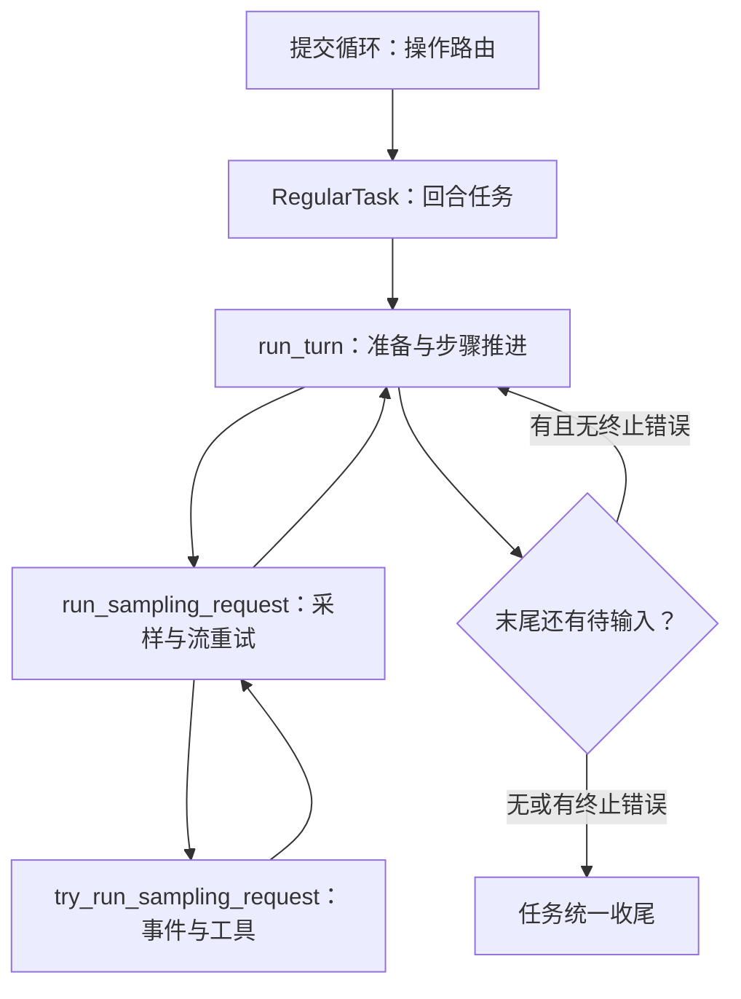

图中的返回箭头表示函数结果与可能继续，不表示所有错误都重试。每一层都有自己的终止条件：采样重试受错误分类与预算限制，回合步骤受后续工作与预算限制，任务层则处理末尾仍接纳的输入。调用层次先弄清，才不会看到一个 `continue` 就误判为整个 agent 不会停止。

<a id="ch05-agent-loop--第一次采样前先安放输入"></a>

## 第一次采样前，先安放输入

`run_turn` 先取得或创建回合局部的 ModelClientSession，再根据条件处理预采样压缩。接着解析输入所要求的 MCP server 与插件，捕获第一份 StepContext，记录上下文变化，装配技能与插件注入，运行适用的启动 hook，并处理初始输入。这个顺序确保第一次采样有一份一致的环境、工具与指令视图。[首个步骤捕获](https://github.com/openai/codex/blob/e4568a3538c9cab6627d64ff8cdfc7d98b79b7db/codex-rs/core/src/session/turn.rs#L242-L338)是后续工具能够按本次声明执行的前提。

准备并非总成功。预采样压缩发生在新输入正常记录之前，因此失败路径仍调用 `run_hooks_and_record_inputs`，再报告相应错误或中断。获取必需能力时被取消，也有保存输入的分支。这不保证所有存储故障下都能成功持久化，但说明代码没有把“模型还没开始”当作丢弃已接纳输入的理由。对于案例中的修复请求，模型连接失败不应让用户的要求从历史中无声消失。

输入记录也要通过 hook，而不是不加区分地 append。`run_hooks_and_record_inputs` 逐项检查，记录允许的输入及附加上下文；被阻止的输入可以留下适用的上下文，返回值取决于是否全部缺少被接纳的用户内容。对于混合批次，工具输出还保留自己的持久化屏障，不能因为同批有 steer 文本就采用较弱的记录方式。[输入记录逻辑](https://github.com/openai/codex/blob/e4568a3538c9cab6627d64ff8cdfc7d98b79b7db/codex-rs/core/src/session/turn.rs#L940-L987)展示了批次中不同内容的契约。

本书的解读是，输入先找到稳定位置，循环才有恢复与继续的依据。代价是“收到用户消息”到“模型实际采样”之间会出现准备、策略和记录等阶段。界面因此需要区分已接纳和已采样，而不是把所有等待时间都显示成模型正在思考。

<a id="ch05-agent-loop--一份步骤快照连接声明与执行"></a>

## 一份步骤快照连接声明与执行

进入步骤循环后，代码按条件取出 pending input，运行相应 hook 并记录。随后捕获本次 StepContext：如果没有新输入，某些已准备的快照可以继续用；如果新输入提及插件或能力，就重新解析这些要求并捕获适合的视图。最后更新 World State 等上下文，从历史生成适合模型模态的请求输入，交给采样层。[步骤准备](https://github.com/openai/codex/blob/e4568a3538c9cab6627d64ff8cdfc7d98b79b7db/codex-rs/core/src/session/turn.rs#L450-L577)把输入、能力和请求锁定在同一个推进边界。

```text
# 教学伪代码：一个模型步骤
按当前规则取得待输入
运行输入 hook 并记录允许内容
捕获这一步的模型、环境、指令与工具路由
记录步骤上下文的必要变化
request_input = 按模型能力整形当前历史
result = 流式采样并汇合工具结果(request_input)
检查待输入、预算、停止 hook 与结果
继续下一步骤 或 交给回合收尾
```

这个快照不只是缓存。假设模型看到了读取文件工具，随后配置刷新让下一步骤的工具目录变化，已经提出的调用仍应由它所属步骤的 router 解释。否则调用名相同而 handler 或环境已经变化，记录就无法解释模型当时到底获准使用什么。快照绑定提高了可推理性，同时也意味着能力变化必须有明确的下一次捕获点，不能期待所有活工作立即切换。

<a id="ch05-agent-loop--流式工具调用如何回到历史"></a>

## 流式工具调用如何回到历史

当完整 `OutputItemDone` 到达，`handle_output_item_done` 尝试把 item 构造成工具调用。识别成功后先记录调用项，再交 ToolCallRuntime，返回一个 future 并把 `needs_follow_up` 置为真。普通路径会立即 dispatch；如果同步 post-model hook 要求延迟，future 中才执行 dispatch。因而“工具一定在模型流期间立刻执行”也是过度概括，hook 模式会改变这个时机。[输出项处理](https://github.com/openai/codex/blob/e4568a3538c9cab6627d64ff8cdfc7d98b79b7db/codex-rs/core/src/stream_events_utils.rs#L316-L369)给出了两个分支。

如果 item 不是工具调用，运行时将其完成为相应的 turn item，并更新可用的最后 assistant message。如果调用存在可回复给模型的问题，则记录一份工具输出并要求后续；致命错误则直接返回错误。工具失败因此不必总是终止回合：有些错误是模型下一步可以处理的反馈，有些才破坏本次运行的前提。这项分类在[第六章](#ch06-tools)继续展开。

采样处理器把工具 future 放进 `FuturesOrdered`。流处理结束后，它会 drain 这些在途工作，把结果记录回历史，然后返回本次采样结果。这里要分清执行时机与结果汇合顺序：名称中的 ordered 说明取回顺序，不说明所有工具串行执行；具体并发许可由工具运行时决定。[结果汇合](https://github.com/openai/codex/blob/e4568a3538c9cab6627d64ff8cdfc7d98b79b7db/codex-rs/core/src/session/turn.rs#L2575-L2602)和[采样末尾 drain](https://github.com/openai/codex/blob/e4568a3538c9cab6627d64ff8cdfc7d98b79b7db/codex-rs/core/src/session/turn.rs#L3333-L3375)共同连接了流与历史。

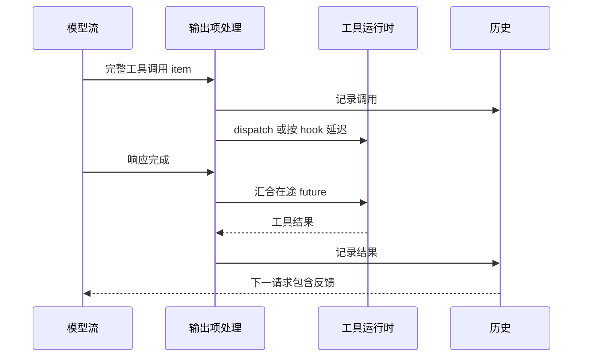

分页案例中，读取返回“空输入走到了取首元素的分支”，下一请求才有依据提出边界修复。补丁工具返回成功，也只证明工具报告了修改结果；若之后检查命令失败，循环可以把失败结果再次交给模型。自然语言描述、动作回执和检查证据在历史中承担不同作用，不能用“模型说修好了”替代后两者。

<a id="ch05-agent-loop--新输入在安全的边界进入"></a>

## 新输入在安全的边界进入

用户在第一请求期间补充“保持函数签名”，不意味着已经发出的网络请求能被原地修改。正常做法是在 pending queue 中接纳，再在下一请求前取出并记录。代码用 `can_drain_pending_input` 管理时机，起始输入需要先采样；某些压缩后的工具继续场景也会延后 drain，以保留正确上下文顺序。[待输入顺序注释与实现](https://github.com/openai/codex/blob/e4568a3538c9cab6627d64ff8cdfc7d98b79b7db/codex-rs/core/src/session/turn.rs#L450-L483)明确说明了这两个例外。

测试将这件事具体化：假模型先输出文本，把 Completed 卡在 gate 后；此时提交第二条用户输入，再放行响应。断言第一请求只含第一条输入，第二请求才同时包含两条。这比“系统支持实时 steer”更精确：核心承诺在后续请求纳入，而没有承诺修改已经在服务端运行的那份输入。[待输入测试](https://github.com/openai/codex/blob/e4568a3538c9cab6627d64ff8cdfc7d98b79b7db/codex-rs/core/tests/suite/pending_input.rs#L897-L987)在本章仅作为覆盖证据，未执行。

部分步骤支持 preemption。它与回合 cancellation 不同：preempt 可以让当前采样让位于新工作，返回 `needs_follow_up`，并在可用时对响应执行 drain，以保持连接和历史一致；普通取消则返回 TurnAborted。Responses Lite 等能力还影响具体的 interrupt 消息。不能把这条有条件路径写成所有输入都会立刻中止模型，也不能把所有流中断都归因于用户取消。

mailbox 输入还有自己的投递阶段。用户已经看见 final answer 后，迟到的子任务消息默认不应无限延长这份答案；代码可将 mailbox delivery 推迟到下一回合。若当前任务又收到明确的同回合工作，则可以重新开放。它解决的是“这一份结果到底何时算对用户说完”，多 agent 的完整投递规则在协作章节进一步说明。

<a id="ch05-agent-loop--没有工具调用为什么仍会继续"></a>

## 没有工具调用，为什么仍会继续

一次采样完成后，`run_turn` 组合两个事实：模型结果是否要求 follow-up，输入队列是否还有待处理内容。两者任一为真，当前工作就尚有后续。`ResponseEvent::Completed` 若明确携带 `end_turn: false`，也会要求继续，即使这次没有普通工具调用。provider 没提供该字段时，则依赖其他已建立的后续工作信号。[后续判断](https://github.com/openai/codex/blob/e4568a3538c9cab6627d64ff8cdfc7d98b79b7db/codex-rs/core/src/session/turn.rs#L580-L611)比“没工具就结束”更完整。

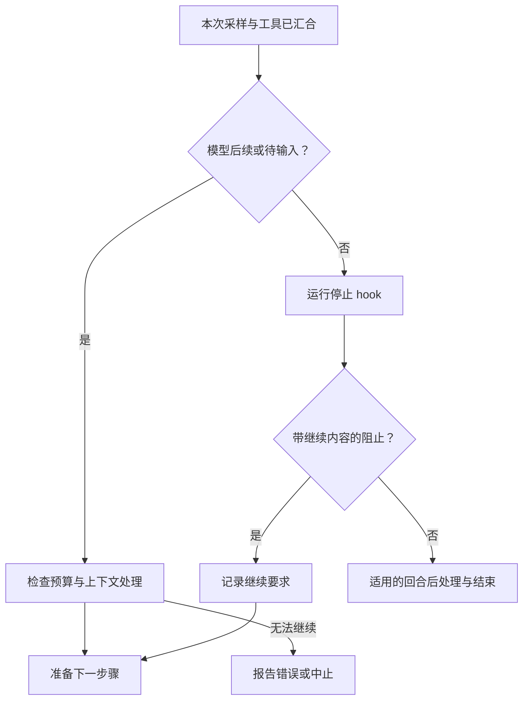

停止 hook 又增加了一个明确的继续来源。如果它阻止结束并提供 continuation 内容，循环记录这份内容，再次采样；如果要求继续却没有内容，代码发警告并忽略这个 block，避免凭空创造一次无输入的续跑。hook 也可以要求停止。这里是一套受运行时解释的返回契约，不能把任意 hook 输出都当作命令。[停止分支](https://github.com/openai/codex/blob/e4568a3538c9cab6627d64ff8cdfc7d98b79b7db/codex-rs/core/src/session/turn.rs#L725-L773)把继续所需的证据写得很清楚。

把案例延长一小步：模型已给出补丁说明，停止 hook 提供“还需说明空输入返回值为何兼容现有调用”的检查要求。后续请求因此获得了新上下文，再产生解释或工具动作。这里没有声称 Codex 默认安装了这样一个 hook；它只是说明这条扩展契约如何影响循环。是否启用、如何授权和加载 hook，是扩展生命周期的问题。

<a id="ch05-agent-loop--预算会改变上下文不能创造无限工作"></a>

## 预算会改变上下文，不能创造无限工作

有 follow-up 时，循环还要观察 token 状态、上下文窗口请求和可用压缩结果，决定是否 rollover。压缩成功后继续推进，但某些模型或工具继续关系会影响下一次是否允许立刻 drain 新输入。开启 TokenBudget 与使用总结压缩的路径也不完全相同，`auto_summarization_enabled` 显式考虑这项 feature。预算机制不是写一个“请节约 token”的提示，而是参与控制流程。

这些细节应当在[第十章](#ch10-context)集中阅读。本章只保留两个事实：上下文处理可以发生在步骤之前、步骤之间和回合结束附近；它的失败不应被都解释成用户业务失败。比如回合后的总结压缩失败，代码有保留已完成答案并记录警告的分支；达到用量限制还可能停止自动工作。一个已经展示给用户的有效答案，不应因为维护性后处理失败就被无条件抹掉。

预算也揭示了结束条件的层次。没有待输入，模型愿意结束，停止 hook 没提出新工作，意味着运行时可以停止这个回合；它没有证明分页函数满足所有产品需求。业务验证需要可检查的工具结果、代码差异或外部验收规则。把“回合正常终止率”直接当“修复正确率”，会把两个不同对象混在一张指标图里。

<a id="ch05-agent-loop--把一条完整修复轨迹放回循环"></a>

## 把一条完整修复轨迹放回循环

为了把抽象步骤接到一项具体工作上，假设案例函数接收列表和页大小，空列表应返回空页集合；原实现却在分支之前读取第一个元素。这里的函数和返回约定是教学设定，并非 Codex 仓库中的真实 bug。模型第一次看到的只有修复要求与项目约定，因而需要先定位源码和调用者，不能凭空假设返回值可以改成 null。

第一模型步骤提出查找调用。调用被记录，工具运行时返回匹配位置；下一步骤据此提出读取函数与邻近调用者。新的工具结果告诉模型，调用方会遍历返回页集合，所以空集合是兼容方向。随后模型提出一个最小补丁，把空输入判断放在读取首元素之前。每次模型请求之间，循环的关键工作都是相同的：汇合结果、记录历史、确认后续，再捕获下一份步骤快照。

```text
# 教学伪代码：假设案例的目标行为
分页(items, size)：
    若 items 为空：返回空页集合
    检查 size 是否有效
    按既有规则构造非空输入的页
    返回页集合
```

这段伪代码刻意没有替项目决定“空输入时无效 size 是否也必须报错”。那仍是需要从原行为与需求确认的另一个边界。一个看似自然的提前返回，可能绕过参数校验。模型看到补丁成功回执后，还应结合现有规范决定是否补充检查，而不能把减少一处越界访问自动等同于保持所有语义。

如果工具结果表明相关检查成功，模型可以给出改变原因、实际检查和仍存在的限制；如果命令因依赖缺失没有运行，最终说明应保留这一事实。两条路径都可能正常结束回合，业务证据却不同。如果检查揭示 size 校验被绕过，失败结果进入历史，循环再提出调整。让模型继续的依据是明确的反馈，而不是设定“至少再想三遍”一类没有验收语义的次数要求。

这条轨迹也说明什么时候应当停下：当前没有新输入，模型没有进一步调用或继续要求，停止 hook 没提出工作，预算和生命周期允许收束。循环无需理解“分页”这个业务名词，仍然能够以统一规则协调它。业务理解留在模型与工具反馈中，运行时保留的是各阶段的身份、边界和可检查结果。

<a id="ch05-agent-loop--错误路径为什么仍然属于循环"></a>

## 错误路径为什么仍然属于循环

循环中部分错误会被转换为 Error 事件并结束当前 `run_turn`，保留会话供用户继续；取消则沿中止路径退出。`terminal_error` 让外层 RegularTask 知道不能因为还有 pending input 就立刻重启同一份失败工作。这样，界面可以报告故障，而下一条用户操作仍然有明确的位置。[错误收束](https://github.com/openai/codex/blob/e4568a3538c9cab6627d64ff8cdfc7d98b79b7db/codex-rs/core/src/session/turn.rs#L893-L913)并非一个简单的进程退出。

```text
# 教学伪代码：决定结束意味着什么
若 用户取消：交给中止生命周期
若 不可恢复错误：记录终止错误并保留已知事实
否则若 模型有后续 或 存在待输入：继续
否则若 停止 hook 提供新要求：记录后继续
否则：结束当前回合
业务是否完成 = 依据工具与验收证据另行判断
```

一个尤其容易忽略的竞态发生在结束瞬间。主循环最后一次检查 pending input 后，新输入仍可能被接纳。任务层末尾再次检查，使这份输入有机会进入处理；若已出现终止错误，统一收尾则负责保留它。这条外层检查不是冗余，而是对时间窗口的补充。类似地，取消与不完整响应同时到达时，代码仍尝试记录已经收到的用量，不让控制路径覆盖花费事实。

循环因此既是推进器，也是边界协调者：它把开放式模型输出放进确定的输入次序，把工具副作用的结果纳入历史，把新用户意图安排到后续步骤，再把结束与错误交还统一生命周期。下一章将沿工具调用向下，解释模型给出的名称和参数如何抵达真正的处理器。

<a id="ch05-agent-loop--带回你的系统"></a>

## 带回你的系统

1. **给每层循环一个完成条件。** 如果重试、模型步骤和任务接纳共享一个 while，先分别命名它们的继续与终止规则；代价是调用层次增加，却能避免错误在错误层级被重跑。
2. **先安放输入再推进。** 如果准备失败可能丢掉已接纳的要求，在采样前及失败分支记录适用输入；代价是需要定义 hook、历史与持久化的先后关系。
3. **把声明和执行绑定到步骤。** 如果能力会动态刷新，让模型请求与工具调用使用同一份路由快照；代价是变化有明确生效边界，不能随意修改活对象。
4. **用多个事实判断继续。** 如果没有工具也可能有新输入或扩展要求，把后续工作作为明确状态；代价是要防止无内容的续跑与错误后的自动重启。
5. **分别报告停止与验证。** 如果模型会宣布任务完成，仍用工具和验收证据判断业务结果；代价是产品必须表达部分完成、验证受阻和运行时故障，而不只有一个成功标志。

<a id="ch05-agent-loop--源码导读"></a>

## 源码导读

- [tasks/regular.rs：最外层任务推进](https://github.com/openai/codex/blob/e4568a3538c9cab6627d64ff8cdfc7d98b79b7db/codex-rs/core/src/tasks/regular.rs#L100-L124)，观察末尾待输入与 terminal error。
- [session/turn.rs：预采样失败仍处理输入](https://github.com/openai/codex/blob/e4568a3538c9cab6627d64ff8cdfc7d98b79b7db/codex-rs/core/src/session/turn.rs#L173-L239)，核对早期失败路径。
- [session/turn.rs：步骤准备](https://github.com/openai/codex/blob/e4568a3538c9cab6627d64ff8cdfc7d98b79b7db/codex-rs/core/src/session/turn.rs#L450-L577)，追踪 pending input、步骤捕获和请求输入。
- [stream_events_utils.rs：完整输出项处理](https://github.com/openai/codex/blob/e4568a3538c9cab6627d64ff8cdfc7d98b79b7db/codex-rs/core/src/stream_events_utils.rs#L316-L440)，区分工具 future、模型可见错误与致命错误。
- [session/turn.rs：结果 drain](https://github.com/openai/codex/blob/e4568a3538c9cab6627d64ff8cdfc7d98b79b7db/codex-rs/core/src/session/turn.rs#L2575-L2602)，核对调用结果何时进入历史。
- [session/turn.rs：采样后决策](https://github.com/openai/codex/blob/e4568a3538c9cab6627d64ff8cdfc7d98b79b7db/codex-rs/core/src/session/turn.rs#L580-L611)，理解 model follow-up 与 pending input 的组合。
- [session/turn.rs：停止 hook](https://github.com/openai/codex/blob/e4568a3538c9cab6627d64ff8cdfc7d98b79b7db/codex-rs/core/src/session/turn.rs#L725-L773)，看有内容与无内容的阻止结果如何分流。
- [session/turn.rs：输入 hook 与记录](https://github.com/openai/codex/blob/e4568a3538c9cab6627d64ff8cdfc7d98b79b7db/codex-rs/core/src/session/turn.rs#L940-L987)，检查混合输入的持久化语义。
- [session/turn.rs：preemption 与 cancellation](https://github.com/openai/codex/blob/e4568a3538c9cab6627d64ff8cdfc7d98b79b7db/codex-rs/core/src/session/turn.rs#L2791-L2825)，不要把让位与回合中止合并。
- [pending_input.rs：增量期间注入输入](https://github.com/openai/codex/blob/e4568a3538c9cab6627d64ff8cdfc7d98b79b7db/codex-rs/core/tests/suite/pending_input.rs#L897-L987)，用受控 gate 查看实际下一请求；本轮没有执行该测试。

---

<a id="ch06-tools"></a>

<a id="ch06-tools--第-6-章-工具从声明走到调用"></a>

# 第 6 章　工具从声明走到调用

上一章里，模型已经走到需要外部事实的时刻。为了修复仓库中的一个边界条件，它可能先搜索实现、读取测试，再提交一份补丁。模型能写出这些意图，却不能自行取得文件系统或终端。真正把“我想做什么”变成一次动作的，是工具运行时。

假设模型返回一条 `exec_command`，参数是搜索某个边界判断的命令。把工具名查到一个函数，然后传入 JSON，看上去已经够用。生产系统还要回答更难的问题：这个名字是不是本次请求声明过的能力？同名外部工具能否抢走内置命令？它来自直接调用还是 Code Mode？钩子改写了参数怎么办？执行成功以后，哪个结果进入模型历史？这些问题共同构成工具契约。

本章研究的是固定快照里从工具计划到结果封装的路径。下一章专门解释并发和取消，[第八章](#ch08-execution)继续跟踪命令与补丁的真实执行。先记住本章的中心：**工具不是一段独立的 schema，也不是一个孤立的回调，而是一份声明和可执行行为相互对应的步骤计划。**

<a id="ch06-tools--一份计划同时服务模型与运行时"></a>

## 一份计划，同时服务模型与运行时

这个快照把共享契约放在 `codex-tools` crate。`ToolExecutor<Invocation>` 要求实现者提供工具名、规格和 `handle`，同时允许声明曝光方式、搜索信息和是否支持并发。也就是说，某个运行时对象既知道自己向模型承诺什么，也知道怎样处理调用。core 再以 `CoreToolRuntime` 补上等待就绪、钩子输入、生命周期、遥测以及流式参数差分。它没有把所有工具强塞进一个具有大量可选字段的函数签名，而是把共享协议和宿主特有协议分层。[共享契约与默认行为](https://github.com/openai/codex/blob/e4568a3538c9cab6627d64ff8cdfc7d98b79b7db/codex-rs/tools/src/tool_executor.rs#L101-L129)

这样的契约仍需要一次具体组装。`build_tool_router` 收到 Session、回合上下文、模型信息和环境快照，先创建受 `ToolPolicy` 约束的 registry，再加入核心工具、MCP 工具、扩展提供的执行器以及客户端动态工具。最后 `finalize_tool_router` 根据有效工具模式等条件收束，得到 `ToolRouter`。router 同时保留可执行 registry、给模型的规格列表和 Code Mode 名称映射。[步骤工具计划的组装](https://github.com/openai/codex/blob/e4568a3538c9cab6627d64ff8cdfc7d98b79b7db/codex-rs/core/src/tools/spec_plan.rs#L121-L185)

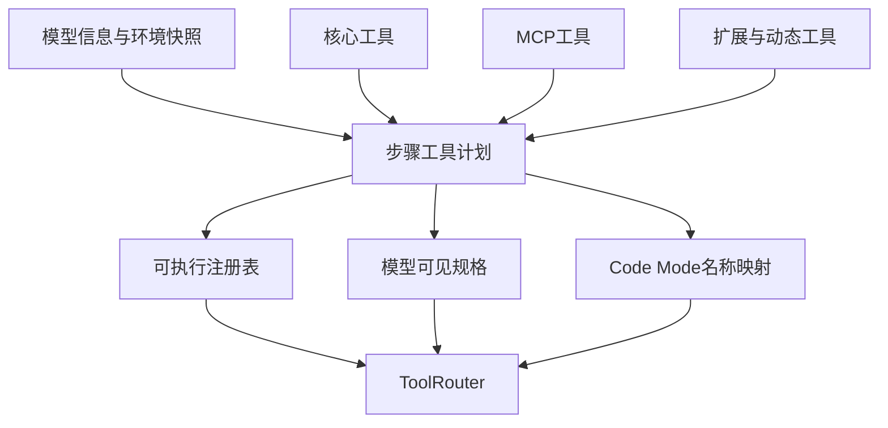

这张图还藏着一个重要范围：不是所有发送给模型的工具都在本机执行。计划另外收集 hosted specs，例如交给模型服务的 web search 声明。本章的 dispatch 链路讨论客户端需要执行的调用，不能把服务端托管工具想象成同一个本地 handler。

工具集合也不是启动后永不变化的全局常量。模型能力、feature、当前环境和策略都参与组装。例如 `apply_patch` 是否注册取决于模型信息中是否有相应工具类型；TTY 能力也有单独条件。因此“源码里存在一个 handler”和“这次模型步骤获得这个工具”之间，还有一段明确的规划过程。保留步骤上下文的意义，正是让稍后完成的调用仍使用当初声明它的那份状态。

从应用开发者的角度看，这里有两类变化。第一类改变工具能否存在，例如权限策略不允许某个身份，注册阶段就不加入它；第二类改变模型接触它的方式，例如从初始列表移到搜索目录。两者对执行器的含义不同。如果把“被搜索隐藏”误写成“被禁止”，宿主可能错误地拒绝合法嵌套调用；如果把“已注册”误写成“已向模型授权”，又会忽略上层计划提供的能力面。源码分别保存 registry 和 model_visible_specs，正是让这些问题有独立答案。

这份计划还约束了可观测性。工具 namespace 信息是基于同一次收束结果生成的，而不是从另一个全局目录随手复制。假如日志说模型能用终端，实际请求却没有 `write_stdin`，读者无法仅凭一个“终端已启用”字段理解行为；router 的 `has_terminal_controls` 因而同时检查启动和交互两个工具是否曝光。本书的解读是，能力最好按用户能完成的操作描述，再由具体工具组合证明，而不是用一个与最终清单可能脱节的布尔值概括。[router 的能力组合检查](https://github.com/openai/codex/blob/e4568a3538c9cab6627d64ff8cdfc7d98b79b7db/codex-rs/core/src/tools/router.rs#L171-L216)

<a id="ch06-tools--可见性是一组能力面"></a>

## 可见性是一组能力面

一个工具注册进来以后，接着要决定模型怎样接触它。`Direct` 可以进入初始工具列表，并在启用 Code Mode 时参与嵌套调用；`Deferred` 先进入可发现目录，通过工具搜索加载；`CodeModeOnly` 只给脚本内的嵌套调用；另外还有只给模型直接调用或只给模型搜索的变体。`Hidden` 则保留运行时注册，但不向模型曝光。[曝光方式的定义](https://github.com/openai/codex/blob/e4568a3538c9cab6627d64ff8cdfc7d98b79b7db/codex-rs/tools/src/tool_executor.rs#L14-L99)

如果仓库修复需要一个外部文档搜索工具，把整个外部工具世界一开始塞进请求，会占用描述预算，也会让模型面对大量不相关选择。deferred 提供了一条按需发现的路。代价是工具发现本身成为一个有状态过程：工具要有搜索元数据，模型要支持相应搜索能力，计划还要处理曝光条件和命名冲突。它不是把 description 变短那么简单。

这里要区分“没有向模型展示”和“没有运行时”。`Hidden` 的注释明确保留 dispatch 注册；`exposes_tool` 则结合直接声明、Code Mode 映射以及搜索工具存在与否，判断计划是否提供某条模型调用途径。本书把曝光理解成能力分发的接口，但不把它当作操作系统安全边界。真正的授权和隔离要到[第九章](#ch09-safety)讨论。

<a id="ch06-tools--名字必须足够精确"></a>

## 名字必须足够精确

工具身份包含 namespace 和 name。默认 namespace 的别名会规范化，但别的 namespace 不会被抹掉。于是默认 `lookup` 和某个 MCP namespace 下的 `lookup` 可以共存；一个未注册的 MCP namespace 也不能因为叶子名称相同，就借到内置工具的实现。

注册时，可信内置来源和外部来源有不同的冲突处理。可信工具重复注册被当作程序配置错误；外部工具重复时保留先前项、记录冲突并跳过后来者。默认 namespace 的 `exec_command` 和 `shell_command` 还属于保留名称，外部 runtime 不能直接注册成这两个名字。否则，一个集成只需复用终端工具名，就可能改变核心运行时对命令的解释。[注册与保留名称处理](https://github.com/openai/codex/blob/e4568a3538c9cab6627d64ff8cdfc7d98b79b7db/codex-rs/core/src/tools/registry.rs#L422-L495)

这种做法把错误前移了一部分：尽量在构造工具计划时发现碰撞，不把歧义留给执行时猜测。它也有代价。扩展不能随意替换核心能力，真正想覆盖一个名字的宿主必须经过明确设计。对一个编码 agent 来说，这比“最后注册的函数获胜”更容易解释和审计。

测试给出了这条身份规则的具体样子。`handler_normalizes_only_the_default_namespace` 构造同名普通工具和 MCP 工具，断言默认别名指向前者，而另一个 MCP namespace 查不到；其他测试分别覆盖默认别名冲突、保留命令名和不同 namespace 同名。这里阅读的是测试安排及断言，没有把它写成已经运行通过。[身份测试](https://github.com/openai/codex/blob/e4568a3538c9cab6627d64ff8cdfc7d98b79b7db/codex-rs/core/src/tools/registry_tests.rs#L193-L242)

<a id="ch06-tools--从流事件走进一次调用"></a>

## 从流事件走进一次调用

现在回到模型生成的搜索命令。流处理收到完整输出项后，`ToolRouter::build_tool_call` 先辨认协议类型：函数调用形成 `ToolPayload::Function`，自由文本工具调用形成 `Custom`，客户端执行的工具搜索形成 `ToolSearch`。调用携带 `call_id`，并把 namespace 规范化后的名字保留下来。服务端执行的搜索项不会被这段代码误派到客户端。[协议项到调用的转换](https://github.com/openai/codex/blob/e4568a3538c9cab6627d64ff8cdfc7d98b79b7db/codex-rs/core/src/tools/router.rs#L256-L309)

流处理器先把完整调用记录到历史，再安排工具执行。这一点影响恢复：模型已经提出的调用不能在中断后只剩一个没有答案的洞。每次调用取得回合 token 的子 token。通常调度立即启动；当同步 post-model hook 要求延迟派发时，future 会等收集阶段才真正启动。如果这时已经取消，系统仍补一条中止输出与原调用配对。[记录与派发的先后](https://github.com/openai/codex/blob/e4568a3538c9cab6627d64ff8cdfc7d98b79b7db/codex-rs/core/src/stream_events_utils.rs#L324-L369)

下面的教学伪代码只压缩控制关系，不是可直接调用的 Rust API：

```text
教学伪代码：接住一个完整输出项
call = decode_tool_call(item)
if call exists:
    record_history(item)
    token = turn_token.child()
    future = dispatch_using_advertising_step(call, token)
    remember_future_in_response_order(future)
else:
    finish_non_tool_item(item)
```

router 随后把调用包装成 `ToolInvocation`。除了参数，还带 Session、StepContext、回合、取消 token、差分跟踪器和调用来源。来源区分模型直接调用与 Code Mode 嵌套调用；后者还保留 cell 身份。把这些信息放进一个明确对象，使 handler 不必从任意全局变量重新猜测自己属于哪次请求。

<a id="ch06-tools--处理器外面还有一圈生命周期"></a>

## 处理器外面还有一圈生命周期

进入 registry 后，执行并不是立刻 `handle`。它先更新活动回合的工具调用计数，按完整工具身份查找 runtime，再核对 payload 类型。未知名字属于可反馈给模型的调用错误；找到正确工具却收到不相容 payload，则被当作 Fatal。前者可能是模型选错能力，后者意味着协议与运行时契约不一致，不能一概揉成“工具失败”。

接下来是 PreToolUse。钩子可以阻断动作，也可以按该工具的 hook 契约改写输入。改写不是绕过 handler：新的输入仍被构造成 invocation，然后进入正常处理路径。生命周期开始通知、遥测、处理器执行和成功后的 PostToolUse，也都由 registry 包裹。[统一派发流程](https://github.com/openai/codex/blob/e4568a3538c9cab6627d64ff8cdfc7d98b79b7db/codex-rs/core/src/tools/registry.rs#L615-L759)

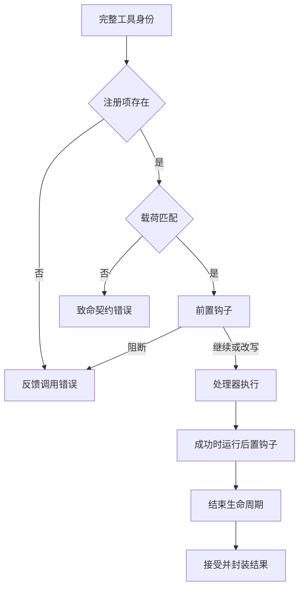

需要小心图里的“后置”。假设补丁已经修改文件，后置钩子拒绝结果。registry 的注释明确说，它拒绝的是结果，不是已经完成的工具执行。调用者可能得到钩子反馈，而磁盘上的更改仍然存在。把后置验证当成事务回滚，会让 agent 的内部理解和真实环境分叉。正确处理方式是让动作结果、接受结果与副作用事实能够分别表达。[后置钩子的边界](https://github.com/openai/codex/blob/e4568a3538c9cab6627d64ff8cdfc7d98b79b7db/codex-rs/core/src/tools/registry.rs#L811-L889)

<a id="ch06-tools--结果要回到谁的世界"></a>

## 结果要回到谁的世界

工具返回的不是一段只能打印的字符串，而是实现 `ToolOutput` 的对象。`AnyToolResult` 保留 call_id、原 payload 和具体结果。写入模型历史时，它调用 `to_response_item`；交给 Code Mode 时，它调用 `code_mode_result`。两条表示可以不同：模型需要受上下文预算约束的内容，脚本可能需要结构化字段。把同一段已格式化文本同时拿去做日志、脚本返回和模型输入，会过早丢失类型与预算信息。

这也解释了为什么错误需要分层。handler 解析 JSON 时发现字段无效，可以要求向模型报告；普通工具错误通常转成 `success=false` 的工具输出，原 call_id 不变，模型有机会调整参数继续工作。Fatal 则上升为回合错误。若系统把每一个错误都作为全局异常，模型无法修正一个工作目录拼写；若把每个错误都伪装成普通文本，又会掩盖运行时的契约破坏。

<a id="ch06-tools--code-mode-把编排送进-cell"></a>

## Code Mode 把编排送进 cell

前文多次提到 Code Mode，现在需要把它放回真正的执行边界。模型在这条路径提交原始 JavaScript 源码，`CodeModeExecuteHandler` 从当前工具计划生成允许嵌套调用的工具定义，再向 `CodeModeService` 提交执行请求。它没有把一段脚本直接交给仓库 shell。工具模式可来自模型信息，也受 CodeMode、CodeModeOnly 等 feature 影响；host 不可用时的退路又由有效模式和配置共同决定，不能假设所有模型都会使用脚本编排。

当前 ThreadManager 仅在 `CodeModeHost` 开启或 `disable_in_process_fallback` 为真时构造独立 `codex-code-mode-host` provider，否则使用 Disabled provider；另有 gRPC host 选项。host 内部持有 `InProcessCodeModeSession`，真正的 JavaScript 在 runtime crate 创建的 V8 线程运行。这里的 InProcess 指相对于 host，并非说业务核心直接执行任意 Node 程序。runtime 安装自己的工具对象和输出、存取值、计时等辅助函数，还移除了部分全局能力。[host 的选择](https://github.com/openai/codex/blob/e4568a3538c9cab6627d64ff8cdfc7d98b79b7db/codex-rs/core/src/thread_manager.rs#L578-L588)、[V8 运行线程](https://github.com/openai/codex/blob/e4568a3538c9cab6627d64ff8cdfc7d98b79b7db/codex-rs/code-mode-runtime/src/runtime/mod.rs#L90-L142)

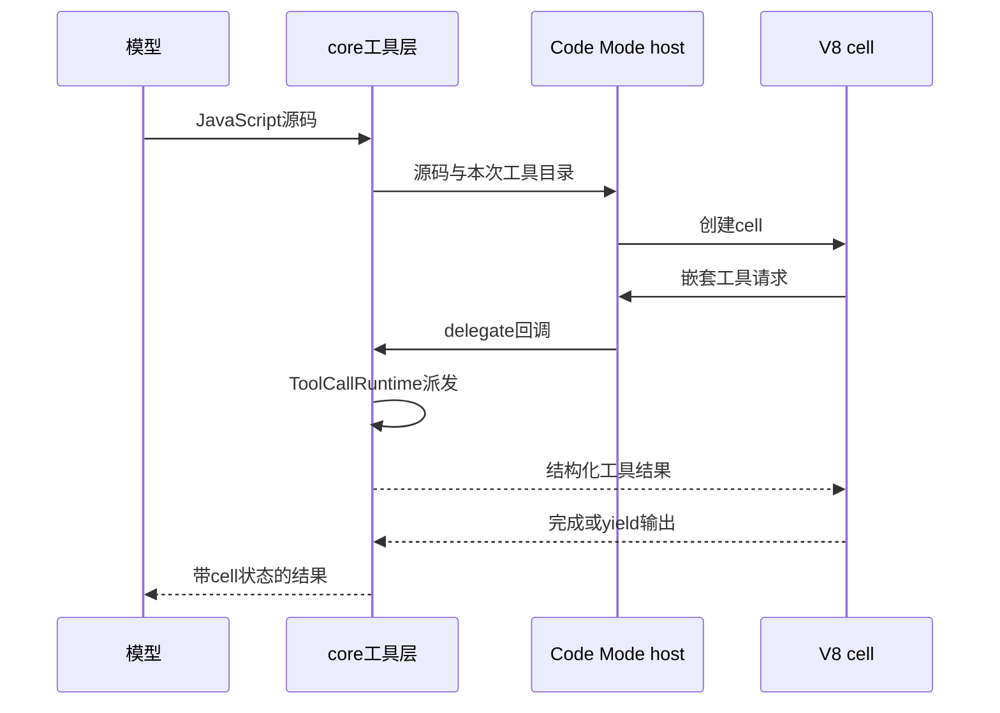

例如脚本可以并发搜索实现和测试，再按字段筛选结果，只把相关几行输出给模型。真正的嵌套调用会通过 delegate 回到 core，重新形成 `ToolCall`，带 `ToolCallSource::CodeMode`、cell ID 和该 cell 内的 runtime 调用 ID，进入前面讨论的 `ToolCallRuntime`。因此脚本可以减少来回采样、做结果加工，却没有替代每个工具自己的处理器、并发门和审批边界。runtime 内的调用 ID 只要求在 cell 内唯一，也不能拿来冒充 Codex 全局工具调用身份。[嵌套调用回到工具运行时](https://github.com/openai/codex/blob/e4568a3538c9cab6627d64ff8cdfc7d98b79b7db/codex-rs/core/src/tools/code_mode/mod.rs#L336-L414)

cell 也有独立生命周期。首次观察可能返回 Yielded，说明脚本仍在运行；完成与失败结果则关闭 cell dispatch 归属。handler 先登记 cell 和外层调用关系，再放开嵌套派发门，避免回调先于身份记录。输出经历 Code Mode 自己的预算处理，原始 runtime 响应和模型可见输出分别记录。一次 yield 不能被写成整段脚本已经完成。[cell 身份、派发门与首次结果](https://github.com/openai/codex/blob/e4568a3538c9cab6627d64ff8cdfc7d98b79b7db/codex-rs/core/src/tools/code_mode/execute_handler.rs#L86-L172)

取消同样跨两层：会话服务可终止活跃 cell，cell actor 再用自己的取消 token 及子 token 协调 V8 终止和待完成的工具回调。外层工具调用、脚本 cell 与嵌套工具不是同一个生命期。终止脚本也不代表已发生的外部副作用会被撤销。这套边界让脚本承担编排，让宿主仍能回答每个真实动作来自哪个 cell、哪条模型调用，以及它如何结束。[cell actor 的取消收尾](https://github.com/openai/codex/blob/e4568a3538c9cab6627d64ff8cdfc7d98b79b7db/codex-rs/code-mode-runtime/src/cell_actor/mod.rs#L123-L169)

集成测试给了一个很小的编排例子：脚本以 `Promise.all` 调用两个带 barrier 的同步测试工具，最后用 `text` 输出结果数组。测试检查下一次模型请求包含两个 `ok`，并检查时间范围；它覆盖的是脚本的并发请求确实回到工具运行时，再把值汇聚成模型可见输出。另一组 runtime 契约测试让通知回调保持未完成，终止 cell 时先观察回调取消，再等待清理释放。这些覆盖意图表明，cell 的终止也要处理宿主回调，不能只停止 V8 字节码就立即宣告资源清空。[嵌套编排测试](https://github.com/openai/codex/blob/e4568a3538c9cab6627d64ff8cdfc7d98b79b7db/codex-rs/core/tests/suite/code_mode.rs#L4199-L4288)、[回调清理测试](https://github.com/openai/codex/blob/e4568a3538c9cab6627d64ff8cdfc7d98b79b7db/codex-rs/code-mode-runtime/src/service_contract_tests.rs#L507-L552)

<a id="ch06-tools--用一次失败检查整条链路"></a>

## 用一次失败检查整条链路

把案例具体化：待修复的仓库有一个分页函数，空输入时仍生成下一页标记。模型暂时不知道实现位置，提出 `exec_command`，调用身份记作 `call-search-1`，参数可写成 `{"cmd":"rg -n 'normalize_limit|next_cursor' src","workdir":"/repo/pager"}`。这只是教学输入，本书没有真实运行这个仓库。此时规格决定模型能否提出这个名称，`ToolCall` 保留它的身份，handler 负责把参数解析成命令请求，执行层再返回搜索结果。

若观察到两行匹配，下一模型步骤应能把它们关联回 `call-search-1`，再提出读取命中位置的动作。它不需要从日志里猜哪条命令产生这些行。工具结果是一次有身份的反馈，能够和同一响应里的另一条搜索结果区分开。如果命令本身没有命中，模型也应依据退出状态和输出判断下一步搜索范围，不能把空输出自动解释为“这个实现不存在”。

把贯穿案例中的搜索写成一个思想实验：模型想找 `normalize_limit`，第一次给了不存在的工作目录。声明描述告诉模型参数应该长什么样，具体 handler 的反序列化确认参数能成为本地类型，环境解析再确认工作目录和选中的执行环境相容。这三个检查发生在不同地方，解决的也不是同一个问题。schema 不能证明目录存在，JSON 能解析也不能证明命令取得了批准；这一点会贯穿后两章。

在这个失败分支里，运行时返回 `call-search-1` 的失败输出。模型下一次可以把 `workdir` 改成环境报告的仓库根，生成新的调用身份 `call-search-2`。旧调用没有被悄悄“修好”，新动作也没有冒用旧结果。这让读者复原过程时能区分第一次参数错误和第二次有效搜索。如果模型误用了 `search_repository` 这个未注册名称，registry 也可反馈未知工具，促使下一步改用可用能力。

与此相对，假设名为 `apply_patch` 的注册项只接受自由文本补丁，却被协议层当成普通函数参数调用。这不是同一种可修复的目录错误。registry 在进入 handler 前就发现载荷种类与声明契约不相容，并将其升级为 Fatal。它所保护的是宿主内部的一致性：若仍把结构不对的载荷送下去，让每个 handler 各自猜测，故障就会散落在深层实现里。

再假设模型把上一回合看到的外部工具名称照抄回来，而当前步骤已经没有那个注册项。registry 按精确身份查不到，返回可反馈错误，模型得到的是这一次调用的失败结果。运行时不应去另一个相似名称里猜一个替代实现。猜测可能让一次原本只想读文档的调用落到具有不同副作用的接口上，也会让历史无法说明实际执行了什么。未知工具的失败因此承担了一项实用职责：让模型的能力认知重新与当前计划对齐。

第三种失败发生得更晚。前置钩子把搜索命令改成一个允许的替代命令，handler 执行成功，后置钩子要求模型改用另一种格式解释结果。registry 可以包装结果，让模型看到反馈，同时保留原输出对象的部分能力。这里不能粗略地把“模型最后看见的文本”当成“程序实际返回的对象”。测试 `post_tool_use_feedback_output_keeps_code_mode_result_typed` 就关注反馈包装以后，Code Mode 的值仍保有类型。对作者来说，这类测试比只断言最后字符串更能揭示接口的稳定边界。[反馈包装的测试](https://github.com/openai/codex/blob/e4568a3538c9cab6627d64ff8cdfc7d98b79b7db/codex-rs/core/src/tools/registry_tests.rs#L643-L697)

还可以从反面检查一份工具实现。若 handler 直接打印结果、绕开 `ToolOutput`，宿主将难以统一控制日志和模型预算；若它从当前全局状态重新读取配置，而不使用 invocation 里的步骤上下文，执行延迟就可能改变请求含义；若它自行发送多次结束事件，取消分支再补一次结束通知，界面和扩展观察者就会得到矛盾终态。这些不是一张 JSON schema 能解决的问题，却都属于“把工具交给模型”之后必须承担的运行时责任。

因此，读工具代码时不要停在注册清单。先用名字找到规格，确认它在什么条件下曝光；再从流项追到调用身份，找到 handler 的参数解析；最后沿着返回对象读到历史封装和错误分支。读到此处，才知道一个工具真正向模型承诺了什么。源码导读中的入口按这个方向排列，而不是按目录深度排列。

可以把两种返回面理解成下面的教学形状。字段只展示差异，不承诺真实接口恰好使用这些字段：

```text
教学伪代码：同一次命令的两种返回面
history_item = {
    call_id: "call-search-2",
    output: "Process exited with code 0\nOutput:\nsrc/page.rs:41:..."
}
code_mode_value = {
    exit_code: 0,
    output: "src/page.rs:41:...",
    wall_time_seconds: 0.02
}
```

历史面让模型看到可读且有预算的证据；结构化面让脚本按字段编排下一步。真正值得复用的是分开编码的接口设计，而不是照抄示例里的对象字段。

```text
教学伪代码：保留输出的不同用途
result = handler.handle(invocation)
if result is fatal_error:
    stop_turn(result)
else if result is ordinary_error:
    return failed_output(original_call_id, result.message)
else:
    log(result.log_view())
    return result.history_view_or_code_mode_view()
```

回到贯穿案例：一次搜索命令的成功，不只是终端返回零退出码。它还意味着运行时找到了正确工具、输入通过适用的处理与钩子、输出以正确调用身份返回，下一模型步骤能够看见它。一次失败也应留下同样清楚的轨迹。工具层的工程价值，就是把开放式行动缩成可解释的一次协议往返；并发和取消会在这个往返上增加时间维度。

这种设计并不保证模型会选对工具，也不保证外部服务会遵守承诺。它提供的是定位错误所需的接缝：选择问题可以在声明和历史之间追查，协议问题可以在载荷匹配处发现，环境问题留给具体执行层解释，结果加工则在统一封装处复核。接缝越清楚，失败越不必靠一条模糊的“调用失败”消息来猜。要把同样的结构带回自己的系统，可以先从一个最常用工具做完整往返，再扩展目录；一开始就接几十个回调，往往只会扩大那些尚未定义的边界。

<a id="ch06-tools--带回你的系统"></a>

## 带回你的系统

1. 当 schema 和执行代码经常漂移时，让同一运行时对象提供规格与处理方法，再由每次请求的计划决定曝光；代价是规划层需要承担能力筛选，不能只维护一张静态清单。
2. 当工具来自多个集成时，用 namespace 与 name 共同标识身份，并为核心命令保留名称；代价是替换内置实现必须走明确扩展接口，不能依赖注册顺序。
3. 当能力数量增长时，区分直接展示、按需发现与脚本嵌套调用；代价是发现和曝光自身也需要契约，隐藏声明不能代替执行授权。
4. 当失败需要模型自行修正时，把可反馈错误与运行时契约错误分开，并保留 call_id；误把全部异常转成文本，会让严重缺陷在循环里反复发生。
5. 当动作前后有钩子时，明确输入改写、执行完成和结果接受的边界；后置检查有价值，但除非另做事务设计，它不能撤销已经发生的副作用。

<a id="ch06-tools--源码导读"></a>

## 源码导读

- [ToolExecutor：声明、曝光与执行的共享契约](https://github.com/openai/codex/blob/e4568a3538c9cab6627d64ff8cdfc7d98b79b7db/codex-rs/tools/src/tool_executor.rs#L49-L129)
- [build_tool_router：组装本步骤的能力来源](https://github.com/openai/codex/blob/e4568a3538c9cab6627d64ff8cdfc7d98b79b7db/codex-rs/core/src/tools/spec_plan.rs#L121-L185)
- [finalize_tool_router：曝光与工具计划收束](https://github.com/openai/codex/blob/e4568a3538c9cab6627d64ff8cdfc7d98b79b7db/codex-rs/core/src/tools/spec_plan.rs#L368-L552)
- [ToolRegistry：外部注册与保留名称](https://github.com/openai/codex/blob/e4568a3538c9cab6627d64ff8cdfc7d98b79b7db/codex-rs/core/src/tools/registry.rs#L422-L495)
- [ToolRouter：协议输出项转工具调用](https://github.com/openai/codex/blob/e4568a3538c9cab6627d64ff8cdfc7d98b79b7db/codex-rs/core/src/tools/router.rs#L256-L309)
- [stream_events_utils：先记调用，再派发](https://github.com/openai/codex/blob/e4568a3538c9cab6627d64ff8cdfc7d98b79b7db/codex-rs/core/src/stream_events_utils.rs#L324-L369)
- [dispatch_any_with_state：处理器周围的生命周期](https://github.com/openai/codex/blob/e4568a3538c9cab6627d64ff8cdfc7d98b79b7db/codex-rs/core/src/tools/registry.rs#L615-L895)
- [AnyToolResult：历史与脚本返回表示](https://github.com/openai/codex/blob/e4568a3538c9cab6627d64ff8cdfc7d98b79b7db/codex-rs/core/src/tools/registry.rs#L207-L237)
- [registry_tests：身份规范化和碰撞覆盖](https://github.com/openai/codex/blob/e4568a3538c9cab6627d64ff8cdfc7d98b79b7db/codex-rs/core/src/tools/registry_tests.rs#L193-L375)
- [Code Mode：嵌套调用、来源与结构化返回](https://github.com/openai/codex/blob/e4568a3538c9cab6627d64ff8cdfc7d98b79b7db/codex-rs/core/src/tools/code_mode/mod.rs#L336-L414)

---

<a id="ch07-concurrency"></a>

<a id="ch07-concurrency--第-7-章-并发顺序与取消"></a>

# 第 7 章　并发、顺序与取消

模型已经找到分页函数，现在还想读取边界条件测试和调用者。两次读取互不依赖，可以一起开始；补丁却应在理解两份结果之后生成。这个简单场景包含三个不同问题：哪些动作允许重叠，结果按照什么顺序进入历史，用户中断时谁负责把未完成动作收尾。

在一个命令行脚本里，我们常把这些问题都藏进 `await` 的位置。在 agent 中，它们必须成为运行时协议。模型流还没结束，工具可能已经启动；用户界面已经显示第二个工具完成，历史却还在等待第一个结果；用户取消时，某个处理器也许已经完成副作用，只剩结束通知尚未送达。把“同时执行”理解成把所有 future 放进列表，会漏掉这些边界。

本章的主线是：**准入顺序、执行完成顺序和历史顺序可以不同，但每个调用只能有一个可解释的终态。** 这里的线程仍指会话线程，不是操作系统线程；实际异步任务由 Tokio 调度，而工具运行时另外定义了自己的并发契约。

<a id="ch07-concurrency--并发能力来自显式声明"></a>

## 并发能力来自显式声明

`ToolExecutor` 的默认 `supports_parallel_tool_calls` 返回 false。某个工具想共享执行窗口，必须由实现者明确声明。router 查询当前注册项，hidden 工具不能因底层 runtime 声明而获得并发许可。这个选择让未知工具默认进入保守路径，却没有试图分析任意命令的全部语义。

这一点尤其容易误读。`exec_command` 和 `write_stdin` 都明确返回 true。终端命令当然可能写文件、访问共享目录，甚至两个命令可能竞争同一份资源。因此“支持并发”说明的是运行时允许怎样调度该工具，不是 Codex 证明它是纯函数，也不是它与本响应中所有其他调用都没有依赖。[命令工具的并发声明](https://github.com/openai/codex/blob/e4568a3538c9cab6627d64ff8cdfc7d98b79b7db/codex-rs/core/src/tools/handlers/unified_exec/exec_command.rs#L107-L144)

MCP 工具还有自己的声明来源。handler 接受服务端配置的并发 opt-in，或工具 annotation 的 `read_only_hint`。代码注释把前提说得很清楚：正确实现的服务器应能容忍只读工具并发。它信任集成声明，没有现场验证该工具无副作用。如果服务端把会修改状态的接口标成只读，锁不会替它恢复正确性。[MCP 并发判断及相应测试](https://github.com/openai/codex/blob/e4568a3538c9cab6627d64ff8cdfc7d98b79b7db/codex-rs/core/src/tools/handlers/mcp.rs#L133-L152)

把这个边界放回分页修复：并发搜索实现和测试通常合理；先生成补丁再运行依赖旧文件内容的读取，就可能让证据跨版本。模型或者编排脚本仍须表达业务依赖。工具层提供的是可以并发的执行面，不是从自然语言目标自动生成一张正确的依赖图。

<a id="ch07-concurrency--一把读写锁代表两种准入"></a>

## 一把读写锁代表两种准入

`ToolCallRuntime` 持有 Session、发出工具声明的 StepContext、差分 tracker，以及一个共享的 `RwLock<()>`。它的 clone 共享同一把锁。锁里没有待保护的数据；空值本身表明，这里保护的是进入执行区的资格。[调用运行时及共享门](https://github.com/openai/codex/blob/e4568a3538c9cab6627d64ff8cdfc7d98b79b7db/codex-rs/core/src/tools/parallel.rs#L45-L65)

调用启动后，运行时先取得该工具的 readiness future；有些集成需要等自身准备好。等待就绪发生在拿执行锁之前，避免一个尚未可用的工具先占住全局执行资格。随后，可并发工具取读锁，不可并发工具取写锁。读锁之间能够重叠，写锁则需要独占。readiness 和锁等待都经过取消包装，即使 handler 要求自行完成取消收尾，也不能让它在准入前无限挂住。[就绪、准入与派发](https://github.com/openai/codex/blob/e4568a3538c9cab6627d64ff8cdfc7d98b79b7db/codex-rs/core/src/tools/parallel.rs#L202-L239)

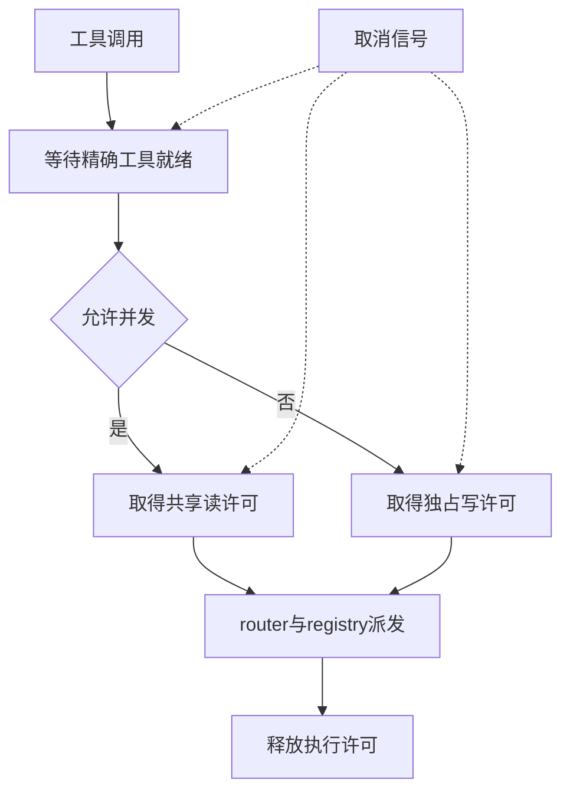

这里的锁覆盖整个 registry 派发，因而也包含相关钩子与输出处理，并不只包住某一个系统调用。一个慢后置钩子可能延长独占区。这样做的好处是工具的宿主生命周期具有完整准入边界；代价是独占工具后面的其他调用也会等它做完宿主工作。若只测真正命令的执行时长，就会看不见这部分等待。

还要限定锁的范围。它属于这份 `ToolCallRuntime`，是一次执行路径的门；不能把它称为整个 Codex 进程、所有会话或所有 agent 的全局文件系统锁。多个会话线程仍可能访问相同仓库。并发资格也不会替代终端自身的锁，更不会替代 Git、数据库或应用程序管理共享资源的方式。

```text
教学伪代码：取得执行资格
runtime = registry.find(call.name)
await cancellable(runtime.readiness())
permit = if runtime.supports_parallel:
    await cancellable(gate.read())
else:
    await cancellable(gate.write())
result = await router.dispatch(call, original_step)
drop(permit)
return result
```

<a id="ch07-concurrency--两个搜索三条时间线"></a>

## 两个搜索，三条时间线

设模型在同一个响应里依次提出 A、B 两次搜索。A 搜索整个 `src`，耗时较长；B 读取一个小测试文件，很快返回。没有同步 post-model hook 要求延迟派发时，工具调用会在完整流项到达后立即启动，而不是等到 future 被最后收集时才开始。这是并发能够覆盖模型流尾部等待的基础。

此时存在三种顺序。接收顺序是 A、B；实际完成顺序可能是 B、A；模型历史中的输出顺序仍由 A、B 的登记次序控制。采样函数使用 `FuturesOrdered` 保存在途 future，流结束后 `drain_in_flight` 逐项等待并记录返回 envelope。[有序收集容器与回收逻辑](https://github.com/openai/codex/blob/e4568a3538c9cab6627d64ff8cdfc7d98b79b7db/codex-rs/core/src/session/turn.rs#L2574-L2602)

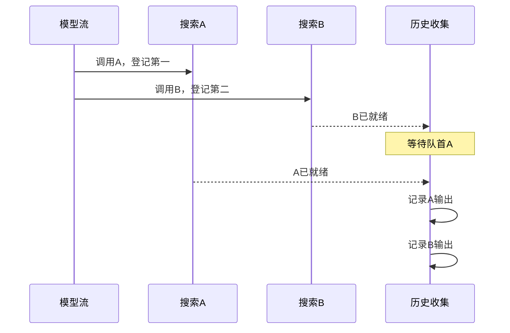

有序收集不会让已经启动的 B 失去并发。它只是暂时不把 B 的 envelope 写入这条历史。真实事件和追踪可以更早反映 B 已完成；`parallel.rs` 特意在调度任务内部记录 `result_ready`，避免等到有序收集时才误报 B 的完成时间。否则，A 慢两秒，监控里 B 也会平白多出两秒，看起来像工具性能退化。

代价是队首阻塞。B 的内容已经可用，下一模型步骤仍要等当前批次按序回收。对于这一条以模型响应为单位推进的路径，这使调用与输出更容易稳定重放。本书的解读是，运行时用一部分即时消费能力换取了历史的可解释性。它没有给出“每个工具一完成就独立启动下一次采样”的通用数据流执行器。

这也说明不能靠界面位置推断依赖。如果终端先显示 B 完成，并不意味着模型已经消费 B；如果历史里 A 的输出在前，也不意味着 A 是先完成的。排查时必须看对应事件边界，而不是把一种顺序投射到所有层。

可以给这条时间线加上具体内容。A 的身份是 `call-src`，参数搜索 `src` 中所有 `next_cursor`；B 的身份是 `call-test`，参数只读取 `tests/empty_page.rs`。假设 B 的工具结果在二百毫秒时准备好，内容指出“空数组应返回空游标”；A 在一秒后才返回三个实现位置。运行时允许这两条搜索重叠，B 的完成事件也可以先出现，但进入下一次模型请求的历史仍能按照原调用身份依次配对。模型随后才有充分输入决定应修改哪一个位置。

如果模型在同一个响应里又提出 C，直接把 `next_cursor` 改为固定空值，问题就变了。C 不是一个可以凭速度安排的读取，它依赖对 A、B 内容的理解。运行时不会因为 C 排在后面，就知道它在业务上依赖两个结果。即便 C 取得独占锁，它也只是等前面的执行区让开；它的补丁参数早已生成，不能自动吸收尚未看见的证据。正确编排应当让结果先回到模型，再生成补丁，或者在脚本中明确等待结果并检查条件。

这种区别常被“串行执行”四个字掩盖。串行可以保证副作用不重叠，却不能保证后生成的参数来自前一个结果；参数若在同一模型响应中已经全部确定，等待只改变时间，不改变信息。对于分页修复，这可能意味着补丁仍建立在错误猜测上，只是更有秩序地写错文件。运行时能执行依赖，不能凭空补出模型没有表达的推理边。

<a id="ch07-concurrency--取消不能留下半个协议往返"></a>

## 取消不能留下半个协议往返

现在用户发现修复方向不对，发出中断。调用 A 仍在执行，B 已完成但尚未收集，C 则还在等待独占许可。取消信号传播后，运行时需要分别处理它们，却仍要保留每条调用的身份。

每个派发任务由 `AbortOnDropHandle` 管理，外层 `select!` 同时等待任务结果和取消。普通 handler 还未终止时，运行时可以 abort 任务，并合成一条中止输出。取消发生在准入之前，也有“派发前被用户中止”的结果。上一章解释过，完整调用已先写历史；补回输出能够避免恢复时只有请求没有应答。[取消分支与中止结果](https://github.com/openai/codex/blob/e4568a3538c9cab6627d64ff8cdfc7d98b79b7db/codex-rs/core/src/tools/parallel.rs#L258-L318)

但有些 handler 声明 `finishes_on_cancellation`，表示自己观察 token 并负责终态发布。遇到这种工具，外层不能立刻把它砍掉；准入后的取消会等待它完成。类似地，如果调用已经抢先声明终态，或者 dispatch task 已经完成，也应收下原结果。这里的区别是处理器生命周期协议，不是取消优先级上的任意特殊照顾。

最微妙的时刻发生在副作用结束之后。假设 B 已经完成，registry 正向扩展观察者发送结束通知，用户恰好取消。若外层只检查 token，就可能再发布一次 Aborted。于是界面看到完成，监控看到中止，模型历史又得到第三种解释。源码用调用外部持有的 `ToolCallState`，在终态通知处通过原子交换抢占归属，防止一个调用重复结束。[终态归属的原子判定](https://github.com/openai/codex/blob/e4568a3538c9cab6627d64ff8cdfc7d98b79b7db/codex-rs/core/src/tools/registry.rs#L899-L909)

```mermaid
stateDiagram-v2
    [*] --> 等待就绪
    等待就绪 --> 等待许可
    等待许可 --> 执行
    等待就绪 --> 中止
    等待许可 --> 中止
    执行 --> 完成
    执行 --> 失败
    执行 --> 取消收尾
    取消收尾 --> 中止
    取消收尾 --> 完成: 完成终态已归属
    取消收尾 --> 失败: 失败终态已归属
    完成 --> [*]
    失败 --> [*]
    中止 --> [*]
```

图中没有“完成再中止”这条边。取消收尾要先尊重已经归属的终态；`finishes_on_cancellation` 只要求外层等待处理器，不能单凭这个声明推断最后一定是什么结果。若处理器在取消时才结束且尚无终态，registry 还会按 token 判定中止。图表达的是宿主生命周期归属，不表示所有系统动作都能原子结束。取消 future 不会把已经写入的文件恢复，也不会自动撤回外部消息。尤其是交互终端，工具请求的返回窗口和进程存活时间可能不同；下一章会说明为什么一次请求结束后仍可能保留进程会话。

还应把“收到了取消请求”和“已经停止产生效果”分开。前者是 token 的事实，后者取决于具体 handler 和它管理的资源。只要一个外部动作跨越进程、网络或客户端响应，它就可能在本地等待被取消时已经发出请求。因此，中止输出说明本次工具调用的宿主生命周期怎样结束，不能作为外部世界完全没有变化的证明。恢复工作时，模型应重新观察环境中与任务相关的事实，而不是根据“aborted”直接重放同一个有副作用请求。

对本书的仓库案例，可以在中断后先重新读取目标函数与 diff，确认补丁是否已有部分生效，再决定继续哪一步。这是一条从取消边界推导出的工程建议，并不是声称 Codex 自动对任意工具执行了回滚或幂等重试。把这个建议显式写出，是为了避免读者把生命周期的完整性误认为外部事务的完整性。

<a id="ch07-concurrency--把取消当作可以验证的竞态"></a>

## 把取消当作可以验证的竞态

源码测试没有只发一个取消信号再期待“不崩溃”。`cancellation_before_dispatch_admission_logs_dispatch_only_timing` 先人为占住执行门的写锁，启动工具，再立即取消。测试检查只有一条计时记录，且 `execution_started=false`、`handler_duration_ms=0`。这能够把排队取消和已经执行后取消分开。[准入前取消测试](https://github.com/openai/codex/blob/e4568a3538c9cab6627d64ff8cdfc7d98b79b7db/codex-rs/core/src/tools/parallel.rs#L612-L710)

另一个测试让 handler 立即完成，却把结束观察者暂时堵住。然后发出取消，最后放开观察者，断言结果仍为成功，而且只记录一个 `Completed { success: true }`。这种安排主动制造边界上的交错，比依赖真实负载偶然碰到竞态更可靠。它验证的是“终态已经归属谁”，不是“取消永远优先于完成”。[完成阶段的取消测试](https://github.com/openai/codex/blob/e4568a3538c9cab6627d64ff8cdfc7d98b79b7db/codex-rs/core/src/tools/parallel.rs#L804-L878)

并发测试也值得这样读。名为 `read_file_tools_run_in_parallel` 的测试，实际用 `test_sync_tool` 的两参与者 barrier 保证重叠，再用时长作补充检查；它不能被概括成“所有真实文件读取都经过同一个专用读取工具”。shell 测试另行发出两次 `exec_command`。测试文件在 Windows 上整体排除，部分测试还检查网络环境条件。书中阅读了这些测试，没有执行它们，更不能把 POSIX 测试安排扩大成所有平台的性能承诺。

同一个测试文件里的 `tool_results_grouped` 则检查另一个维度。它让假模型在一份响应中发出三条命令，再检查下一次请求：三条调用全部在输出之前，而且调用与输出按 `call_id` 一一对应。它检查的不是哪一个命令先退出，而是模型历史的组织。还有一项测试故意扣住流中的 response completed，借命令写入的时间证据观察工具是否在响应结束前启动。把这两类测试放在一起读，才能理解“早启动”和“后有序收集”可以同时成立。[分组结果与延迟流测试](https://github.com/openai/codex/blob/e4568a3538c9cab6627d64ff8cdfc7d98b79b7db/codex-rs/core/tests/suite/tool_parallelism.rs#L225-L355)

最后还有第二层并发边界。两个 `write_stdin` 调用都能通过共享执行门，但如果它们指向同一 terminal，进程管理器会取得该进程的交互锁。原因不是整类工具突然变成不可并发，而是同一个输出缓冲区会被排空，同一个输入流也有次序。不同 terminal 可以重叠，同一 terminal 的交互需要保护。这个粒度划分让全局工具调度不必知道每个资源的内部规则，同时要求资源管理器承担自己的同步责任。[终端内部的交互锁](https://github.com/openai/codex/blob/e4568a3538c9cab6627d64ff8cdfc7d98b79b7db/codex-rs/core/src/unified_exec/process_manager.rs#L895-L928)

```text
教学伪代码：验证边界上的取消
hold(execution_gate)
call = start_tool()
cancel(call)
assert one_terminal_output(call.id)
assert timing(call).execution_started == false
release(execution_gate)
assert no_late_completion(call.id)
```

<a id="ch07-concurrency--计时也需要与语义对齐"></a>

## 计时也需要与语义对齐

同一条调用至少有派发等待、handler 工作和总耗时。运行时在拿到执行许可后记录 `execution_started_at`，结束时一次性取样，计算等待与工作时间。尚未取得许可就取消的调用，工作时间是零，派发等待却不是零。它们混在一起，会把一个独占工具造成的排队误诊成所有工具都慢。[计时边界](https://github.com/openai/codex/blob/e4568a3538c9cab6627d64ff8cdfc7d98b79b7db/codex-rs/core/src/tools/parallel.rs#L419-L465)

这个区分对贯穿案例很实际。如果读取测试文件本来只要几十毫秒，用户却等了几秒，首先要判断它是在等 MCP 就绪、在等独占许可、在执行命令，还是已经完成但排在历史队首之后。优化命令本身只能解决其中一种。给每条调用统一身份，再按阶段计时，才能让不同层的日志回答同一个问题。

从这些边界可以推断，这套并发设计追求的是可控重叠：共享动作可以并行，独占动作有明确门，历史有稳定收集点，取消有唯一终态。它没有承诺自动解决任意共享状态竞争。对于自己的 agent，先把这四个事实分开建模，通常比一开始追求更大的并发数更能减少难以恢复的故障。

最后要保留一个故障出口：普通调用错误会成为模型可见的失败结果，Fatal 则向外传播为运行时错误。并发容器并没有因此获得修复内部契约的职责。阅读这些边界时，应同时问“这条调用怎样结束”和“它是否允许整个回合继续”，因为失败输出与回合失败属于不同层。任务数量增加以后，这个区分仍需成立，否则一处基础设施故障就可能被误报成模型还可以继续尝试的普通工具反馈。

<a id="ch07-concurrency--带回你的系统"></a>

## 带回你的系统

1. 当工具来自不同实现者时，要求显式声明并发资格，并让默认值保守；代价是需要维护声明可信度，声明为只读不能替代真实依赖分析。
2. 当某类操作必须独占时，用共享与独占两种准入表达执行窗口；代价是生命周期钩子也可能延长占用，应明确锁覆盖范围。
3. 当并发结果需要稳定重放时，分别记录完成顺序和历史顺序；代价是有序回收会产生队首阻塞，不能只看最终历史评估延迟。
4. 当取消会与完成竞争时，为每个调用设置唯一终态归属，并补齐已记录请求的输出；代价是处理器需要声明并实现自己的取消收尾协议。
5. 当用户报告工具慢时，分开就绪等待、准入等待、执行和收集时间；代价是计时边界要与真实控制流一致，单个总耗时不足以定位问题。

<a id="ch07-concurrency--源码导读"></a>

## 源码导读

- [ToolCallRuntime：共享执行门与原始步骤上下文](https://github.com/openai/codex/blob/e4568a3538c9cab6627d64ff8cdfc7d98b79b7db/codex-rs/core/src/tools/parallel.rs#L45-L65)
- [准入与执行：先就绪，再取读锁或写锁](https://github.com/openai/codex/blob/e4568a3538c9cab6627d64ff8cdfc7d98b79b7db/codex-rs/core/src/tools/parallel.rs#L202-L254)
- [取消：等待自收尾或合成中止输出](https://github.com/openai/codex/blob/e4568a3538c9cab6627d64ff8cdfc7d98b79b7db/codex-rs/core/src/tools/parallel.rs#L258-L318)
- [drain_in_flight：按登记顺序写回历史](https://github.com/openai/codex/blob/e4568a3538c9cab6627d64ff8cdfc7d98b79b7db/codex-rs/core/src/session/turn.rs#L2574-L2602)
- [MCP：read_only_hint 与服务器 opt-in](https://github.com/openai/codex/blob/e4568a3538c9cab6627d64ff8cdfc7d98b79b7db/codex-rs/core/src/tools/handlers/mcp.rs#L880-L914)
- [tool_parallelism：barrier、shell 与分组结果测试](https://github.com/openai/codex/blob/e4568a3538c9cab6627d64ff8cdfc7d98b79b7db/codex-rs/core/tests/suite/tool_parallelism.rs#L84-L245)
- [取消测试：尚未准入时工作耗时为零](https://github.com/openai/codex/blob/e4568a3538c9cab6627d64ff8cdfc7d98b79b7db/codex-rs/core/src/tools/parallel.rs#L612-L710)
- [取消测试：已经完成的调用只发布完成终态](https://github.com/openai/codex/blob/e4568a3538c9cab6627d64ff8cdfc7d98b79b7db/codex-rs/core/src/tools/parallel.rs#L804-L878)
- [ToolCallTimingGuard：等待与工作耗时分开](https://github.com/openai/codex/blob/e4568a3538c9cab6627d64ff8cdfc7d98b79b7db/codex-rs/core/src/tools/parallel.rs#L419-L465)

---

<a id="ch08-execution"></a>

<a id="ch08-execution--第-8-章-命令终端与补丁"></a>

# 第 8 章　命令、终端与补丁

模型已经读到分页函数的边界条件，接下来准备修改实现，并运行一个聚焦测试。工具层把这两种意图变成有身份的调用；真实环境却带来新的时间尺度。测试可能很快退出，也可能持续输出；终端可能等待输入；补丁可能先改好一个文件，再在另一个文件上失败。一次工具返回，不能简单等同于一个操作系统进程已经结束。

这个快照的 Unified Exec 把命令启动、交互、输出收集和进程回收放进一套生命周期。它又和补丁工具共享审批与沙箱编排，使“命令在哪里运行”和“允许它做什么”有统一入口。本章跟随执行资源；[第九章](#ch09-safety)解释授权与隔离怎样约束这些资源。

贯穿本章的例子是：模型提出 `cargo test empty_page -- --nocapture`，希望检查空输入时的游标行为。它是教学案例，本书没有在目标仓库真正执行这条测试。我们关心运行时会怎样把命令变成进程、怎样把观察窗口变成输出，以及失败后哪些事实仍需要重新检查。

<a id="ch08-execution--命令先属于一个环境"></a>

## 命令先属于一个环境

`ExecCommandHandler` 首先解析函数参数，选择本步骤的执行环境，然后解析工作目录。这里已经不能把所有路径当作本机 `PathBuf`：环境可能在远端，路径保留 `PathUri`。只有需要主机本地沙箱时，才必须得到符合主机路径约定的原生目录。一个 Windows 路径即使能在 POSIX 主机拼成某种绝对路径，也不意味着它就是主机上的合法仓库目录。[环境、目录与原生路径判定](https://github.com/openai/codex/blob/e4568a3538c9cab6627d64ff8cdfc7d98b79b7db/codex-rs/core/src/tools/handlers/unified_exec/exec_command.rs#L172-L233)

shell 同样属于环境。远端报告了 shell 时，handler 优先使用它；当前实现还限制远端请求的 shell 类型必须与环境报告相符。这防止控制端拿自己的默认 shell 规则去解释另一台机器。TTY 则有 feature 检查，不能因为参数写了 `tty=true` 就假设一定创建伪终端。参数规格、配置开关和后端能力共同决定最后的启动请求。

教学命令中的 `--`、工作目录和 shell 不是包装细节。若命令在错误目录运行，测试可能根本没覆盖目标 crate；若经过不同 shell 解释，引用和变量展开也可能改变。handler 因而先建立明确环境，再形成参数向量与 shell 调用信息，随后才预留进程身份。准备阶段仍可取消，源码特意把进程 ID 的分配放在准备结束之后，避免为一个从未进入启动阶段的请求留下虚假资源。

```mermaid
flowchart TD
    I[命令工具参数] --> E[选择步骤环境]
    E --> W[解析PathUri与shell]
    W --> V[验证权限与运行条件]
    V --> A[分配进程身份]
    A --> O[审批与沙箱编排]
    O --> L[本地或远端进程]
    L --> B[输出收集与状态管理]
    B --> R[工具结果]
```

<a id="ch08-execution--yield-是观察窗口timeout-是生命期限"></a>

## yield 是观察窗口，timeout 是生命期限

统一执行有两种 lifetime。交互式路径允许命令在一次返回后继续存在；一次性路径等待完成，并在超时或取消时终止对应进程。一次性模式强制关闭 TTY，使用完成超时，不向调用者提供可继续操作的进程。[两种生命周期与超时选择](https://github.com/openai/codex/blob/e4568a3538c9cab6627d64ff8cdfc7d98b79b7db/codex-rs/core/src/tools/handlers/unified_exec/exec_command.rs#L293-L300)

交互式调用里的 `yield_time_ms` 回答的是“这次等多久再把已收集结果交还”。命令在窗口结束时仍运行，结果可以带进程 ID，模型再用 `write_stdin` 继续收集。不能把 yield 当成强制杀进程的超时，也不能因为一次工具返回就宣称测试执行完成。下一步骤必须读取返回形状：有退出码意味着什么，有可继续会话又意味着什么。

快照给这些等待设置了边界。初始 yield 一般限制在二百五十到三万毫秒；Windows 还有一万毫秒的初始下限。空 `write_stdin` 轮询至少等待五秒，默认后台等待上限为五分钟；非空输入采用不同等待上限。这些值是本快照的实现条件，不是所有后端的服务级承诺。[等待窗口与预算常量](https://github.com/openai/codex/blob/e4568a3538c9cab6627d64ff8cdfc7d98b79b7db/codex-rs/core/src/unified_exec/mod.rs#L68-L77)

把它放进案例：测试在第一秒打印了编译信息，第二秒还没退出。若当前观察窗口结束，模型应保留返回的会话身份，下一次发送空输入来取新输出。空轮询不会重新运行测试；它操作的是同一个托管进程。反过来，如果结果已经给出退出码，就不应把旧 ID 当成可以无限复用的永久终端地址。

```text
教学伪代码：把一次调用接成执行会话
r = exec(command, observation_window)
show(r.output)
while r.has_resumable_process:
    r = write_stdin(r.process_id, input="")
    show(r.output)
inspect(r.exit_code)
```

一次性取消的实现更严格。它保留正常启动路径发布的精确进程 handle；取消后，若进程已经创建就调用确认终止，再等待原执行路径收尾；尚未创建则丢弃执行并释放预留 ID。这样不会在清理时仅凭一个可能已被复用的整数去杀进程。[一次性取消与精确进程句柄](https://github.com/openai/codex/blob/e4568a3538c9cab6627d64ff8cdfc7d98b79b7db/codex-rs/core/src/unified_exec/oneshot.rs#L41-L123)

<a id="ch08-execution--进程退出以后输出未必读完"></a>

## 进程退出以后，输出未必读完

`UnifiedExecProcessManager` 既保存进程，也保存原始调用身份、工作目录、TTY、环境身份、权限、网络审批状态和最近使用时间。进程会话是有所有者和权限快照的资源，不是一张单纯的整数到进程表。

启动成功后，管理器收集观察窗口内的输出，构造 `ExecCommandToolOutput`，其中包含原始输出、截断策略、输出预算、进程身份和退出码。它还处理一个常见远端竞态：执行端先报告进程退出，但输出管道尚未关闭，最后一批字节仍在路上。若只看到退出就删掉记录，测试失败的最后几行可能永久丢失。

源码因此区分退出和输出闭合。需要等待输出闭合的后端，在进程已退出、但输出尚未 closed 或缓冲仍有 pending 内容时，仍保留记录供后续收集；不会在共享进程表锁下等待输出。这样既保护尾部数据，也避免一个慢管道阻塞所有终端状态访问。[退出与尾部输出的处理](https://github.com/openai/codex/blob/e4568a3538c9cab6627d64ff8cdfc7d98b79b7db/codex-rs/core/src/unified_exec/process_manager.rs#L1140-L1185)

```mermaid
stateDiagram-v2
    [*] --> 启动准备
    启动准备 --> 运行
    启动准备 --> 启动失败
    运行 --> 运行: yield后继续
    运行 --> 已退出仍有输出
    已退出仍有输出 --> 输出收集完成
    运行 --> 终止收尾
    终止收尾 --> 输出收集完成
    输出收集完成 --> 回收
    启动失败 --> 回收
    回收 --> [*]
```

这张状态图也解释了为何退出码不是所有事实的终点。对模型而言，“进程退出”和“我已经拿到了它的完整可用输出”需要一起判断。对界面而言，终端结束事件和最后一次交互事件也需要有稳定关系。对维护者而言，输出闭合规则必须按后端协议处理，不能拿本地管道的经验直接推断远端推送事件。

<a id="ch08-execution--一层保护内存一层保护上下文"></a>

## 一层保护内存，一层保护上下文

一个输出无界的测试或错误循环，足以拖垮 agent。Unified Exec 的内部缓冲有一 MiB 上限，`HeadTailBuffer` 将容量大致分给稳定前缀和最新后缀，中间过量内容被丢弃，并累计省略字节数。输出不是悄悄消失，而是插入明确省略标记。[有界头尾缓冲](https://github.com/openai/codex/blob/e4568a3538c9cab6627d64ff8cdfc7d98b79b7db/codex-rs/core/src/unified_exec/head_tail_buffer.rs#L5-L124)

保留前后两端是一种实用取舍。开头往往包含命令、构建上下文和最初错误，结尾常包含最终状态或失败摘要；中间可能是重复进度。它无法保证保留下来的恰好是最有价值证据。模型遇到省略标记，应缩小检查范围或把程序输出写入可另行检索的产物，不能宣称已经逐行看完完整日志。

内部字节上限还不是给模型的全部预算。工具输出另有 `max_output_tokens` 与模型截断策略，格式化时要为退出信息、警告和截断标记保留空间。否则，先把内容截到“刚好”，再加头部，历史层又会截一次，甚至截掉“中间内容已省略”的说明。这里需要把原始观察量、保留量和模型可见量分开。

源码测试故意用只有十个字节容量的缓冲反复生产、排空，比较最终结果与一次性压入全部内容的结果；另一项测试检查早先已经发生的省略信息不会在 drain 后丢失。它们验证的是跨多次收集仍维持预算与计数，而不只是单次长字符串被裁短。本书只读了测试实现。[反复排空的缓冲测试](https://github.com/openai/codex/blob/e4568a3538c9cab6627d64ff8cdfc7d98b79b7db/codex-rs/core/src/unified_exec/process_manager_tests.rs#L345-L430)

还要拆开“工具成功返回”和“命令执行成功”。`ExecCommandToolOutput` 能把退出码为非零的命令输出正常交给模型，它的工具输出层仍可视为成功交付。退出码保留在结果里面，模型必须读它。否则，一条显示测试失败摘要的正常工具结果，会被上层错误地解释成测试已经通过。工具层完成了观察职责，应用层目标是否达成仍需要另外判断。[执行输出的协议封装](https://github.com/openai/codex/blob/e4568a3538c9cab6627d64ff8cdfc7d98b79b7db/codex-rs/core/src/tools/context.rs#L379-L445)

例如聚焦测试返回编译错误时，模型应该先判断是修改引入的类型问题、测试环境缺少依赖，还是测试真正进入断言后失败。它们可能都有非零退出码，却需要不同下一步。若结果还包含省略信息，模型也需要缩小输出再找关键错误，不能只依据末尾一句“失败”改业务逻辑。执行运行时保留这些原始事实，是为了让下一步推理有依据；它没有替模型完成错误归因。

<a id="ch08-execution--stdin-是新动作不是旧授权的延长线"></a>

## stdin 是新动作，不是旧授权的延长线

如果模型启动的是交互 shell，随后给它写入字符，实际可能发起一条全新命令。`write_stdin` 先找到精确进程对象，再取得它的交互锁。不同终端可以并发，同一终端的输入和排空不能互相踩踏；否则两个轮询可能瓜分同一缓冲，让每个调用看到不完整证据。

取得锁后，管理器检查当前严格自动审查条件，并按终端保留的权限判断这次输入是否需要审批。它限制送审动作的完整序列化大小，超过上限就拒绝，不能只审前半段却执行尾部。审批返回后还会再次检查进程对象的 `Arc` 身份，防止等待期间旧进程被移除、整数 ID 被另一个进程复用。[交互锁、完整输入审查与身份复核](https://github.com/openai/codex/blob/e4568a3538c9cab6627d64ff8cdfc7d98b79b7db/codex-rs/core/src/unified_exec/process_manager.rs#L895-L998)

把这个细节用在案例里：最初获批启动测试 shell，并不意味着稍后输入一条删除目录的命令天然获得同样批准。终端持有的较大权限是一种执行能力；新输入是否允许使用它，还要按当前规则判断。这一事实将连接到下一章的审批缓存：缓存必须描述实际动作和权限范围，不能只记“这个终端曾经被批准”。

非 TTY 模式也有边界。它不接受任意后续文本输入；中断控制字符有专门路径，普通字符则返回 stdin 关闭错误。TTY 是交互能力选择，不是为了让输出看起来像终端而随便添加的展示参数。模型需要根据实际任务选择它，后端也必须能支持它。

<a id="ch08-execution--会话有容量也有回收顺序"></a>

## 会话有容量，也有回收顺序

托管进程不能无限增长。源码设置六十四个进程的容量阈值，清理策略保护最近使用的八个，优先选择保护集合之外已退出的进程，否则回退到较旧的候选。但它是软上限：正在交互或发布终态的进程不能被顺手驱逐；当一个退出进程短暂持锁时，管理器宁可暂时超限，也不为了凑数字去杀一个仍活跃的进程。[进程清理与软上限](https://github.com/openai/codex/blob/e4568a3538c9cab6627d64ff8cdfc7d98b79b7db/codex-rs/core/src/unified_exec/process_manager.rs#L1750-L1820)

这意味着模型不能把会话 ID 当永久资源。一次长任务创建很多终端后，早先的 ID 可能已经不可用。正确反馈是未知进程，随后重新建立需要的环境。对宿主来说，回收策略也不是后台杂务：它改变未来哪些动作仍然可做，必须与交互锁、退出通知和权限清理协调。

<a id="ch08-execution--补丁先变成可检查的变更"></a>

## 补丁先变成可检查的变更

现在模型准备修改分页实现。`apply_patch` 的自由文本输入先经过语法解析，再选择环境文件系统，调用验证函数，将补丁整理成可执行的文件变更。随后 handler 准备安全判断、发送开始事件，再通过 `ToolOrchestrator` 调用 `ApplyPatchRuntime`。可识别的 shell 形式补丁也能被截获后送进这条路径，但不能据此声称任意包含 `apply_patch` 字样的 shell 都会被识别。

参数流中的补丁预览又是另一件事。启用对应 feature 时，流式 parser 可以在补丁尚未完整到达时发出更新事件，并合并短时间内的频繁更新。它帮助界面展示模型准备改什么，不意味着这些行已经写到磁盘。区分“生成中”“验证后”和“已提交变更”，才能避免界面提前把计划当成果。[补丁解析、验证与执行入口](https://github.com/openai/codex/blob/e4568a3538c9cab6627d64ff8cdfc7d98b79b7db/codex-rs/core/src/tools/handlers/apply_patch.rs#L301-L381)

```mermaid
flowchart LR
    S[补丁文本流] --> P[预览事件]
    S --> C[完整补丁]
    C --> V[环境文件系统验证]
    V --> A[安全判断与审批]
    A --> X[提交文件变更]
    X --> D[实际提交delta]
    D --> F[完成或失败事件]
```

对文件移动，源路径和目标路径都会进入涉及文件集合；额外写权限按实际需要计算。它不会因为一个目标本来可写，就反而为其父目录申请更宽权限。执行层还按沙箱情况决定符号链接处理。路径、权限和环境的关系在这里仍然存在，补丁没有因为格式比 shell 受限，就脱离安全边界。

最需要记住的是，补丁不是跨文件事务。`apply_patch_with_options` 失败时也能带回已提交的 delta，runtime 把它追加到 `committed_delta`；handler 在错误分支仍把实际 delta 交给完成事件。两个文件中，第一个已经修改，第二个写入失败，并不意味着第一个自动恢复。[失败仍保留已提交更改](https://github.com/openai/codex/blob/e4568a3538c9cab6627d64ff8cdfc7d98b79b7db/codex-rs/core/src/tools/runtimes/apply_patch.rs#L170-L258)

```text
教学伪代码：失败结果仍携带事实
result = apply_files(patch)
if result.failed:
    committed = result.changes_before_failure
else:
    committed = result.all_changes
record_actual_delta(committed)
report_status_and_delta(result.status, committed)
```

例如，修复需要改 `src/page.rs` 和测试文件，后者在提交时出现写入错误。下一步应先检查真实 diff，确认实现文件是否已经改动，再决定补足测试文件或调整方案。直接重放整份补丁可能因为旧文本已经变化而再次失败。apply-patch crate 的测试明确包含“部分成功后失败仍留下更改”的场景；它提醒维护者，报告失败不能抹掉已经发生的事实。

这项测试的构造非常直接：一份补丁先增加 `created.txt`，再更新不存在的 `missing.txt`。CLI 被期望报告失败，测试随后仍读取新文件并断言内容是 `hello`。它没有通过复杂并发制造偶发异常，而是用两步补丁固定了一个部分完成场景。对读者来说，最值得复制的是这种验收方式：既检查最终错误，也检查错误之前已经落地的状态；只检查退出状态，无法证明失败路径是否留下了需要处理的资源或文件。

命令和补丁最终在同一个工程原则上相遇：资源生命周期、可见输出和实际副作用必须能够分别描述。命令返回不一定代表进程退出，进程退出不一定代表输出读尽，补丁失败不一定代表文件没变。运行时的工作就是把这些差异保留下来，让下一模型步骤有机会基于真实环境继续。

这也改变了完成报告的写法。模型应说明自己观察到了哪一个退出状态、哪一份测试摘要以及哪一组实际修改，遇到窗口返回或部分失败时继续收集证据。把动作已经发出当作目标已经完成，会丢掉这一章花费大量状态管理才保留下来的区别。

<a id="ch08-execution--带回你的系统"></a>

## 带回你的系统

1. 当执行跨本地与远端时，让环境拥有目录、shell 和路径约定，在执行边界才转原生路径；代价是不能到处把路径简化为控制端字符串。
2. 当命令可能长时间运行时，区分观察窗口与完成超时，并返回可继续会话或终态；代价是要管理会话回收，工具返回不能被当作进程退出。
3. 当输出可能无界时，同时设置内部存储预算和模型输入预算，保留省略信息；代价是被截掉的证据需要另行检索，不能假装完整阅读。
4. 当已有终端继续接收输入时，把新输入当作新动作审查，并在等待后复核资源身份；代价是交互路径比简单写管道复杂，但能避免权限延用和 ID 复用错误。
5. 当一次修改涉及多个文件时，返回实际已提交的变更，即使整体失败；代价是调用方必须处理部分完成，事务回滚需要独立实现。

<a id="ch08-execution--源码导读"></a>

## 源码导读

- [ExecCommandHandler：环境、路径与 shell](https://github.com/openai/codex/blob/e4568a3538c9cab6627d64ff8cdfc7d98b79b7db/codex-rs/core/src/tools/handlers/unified_exec/exec_command.rs#L172-L280)
- [启动前准备、补丁截获和进程分配](https://github.com/openai/codex/blob/e4568a3538c9cab6627d64ff8cdfc7d98b79b7db/codex-rs/core/src/tools/handlers/unified_exec/exec_command.rs#L358-L424)
- [Unified Exec：窗口、预算和进程状态](https://github.com/openai/codex/blob/e4568a3538c9cab6627d64ff8cdfc7d98b79b7db/codex-rs/core/src/unified_exec/mod.rs#L68-L199)
- [oneshot：超时与取消的精确清理](https://github.com/openai/codex/blob/e4568a3538c9cab6627d64ff8cdfc7d98b79b7db/codex-rs/core/src/unified_exec/oneshot.rs#L41-L123)
- [write_stdin：串行交互、审批与身份复核](https://github.com/openai/codex/blob/e4568a3538c9cab6627d64ff8cdfc7d98b79b7db/codex-rs/core/src/unified_exec/process_manager.rs#L895-L998)
- [HeadTailBuffer：前后保留与省略计数](https://github.com/openai/codex/blob/e4568a3538c9cab6627d64ff8cdfc7d98b79b7db/codex-rs/core/src/unified_exec/head_tail_buffer.rs#L5-L124)
- [输出测试：多次排空仍保持上限](https://github.com/openai/codex/blob/e4568a3538c9cab6627d64ff8cdfc7d98b79b7db/codex-rs/core/src/unified_exec/process_manager_tests.rs#L345-L430)
- [补丁 handler：验证后进入统一执行](https://github.com/openai/codex/blob/e4568a3538c9cab6627d64ff8cdfc7d98b79b7db/codex-rs/core/src/tools/handlers/apply_patch.rs#L301-L381)
- [补丁 runtime：失败也记录已提交 delta](https://github.com/openai/codex/blob/e4568a3538c9cab6627d64ff8cdfc7d98b79b7db/codex-rs/core/src/tools/runtimes/apply_patch.rs#L170-L258)
- [部分失败测试：变更不会自动撤销](https://github.com/openai/codex/blob/e4568a3538c9cab6627d64ff8cdfc7d98b79b7db/codex-rs/apply-patch/tests/suite/tool.rs#L378-L396)

---

<a id="ch09-safety"></a>

<a id="ch09-safety--第-9-章-审批策略与沙箱"></a>

# 第 9 章　审批、策略与沙箱

模型已经准备好补丁，也知道应该运行哪条测试。现在假设测试需要写入构建目录，或者下载一个尚未缓存的依赖。运行时不能只问“用户是否同意修复问题”，还要问这一次动作具体请求了哪些权限、策略怎样判断、实际执行端能否把限制落实。

权限相关名词容易挤在一起。审批决定某个动作是否获得授权；命令策略把规则和请求转换成执行要求；沙箱负责在操作系统或执行端落实允许的范围。模型说自己只读，并不能代替内核限制；用户批准一条命令，也不意味着所有现存的拒读规则都应该消失。本章围绕这些边界，跟踪一次测试命令从默认权限到失败、再到可能提权的路径。

中心结论是：**许可、审查和隔离必须分别成立，重试若改变权限，就改变了需要解释的动作。** 源码展示了多个平台与后端，本章只描述固定快照可证明的控制流，不把某种本地配置当成产品的统一默认状态。

<a id="ch09-safety--策略先把请求压成三种要求"></a>

## 策略先把请求压成三种要求

执行层不会直接拿模型的 `justification` 当作批准。它先让 `ExecPolicyManager` 检查命令。shell 命令会被整理成可评估的片段，规则检查结合未匹配命令的 fallback，聚合出 Forbidden、Prompt 或 Allow，然后转成 `ExecApprovalRequirement` 的 `Forbidden`、`NeedsApproval`、`Skip`。[命令策略到执行要求](https://github.com/openai/codex/blob/e4568a3538c9cab6627d64ff8cdfc7d98b79b7db/codex-rs/core/src/exec_policy.rs#L339-L463)

这三种结果不是三个同义词。Forbidden 直接阻断；NeedsApproval 要求建立一份可审动作；Skip 表示通常不需要这一轮常规审批，但还携带是否建议首轮绕过沙箱的信息。更重要的是，`strict_auto_review` 开启时，即使 requirement 是 Skip，orchestrator 仍构造动作送审。因此不能把 Skip 解释成无条件放行。[Skip 与严格自动审查](https://github.com/openai/codex/blob/e4568a3538c9cab6627d64ff8cdfc7d98b79b7db/codex-rs/core/src/tools/orchestrator.rs#L164-L225)

```mermaid
flowchart TD
    C[具体命令与权限请求] --> P[规则与fallback评估]
    P --> F[Forbidden]
    P --> N[NeedsApproval]
    P --> S[Skip]
    F --> R[拒绝]
    N --> A[构造审批动作]
    S --> T{严格自动审查}
    T -->|开启| A
    T -->|关闭| X[选择执行隔离]
    A --> D{批准}
    D -->|是| X
    D -->|否| R
```

未匹配命令的分支也比配置名复杂。`Never` 表示不弹出审批，并不表示一切都能执行：被危险命令识别命中的请求，在 Never 下会 Forbidden；正常未匹配命令则可能依靠现有沙箱边界执行。`OnRequest` 下，受限环境中的普通非提权命令可以先在沙箱内尝试，而显式请求扩权会改变判断。Windows 沙箱后端禁用但仍存在受管理文件系统限制时，代码特别保守，因为限制形状此时没有相应平台机制保证。[未匹配命令与平台条件](https://github.com/openai/codex/blob/e4568a3538c9cab6627d64ff8cdfc7d98b79b7db/codex-rs/core/src/exec_policy.rs#L777-L860)

所以不要把这些策略压成一张“某模式永远提示、某模式永不拒绝”的小表。真正参与判断的是命令、规则来源、审批设置、环境权限和平台后端。配置名给出大方向，最后动作仍有明确输入。

<a id="ch09-safety--规则允许也有不同来源"></a>

## 规则允许也有不同来源

假设命令是 `cargo test empty_page`。它可能命中显式 allow 规则，也可能因为并非危险命令、当前沙箱足以限制副作用而被 fallback 允许。两者都可产生 Allow，却不代表相同信任范围。源码只在每个解析片段都命中显式 allow 规则时，给 Skip 设置 `bypass_sandbox=true`；启发式允许并不自动带来这项含义。

这能防止复合命令借前缀的名字偷渡。例如一条 shell 行由目录切换、测试和额外动作构成，检查不能只看第一个看起来安全的可执行名。规则修改建议也要基于所有片段判断，避免新前缀不足以覆盖整条动作，却在界面上给出“下次都允许”的错觉。这里没有宣称 shell 解析能理解任意程序语义；它提供的是规则检查的保守结构。

对自己的系统，可以把这看成“允许的理由必须保留下来”。同样是允许，可能因为规则显式授权、因为操作仍被沙箱限制，或因为更高层审批者同意。后续重试、缓存与界面解释会用到这些区别。若过早只保存一个布尔值，权限变化时就失去重新判断的依据。

还有一类常见误解：把审批策略理解成权限本身。用户选择不弹提示，改变的是遇到某种动作时能否等待人工决策；它并不直接创建一个可写目录，也不启用某个平台后端。反过来，沙箱允许写工作区，说明该范围可以被系统执行，却不代表命令策略一定接受所有写工作区的程序。两层判断可以给出不同答案，运行时需要按先后顺序消费，而不是让后一层悄悄覆盖前一层。

<a id="ch09-safety--审批动作描述实际权限"></a>

## 审批动作描述实际权限

当需要审批时，统一运行时构造 `ApprovalAction::ExecCommand`，其中有命令向量、环境身份、目录、TTY、沙箱权限、额外权限和规则修改建议。它审的是一份具体动作，不只是“运行测试”这句自然语言。`request_approval` 先运行 PermissionRequest hooks；钩子没有给出决定时，再按配置进入 Guardian 自动审查或用户审批。[统一审批入口与优先级](https://github.com/openai/codex/blob/e4568a3538c9cab6627d64ff8cdfc7d98b79b7db/codex-rs/core/src/tools/approvals.rs#L454-L550)

Guardian 在这里是公开运行时可见的审查路径。书中可以分析它收到什么动作、它的拒绝怎样反馈，却不能从调用链推出模型审查的准确率，也不能把其存在等同于操作系统隔离。自动审查和人审都产生授权结果，真正能否访问某个文件，仍取决于后面的权限 profile、变换和执行端。

审批缓存同样围绕具体动作。命令缓存键包含环境、可执行程序、规范化命令、cwd、TTY、沙箱权限和额外权限；用户命令审批还结合环境策略指纹。只有 `ApprovedForSession` 才写入这类会话缓存，普通单次批准不会悄悄升级成长期允许。[动作缓存键](https://github.com/openai/codex/blob/e4568a3538c9cab6627d64ff8cdfc7d98b79b7db/codex-rs/core/src/tools/approvals.rs#L224-L260)

```text
教学伪代码：缓存一次等价授权
key = (environment, executable, command, cwd,
       tty, sandbox_permissions, extra_permissions, policy_fingerprint)
if cache[key] is approved_for_session:
    use_cached_decision()
else:
    decision = review(actual_action)
    if decision is approved_for_session:
        cache[key] = decision
```

为什么目录也在键里？同一条 `./scripts/check` 在不同仓库可能是完全不同的程序。为什么要保留权限？同一命令在只读沙箱内获批，和在更大权限下执行，后果不同。为什么有环境？控制端的本地仓库和远端工作区不能因为命令文本相同，就共享所有授权。这些字段既增加实现复杂度，也使“同一个动作”成为可复核的工程概念。

<a id="ch09-safety--隔离必须在执行端落实"></a>

## 隔离必须在执行端落实

orchestrator 在授权后选择首轮执行方式。`SandboxManager` 根据权限和平台决定是否需要本地包装：macOS 对应 Seatbelt；Linux 的枚举名是 LinuxSeccomp；Windows 只有启用相应后端时才有平台沙箱。不能从统一枚举名字推断每个平台用了同一种机制。[平台沙箱选择](https://github.com/openai/codex/blob/e4568a3538c9cab6627d64ff8cdfc7d98b79b7db/codex-rs/sandboxing/src/manager.rs#L43-L64)

Linux 尤其需要纠正旧印象。这个快照默认由 bubblewrap 建立文件系统隔离，再在内层应用 seccomp 与 `no_new_privs`；旧 Landlock 路径是显式选择的兼容选项。枚举仍叫 LinuxSeccomp，并不说明文件系统只靠 syscall 过滤，也不说明默认是 Landlock。[Linux helper 的实际流水线](https://github.com/openai/codex/blob/e4568a3538c9cab6627d64ff8cdfc7d98b79b7db/codex-rs/linux-sandbox/src/linux_run_main.rs#L55-L94)

远端执行还有一层反直觉的情况。工具使用 executor 管理的沙箱时，控制端的具体 `SandboxType` 可以是 None，但 `sandbox_requested` 和发给执行端的权限仍然有效。这里的 None 表示本机不再套一层平台 wrapper，不能据此声称远端完全没有隔离。相反，只有一份 policy 形状却没有能够落实它的后端，也不能声称已经安全执行。

```mermaid
flowchart LR
    A[已授权动作] --> P[权限profile与执行环境]
    P --> L[主机平台变换]
    P --> R[执行端托管沙箱]
    L --> O[操作系统限制]
    R --> E[执行端落实权限]
    O --> C[实际命令]
    E --> C
```

这就是“权限允许不等于 OS 隔离”的具体含义。权限对象表达意图，审批决定是否接受动作，沙箱变换把它翻译成系统可落实的约束，后端能力决定翻译是否成立。任何一层被省略，不能拿另一层的名字来补证。

<a id="ch09-safety--提权不能吞掉拒读规则"></a>

## 提权不能吞掉拒读规则

再加一个条件：项目明确禁止读取某类敏感文件，而测试只需要扩大写入范围。最粗糙的提权办法是整个去沙箱，但它会同时移除拒读能力。源码因此先检查当前文件系统策略能否由无沙箱执行表示；只要有 denied-read restrictions，答案就是不能。

在这种策略下，已批准的显式提权可以进入 `EscalatedSandboxWithRestrictions`，扩大合适范围并保留拒读。显式 allow 规则也不能直接删除这些限制。若本地没有可用文件系统沙箱，`ensure_native_sandbox` 会拒绝这种升级；若远端不能证明支持保留限制的升级，orchestrator 也会拒绝并要求升级执行端。[拒读约束与沙箱保留](https://github.com/openai/codex/blob/e4568a3538c9cab6627d64ff8cdfc7d98b79b7db/codex-rs/core/src/tools/sandboxing.rs#L234-L309)

这使权限模型不再是一条从“严”到“松”的单轴。多写一个目录，不应必然意味着多读所有目录。对分页测试而言，批准构建缓存写入可以解决运行问题，却无需给它读取项目外敏感文件的能力。代价是平台必须真正表达这些组合，不能表达时就得停在拒绝，而不是把限制静默丢掉。

对应单元测试构造了 `**/*.env` 的拒读规则，检查显式提权仍选择保留限制的沙箱，并断言缺失原生沙箱时拒绝。它还检查，即使 requirement 建议 bypass，拒读策略仍阻止彻底绕过。这些断言说明运行时维护的是组合权限的语义，不只是一个“已提权”标签。

<a id="ch09-safety--首轮失败不会自动打开权限"></a>

## 首轮失败不会自动打开权限

现在测试在首轮沙箱里失败。首先要区分普通非零退出和 `SandboxErr::Denied`。断言失败、编译失败或工具拒绝，不会天然进入“去沙箱重试”。orchestrator 只在匹配到具体沙箱拒绝后，再检查工具是否支持失败提权、审批策略是否允许、网络拒绝上下文是否可解释，以及当前拒读限制能否保留。[重试的准入条件](https://github.com/openai/codex/blob/e4568a3538c9cab6627d64ff8cdfc7d98b79b7db/codex-rs/core/src/tools/orchestrator.rs#L394-L472)

默认 Approvable 对 Never 和 OnRequest 的一般无沙箱审批重试都返回 false；网络拒绝存在受控特例，具体工具也可以覆盖默认行为。因此“命令失败就自动放宽再试”不是这份实现的规则。批准范围、失败种类和工具策略必须共同成立。

更细的边界是审批来源。首次 Guardian 允许一个受限动作，不表示它也允许去沙箱后的动作。orchestrator 不把 Guardian 的首次裁决视为扩大权限重试的预批准，而是按实际重试把权限改成 `RequireEscalated`、清掉较窄的额外权限描述，再送审。人的批准或钩子来源在适用策略下可以保留已有重试范围，但严格自动审查仍会影响是否绕过复审。[按实际重试权限重建审批](https://github.com/openai/codex/blob/e4568a3538c9cab6627d64ff8cdfc7d98b79b7db/codex-rs/core/src/tools/orchestrator.rs#L484-L533)

```mermaid
sequenceDiagram
    participant T as 工具运行时
    participant A as 审批者
    participant E as 执行端
    T->>A: 审查受限动作
    A-->>T: 允许
    T->>E: 首轮沙箱执行
    E-->>T: 明确沙箱拒绝
    T->>T: 检查重试与限制条件
    T->>A: 审查更大权限动作
    A-->>T: 拒绝
    Note over T,E: 不发出第二次启动
```

这不是抽象示意。`guardian_rechecks_unsandboxed_retry_after_sandboxed_approval` 用假执行端让首轮报告沙箱拒绝，假模型让第一次审查 allow、第二次 deny。测试随后断言只有一次 `process/start`，并比较两次审查动作，确认第二次已经变成 `require_escalated`。它覆盖的是公开运行时对批准范围的处理，没有证明审查模型能够识别所有危险操作；本书也没有执行此测试。[提权复审的集成测试](https://github.com/openai/codex/blob/e4568a3538c9cab6627d64ff8cdfc7d98b79b7db/codex-rs/core/tests/suite/guardian_sandbox_retry.rs#L160-L208)

<a id="ch09-safety--把一次测试拆成可审查的事实"></a>

## 把一次测试拆成可审查的事实

现在完整走一遍教学案例。模型提交 `cargo test empty_page -- --nocapture`，目录指向选中的仓库环境，使用默认沙箱权限，没有请求额外写目录。命令策略先检查整个解析结果；假设没有危险命中，也没有规则要求阻断，当前策略允许它在受限环境内执行。这一次“允许”的前提是限制仍会被执行，不能在后续代码中把它改写成无限制启动。

测试接着因为无法写某个构建目录而停止。模型看到非零退出码和拒绝信息，仍不能立刻断定自己有权提权。运行时还要识别它是否属于沙箱拒绝，工具是否支持对应重试、当前模式是否允许自动发起这类审批。即使书中的例子很容易让人觉得“只是测试缓存”，代码也必须沿相同链路解释权限，而不是让模型的理由直接跨过策略。

若改为请求一个具体写入目录，新的动作应明确列出该范围；若改为去沙箱重试，新的动作则拥有更大的权限含义。审查者看到的不能仍是最初那份默认权限请求。前面提到的 Guardian 测试正把这个差别写成机器可比较的对象：两份 action 的命令相同，权限字段不同，第二份被拒绝时不会真的启动第二个进程。

接着假设用户批准了某个写入范围，并选择可复用的会话决策。下一次模型在相同环境、相同目录下提交等价命令，可能命中相应缓存；换到另一个环境或改变权限，就不是原来的缓存键。这个保守性有实际成本：用户可能遇到看起来“刚刚已经批准过”的等待。但从执行语义看，它避免了把一个目录里的检查脚本许可，移交给另一个目录里同名脚本。

最后，测试不再需要网络，但终端仍保留启动时得到的权限。模型随后写入新的输入，仍需经过上一章讨论的 stdin 审批判断。这让授权边界跨越长时间终端时保持连续：可以保留能力以免反复创建进程，却不能把后续任何输入都当成启动动作的同义词。命令、stdin、网络目标和补丁文件集合，是几种不同形态的实际动作，统一的是审查入口，不能统一掉各自的权限内容。

这个案例还揭示了失败报告应该保留哪些信息。策略拒绝说明动作没有被允许；沙箱拒绝说明执行尝试碰到了已落实的限制；测试断言失败说明命令可能正常运行却没有达成业务预期；自动审查拒绝说明当前动作未获得该审查路径授权。它们都可能使目标暂时无法完成，但下一步不同。给模型一条没有出处的“失败”，就会逼它用猜测选择修改代码、修改命令还是继续请求权限。

<a id="ch09-safety--网络授权有自己的生命周期"></a>

## 网络授权有自己的生命周期

下载依赖还会遇到网络边界。托管代理不仅是一个环境变量；orchestrator 为一次执行建立网络审批登记，把取消 token 和执行代理交给尝试。命令启动成功后，登记可以作为 deferred approval 留在进程会话上，直到退出或后续收尾。网络拒绝因此可能发生在命令已经启动之后，管理器需要停止相应进程并结束登记。

这解释了为什么“启动命令获批”不能被扩写成“此命令今后访问任意主机都获批”。命令权限和网络目的地是不同轴，长时间运行的终端还会跨越多次输入。网络审批上下文带目的地主机，策略更新与拒绝也需要在自己的完成路径中处理。这里讨论的是启用相应托管网络路径时的行为，不是声称任意执行环境都会自动经过同一代理。[网络审批登记与延后收尾](https://github.com/openai/codex/blob/e4568a3538c9cab6627d64ff8cdfc7d98b79b7db/codex-rs/core/src/tools/network_approval.rs#L55-L127)

```text
教学伪代码：一次有边界的重试
requirement = evaluate(command, policy, requested_permissions)
approve_if_required(requirement, strict_review)
result = run_with_effective_sandbox()
if result.is_sandbox_denial and retry_is_allowed:
    retry_action = describe_actual_retry_authority()
    approve_retry_if_required(retry_action)
    return run_retry_preserving_required_restrictions()
return result
```

回看修复任务，运行失败可以有很多原因。模型可以改正路径、缩小测试、请求必要权限，或者承认当前环境无法完成验证。运行时的职责是让每一种选择都有清楚的证据和边界，而不是把失败都变成无限重试。审批和沙箱越明确，模型越能根据真实约束调整计划，用户也越能知道自己究竟批准了什么。

<a id="ch09-safety--带回你的系统"></a>

## 带回你的系统

1. 当系统会执行开放式命令时，把规则判断转换成明确的拒绝、需审和跳过要求，并保留原因；代价是不能再用一个布尔“安全”字段覆盖所有来源。
2. 当批准需要复用时，按环境、目录、命令和权限建立等价键，只缓存明确的会话授权；代价是缓存命中更保守，但不会把窄授权误用于宽动作。
3. 当隔离跨平台或跨执行端时，把权限意图与实际沙箱机制分开记录；代价是要验证后端能力，策略对象本身不能作为隔离证据。
4. 当提权只应扩大部分能力时，保留拒读等独立约束，无法表达就拒绝；代价是兼容路径更复杂，彻底去沙箱不能当作通用修复办法。
5. 当失败后重试会改变权限时，重建实际动作并按来源与策略复审；代价是可能增加一次等待，但首次批准不能自动证明新权限已获授权。

<a id="ch09-safety--源码导读"></a>

## 源码导读

- [ExecPolicyManager：规则评估与三种执行要求](https://github.com/openai/codex/blob/e4568a3538c9cab6627d64ff8cdfc7d98b79b7db/codex-rs/core/src/exec_policy.rs#L339-L463)
- [未匹配命令：Never、OnRequest 与平台限制](https://github.com/openai/codex/blob/e4568a3538c9cab6627d64ff8cdfc7d98b79b7db/codex-rs/core/src/exec_policy.rs#L777-L860)
- [ToolOrchestrator：Skip 仍可进入严格审查](https://github.com/openai/codex/blob/e4568a3538c9cab6627d64ff8cdfc7d98b79b7db/codex-rs/core/src/tools/orchestrator.rs#L164-L225)
- [request_approval：钩子、Guardian 与用户入口](https://github.com/openai/codex/blob/e4568a3538c9cab6627d64ff8cdfc7d98b79b7db/codex-rs/core/src/tools/approvals.rs#L454-L550)
- [审批键：具体环境、动作与权限](https://github.com/openai/codex/blob/e4568a3538c9cab6627d64ff8cdfc7d98b79b7db/codex-rs/core/src/tools/approvals.rs#L224-L260)
- [沙箱权限：拒读限制阻止完全绕过](https://github.com/openai/codex/blob/e4568a3538c9cab6627d64ff8cdfc7d98b79b7db/codex-rs/core/src/tools/sandboxing.rs#L234-L309)
- [Linux sandbox：bubblewrap 与内层 seccomp](https://github.com/openai/codex/blob/e4568a3538c9cab6627d64ff8cdfc7d98b79b7db/codex-rs/linux-sandbox/src/linux_run_main.rs#L55-L94)
- [提权重试：审批来源与重建动作](https://github.com/openai/codex/blob/e4568a3538c9cab6627d64ff8cdfc7d98b79b7db/codex-rs/core/src/tools/orchestrator.rs#L484-L533)
- [Guardian 重试测试：第一次允许不覆盖第二次权限](https://github.com/openai/codex/blob/e4568a3538c9cab6627d64ff8cdfc7d98b79b7db/codex-rs/core/tests/suite/guardian_sandbox_retry.rs#L32-L208)
- [拒读单元测试：提权仍保留文件系统约束](https://github.com/openai/codex/blob/e4568a3538c9cab6627d64ff8cdfc7d98b79b7db/codex-rs/core/src/tools/sandboxing_tests.rs#L190-L250)

---

<a id="ch10-context"></a>

<a id="ch10-context--第-10-章-上下文是一份有预算的工作集"></a>

# 第 10 章　上下文是一份有预算的工作集

设想我们正在请 Codex 修复一个仓库的边界条件。第一轮找入口，第二轮读实现，第三轮查看几千行命令输出，接下来才开始修改。用户眼里，这仍是一个连续任务；模型下一次请求却必须装进有限窗口。把所有材料按时间追加，迟早会撞到上限。随意删除旧消息，又可能留下失配的工具结果、丢失最初约束，或者让模型误以为一条未完成的命令已经成功。

前几章解释了模型步骤和工具执行如何继续。本章把镜头转向它们之间的工作集：什么被放进去，什么经过裁剪，什么时候换一份表示。这里的“上下文”特指模型可见输入；[下一章的回放日志](#ch11-persistence)和[第 12 章的跨会话记忆](#ch12-memory)各自承担别的职责。只有先区分这些状态，才谈得清压缩之后到底保留了什么。

<a id="ch10-context--工作集从进入时就已经整形"></a>

## 工作集从进入时就已经整形

Codex 没有等到窗口满了才考虑预算。`ContextManager::record_item_with_metadata` 在接收响应项时先判断它是否适合成为 API 消息，再克隆一份进入历史。遇到 function 或 custom tool 输出时，它会按照截断策略处理有效载荷。元数据可以覆盖工具输出的历史 token 上限；没有覆盖时使用带序列化余量的策略。因此，案例中的长命令输出进入模型工作集之前，就可能已经被限制长度。[历史录入逻辑](https://github.com/openai/codex/blob/e4568a3538c9cab6627d64ff8cdfc7d98b79b7db/codex-rs/core/src/context_manager/history.rs#L517-L597)明确把这种截断限定在 live history，原始 envelope 仍可交给持久化链路。

这不意味着日志无限保存一切。持久化还有自己的过滤和输出预算。这里真正值得注意的是两个预算没有被强行合成一个：下一次推理需要紧凑材料，恢复与界面回看需要另一种材料。假如把截断直接写回唯一对象，后面无论改善历史浏览还是调整摘要策略，都已经拿不到先前保留下来的原内容。

```mermaid
flowchart LR
    A[响应项与来源元数据] --> B[持久化链路]
    A --> C[克隆为工作集项]
    C --> D[工具输出截断]
    D --> E[内存历史]
    E --> F[请求前规范化]
    F --> G[模型输入]
```

请求前还要再过一遍结构检查。历史中的每个工具调用必须有相应输出，每个成对输出必须找到调用；具名外部工具事件则允许独立存在。普通 function 调用缺失结果时，规范化代码会补一个内容为 `aborted` 的合成输出。此外，模型不支持的图像、音频会被剔除。这些行为属于请求契约修复，不能理解成运行时替我们撤销了外部动作。某条命令是否留下文件变化，要到执行层判断；这里仅让模型收到一个可以解释的历史形状。[请求规范化](https://github.com/openai/codex/blob/e4568a3538c9cab6627d64ff8cdfc7d98b79b7db/codex-rs/core/src/context_manager/history.rs#L964-L981)和[缺失输出处理](https://github.com/openai/codex/blob/e4568a3538c9cab6627d64ff8cdfc7d98b79b7db/codex-rs/core/src/context_manager/normalize.rs#L21-L97)共同定义了这条边界。

这让取消也成为上下文问题。用户在工具执行途中停止回合，下一次继续时，历史不能假装所有调用都有正常结果。与此同时，源线程中尚未结束的调用也可能被继承到分叉快照；某些 custom tool 的缺失输出检查会考虑继承标记。生产系统需要表达“没有结果”的原因，单纯把缺失项过滤掉会抹去这种区别。

<a id="ch10-context--预算既有估算也有硬边界"></a>

## 预算既有估算，也有硬边界

“当前用了多少 token”不是简单地对字符串长度求和。历史管理器以最后一次服务端 token usage 为基数，再估计最近模型生成项之后新增的本地材料；服务端是否已包含过去的 reasoning token，也会改变补算方式。这样可以覆盖工具结果和新注入内容尚未反映在服务端计数中的间隙。它提供的是运行时决策用量，不能当成每一步都经过同一 tokenizer 精确重算的证明。

`context_window_token_status` 把用量与阈值分开建模。`Total` scope 按整个活动上下文计算自动压缩预算；`BodyAfterPrefix` 则从用量中扣除窗口初始前缀的 prefill 基线。无论选择哪种，完整模型窗口仍按有效窗口比例计算独立上限，避免“正文预算尚未满”掩盖前缀已经占去太多空间的事实。还有可选的 fallback buffer，只有配置中确有可用的 fallback prompt 时才预留。回合结束压缩阈值又是另一项百分比配置。[预算计算](https://github.com/openai/codex/blob/e4568a3538c9cab6627d64ff8cdfc7d98b79b7db/codex-rs/core/src/session/context_window.rs#L53-L129)把这些关系放在一个状态对象里。

教学伪代码：不同阈值回答不同问题，不能只保留一个计数器。

```text
active = 服务端最近用量 + 尚未计入的本地项估算
scope = total ? active : active - 本窗口前缀基线
hard_full = active >= 有效完整窗口
compact_due = scope >= 自动阈值加缓冲 or hard_full
remaining = min(正文剩余预算, 完整窗口剩余预算)
post_turn_due = 回合后策略开启 and 达到对应百分比
```

把前缀单独看待，有助于理解本章标题。一个窗口不只有任务对话，还包含稳定指令、工具声明以及环境状态。它们与不断增长的操作正文具有不同更新频率。本书的解读是：预算 scope 让系统可以分别观察“维持这次运行本来就要付出的成本”和“本窗口继续工作产生的增量”，但完整窗口限制始终约束二者之和。

当前代码也没有宣称阈值检查能预测所有输入。回合前压缩先于本次 context 更新与新用户消息录入，源码 TODO 明确指出尚需估计这些待加入材料。因而，阈值是一层主动防线，服务端报窗口超限后的处理仍然有存在价值。[回合开始位置](https://github.com/openai/codex/blob/e4568a3538c9cab6627d64ff8cdfc7d98b79b7db/codex-rs/core/src/session/turn.rs#L181-L205)保留了这个可见边界。

<a id="ch10-context--压缩是一项受调度的状态转换"></a>

## 压缩是一项受调度的状态转换

回到修复任务。如果窗口已接近上限，Codex 可以在新回合采样前压缩；模型步骤产生更多上下文后，也会检查是否需要压缩再继续。配置允许时，完成回答后还可以整理工作集，给下一回合留空间。回合后路径要求没有待处理输入且取消尚未发生，避免用户已经提交下一条指令时仍优先做维护工作。普通回合后压缩失败会保留已完成回合，记录错误；遇到中断等情况则遵守取消语义。

这里的 `compact` 不是单一算法名称。`run_auto_compact` 先看 `TokenBudget` feature：这一分支直接安装新上下文窗口，不调用模型做摘要。其余路径按 provider 的 remote compaction 能力选择 V2 远程压缩或普通 Responses 摘要路径。因此，读到“压缩开始”事件时，不能直接推断后台一定生成了一段自然语言摘要。[策略分派](https://github.com/openai/codex/blob/e4568a3538c9cab6627d64ff8cdfc7d98b79b7db/codex-rs/core/src/session/turn.rs#L1514-L1618)与[TokenBudget 窗口切换](https://github.com/openai/codex/blob/e4568a3538c9cab6627d64ff8cdfc7d98b79b7db/codex-rs/core/src/compact_token_budget.rs#L16-L68)应当一起阅读。

```mermaid
flowchart TD
    A[检查点需要整理工作集] --> B{TokenBudget 开启}
    B -->|是| C[安装新上下文窗口]
    B -->|否| D{provider 支持 remote V2}
    D -->|是| E[远程压缩与保留策略]
    D -->|否| F[普通 Responses 摘要]
    C --> G[更新窗口与回放检查点]
    E --> G
    F --> G
```

普通摘要路径会克隆历史，加入摘要提示词，复用一个 model client session 完成请求。如果失败原因是可重试流错误，就按 provider 限制退避重连；如果是中断、回合终止、预算超限或不完整响应，则不在这一层无条件重试。若摘要请求本身超出上下文窗口，代码会移除最旧历史项再试，而且删除成对调用中的一项时也会删除对应项。我们不能把“为了摘要而先丢掉部分旧材料”说成无损操作；它是系统在已经越界时选择继续前进的退路。

摘要成功后，普通路径收集用户消息，按独立预算优先保留较近内容，再加入摘要，并重建规范的初始上下文。构造函数中的用户消息预算为 20,000 近似 token；过大的消息仍可能截断。环境上下文优先插在最后一条真实用户或 agent 消息之前，没有合适位置时再退到摘要附近。这样做维持了角色与相对位置的可解释性，却不会恢复所有原工具输出。代码随后还向用户发送长线程及多次压缩可能降低准确性的提醒。[失败与重试](https://github.com/openai/codex/blob/e4568a3538c9cab6627d64ff8cdfc7d98b79b7db/codex-rs/core/src/compact.rs#L294-L445)和[重建保留预算](https://github.com/openai/codex/blob/e4568a3538c9cab6627d64ff8cdfc7d98b79b7db/codex-rs/core/src/compact.rs#L650-L760)没有给压缩保真作保证。

远程 V2 同样不是把所有旧项原样搬进新窗口。客户端先按保留规则筛选消息组，再施加 token 与图像预算，最后追加压缩输出。真实用户消息、部分 agent 消息各有规则；保留客户端 developer 消息或工具输出还取决于对应 feature。部分子 agent 进度和完成消息会被排除在原项保留形状之外。摘要仍可能承载其中信息，但这是模型输出的语义问题，不能从“存在保留规则”推出内容一定完整。

<a id="ch10-context--提前生成摘要如何避免覆盖新工作"></a>

## 提前生成摘要，如何避免覆盖新工作

同步整理会把等待直接暴露给用户，因此当前实现还有 speculative 的异步压缩。但这条路径必须同时满足 `AsyncCompaction` 开启、`TokenBudget` 关闭、provider 支持 remote V2，并达到配置的预启动阈值。它捕获前缀快照，在后台做请求，让前台继续追加新的步骤与工具结果。[异步状态](https://github.com/openai/codex/blob/e4568a3538c9cab6627d64ff8cdfc7d98b79b7db/codex-rs/core/src/session/async_compaction.rs#L23-L155)记录历史代际、模型、兼容性 hash 和认证拥有者代际。

最容易写错的地方是“历史发生变化就丢弃摘要”。普通 append 不必改变这里的历史代际，否则前台只要继续工作，任何后台候选都会失去价值。真正需要防的是历史替换、回滚、模型或身份条件不兼容。在安装点，运行时重新校验捕获的 generation、前缀长度与认证代际，替换那段前缀，再接回它之后新增的 suffix。案例中，摘要请求发出后刚得到的测试输出因此仍可留在新工作集中；若此间发生回滚，旧候选就不能盲目安装。[前缀安装检查](https://github.com/openai/codex/blob/e4568a3538c9cab6627d64ff8cdfc7d98b79b7db/codex-rs/core/src/session/mod.rs#L4253-L4298)是这项优化成立的关键。

```mermaid
sequenceDiagram
    participant F as 前台步骤
    participant S as 会话状态
    participant B as 后台压缩
    F->>S: 捕获代际与前缀长度
    S->>B: 发送前缀快照
    F->>S: 继续追加 suffix
    B-->>S: 返回候选
    F->>S: 到达检查点
    S->>S: 校验代际、长度、身份
    S->>S: 替换前缀并接回 suffix
```

教学伪代码：优化结果在提交时重新证明自己仍然适用。

```text
candidate = 后台处理(captured_prefix)
到达安装检查点:
    lock 会话状态
    if 代际不符 or 前缀已缩短 or 身份已变化:
        放弃 candidate
    else:
        suffix = 当前历史[captured_length:]
        当前历史 = 重建前缀(candidate) + suffix
        生成新的窗口与恢复元数据
```

取消的归属也有区分。停止当前回合会阻止新的后台请求启动，已经运行的请求仍由 session 持有；会话关闭才取消剩余网络工作，并等待已经完成的用量记账。放弃候选不等于请求免费，前台不采用结果也可能已经消耗 token。这是延迟优化的真实代价：除了额外成本，还有版本验证和生命周期管理。

<a id="ch10-context--用检查点描述新的现在"></a>

## 用检查点描述“新的现在”

无论采用哪种摘要策略，新窗口不能只留下一个显示用的“压缩完成”。运行时会为缺失 ID 的项补身份，并保存与 live history 对应的 `replacement_history`，同时记录窗口编号与 ID、保留上下文、review 相关检查点、最近 token usage 和恢复元数据。环境 world state 与当前设置也作为相关日志项写入。这让下一次恢复知道现在的工作集从哪里开始，而不必凭界面文本猜测。

这也解释了前缀稳定性的另一层含义：它不仅关系到请求缓存，还关系到状态比较。压缩要重建当前环境的基线，后续更新才能继续表达增量；如果基线已被回滚或替换破坏，系统就应重新注入，不能在错误旧状态上继续计算差异。这里有持久化失败边界：live history 已经替换，与相关记录写入成功不是跨存储原子事务。[检查点构造](https://github.com/openai/codex/blob/e4568a3538c9cab6627d64ff8cdfc7d98b79b7db/codex-rs/core/src/session/mod.rs#L4325-L4385)提供恢复材料，第 11 章会进一步说明材料如何落盘以及哪些故障仍可能让它缺失。

<a id="ch10-context--把预算放回修复任务的时间线"></a>

## 把预算放回修复任务的时间线

为了看清这些边界，给开篇任务加一组明确的教学假设。我们假设待修复的是分页函数：空输入时仍尝试访问第一项。下面所有用量只是解释算法的数字，不是对 Codex 的实测，也不是模型默认值。设有效完整窗口为十万 token，自动整理基础阈值为四万，配置中还有可用 fallback prompt 和一万缓冲；某个窗口的前缀基线是六万，现在活动上下文合计九万二。

如果采用 Total scope，九万二已经超过五万的缓冲阈值，应当整理。换成 BodyAfterPrefix，计入自动阈值的是三万二，还没有越界；按基础阈值计算的正文余量是八千，完整窗口余量同样是八千。这不是让两种配置产生一样的体验：它们有意对窗口正文增长采用不同判断。用户看到“还剩多少空间”时，也不能拿正文余量代替完整输入的物理容量。

此时模型已经看过一轮搜索输出。搜索匹配数很多，输出进入 live history 时受工具结果预算截断；其中有用的路径也许还在，某个更早匹配却可能不在。我们假设模型随后读取了分页函数，并观察到一次针对空输入的失败检查。失败现象、相关路径和当前假设都已经进入前缀；若异步策略条件满足，后台压缩就可能以这份快照开始工作。这里不能说“失败检查有日志，所以摘要必定保留每个断言和栈帧”，保留原项与总结内容是两个层次。

前台继续处理，修改方案尚在讨论，又收到九千 token 的新工具结果，活动上下文于是达到十万一。即使按正文计数四万一仍低于五万的缓冲阈值，完整窗口上限也已经触发。这个例子说明硬上限必须独立检查：缓冲只能为策略留空间，不能让模型物理窗口变大。至于是等待已运行候选，还是使用前台路径，要由当时可用候选和策略分支决定；教学数字本身不决定网络执行顺序。

假设后台候选这时成功返回，而且模型、身份和历史代际仍兼容。运行时压缩它捕获的旧前缀，再接上后来九千 token 的 suffix。新的工具结果不会因为生成摘要时还没出现，就被覆盖为“不存在”。反过来，如果用户此间回滚到了修改之前，历史代际已经改变，同一份旧候选就不能继续安装。版本检查保护的是状态所属关系，它不会判断摘要是否把“空列表”错误概括成“所有空值”。

继续工作时，模型可能需要核对改动前的精确分支、失败检查的原始断言，或者确认最新工具结果是否真的支持方案。此时正确动作仍然是读取当前文件和必要记录。新工作集中的摘要提供线索，后缀提供近期证据，原文件提供当前事实。若某条记录经过持久化裁剪或未写成功，日志也未必有完整原文；系统应暴露这种边界，而不能拿摘要的流畅程度代替证据。

还有一种更安静的失败：回答已经完成，后台整理才遭遇网络错误。用户刚得到的答案不应仅因维护失败就从历史消失；当前回合后路径保留完成结果并记录失败。若把“业务完成”和“给下一回合准备空间”合成一个成败位，界面便可能把一次成功修复显示成整体失败。将这些生命周期拆开，用户才能知道当前任务与后续继续能力各处于什么状态。

对于自己的 agent，最值得带走的不是某个百分比。先决定哪些信息必须保持原始身份，哪些信息允许由摘要承担，再决定何时转换。模型窗口有限是物理约束；把“已知内容”“当前工作集”“用于授权和恢复的来源”混成一个数组，才会把一次正常压缩变成系统无法解释的失忆。

<a id="ch10-context--带回你的系统"></a>

## 带回你的系统

1. 当模型输入和历史回看需要不同预算时，为它们保留各自表示，在录入工作集时截断副本；代价是多条数据路径必须维护来源与身份，日志本身也仍需容量策略。
2. 当工具调用可能取消或缺失结果时，在请求边界检查调用与输出配对，明确表达未完成；合成失败项只修复输入契约，不能替代外部副作用清理。
3. 当稳定前缀占用很大时，同时计算正文增量预算和完整窗口上限；阈值依赖估算与模型元数据，应为临界输入和服务端超限保留退路。
4. 当压缩延迟影响体验时，可以后台处理前缀、前台继续追加，在安装时校验代际并保留后缀；代价是额外请求成本以及取消、身份和模型兼容性管理。
5. 当压缩后的会话需要恢复时，保存替换历史与状态基线，而不仅记录摘要文本；检查点只能证明可重建的结构，摘要的语义完整性仍要通过任务设计和效果评估判断。

<a id="ch10-context--源码导读"></a>

## 源码导读

- [工作集录入与请求前规范化](https://github.com/openai/codex/blob/e4568a3538c9cab6627d64ff8cdfc7d98b79b7db/codex-rs/core/src/context_manager/history.rs#L507-L617)：工具输出副本截断和 prompt 视图。
- [用量与预算状态](https://github.com/openai/codex/blob/e4568a3538c9cab6627d64ff8cdfc7d98b79b7db/codex-rs/core/src/session/context_window.rs#L53-L129)：scope、完整窗口和回合后阈值。
- [自动压缩分派](https://github.com/openai/codex/blob/e4568a3538c9cab6627d64ff8cdfc7d98b79b7db/codex-rs/core/src/session/turn.rs#L1514-L1618)：TokenBudget、remote V2 与普通摘要的分支。
- [普通摘要的失败与安装](https://github.com/openai/codex/blob/e4568a3538c9cab6627d64ff8cdfc7d98b79b7db/codex-rs/core/src/compact.rs#L294-L445)：重试、超限裁剪、替换历史及准确性提醒。
- [V2 原项保留规则](https://github.com/openai/codex/blob/e4568a3538c9cab6627d64ff8cdfc7d98b79b7db/codex-rs/core/src/compact_remote_v2.rs#L480-L577)：预算与 feature 条件。
- [异步压缩生命周期](https://github.com/openai/codex/blob/e4568a3538c9cab6627d64ff8cdfc7d98b79b7db/codex-rs/core/src/session/async_compaction.rs#L40-L201)：启动、候选领取、等待与关闭。
- [前缀验证和检查点写入](https://github.com/openai/codex/blob/e4568a3538c9cab6627d64ff8cdfc7d98b79b7db/codex-rs/core/src/session/mod.rs#L4253-L4385)：保留并发后缀、保存恢复材料。

---

<a id="ch11-persistence"></a>

<a id="ch11-persistence--第-11-章-持久化恢复与分叉"></a>

# 第 11 章　持久化、恢复与分叉

修复仓库边界条件的任务进行到一半，终端进程退出了。重新打开后，用户希望继续讨论刚才的修改，查看工具输出，或者从较早回合分叉再试另一种方案。这个愿望看起来像“把聊天记录存下来”，真正要保存的却远多于文本：线程身份、回合边界、压缩后的工作集、环境基线、来源关系和最近设置，都可能影响下一次模型请求。

[第 10 章](#ch10-context)讨论了有限窗口中的当前工作集。本章处理跨进程的材料怎样组织，重点放在当前公开源码的本地存储实现。恢复的目标是重建可继续工作的运行状态；它不会把外部世界倒带，也不会因为历史里出现一条命令就重新执行它。这样的语义边界，比“支持恢复”四个字更重要。

<a id="ch11-persistence--会话依赖存储句柄不直接管理所有文件"></a>

## 会话依赖存储句柄，不直接管理所有文件

当前源码把职责分在三个层次。核心会话通过 `LiveThread` 追加回放日志（rollout）项；`LiveThread` 管理活动线程的持久化生命周期，并把操作交给 `ThreadStore`；本地实现 `LocalThreadStore` 再组合文件和 SQLite。这个划分已经超出了旧式“核心循环里顺便 append 一个文件”的结构。[活动线程句柄](https://github.com/openai/codex/blob/e4568a3538c9cab6627d64ff8cdfc7d98b79b7db/codex-rs/thread-store/src/live_thread.rs#L33-L56)明确允许存储实现采用本地文件或服务，所以下文的 JSONL 与 SQLite 行为不应推广到所有后端。

本地的规范回放材料是 JSONL 文件，SQLite 则提供可查询的元数据索引，并在分页历史模式下具现化回合与条目。一个回答的流式 delta、模型原始响应项、界面完成事件，具有不同保存价值。进入存储前有专门 policy 决定保留哪些内容、如何约束输出。压缩检查点、回合上下文、world state、保留来源等执行标记也有保存规则。因而回放日志既不是屏幕录像，也不是把所有内部事件不加选择地序列化。[本地存储职责](https://github.com/openai/codex/blob/e4568a3538c9cab6627d64ff8cdfc7d98b79b7db/codex-rs/thread-store/src/local/mod.rs#L133-L145)与[持久化过滤](https://github.com/openai/codex/blob/e4568a3538c9cab6627d64ff8cdfc7d98b79b7db/codex-rs/rollout/src/policy.rs#L16-L99)分别说明了存储与内容边界。

```mermaid
flowchart TD
    A[核心会话] --> B[LiveThread]
    B --> C[ThreadStore]
    C --> D[本地单 writer]
    D --> E[规范 JSONL]
    E --> F[分页历史投影]
    F --> G[SQLite 回合与条目]
    C --> H[线程元数据与查询索引]
```

以命令输出为例，模型工作集已经可能按推理预算截断；持久化侧又会限制部分命令和 MCP 展示结果，当前常量上限为 64 KiB。两种裁剪服务不同目标。因此，“日志比工作集保留更多原材料”在具体路径上成立，“日志包含所有输出的每一个字节”却不成立。设计恢复协议时，应说明所需事实是否属于正式持久化契约，而不能从 UI 曾经显示过它推断它一定还在。

<a id="ch11-persistence--单-writer-把顺序变成明确的协议"></a>

## 单 writer 把顺序变成明确的协议

`RolloutRecorder` 对外是可克隆句柄，内部通过 channel 把 `AddItems`、`Persist`、`Flush`、`Shutdown` 等命令交给一个 writer task。添加项与确认写完是不同动作：`record_canonical_items` 的返回表示命令成功进入队列；`flush` 发送带 oneshot 回复的屏障，等待前面的写入处理完。状态机还支持延迟创建文件，在需要 materialize 时再把初始元数据和待写项落下。[recorder 命令与屏障](https://github.com/openai/codex/blob/e4568a3538c9cab6627d64ff8cdfc7d98b79b7db/codex-rs/rollout/src/recorder.rs#L1048-L1102)让这些含义可以由调用者选择。

这层区别不能在应用代码中悄悄丢掉。本地 `write_and_project` 路径执行追加时，会先入队，再等待 recorder flush，然后才进入投影。因此，通过这条路径完成的 append，比仅仅调用低层 AddItems 多了一层完成确认。读源码时必须沿调用链找屏障，不能只看到异步队列就断言“写入完全是尽力而为”，也不能只看到一个 `await` 就断言字节已经进入文件。[本地写入次序](https://github.com/openai/codex/blob/e4568a3538c9cab6627d64ff8cdfc7d98b79b7db/codex-rs/thread-store/src/local/live_writer.rs#L327-L383)给出了实际顺序。

writer 自己保存 `pending_items`。写一批时，只有成功写出的前缀才从队列移除；发生 I/O 错误则丢弃文件句柄、保留未写后缀，重新打开再试一次。第二次仍失败，屏障才返回错误，writer 仍能在之后的 flush 或 shutdown 继续尝试。持有 writer 任务的对象还记录终止失败，避免后台任务消失后，调用者只得到难以解释的 channel 错误。[失败恢复状态](https://github.com/openai/codex/blob/e4568a3538c9cab6627d64ff8cdfc7d98b79b7db/codex-rs/rollout/src/recorder.rs#L1795-L1958)让临时文件故障不会立刻丢掉进程内的未写数据。

教学伪代码：把正常写入和失败后的重试放进同一个拥有队列的组件。

```text
收到 AddItems(batch):
    pending += batch
收到 Flush:
    尝试打开文件并写 pending
    每成功一项，推进 ordinal 并移除该项
    若失败，关闭句柄，保留未写后缀
    重新打开并再试一次
    回复成功或最终错误
```

这里仍有两个不能越过的保证。第一，pending 是进程内存，进程突然结束后不能指望它继续重试。第二，当前 JSONL writer 的关键路径调用 `write_all` 和异步文件 `flush`，没有在这里调用 `sync_all`。书中把屏障理解为 writer 已处理并刷新这批数据，不能据此宣称断电时无损。部分写入、文件系统故障与存储设备行为也不会自动变成“恰好一次”语义。可靠系统的说明，应当停在源码实际提供的边界上。

<a id="ch11-persistence--sqlite-可以落后不能先宣布完成"></a>

## SQLite 可以落后，不能先宣布完成

现在考虑一个更具体的故障：修复结果已经写进 JSONL，SQLite 却暂时不可写。若把二者当成一个未经说明的双写事务，就可能不知道哪份是真实状态。Codex 本地分页路径先完成规范日志，再从日志生成投影；投影失败只记 warning，允许数据库落后。下一次具现化可以从已提交 checkpoint 接着读。规范日志在这里负责保存材料，数据库负责让回合列表与分页读取高效。

投影的 checkpoint 同时包含字节偏移和 ordinal。字节偏移用于定位文件位置，ordinal 表示记录次序；只保存其中一个，遇到跳过坏行、格式迁移或共享历史时就更难判断读到了哪里。`apply_projection` 在同一个 SQLite 事务里写投影行并推进这两个位置，事务失败就一起回退。这样数据库不会宣称某段规范日志已经转成可查询条目，实际却只写了一半。[投影事务](https://github.com/openai/codex/blob/e4568a3538c9cab6627d64ff8cdfc7d98b79b7db/codex-rs/thread-store/src/local/thread_history.rs#L104-L239)只保证投影内部一致，并没有把 JSONL 纳入一个跨存储事务。

```mermaid
sequenceDiagram
    participant W as 本地 writer
    participant J as JSONL
    participant P as 投影器
    participant D as SQLite
    W->>J: 追加并等待 flush
    J-->>W: writer 确认
    W->>P: 读取完整日志前缀
    P->>D: 开始事务
    P->>D: 条目与位置一起更新
    alt 投影成功
        D-->>P: 提交
    else 投影失败
        D-->>P: 回滚
        P-->>W: 警告，保留日志
    end
```

投影器还把每次读取冻结在捕获的文件末尾，并以有界批次处理完整记录。末尾没有换行的半条记录留给下一次；完整坏行则按异常路径跳过并维护进度。这是追加日志常见但容易遗漏的规则：不要把仍在形成的一条记录当作确定损坏，也不要为了容忍单行错误而让整个历史查询永远卡住。这里的有界批次也避免每次补投影都把整个未处理后缀装进内存。

<a id="ch11-persistence--恢复需要重建一个有语义的当前状态"></a>

## 恢复需要重建一个有语义的当前状态

最直观的旧格式恢复入口会读完整 rollout，找到本文件身份，再交给 `resume_thread_with_history`。当前代码明确区分 legacy 与分页历史：分页线程不能经由这个全文件入口恢复，应当由 `ThreadStore::load_latest_model_context` 取模型需要的上下文，再进入核心启动流程。恢复线程也会在 writer ownership 下选择回放材料，避免读取与后续追加之间出现无法协调的状态变化。

JSONL 读取器会跳过部分 JSON 或解码失败行，并计数；它也拒绝某些不能安全理解的格式，例如本线程元数据中的未知 history mode。第一个 `SessionMeta` 被视为本 rollout 的规范身份，后面可能出现从分叉历史复制来的元数据。宽容读取可以让一段有效历史继续可用，却不能补回损坏行的信息。[读取与身份规则](https://github.com/openai/codex/blob/e4568a3538c9cab6627d64ff8cdfc7d98b79b7db/codex-rs/rollout/src/recorder.rs#L1104-L1187)说明“读成功”和“全部历史完整”不是一个结论。

更深的工作在 `ContextManager::reconstruct_rollout`。它先判断最新压缩检查点能否安全界定输入：需要替换历史、窗口编号；非分页历史还要求新恢复契约的 metadata。若最新检查点不完整，代码不会随意退到较旧检查点并假装后续状态不存在，而是回到更广的回放路径。之后它倒序寻找仍然有效的回合状态，再正序构建模型历史，应用原始响应项、保留来源和历史回滚标记。[检查点选择](https://github.com/openai/codex/blob/e4568a3538c9cab6627d64ff8cdfc7d98b79b7db/codex-rs/core/src/session/rollout_reconstruction.rs#L54-L91)与[模型历史重建](https://github.com/openai/codex/blob/e4568a3538c9cab6627d64ff8cdfc7d98b79b7db/codex-rs/core/src/session/rollout_reconstruction.rs#L492-L574)应当作为一套算法理解。

教学伪代码：恢复处理的是解释过的历史，而非最后若干行文本。

```text
checkpoint = 选择满足恢复契约的最新检查点
base = checkpoint 的 replacement_history，或空历史
tail = 对应后缀，或全部输入
反向扫描 tail，确定存活回合和设置
正向扫描选定历史:
    响应项 -> 重建模型工作集
    保留来源 -> 恢复来源记录
    回滚标记 -> 移除对应指令回合
重建 world state 与比较基线
```

回滚尤其能暴露“日志”和“工作集”的区别。追加式日志可以保留先前发生的记录，再用标记改变它们在当前解释中的地位。若只截取最后一段文本，可能把已经回滚的压缩当成有效起点，或把此前环境增量套用到错误基线上。legacy 压缩缺少新版替换历史时，代码采取兼容重建并清空部分比较基线，后续重新注入规范上下文。它承认旧格式无法完全重建原来形状，而不是虚构一个从未保存过的精确状态。

这也限定了恢复的含义：这里的回放是构建数据结构和模型输入，没有重新执行记录中的 shell 命令。已经修改的文件、曾经发出的网络请求以及仍在别处运行的进程，需要由各自生命周期与实际环境决定。继续修复任务时，模型应重新观察必要事实，而不能仅凭旧日志推断工作区依然处于那个瞬间。

<a id="ch11-persistence--分叉保存的是边界和血缘"></a>

## 分叉保存的是边界和血缘

分叉与恢复共享重建能力，却创造新的线程身份。当前实现既有 copied history，也有 reference-backed history。前者把选定材料交给新线程；分页路径则先生成 `PreparedFork`，携带源线程、`history_base` 和模型上下文，再由 `fork_prepared_thread` 以引用持久化方式启动。两者不应被一律描述成“复制整个 JSONL”。[两种分叉入口](https://github.com/openai/codex/blob/e4568a3538c9cab6627d64ff8cdfc7d98b79b7db/codex-rs/core/src/thread_manager.rs#L1558-L1662)保留了统一快照语义与不同存储成本。

分页分叉先保留源生命周期，再持久化源、解析 lineage、补齐必要投影，最后决定 cutoff。`Latest` 采用当前确认的位置；`ThroughTurn` 要求目标回合已结束；`BeforeTurn` 要有可靠的开始位置。边界同时记录排他的 ordinal 与字节偏移，且不能超出已经继承的历史范围。对于案例中的“从第二轮之前另试方案”，选择的是一个可命名的语义边界，不是用户自己猜测某个文件行号。

```mermaid
flowchart LR
    A[源日志的有界前缀] --> B[子线程 history_base]
    B --> C[子线程自己的日志后缀]
    A --> D[另一个子线程 history_base]
    D --> E[另一份独立后缀]
    C --> F[按 lineage 读取组合历史]
    E --> G[按 lineage 读取组合历史]
```

引用节省复制，但引入了依赖。准备过程用 reservation 保留源，直到子线程引用持久化，删除、归档等生命周期操作不能抢先破坏材料；这个保留与 writer 锁分开，让源在子线程初始化时仍可继续接受写入。即使调用者取消准备，已经启动的解析仍持有必要资源。lineage reader 则统一追随 `history_base`，校验线程身份、分页模式、管理目录和 cutoff，产出一组有界日志段。让每种读取器各自追指针，会把边界检查复制到更多地方。[分叉准备与边界](https://github.com/openai/codex/blob/e4568a3538c9cab6627d64ff8cdfc7d98b79b7db/codex-rs/thread-store/src/local/paginated_fork.rs#L15-L178)揭示了优化背后的协调代价。

会话启动本身也可能取消。`LiveThreadInitGuard` 持有已获得的句柄以及仍在进行的 acquisition；如果后续启动失败，它会等待获取结束再 discard writer，避免“调用者不再等待，后台却刚好装好了写入器”的泄漏。这个模式与分叉 reservation 解决同一种问题：异步操作的资源归属不能随着等待方消失而变得含糊。

<a id="ch11-persistence--一次中断之后读者应该相信哪些东西"></a>

## 一次中断之后，读者应该相信哪些东西

把上面的组件放回同一条教学时间线。我们仍然假设分页函数的空输入检查失败，Codex 已经读过实现并形成修改方案；这里没有真实执行这个仓库。工具结果被转换成历史项，调用者通过 LiveThread 交给本地存储，writer 写入规范 JSONL 并回复屏障。接下来数据库投影失败，界面的分页查询暂时缺少这次结果。此时不能因为列表少了一条就判断命令没运行，也不能因为 writer 确认就判断所有查询立即一致。两项观察来自不同进度的表示。

用户继续讨论，模型工作集又发生了一次压缩。如果相关检查点成功保存，下一次恢复可以从替换历史开始解释之后的记录；如果 live history 已经替换，但写检查点失败，进程随后退出，恢复只能依赖此前真正保存的材料。新工作集曾经在内存里存在，不会让它自动成为可恢复状态。这正是为什么“压缩完成”和“相关记录确认”不应被作者在叙事中合并成一个绝无缝隙的提交。

重新打开线程时，本地存储先协调写入所有权，再读可用回放材料。模型历史重建器应用最新可用检查点、后缀和回滚标记；分页投影则按自己的位置补齐查询视图。若文件末尾是未完成记录，投影器会把它留到后续；若某条完整记录格式无效，解析路径会记录异常并跳过。这允许有效前缀继续服务，但任何被跳过的用户约束或工具结果都不能凭空恢复。产品若需要展示更明确的恢复质量，就要把这类异常传播到适当观察面，而不是只报告线程已经找到。

接下来最需要重新观察的，反而可能是文件系统。假设补丁在进程退出前已经修改了分页函数，描述补丁的日志却尚未确认。恢复后的模型工作集可能停留在“准备修改”，当前文件却已经是新版本。若它据旧对话再次套用同一补丁，就可能失败或重复修改。历史重建器处理记录，没有参与文件系统事务；继续工作的策略应把日志当作计划和证据线索，再读取现有 diff、相关源码以及必要执行状态。

用户随后决定从已结束的第二回合分叉，比较另一种修法。分页分叉准备会确定该回合对应的终止位置，把它变为 history_base。即使源线程继续追加第三、第四回合，子线程继承的范围也不会自动延长；引用保存的是带 cutoff 的前缀，不是“始终读取父线程最新状态”。因此，子线程可以有独立后缀和身份，同时保留共享材料的明确来源。若用户指定的是尚在进行中的回合并要求 ThroughTurn，代码会拒绝，以免把“通过这回合”的含义交给竞态决定。

启动子线程时还可能等待环境与工具服务初始化。若准备阶段刚释放源，另一个操作便删除了源文件，子引用尚未持久化就会悬空；如果一直占着写锁，源又无法在较长初始化期间继续工作。分离 lifecycle reservation 与 writer 锁，就是同时满足这两个要求。取消方停止等待后，清理责任仍须由 guard 或被启动的任务持有；仅依靠栈上 future 被 drop，并不足以证明它已获得的所有资源都归还了。

这条时间线给恢复画出了几种不同的可信度：已确认日志能提供回放材料，数据库提供截至自身 checkpoint 的查询视图，重建器解释哪些回合仍有效，当前工作区提供外部事实。它们可以互相帮助，却不能互相冒充。工程上最有用的恢复协议，通常不是承诺“一切都回来了”，而是让继续工作的组件知道材料来自哪里、边界在哪里，以及下一步还需要观察什么。

从这些边界可以推断，Codex 在本地存储上选择了一条便于审查和修复的路径：规范日志保存解释所需材料，投影提供查询性能，检查点限制恢复成本，血缘引用控制分叉体积。每一项优化都把更多责任交给协议和生命周期。所谓可恢复，最终取决于哪些记录已经确认、它们怎样被解释，以及外部事实还能否被重新观察。

<a id="ch11-persistence--带回你的系统"></a>

## 带回你的系统

1. 当 agent 既要继续推理又要浏览历史时，把活动线程生命周期放在存储接口之上，明确规范日志与查询投影；代价是需要说明不同后端各自提供的保证。
2. 当后台写入需要可靠反馈时，区分入队、持久化和刷新屏障，由单一 writer 拥有未写队列；进程内重试不能替代崩溃恢复或断电持久性设计。
3. 当日志与数据库必须双写时，先确定权威材料，再让投影以位置检查点追赶，投影数据和位置一起提交；这样允许查询暂时落后，也需要可观测和补投影入口。
4. 当恢复需要跨过压缩和回滚时，保存可解释检查点并按语义重建，遇到旧格式缺项要明确降级；不要把重建模型输入当作恢复外部进程和文件系统快照。
5. 当分叉成本随历史增长时，可用有界引用保存公共前缀，并在子引用确认前保留源生命周期；节省空间的代价是血缘校验、删除约束以及更复杂的取消清理。

<a id="ch11-persistence--源码导读"></a>

## 源码导读

- [LiveThread 与初始化 guard](https://github.com/openai/codex/blob/e4568a3538c9cab6627d64ff8cdfc7d98b79b7db/codex-rs/thread-store/src/live_thread.rs#L33-L130)：持久化接口及失败启动的资源归属。
- [回放项保存策略](https://github.com/openai/codex/blob/e4568a3538c9cab6627d64ff8cdfc7d98b79b7db/codex-rs/rollout/src/policy.rs#L16-L124)：规范历史与记忆输入的不同过滤规则。
- [recorder 屏障与读取](https://github.com/openai/codex/blob/e4568a3538c9cab6627d64ff8cdfc7d98b79b7db/codex-rs/rollout/src/recorder.rs#L1048-L1187)：入队、刷新、坏行容忍与线程身份。
- [writer 的未写后缀](https://github.com/openai/codex/blob/e4568a3538c9cab6627d64ff8cdfc7d98b79b7db/codex-rs/rollout/src/recorder.rs#L1795-L1993)：失败后重新打开与重试。
- [规范写入先于投影](https://github.com/openai/codex/blob/e4568a3538c9cab6627d64ff8cdfc7d98b79b7db/codex-rs/thread-store/src/local/live_writer.rs#L327-L383)：JSONL 与 SQLite 的顺序边界。
- [投影事务与位置](https://github.com/openai/codex/blob/e4568a3538c9cab6627d64ff8cdfc7d98b79b7db/codex-rs/thread-store/src/local/thread_history.rs#L104-L239)：行、byte offset 和 ordinal 一起提交。
- [回放重建](https://github.com/openai/codex/blob/e4568a3538c9cab6627d64ff8cdfc7d98b79b7db/codex-rs/core/src/session/rollout_reconstruction.rs#L207-L265)：选择输入范围与存活回合，继续读至正向历史构建。
- [分叉准备](https://github.com/openai/codex/blob/e4568a3538c9cab6627d64ff8cdfc7d98b79b7db/codex-rs/thread-store/src/local/paginated_fork.rs#L15-L178)：源保留、具现化与命名边界。
- [共享日志血缘](https://github.com/openai/codex/blob/e4568a3538c9cab6627d64ff8cdfc7d98b79b7db/codex-rs/thread-store/src/local/rollout_lineage.rs#L125-L201)：身份、目录和 cutoff 校验。

---

<a id="ch12-memory"></a>

<a id="ch12-memory--第-12-章-记忆怎样成为下一次输入"></a>

# 第 12 章　记忆怎样成为下一次输入

昨天，Codex 帮我们修复了分页函数的空输入边界；今天，用户又在同一仓库修改另一个接口。昨天的回放日志可以恢复那条线程，但新任务未必应当继承几万 token 的搜索、失败尝试和工具输出。真正可能有用的是少数经验：项目使用哪条命令检查边界、某个目录保存兼容性约束、用户要求先报告现象再修改。跨会话记忆要做的，是从旧任务中提取以后仍可能有用的线索，再以有限成本提供给新任务。

这与[工作集压缩](#ch10-context)和[线程恢复](#ch11-persistence)有不同语义。压缩改变同一条运行中的上下文表示；恢复重建一条已保存线程；记忆会筛选多个旧线程，生成新的派生材料，供未来线程选择使用。它可以减少重复调查，也会带来旧信息、错误总结和作用域漂移。本章沿实际读写链路展开，不把“记录过”当作“现在仍然正确”。

<a id="ch12-memory--先走完一次跨会话时间线"></a>

## 先走完一次跨会话时间线

下面是一条教学时间线，用来连接源码机制，不代表本书实际运行过这次模型任务。第一天的修复完成后，原线程的日志进入本地存储，线程元数据也标明是否允许参与记忆生成。此时不会因为回答结束就立刻把整段对话注入所有新会话。管线要等到后续触发，按来源、时间、空闲时长、线程记忆模式和已有作业状态筛选材料。

第二天，新任务带着用户输入开启回合。在当前 app-server 路径中，`turn_processor` 只有确认带输入的新回合已开始，并且主环境配置完成，才调用 `start_memories_startup_task`。该函数再检查 ephemeral、`MemoryTool` feature、是否非 root agent，随后在后台检查 state DB、准备目录、清理旧数据和判断配额，再顺序运行两个阶段。[真实触发位置](https://github.com/openai/codex/blob/e4568a3538c9cab6627d64ff8cdfc7d98b79b7db/codex-rs/app-server/src/request_processors/turn_processor.rs#L705-L718)比“启动进程就自动学习”的说法具体得多。

假设昨天那条线程已满足空闲条件，第一阶段为它获取租约，读取筛选后的日志，向模型请求结构化提取，成功后把输出写回记忆数据库。第二阶段拿到该版本的全局整理租约，把当前选中的提取结果同步到记忆工作区，生成相对上次成功基线的差异，再由内部 agent 更新汇总材料。后来某条线程构建记忆上下文时，读扩展提供有限长度的摘要与读取指引；模型需要更多证据，再查对应记录。这条链上没有“当前任务一开始，就必定已拿到刚生成的新记忆”的同步承诺。

```mermaid
flowchart TD
    A[旧线程日志与元数据] --> B[第一阶段筛选与认领]
    B --> C[逐线程结构化提取]
    C --> D[版本化记忆数据库]
    D --> E[第二阶段全局整理]
    E --> F[摘要与明细文件]
    F --> G[新线程上下文贡献]
    G --> H[按需要检索明细]
```

这也说明读取和生成是两种偏好。`use_memories` 控制读扩展是否贡献内容；`generate_memories` 影响线程是否作为生成来源，写进相应记忆模式。禁止当前线程贡献经验，不等于删除已有记忆；不使用已有记忆，也不自动等于所有历史线程都不得被后台处理。调试“为什么还看见旧经验”时，先判断遇到的是读路径、来源资格还是已生成产物，能省去很多误判。

<a id="ch12-memory--第一阶段先决定哪些历史值得处理"></a>

## 第一阶段先决定哪些历史值得处理

把每次启动看到的所有日志都重新总结，成本会随使用时间增长，也容易总结还在变化的任务。Codex 将候选选择交给数据库。当前查询要求线程 `memory_mode` 为 enabled，排除当前工作线程，按允许的交互来源过滤，并同时应用最大年龄和最短空闲时间。扫描与认领都有上限；每个任务带所有权 token 和租约，防止多个后台启动重复处理同一份来源。[候选规则](https://github.com/openai/codex/blob/e4568a3538c9cab6627d64ff8cdfc7d98b79b7db/codex-rs/state/src/runtime/memories.rs#L153-L259)把资格判断放在正式状态中。

认领后也不是无限并发。第一阶段通过 `buffer_unordered` 限制并行作业，当前常量为八个；失败作业带重试延迟，完成则按所有权标记成功，空输出还有独立结果。空输出并不总是错误：一段只包含简单问答、没有可复用经验的历史，合理结果就是不留下长期材料。如果系统把“必须产出记忆”当成功条件，模型就会被迫给普通操作编造长期意义。

教学伪代码：后台提取是有界作业队列，不是启动时遍历所有文件。

```text
候选 = 数据库筛选(来源、年龄、空闲、记忆模式)
作业 = 原子认领有限候选并取得所有权 token
以并发上限处理每个作业:
    evidence = 按版本筛选并限制日志材料
    output = 模型结构化提取(evidence)
    if 输出格式失败: 记录失败与重试时间
    else if 无有用内容: 标记成功但无输出
    else: 凭所有权 token 保存提取结果
```

输入也经过筛选。V1 从 response item 与 agent 通信构造材料，去掉不适合作记忆的内容；developer 消息、reasoning 和一些运行标记不会原样进入提取输入。V2 使用分层输入与自己的预算。进入模型前有脱敏路径，生成字段保存前也会调用脱敏函数。我们能确认代码做了这些转换，不能据此保证所有形式的秘密都能识别，或者模型一定不会从允许材料中总结出错误含义。

<a id="ch12-memory--两个版本拥有不同的材料契约"></a>

## 两个版本拥有不同的材料契约

当前快照同时存在 Memory V1 与 V2，枚举默认值为 V1，但这不表示运行环境一定启用了记忆 feature。两者分别使用 `memories` 和 `memories_v2` 目录以及匹配的数据库路径。配置允许在选择 V1 时双写 V2，用来准备另一套产物；选择 V2 后不再沿用这项暖写逻辑。版本隔离让清理和回退可以各自发生，避免两套算法同时改写同一份派生材料。

第一阶段的输出协议有实质区别。V1 要求 `raw_memory`、`rollout_summary` 和可空的 `rollout_slug`；V2 只要求摘要与 slug，不解码 raw memory。V2 摘要脱敏后还按 9,000 bytes 截断。请求附带严格 JSON schema，解析结构拒绝未知字段，格式正确后才进入作业完成路径。[版本输出契约](https://github.com/openai/codex/blob/e4568a3538c9cab6627d64ff8cdfc7d98b79b7db/codex-rs/memories/write/src/phase1_output.rs#L1-L83)是区别两版的可靠依据，不能把 V1 的 raw memory 讲成所有版本的共同中间层。

严格 schema 降低了解析和存储的不确定性，没有验证“这条经验是否真实”。例如模型输出了格式完好的“所有分页接口空输入都返回空列表”，实际源码可能只有其中一个接口遵循这个约定。格式校验能阻止多余字段和缺失键，却不能判定这个泛化是否越界。记忆系统需要在提示词、来源指针、后续查证和失效策略上继续承担语义风险。

<a id="ch12-memory--第二阶段把局部经验整理成可读工作区"></a>

## 第二阶段把局部经验整理成可读工作区

第一阶段可以并行，因为每个作业主要处理一条线程。第二阶段会改写共享产物，先认领全局租约，再触碰工作区。它从数据库加载有界输入集：已经被使用过的记录按 `last_usage` 判断是否仍在保留窗口，未被使用过的则回退到 `source_updated_at`；按使用次数、最近使用或来源更新时间等排序选 top-N，最终又以稳定线程 ID 顺序输出。[当前选择 SQL](https://github.com/openai/codex/blob/e4568a3538c9cab6627d64ff8cdfc7d98b79b7db/codex-rs/state/src/runtime/memories.rs#L440-L493)显示，未使用记录的时间基准是来源更新时间。

这种选择策略有两种不同目的。排名决定哪些材料占用有限整理预算；稳定顺序减少使用排名轻微变化产生的大量无意义文本移动。本书的解读是，后者让差异更能表达内容增删，而不只是排序抖动。它也提醒我们：使用次数是分配资源的一个信号，并不能证明最常用的记忆最正确。

同步工作区时，两版都会写逐线程的 Markdown 摘要，并删除不再属于当前选择的旧摘要；V1 还重建 `raw_memories.md`，V2 跳过这一项。摘要文件带线程 ID、源更新时间、原 rollout 路径、cwd 等定位信息。这些文件是派生的 Markdown，原 rollout 才是另一种 JSONL 材料，两者不能因为名称中都有 rollout 就混为一谈。[产物同步](https://github.com/openai/codex/blob/e4568a3538c9cab6627d64ff8cdfc7d98b79b7db/codex-rs/memories/write/src/storage.rs#L22-L41)与[摘要文件内容](https://github.com/openai/codex/blob/e4568a3538c9cab6627d64ff8cdfc7d98b79b7db/codex-rs/memories/write/src/storage.rs#L110-L135)明确了这种区别。

工作区以 Git 基线描述上一次成功状态。同步和清理后，管线计算差异；只有无变化且所需产物结构有效，才直接完成，不启动整理 agent。否则将差异写成 `phase2_workspace_diff.md`，给内部 agent 提供明确变化证据。数据库 watermark 记录已处理到的输入时间，主要的“有没有整理工作”判断来自工作区变化，不是仅比较时间戳。[第二阶段顺序](https://github.com/openai/codex/blob/e4568a3538c9cab6627d64ff8cdfc7d98b79b7db/codex-rs/memories/write/src/phase2.rs#L49-L191)避免把产物丢失、删除或扩展输入变化漏掉。

```mermaid
flowchart TD
    A[取得全局租约] --> B[同步选中的输入]
    B --> C[清理旧摘要与扩展材料]
    C --> D{有差异或产物无效}
    D -->|否| E[记录完成]
    D -->|是| F[写差异并启动整理 agent]
    F --> G[监视状态并续租]
    G --> H{完成、结构有效、仍拥有租约}
    H -->|是| I[重置基线并登记输入快照]
    H -->|否| J[失败或等待后续重试]
```

成功也不是只看 agent 说“完成了”。运行时先等待最终状态并关闭内部 agent，检查所需文件，再确认租约仍属于自己，之后才重置工作区基线并标记作业成功。基线重置前会移除生成差异文件，避免被删除的记忆内容继续留在这份提示材料或 Git 对象中。若 agent 关闭没有完成，代码保留租约直至到期，防止下一个 worker 与它同时整理同一工作区。

这些检查的范围仍然有限。V1 要求 `MEMORY.md` 等必要产物；两版的 `memory_summary.md` 都有格式要求，V2 还检查大小和四个固定标题。此处摘要首行的 `v1` 是产物格式标记，不能据此判定使用的是 Memory V1 管线。结构有效不等于经验准确，失败也不意味着所有文件编辑都被事务回滚。将它理解为可重试的派生工作区，更符合实际边界。

<a id="ch12-memory--内部整理-agent-的权限取决于父配置"></a>

## 内部整理 agent 的权限取决于父配置

整理 agent 会被设为 ephemeral，关闭记忆生成和读取，禁用协作、Apps、Plugins 等能力，清空 MCP servers，审批策略设为 Never。这些设置避免整理结果再次成为自己的提取来源，也减少后台 agent 递归扩展的机会。审批从不询问不等于拥有所有权限，它必须结合权限配置一起理解。

当前代码只在父权限为 `Managed` 时，明确给整理 agent 配置 memory root 的 workspace-write，并关闭网络、排除常见临时目录写权限。父权限为 `Disabled` 时保留禁用 Codex 管理沙箱的选择；为 `External` 时保留外部模式与相应网络设置。因此，不能概括成“记忆整理永远只能本地写且没有网络”。[整理 agent 配置](https://github.com/openai/codex/blob/e4568a3538c9cab6627d64ff8cdfc7d98b79b7db/codex-rs/memories/write/src/phase2.rs#L294-L353)直接展示了三个分支。读这样的代码，具体条件比功能介绍中的简短承诺更能说明实际约束。

<a id="ch12-memory--下一次读取从小摘要开始"></a>

## 下一次读取从小摘要开始

读路径现在由 `ext/memories` 的 `ContextContributor` 实现。只有 `MemoryTool` 和 `use_memories` 都开启，它才尝试读取选定版本的 `memory_summary.md`；文件读不到、为空或模板渲染失败，都可以不贡献这段上下文。摘要先受 2,500 token 预算限制，再与版本对应的读取指引组合为 developer policy 片段。V2 会把组合内容切成单片不超过 8,900 bytes 的 typed fragment，但这不意味着整个记忆目录都注入了模型。[上下文贡献](https://github.com/openai/codex/blob/e4568a3538c9cab6627d64ff8cdfc7d98b79b7db/codex-rs/ext/memories/src/extension.rs#L45-L104)和[摘要加载预算](https://github.com/openai/codex/blob/e4568a3538c9cab6627d64ff8cdfc7d98b79b7db/codex-rs/ext/memories/src/prompts.rs#L31-L64)共同限制了入口成本。

在我们的教学任务里，新线程看到的也许只是“这个仓库的分页约束与检查方式见某条摘要”。这条路线足以引导下一次有效调查，不应替代读取当前源码。V2 提示明确把记忆当作历史上下文，遇到会变化或后果较大的判断，要视漂移风险和查证成本读取真正拥有事实的来源。它还要求有必要时才补查明细，避免为了证明自己“用了记忆”而主动读取全部历史。

若 `dedicated_tools` 同时开启，扩展还提供 `memories.list`、`read`、`search` 和添加临时笔记的工具。专用后端将路径限制在记忆根内，拒绝父目录、绝对路径、隐藏组件，并检查遍历到的符号链接。没有这个开关，存在读取指引也不能证明这些工具一定可调用。在线程配置更新时，扩展保留开始时选定的 memory version，确保摘要与检索工具使用同一命名空间，不会在任务中途一边读旧摘要、一边查另一版目录。

教学伪代码：让摘要负责路由，让当前证据负责判断。

```text
构建线程上下文:
    if feature 开启且允许读取:
        注入有预算的摘要和读取规则
处理任务:
    从摘要提取相关线索
    若细节会改变答案，检索少量对应明细
    若事实可能变化，读取当前拥有事实的来源
    只引用实际使用的历史材料
```

<a id="ch12-memory--引用反馈与删除都需要继续传播"></a>

## 引用反馈与删除都需要继续传播

模型回答中的记忆引用块会被解析成文件位置、说明和 rollout IDs；合法线程 ID 可以用于更新第一阶段记录的 `usage_count` 与 `last_usage`，影响以后整理时的选择。这形成了一条从使用回到保留策略的反馈路径。[引用使用登记](https://github.com/openai/codex/blob/e4568a3538c9cab6627d64ff8cdfc7d98b79b7db/codex-rs/core/src/stream_events_utils.rs#L186-L213)消费的是模型输出中的引用声明，不能独立证明它确实逐行读过文件，更不能验证由此得出的答案。

```mermaid
flowchart LR
    A[模型使用历史线索] --> B[输出引用]
    B --> C[解析线程 ID]
    C --> D[更新使用次数与时间]
    D --> E[以后选择整理输入]
    E --> F[更新摘要与明细]
    F --> A
```

这条反馈也可能让错误或过时内容反复出现，所以系统还需要明确更新入口。版本对应的读取提示要求：只有用户明确要求记住、遗忘或纠正时，才添加一条小 Markdown 笔记到 `extensions/ad_hoc/notes/`，不要直接编辑生成文件。专用工具以新建文件方式写入，验证文件名并拒绝覆盖；后续整理再把请求应用到派生产物。这样的设计保留变化来源，但它是提示约束与工具能力的组合，并非“运行时已经证明用户授权”的通用机制。

删除也不是只删一份输入就结束。被选记录淘汰后，旧摘要会清理，差异会向整理 agent 展示删除信号；高层汇总中由这些来源推导出的内容，还要在整理中继续移除或修正。在管线完成之前，新任务可能仍遇到先前生成的摘要。若产品要承诺更强的即时遗忘，就需要另外设计读取阻断和一致性边界，不能从当前后台整理流程直接推出。

再接回分页任务，假设提取结果把一个局部约定写得过宽：“空输入都应当返回空列表。”用户在新任务中纠正：“请记住，这只适用于这个仓库的分页接口，另一个项目应报参数错误。”按照读取提示，模型应把这条显式请求写成小笔记，包含项目作用域和应替换的含义。专用工具成功新建笔记，只能证明变更材料已经写下，不能立即宣布所有汇总都已修正。

后续整理拿到租约后，会在工作区差异中看到这条新材料。整理 agent 需要把作用域修正应用到摘要或明细，让未来任务从入口就更难误用旧经验。若整理失败，下一次应根据尚未确认的变化继续处理；若它已经修改文件却在登记完成时出错，也不能假装文件与数据库完成状态天然一致。这个例子把“用户要求纠正”“记下纠正请求”“生成产物已更新”分成三个可观察事实。

在修正传播之前，当前回合仍必须服从用户刚提供的限制。记忆只是历史上下文，不能因为摘要中的旧句子更简短，就压过新的明确要求。反过来，若模型只在回答里复述“已记住”，却既未添加请求材料也未观察结果，就没有足够证据把记忆写入当作完成。把这类产品语言绑定到具体状态，才能避免用户在下一次任务遇到同一误解时无从判断哪一步失效。

最终，记忆能力不是一个自动累积真相的仓库。它是一套有来源、有预算、有版本和作业状态的派生流程。案例中值得复用的是昨天怎样定位问题、用户怎样限定任务，以及哪些证据可以帮助今天少走弯路；今天的代码到底怎样，仍由今天的源码、配置与执行结果决定。

<a id="ch12-memory--带回你的系统"></a>

## 带回你的系统

1. 当新任务需要经验却不该继承整条旧会话时，将跨会话记忆建成派生产物，独立于压缩和恢复；代价是需要自己的来源、更新与失效契约。
2. 当后台提取可能重复或争抢预算时，以来源资格、空闲窗口、有限认领和租约控制作业；允许“成功但无输出”，避免为了产出而编造长期经验。
3. 当共享记忆需要合并时，让并行提取与串行整理分工，以稳定输入和工作区差异传递增删；文件、模型与数据库之间没有天然事务，应明确失败后的重试状态。
4. 当记忆进入模型输入时，先注入有预算的路由摘要，再按必要性读取明细并核对易变事实；检索次数与引用数量都不是正确性的证明。
5. 当用户提出记住、忘记或纠正时，保存有来源的变更请求并让删除传播到汇总层；后台整理由此获得可追踪输入，但若需要即时遗忘，还要额外约束读取一致性。

<a id="ch12-memory--源码导读"></a>

## 源码导读

- [带输入回合的管线触发](https://github.com/openai/codex/blob/e4568a3538c9cab6627d64ff8cdfc7d98b79b7db/codex-rs/app-server/src/request_processors/turn_processor.rs#L705-L718)：当前 app-server 的实际调用位置。
- [后台写管线条件](https://github.com/openai/codex/blob/e4568a3538c9cab6627d64ff8cdfc7d98b79b7db/codex-rs/memories/write/src/start.rs#L20-L95)：feature、root、ephemeral、双写、DB 与配额。
- [第一阶段认领与并发](https://github.com/openai/codex/blob/e4568a3538c9cab6627d64ff8cdfc7d98b79b7db/codex-rs/memories/write/src/phase1.rs#L119-L190)：把历史转换为有界后台作业。
- [两版结构化输出](https://github.com/openai/codex/blob/e4568a3538c9cab6627d64ff8cdfc7d98b79b7db/codex-rs/memories/write/src/phase1_output.rs#L1-L83)：字段、严格 schema、脱敏和 V2 摘要限制。
- [当前整理输入选择](https://github.com/openai/codex/blob/e4568a3538c9cab6627d64ff8cdfc7d98b79b7db/codex-rs/state/src/runtime/memories.rs#L440-L493)：使用信号与来源更新时间的排序规则。
- [第二阶段工作区流程](https://github.com/openai/codex/blob/e4568a3538c9cab6627d64ff8cdfc7d98b79b7db/codex-rs/memories/write/src/phase2.rs#L49-L191)：全局认领、差异、内部 agent 与完成交接。
- [整理权限与成功条件](https://github.com/openai/codex/blob/e4568a3538c9cab6627d64ff8cdfc7d98b79b7db/codex-rs/memories/write/src/phase2.rs#L294-L472)：父权限分支、关闭、产物和租约确认。
- [读扩展与命名空间](https://github.com/openai/codex/blob/e4568a3538c9cab6627d64ff8cdfc7d98b79b7db/codex-rs/ext/memories/src/extension.rs#L45-L161)：上下文、配置变化与专用工具的独立条件。
- [V2 读取和纠正规则](https://github.com/openai/codex/blob/e4568a3538c9cab6627d64ff8cdfc7d98b79b7db/codex-rs/ext/memories/templates/memories/read_path_v2.md#L1-L44)：历史语义、按需查证、引用与用户请求笔记。

---

<a id="ch13-extensions"></a>

<a id="ch13-extensions--第-13-章-指令技能插件与钩子"></a>

# 第 13 章　指令、技能、插件与钩子

修复分页边界时，项目可能还要求“变更前先定位现有测试”“生成补丁后记录涉及文件”。这些约定可以写进项目指令，也可以包装成可复用技能；另一个团队可能安装插件，提供外部搜索和审查钩子。它们都在扩展 agent，却进入不同的执行边界。

如果把这些东西统称为“提示词插件”，就会误解权限。技能正文主要成为模型的工作说明；插件可以组合技能、MCP 与钩子等能力；钩子会在特定事件上运行程序或调用 MCP，并把结构化决定送回宿主。一个文本文件被读入，与一段程序获得执行机会，是两个不同事实。本章用同一个修复任务追踪这几条路径。

项目指令的发现规则已在[第二章](#ch02-bootstrap)说明，这里不再重复目录扫描。我们要回答的是：**扩展内容在什么时候被发现、何时真正加载、谁能执行它，以及更新或失败会怎样影响当前回合。**

<a id="ch13-extensions--先分清扩展改变了什么"></a>

## 先分清扩展改变了什么

设团队有一个名为 `boundary-check` 的技能，正文指导模型先寻找空输入测试，再提出最小补丁。模型读取它以后，仍然需要调用终端搜索和补丁工具。技能没有因为写着“运行测试”，就直接创建进程；动作继续经过[第六章](#ch06-tools)到[第九章](#ch09-safety)的路由、执行和授权。

再设插件包里还声明一个 MCP 文档工具和 PreToolUse hook。MCP 工具需要连接、发现和审批，下一章详述；hook 则由事件引擎选择并执行。它们可以来自同一个包，但宿主不会因为包已加载，就把三种机制合成一个无边界的脚本入口。

```mermaid
flowchart TD
    P[插件包与配置] --> S[技能目录]
    P --> M[MCP服务声明]
    P --> H[钩子声明]
    S --> C[按需内容进入上下文]
    C --> A[模型提出动作]
    A --> T[统一工具运行时]
    M --> T
    H --> E[生命周期事件引擎]
    E --> X[专用命令或MCP runner]
    X --> O[结构化决定与上下文]
    O -.-> T
```

这张图的连线表达参与关系，不意味着 hook 总通过模型工具调用执行。命令 hook 有自己的 runner，MCP hook 也有专门适配。扩展框架则提供上下文、输入、工具和生命周期 contributor，使这些组件能在约定位置参与。阅读源码时，应顺着实际消费者追来源，不能只看某个目录叫 skills 或 plugins，就推断它具有某种权限。

<a id="ch13-extensions--技能先以目录出现"></a>

## 技能先以目录出现

技能发现的产物首先是目录项。这个快照的主要加载实现位于 `ext/skills`，core 的 `skills.rs` 是桥接层，会把发现输入与捕获的环境文件系统配对，并带入插件技能快照。仓库可能在执行端，因此“当前目录”与“从哪一个文件系统读取”必须一起保存。[环境与技能加载输入](https://github.com/openai/codex/blob/e4568a3538c9cab6627d64ff8cdfc7d98b79b7db/codex-rs/core/src/skills.rs#L45-L74)

发现也不是无限遍历。loader 给 walk 设置深度、目录数和条目数预算，区分递归发现与直接子目录模式，按条件处理隐藏目录与目录符号链接。根不存在可以产生空目录；扫描权限错误或达到遍历上限则留下 warning。模型看到的技能目录因此可能是不完整观察，不能把“没列出来”一律解释成技能不存在。[有界技能发现](https://github.com/openai/codex/blob/e4568a3538c9cab6627d64ff8cdfc7d98b79b7db/codex-rs/ext/skills/src/loader/discovery.rs#L54-L177)

目录和正文分开，还有上下文预算上的理由。用户安装十个技能，并不意味着每次请求都要携带十份完整操作说明。render 层计算目录元数据成本，分配描述空间，必要时压缩描述或报告省略。模型先知道可用技能的名称、用途和定位方式，再在需要时读取正文。代价是目录说明必须足够准确；描述被压缩后，也可能降低选择质量。

来源不只有主机文件。provider 查询能携带 host snapshot、执行端选定能力根、MCP resource client，以及受条件控制的 bundled/cloud 输入。源码还区分实验或尚未完整支持的发现入口。读者不应把统一 provider 接口理解成每种后端都拥有完全一样的文件访问与列举能力；统一的是调用契约，来源权威仍保留在目录项中。

<a id="ch13-extensions--显式提及触发正文加载"></a>

## 显式提及触发正文加载

用户说“使用 `$boundary-check` 检查这次边界修复”时，TurnInputContributor 从本回合目录收集显式提及，再读取选中条目的 main prompt，生成上下文片段。它并非在扫描到文件的瞬间把全部正文塞进会话。读取失败会形成 warning，加载成功和仅被提及也会分别记录。[选择与正文注入](https://github.com/openai/codex/blob/e4568a3538c9cab6627d64ff8cdfc7d98b79b7db/codex-rs/ext/skills/src/extension.rs#L357-L476)

路径提及比纯名称更精确。选择器先处理结构化 Skill 和带技能路径的 Mention，屏蔽同名的后续纯名称匹配，再处理文本中的路径与名称；只选择 enabled 项，并按目录身份去重。同名技能来自不同包时，光知道名称不够说明读了哪份内容。明确来源还能让错误提示指出失败位置，而不是只有“技能加载失败”。文本解析器识别 `$tool-name` 或带此名称的资源链接；任意自然语言裸名并不会因此自动触发这条显式注入路径。模型根据自然语言自行选择技能，是另一层行为。[显式提及的优先级](https://github.com/openai/codex/blob/e4568a3538c9cab6627d64ff8cdfc7d98b79b7db/codex-rs/ext/skills/src/selection.rs#L21-L104)、[文本提及语法](https://github.com/openai/codex/blob/e4568a3538c9cab6627d64ff8cdfc7d98b79b7db/codex-rs/skills/src/mentions.rs#L79-L86)

```mermaid
sequenceDiagram
    participant U as 用户输入
    participant C as 技能目录
    participant L as 内容加载器
    participant M as 模型上下文
    U->>C: 名称或明确路径
    C->>C: enabled与来源匹配
    C->>L: 选中的main prompt
    L-->>M: 成功内容片段
    L-->>M: 失败或截断警告
    M->>M: 根据说明规划动作
```

对教学案例，可以把内容注入想成模型在用户请求旁又读到一份“先观察测试，再修改”的说明。随后模型提出搜索 `empty_page`，不是 loader 自己运行搜索。如果技能正文要求执行不合适命令，最终请求仍需由工具运行时处理。内容影响模型行为，执行权限却不从文字中自动产生。

“隐式调用”也不能被扩大解释。core 能从命令及路径检测某些技能使用，按每回合已见集合去重并记录事件。它描述使用痕迹，不能证明模型内部完整遵守了技能，更不是一个自动执行技能脚本的调度器。对观测指标来说，提及、成功加载和检测到使用是不同事实；把它们混成一个 usage 数字，会让技能看起来比实际更可靠。

```text
教学伪代码：目录不等于正文
catalog = discover_with_source_and_budget()
publish_metadata(catalog)
selected = match_explicit_mentions(input, catalog.enabled_entries)
for skill in selected:
    text_or_error = read_from_owning_source(skill)
    add_prompt_fragment_or_warning(text_or_error)
```

<a id="ch13-extensions--插件加载需要守住快照身份"></a>

## 插件加载需要守住快照身份

插件管理器解决的是能力包怎样成为当前配置下的有效集合。`plugins_for_config` 先检查启用条件，再依据配置与认证身份查缓存；未命中时取得加载 semaphore，调用 `load_plugins_from_layer_stack`，最终只在缓存 generation 和认证修订仍合适时发布结果。[插件加载与认证修订](https://github.com/openai/codex/blob/e4568a3538c9cab6627d64ff8cdfc7d98b79b7db/codex-rs/core-plugins/src/manager.rs#L821-L928)

为什么加载插件要关心账号变化？一次等待或读取可能跨过认证状态更新。旧账号下取得的插件集合，不能在新账号状态中被误当作当前集合。代码区分账号身份变化与同账号的 token 修订：前者丢弃旧遍，后者可重试。它不是简单把所有变化都变成空插件目录，也不是让晚完成的加载无条件覆盖新缓存。

这里可以看到与工具步骤计划相似的思想：异步工作要携带自己出发时的身份，发布时再次确认它仍有效。本书的解读是，扩展系统最难的部分常常不是解析 manifest，而是让“配置已经变了”和“旧加载还在完成”相遇时不串状态。插件集合越大、远端来源越多，这种迟到结果越常见。

有效插件还可能受线程设置过滤。测试 `thread_disabled_plugins_filter_skills_and_tools_without_changing_shared_plugins` 在同一个共享管理器上改变线程禁用项，检查技能和工具曝光，同时保持共享插件集合不被改写。这种划分避免一个会话的临时选择影响另一个会话；代价是消费方都必须使用当前线程的有效视图，不能绕开它直接拿共享目录。[线程过滤的测试](https://github.com/openai/codex/blob/e4568a3538c9cab6627d64ff8cdfc7d98b79b7db/codex-rs/core/tests/suite/plugins.rs#L891-L1035)

这也说明“安装”“发现”“激活”“曝光”不是同一步。包在磁盘上，只能证明资源存在；目录认识它，说明能够列出；当前线程激活，说明它参与有效配置；模型看见某个工具，还要经过工具计划与曝光策略。若用户说“插件装了但不能用”，应逐层确定缺在哪一步，而不是立即重装。

<a id="ch13-extensions--钩子把事件变成可执行协议"></a>

## 钩子把事件变成可执行协议

技能正文等模型决定下一步，hook 则在固定事件上运行。公开事件包括模型请求前后、工具使用前后、权限请求、压缩、会话开始结束、子 agent 开始结束、停止和中断等。并非每一种事件的 matcher 都有意义；引擎只在有相应匹配对象的事件上使用它。把一个工具名 matcher 填在任意事件上，不会凭空建立工具过滤机制。[事件与 matcher 范围](https://github.com/openai/codex/blob/e4568a3538c9cab6627d64ff8cdfc7d98b79b7db/codex-rs/hooks/src/lib.rs#L24-L56)

core 在边界处适配稳定 hook 输入。终端工具可以用兼容名称表达“命令”，MCP 工具有自己的身份与参数，handler 提供输入改写和结果表示。引擎不要求用户钩子理解 core 内部的全部 Rust 结构。这个适配层增加维护成本，却让内部重构不必立即破坏用户已有 matcher 和日志格式。

对于分页修复，PreToolUse 可以在补丁真正执行前检查拟议输入并阻断，或按约定返回改写参数。PermissionRequest 可以对一次审批请求给出允许或拒绝。PostToolUse 可以补充上下文或拒绝结果，但它不会撤销已完成修改。三个事件都可能影响下一步，却作用在不同时间，不能用一个“审核钩子”标签抹平。[core 的工具与权限 hook 入口](https://github.com/openai/codex/blob/e4568a3538c9cab6627d64ff8cdfc7d98b79b7db/codex-rs/core/src/hook_runtime.rs#L188-L328)

<a id="ch13-extensions--同步决定与异步通知分开"></a>

## 同步决定与异步通知分开

hook 引擎会按事件与 matcher 选 handler，同一 handler 即使被多个兼容别名命中，也只执行一次。本地同步 handler 能并发运行，收集后按配置顺序组织返回；异步 handler 则排入另一条路径。这里不能照搬[第七章](#ch07-concurrency)的模型工具结果顺序，也不能假设所有 hook 都逐条串行执行。[hook 选择与结果收束](https://github.com/openai/codex/blob/e4568a3538c9cab6627d64ff8cdfc7d98b79b7db/codex-rs/hooks/src/engine/dispatcher.rs#L41-L190)

异步命令 hook 的运行时持有任务集合与八个并发许可。它处理完成结果时保留适用的上下文、警告与错误，丢弃不能再影响已过去同步边界的 stop 或 feedback。一个后台通知如果在补丁已执行后才说“请阻断”，不能穿越时间撤销动作。需要决定是否执行的检查，就应放在同步可消费的事件与输出契约里。

```mermaid
flowchart TD
    E[生命周期事件] --> M[选择匹配handler]
    M --> S[同步执行与结构化决定]
    M --> A[异步任务队列]
    S --> D[当前边界继续或阻断]
    A --> B[有界并发]
    B --> R[稍后交付上下文与诊断]
```

命令 hook 不是唯一执行方式。MCP hook 把事件字段代入参数模板，再通过 `HookMcpExecutor` 调用配置工具。完整占位符能保留 JSON 类型，嵌在文字里的占位符则变成字符串，缺字段会让 hook 失败。它有自己的超时与信任验证，不是让模型再生成一次普通工具调用，因此还要避免钩子和审批递归触发。

```text
教学伪代码：不同事件有不同影响
event_input = adapt_stable_hook_contract(invocation)
outcomes = run_matching_handlers(event_input)
if event == pre_tool and outcomes.block:
    return rejected_before_execution
if event == post_tool and outcomes.block:
    reject_model_visible_result()
record_additional_context(outcomes.context)
```

<a id="ch13-extensions--更新失败与信任不能留给名称猜测"></a>

## 更新、失败与信任不能留给名称猜测

插件 hook 还保留声明 hash 与受信内容 hash，执行前重新核对包内容。批准后文件改变，需要重新建立信任。取消也能传入排队中的阻塞指纹计算，避免一个已经无用的检查继续长时间扫描。这里批准的是具体内容状态，不是一个永远不变的插件名称。[执行前核对插件内容](https://github.com/openai/codex/blob/e4568a3538c9cab6627d64ff8cdfc7d98b79b7db/codex-rs/hooks/src/engine/plugin_trust.rs#L18-L69)

失败处理必须按事件解释。有的 hook 输出能阻断，有的仅提供诊断；一个服务不可用是否阻断，也要看实际事件实现，不能笼统声称所有 hook 都失败即关闭。MCP hook 测试中既有阻断、改写与抑制递归的场景，也有服务不可用时继续的覆盖。扩展作者若想构建硬门槛，应首先确认自己选的事件、返回字段和失败语义确实支持该门槛。

一个具体改写测试很能说明契约：假模型提交 echo 原参数，PreToolUse 把内容换成另一串文字；测试断言外部工具真正返回改写值，原值没有被执行，而 hook 日志仍记得最初输入。它分别验证“观察了什么”“执行了什么”和“返回了什么”，而不是只看最终消息里出现一句成功。本书阅读了这项覆盖，没有运行测试。[MCP 输入改写测试](https://github.com/openai/codex/blob/e4568a3538c9cab6627d64ff8cdfc7d98b79b7db/codex-rs/core/tests/suite/hooks_mcp.rs#L1084-L1155)

回到最初的分页任务，团队可以用技能表达检查方法，用插件分发所需能力，用同步 hook 约束关键执行边界，用异步 hook 收集诊断。它们能够协作，是因为各自保留了加载、执行和结果消费的时刻。越想把扩展做成“装上就自动有效”，越需要把这些时刻写清楚，否则出问题时，没人能回答正文有没有加载、程序有没有运行、决定是否仍赶得上当前动作。

<a id="ch13-extensions--沿着一次修复复原扩展效果"></a>

## 沿着一次修复复原扩展效果

让这条链路更具体一些。用户提交带 `$boundary-check` 的修复请求，当前目录里有一个同名用户技能和一个插件技能。若界面传入明确技能路径，选择器便按路径和来源匹配，避免仅凭名字随意选另一份；若只有文本名称，则依据当前 enabled 目录选择。随后正文读取失败时，宿主应把它作为失败事实记录，而不是因为目录里曾经出现过名称，就向用户报告已经按技能执行。

假设正文成功注入，其中要求先运行最小观察命令。模型提出搜索以后，PreToolUse 收到的是适配后的工具输入。钩子可能把过宽搜索范围缩小，也可能要求先完成某个检查。只有在相应输出契约允许阻断且返回有效决定时，当前工具才会被挡住。模型随后看到的反馈，应能解释“原动作未运行”，而不是把钩子自己的输出误当作原命令结果。

模型再提交补丁，补丁成功修改了实现文件。PostToolUse 此时把一段检查提示加入上下文，要求同时观察测试文件。它可以帮助模型发现遗漏，但不能把已经落盘的实现更改当作不存在。如果钩子拒绝结果，下一步仍需检查真实 diff。这个例子说明，技能提供的流程建议与钩子提供的程序化反馈可以互补，却不能让各自的完成语义互相冒用。

接着插件在后台更新，hook 程序内容发生变化。先前批准的是旧内容，执行前的 hash 校验会让新内容无法直接借用旧信任。若同时发生账号切换，插件加载器又要丢弃旧账号身份下尚未发布的结果。它们是两种不同的失效：一个关心包内容是否等价，一个关心目录属于哪个认证世界。仅把插件版本号打在日志上，无法替代这两种检查。

这套链路没有保证技能会让模型一次就写对代码。它保证的是遇到偏差时能逐层归因：目录没发现，正文没读到，模型没有采纳说明，工具被前置钩子挡住，还是后置结果被替换。只要这些状态保留，维护者就能改描述、改加载、改模型输入或改事件程序；如果全部只显示一个“扩展已启用”，再多重试也未必知道该修哪里。

因此一份可用的扩展诊断，应能把来源、当前激活视图、成功读取内容和实际执行记录串起来。它不需要把实现细节都展示给最终用户，但维护者必须能按同一次回合复原这些事实。尤其在插件更新、线程禁用或远端目录暂时不可用时，一个静态的安装列表回答不了当前能力为何变化。

<a id="ch13-extensions--带回你的系统"></a>

## 带回你的系统

1. 当扩展机制增长时，区分内容说明、能力包与事件程序的执行边界；代价是接口较多，但一份文本不能默默取得程序执行权。
2. 当技能数量增多时，先发布有预算的目录，按来源和明确提及加载正文；代价是发现与读取都可能不完整，需要保留警告和成功注入记录。
3. 当加载跨越配置或账号变化时，捕获身份与修订并在发布前复核；代价是某些结果需要丢弃重试，迟到缓存不能覆盖新状态。
4. 当钩子决定当前动作是否继续时，使用同步可消费的事件协议，异步路径只承担适用的后续工作；代价是同步检查会增加延迟，后台结果不能追溯阻断。
5. 当插件代码可更新时，把信任绑定到声明和内容状态，分别验证原输入、实际执行和输出；代价是更新需要重新确认，名字相同不能证明内容等价。

<a id="ch13-extensions--源码导读"></a>

## 源码导读

- [core 技能桥接：环境文件系统与插件快照](https://github.com/openai/codex/blob/e4568a3538c9cab6627d64ff8cdfc7d98b79b7db/codex-rs/core/src/skills.rs#L45-L74)
- [技能发现：遍历预算和不完整扫描警告](https://github.com/openai/codex/blob/e4568a3538c9cab6627d64ff8cdfc7d98b79b7db/codex-rs/ext/skills/src/loader/discovery.rs#L54-L177)
- [技能输入贡献：目录、选择和main prompt读取](https://github.com/openai/codex/blob/e4568a3538c9cab6627d64ff8cdfc7d98b79b7db/codex-rs/ext/skills/src/extension.rs#L357-L476)
- [插件加载：认证修订、semaphore与缓存发布](https://github.com/openai/codex/blob/e4568a3538c9cab6627d64ff8cdfc7d98b79b7db/codex-rs/core-plugins/src/manager.rs#L821-L928)
- [线程禁用插件测试：过滤视图不改共享集合](https://github.com/openai/codex/blob/e4568a3538c9cab6627d64ff8cdfc7d98b79b7db/codex-rs/core/tests/suite/plugins.rs#L891-L1035)
- [hook_runtime：稳定输入与前置、权限、后置入口](https://github.com/openai/codex/blob/e4568a3538c9cab6627d64ff8cdfc7d98b79b7db/codex-rs/core/src/hook_runtime.rs#L188-L328)
- [hook dispatcher：选择、并行与异步分流](https://github.com/openai/codex/blob/e4568a3538c9cab6627d64ff8cdfc7d98b79b7db/codex-rs/hooks/src/engine/dispatcher.rs#L41-L190)
- [异步命令hook：有界并发与结果筛选](https://github.com/openai/codex/blob/e4568a3538c9cab6627d64ff8cdfc7d98b79b7db/codex-rs/hooks/src/engine/command_runner.rs#L53-L180)
- [插件hook信任：重新校验内容hash](https://github.com/openai/codex/blob/e4568a3538c9cab6627d64ff8cdfc7d98b79b7db/codex-rs/hooks/src/engine/plugin_trust.rs#L18-L69)
- [改写测试：原输入和实际调用分别核对](https://github.com/openai/codex/blob/e4568a3538c9cab6627d64ff8cdfc7d98b79b7db/codex-rs/core/tests/suite/hooks_mcp.rs#L1084-L1155)

---

<a id="ch14-mcp"></a>

<a id="ch14-mcp--第-14-章-mcp-与外部工具边界"></a>

# 第 14 章　MCP 与外部工具边界

模型修复分页代码时，仓库之外的接口文档可能保存在团队服务中。一个 MCP 搜索工具可以返回字段定义，资源接口可以列出可读文档，认证流程还可能要求用户补充信息。接入协议让能力可以扩展，却也把目录更新、连接重建和授权状态带进同一个回合。

最容易写错的地方，是把“MCP server”四个字当成一个固定进程。本章里的服务器通常是 Codex 连接的外部服务；Codex 是客户端。App Server 则是前端接入 Codex 的另一套 JSON-RPC 协议，它能管理和转发 MCP，不因此变成 MCP 服务器。这个快照的 CLI 有 MCP 管理命令和 App Server，没有旧版 `mcp-server`、`codex-reply` 那套入口；`codex-mcp/src/server.rs` 描述的是有效外部服务配置，不能凭文件名补出旧架构。[当前 CLI 命令面](https://github.com/openai/codex/blob/e4568a3538c9cab6627d64ff8cdfc7d98b79b7db/codex-rs/cli/src/main.rs#L142-L245)

本章的中心问题是：**模型根据某份工具目录作出选择后，执行时怎样保证仍调用同一个服务、同一份能力和同一范围授权？** 网络请求本身只是链路的后半段。

<a id="ch14-mcp--三个边界不要画成一个框"></a>

## 三个边界，不要画成一个框

先画出方向。用户界面或程序通过 App Server 使用 Codex；核心运行时按配置管理 MCP 客户端；客户端再和外部 stdio 或 Streamable HTTP 服务通信。模型调用的是 core 暴露的工具适配器，适配器把调用交给已准备好的 MCP 绑定。[McpBinding 的组成](https://github.com/openai/codex/blob/e4568a3538c9cab6627d64ff8cdfc7d98b79b7db/codex-rs/codex-mcp/src/binding.rs#L33-L99)

```mermaid
flowchart LR
    U[前端或程序] --> A[App Server协议]
    A --> C[Codex核心]
    C --> R[MCP工具适配器]
    R --> B[捕获的MCP绑定]
    B --> T[stdio或HTTP客户端]
    T --> S[外部MCP服务]
    S --> T
```

这张图也帮助定位失败。前端无法显示认证表单，是客户端产品协议与交互问题；MCP 初始化失败，是外部连接启动问题；模型调用一个已隐藏工具，是工具曝光问题。它们可能都出现在一次用户操作里，却不该只汇总成“MCP 不工作”。方向清楚以后，日志身份和测试替身才知道应该放在哪一层。

客户端动态工具也要分开。它们可以由当前线程的宿主提供，经 core 的动态工具 handler 向客户端请求执行；MCP 则有服务连接、目录与协议方法。两者都会进入统一工具 registry，不代表它们共享同一种传输和认证路径。读者如果只按最终模型工具名称识别集成，很容易错过实际执行所有者。

<a id="ch14-mcp--连接可变化步骤绑定要稳定"></a>

## 连接可变化，步骤绑定要稳定

`McpConnectionSet` 管理服务连接、启动与目录，`McpBinding` 则捕获某份配置和工具集合。它的 `tools()` 注释明确称其为冻结的模型可见目录。`prepare_call` 从映射中选出精确服务和工具，还检查该工具是否允许模型使用。`PreparedMcpCall` 随后保留 connection set、具体 client、配置、目录快照和工具信息。

为什么不能执行时再按名字找“最新连接”？假设模型看到 `docs/search`，用户审批期间配置刷新，名称仍相同，但服务地址或工具行为变了。如果执行阶段自动路由到最新客户端，用户批准的动作和真实调用对象就可能不是同一个。捕获绑定让调用保留出发时的身份；连接失效可以失败，却不悄悄把请求交给另一个同名服务。

测试专门覆盖这点：刷新后的准备调用仍保持捕获连接与授权；捕获连接关闭时，不改道到新连接。另一些测试覆盖目录显式刷新后旧调用必须失败。可见这里并非简单地“永远用旧快照”或“永远追新配置”，而是保留精确身份，再检查它是否仍有权执行。[绑定与刷新测试入口](https://github.com/openai/codex/blob/e4568a3538c9cab6627d64ff8cdfc7d98b79b7db/codex-rs/codex-mcp/src/binding_tests.rs#L159-L337)

对贯穿案例，模型可能提出查询“空数组是否返回 next_cursor”。它应调用自己刚看见的文档工具，而不是在等待后自动迁移到一个新装的同名插件。失败会增加一次重新发现或重新采样的成本，却保住了“本次调用到底是谁”的答案。

<a id="ch14-mcp--已发现不等于模型可见"></a>

## 已发现不等于模型可见

外部服务列出的工具不一定全部给模型。MCP apps 的 visibility 元数据若存在，只有明确包含 model 才进入模型可见面；没有这类元数据时按相应默认规则处理。app-only 工具可能仍保有受许可的元数据映射，用于宿主应用路径，却不能由模型的 `prepare_call` 借过去执行。[模型可见性过滤](https://github.com/openai/codex/blob/e4568a3538c9cab6627d64ff8cdfc7d98b79b7db/codex-rs/codex-mcp/src/connection_manager/tool_catalog.rs#L44-L65)

随后 core 的工具计划还会应用启用、禁用、策略、预算与曝光方式。某个工具可以直接展示，也可以经过搜索发现，或参与 Code Mode。命名规范化保留 namespace 所有权，[第六章](#ch06-tools)的注册冲突规则仍然适用。MCP 只是增加一种能力来源，没有取消这些宿主边界。

这有一个产品上的直接后果：外部工具目录、模型工具清单和用户界面可用操作不应被当成完全相同的集合。一个界面按钮能调用的工具，未必适合交给模型任意组合；模型能搜索到的工具，也未必应该在初始提示中占用全部 schema 空间。把集合分开以后，调试就需要同时保存过滤理由，不能只有一个最终数量。

<a id="ch14-mcp--启动等待也有不同要求"></a>

## 启动等待也有不同要求

MCP 启动可以包含外部进程创建、HTTP 握手、认证和目录获取。必需服务验证会收集失败，缺失或启动失败时给出明确错误；但 readiness 策略若允许使用合格缓存目录，某些路径可以先接受缓存。用户明确要求的服务或插件，又可能需要等待活连接。缓存目录能缩短冷启动，并不证明服务已经能够执行请求。[必需服务与缓存就绪条件](https://github.com/openai/codex/blob/e4568a3538c9cab6627d64ff8cdfc7d98b79b7db/codex-rs/codex-mcp/src/connection_manager/required.rs#L13-L62)

代码还提醒一个启动死锁风险：等待必需服务前，MCP runtime 必须已经可达，否则服务初始化过程中发出的 elicitation 没有地方获得回答，初始化又永远等回答。外部能力接入不是一条单向“连接成功后才交互”的直线；握手阶段本身也可能需要上层提供交互通道。

对于文档搜索，如果它只是可选辅助服务，失败不应被误写成整个编码内核不存在；如果用户明确指定它作为任务必要来源，又不能用空结果静默掩盖不可用。源码把 required、explicit requirement 和 cached readiness 分开，就是为了让等待范围成为可配置契约。不能从某项测试里一个服务成功启动，推出所有服务都被同步等待或都允许后台启动。

<a id="ch14-mcp--审批以后仍要验证目录权威"></a>

## 审批以后，仍要验证目录权威

模型调用进入 MCP handler 后，core 先解析参数，确认 prepared call 对模型可用，计算 app 或自定义工具审批模式。参数错误和不可用工具会形成可反馈结果，生命周期事件仍能说明调用为何没有发生。审批通过后才进入 `handle_approved_mcp_tool_call`，但这里还有最后一道目录检查。

`PreparedMcpCall::call_with_preparation` 在捕获目录的权威范围内执行。它先让 `run_with_snapshot` 判断目录是否过期，再运行准备闭包和实际调用。准备闭包可能应用批准状态、改写文件参数或加入访问元数据，已不只是纯读取。因此过期检查必须发生在这些准备副作用之前，不能等请求发出去以后再发现目录不对。[先验证快照，再做准备](https://github.com/openai/codex/blob/e4568a3538c9cab6627d64ff8cdfc7d98b79b7db/codex-rs/codex-mcp/src/binding.rs#L377-L439)

```mermaid
sequenceDiagram
    participant M as 模型步骤
    participant A as 审批路径
    participant C as 目录权威
    participant S as 外部服务
    M->>A: 捕获目录中的调用
    A-->>M: 批准结果
    M->>C: 进入捕获快照
    alt 目录仍可用
        C->>C: 执行调用准备
        C->>S: tools/call
        S-->>M: 工具结果
    else 已被刷新取代
        C-->>M: 拒绝过期调用
    end
```

测试没有只检查一句错误文本。`stale_prepared_call_does_not_run_preparation` 在准备闭包放一个原子标记，刷新目录后调用，最后断言标记仍为 false。它证明覆盖意图包含“不要发生准备副作用”，而不只是“最后返回失败”。相邻测试还让准备过程保持未完成，观察刷新与执行之间的权威边界。本书读到的是这些安排及断言，没有执行它们。[过期调用的准备副作用测试](https://github.com/openai/codex/blob/e4568a3538c9cab6627d64ff8cdfc7d98b79b7db/codex-rs/codex-mcp/src/binding_tests.rs#L338-L415)

```text
教学伪代码：在实际副作用前校验目录
prepared = binding.prepare(server, tool)
decision = await approve(prepared.action)
with catalog.authority(prepared.snapshot):
    if snapshot_is_stale:
        return retry_from_new_tool_plan
    args, meta = prepare_approved_call(decision)
    return await prepared.client.call(args, meta)
```

<a id="ch14-mcp--认证不能按服务名跨环境借用"></a>

## 认证不能按服务名跨环境借用

传输层支持 stdio 和 Streamable HTTP 等配置路径；认证也随服务配置而来。HTTP 工具调用前可以刷新受管理 OAuth，参数和 `_meta` 必须是 JSON 对象，认证失效被转换成可解释的重新连接信号。不同协议模式还有兼容分支，不能把任意 MCP 返回都当成一段标准字符串。[工具调用与认证入口](https://github.com/openai/codex/blob/e4568a3538c9cab6627d64ff8cdfc7d98b79b7db/codex-rs/rmcp-client/src/rmcp_client.rs#L832-L912)

更重要的是凭据归属。有效服务配置区分主机拥有的配置和执行端发现的配置。执行端提供一个环境变量凭据名称，不应该让控制端去自己的环境中按同名查找秘密；源码用 `ExecutorOnly` 明确阻止这种提升。主机配置则保留适用的主机或兼容凭据解析路径。统一服务名称并不意味着统一凭据权威。[服务凭据的来源边界](https://github.com/openai/codex/blob/e4568a3538c9cab6627d64ff8cdfc7d98b79b7db/codex-rs/codex-mcp/src/server.rs#L26-L63)

这是远端 agent 系统里容易被忽略的混淆。控制端知道一个变量名，只是知道标识符；执行端能列出工具，也只是提供能力目录。两者都不足以授予控制端凭据读取权。若连接重建时忘记保留这一来源，guest 配置可能在重连后得到初次连接没有的权限。源码注释明确把凭据策略独立于 executor capabilities 保存，正是为避免这种状态迁移。

<a id="ch14-mcp--超时取消与结果各有边界"></a>

## 超时、取消与结果各有边界

prepared call 的调用者超时只能进一步缩短服务配置超时，不能把配置上限拉长。该方法在准备闭包完成后建立工具调用 deadline，trusted access metadata 的后续准备会扣减剩余时间，最终只把剩余预算传给客户端。不能据此声称从用户点击开始到所有认证和准备结束，全部共用一个绝不暂停的时钟。

底层客户端还有等待交互、传输重试等时间语义，调用取消也通过外层工具生命周期处理。它们能停止本地等待，却不能证明远端工具已经撤销副作用。若搜索是只读，重查通常容易；若是创建工单或更新文档，超时后直接重发就可能重复操作。MCP 标准化了调用形状，没有让所有外部动作自动幂等。

结果同样不只是字符串。MCP 可以返回文本、图片、音频、资源等内容，core 的输出对象分别支持日志、Code Mode 结构化返回和受预算控制的模型历史。模型输入还会处理图片 detail 等能力条件。某个服务返回一大段内容，不意味着模型就能完整看见；输出策略和上下文预算仍会裁剪。

这又回到文档搜索案例。模型得到匹配摘要后，需要确认摘要是否足以证明空输入行为；若内容被截断，或者服务返回的是资源定位符，下一步可能是读取指定资源，而不是把摘要当成完整规范。工具协议提供的是证据入口，证据够不够还要由任务需求决定。

<a id="ch14-mcp--资源是另一条读取路径"></a>

## 资源是另一条读取路径

MCP 的 resources/list、resources/templates/list 和 resources/read 与 tools/call 分开。资源列表可能分页，跨服务列举也可能部分失败。连接管理器使用分页收集器，并为各服务建立独立任务；列举请求失败会记录 warning，尚不可用的连接则可能被跳过，其他成功结果仍能保留。不能把最终少量资源解释成“所有服务完整列举都成功”。[资源分页与部分失败](https://github.com/openai/codex/blob/e4568a3538c9cab6627d64ff8cdfc7d98b79b7db/codex-rs/codex-mcp/src/connection_manager/resources.rs#L37-L81)

这里的“部分失败”发生在服务之间，不是把一个服务的前几页当成成功目录返回。自动收集器只有看到没有 next cursor 才返回成功；超过一百页、两千零四十八项、游标过长、重复游标或整体超时都会报错。该服务不会进入成功结果映射，其他服务的完整结果仍可保留。外部搜索工具自己的分页接口又是另一回事，不能与这条资源目录收集规则混写。[分页完成条件与预算](https://github.com/openai/codex/blob/e4568a3538c9cab6627d64ff8cdfc7d98b79b7db/codex-rs/codex-mcp/src/pagination.rs#L9-L79)

```mermaid
flowchart TD
    Q[外部知识需求] --> T[工具调用]
    Q --> R[资源读取]
    T --> A[具体动作与审批]
    R --> L[列表与模板分页]
    L --> U[指定服务和资源URI]
    U --> C[读取内容]
    A --> C
    C --> B[预算与来源标记]
    B --> M[下一模型步骤]
```

在插件系统中，技能也可能通过资源取得内容，因此资源客户端不能被简化成“另一个 shell 工具”。它需要保留服务身份、URI、缓存 generation 和读取错误。一个名称相同的资源出现在另一服务，不等于同一个内容。跨会话缓存如果只用 URI 字符串，没有来源与连接身份，也可能把上一个授权世界里的内容带到当前世界。

用一份思想实验收尾：模型发出文档搜索，审批期间服务目录刷新；旧调用在准备前被拒绝，模型下一步拿新目录再查询；若认证过期，返回重连信号；若外部搜索工具自身返回续页信息，则按它的接口继续读；若最终工具超时，则先判断操作是否可能已在远端发生。这条路径看起来比一次 HTTP 请求长，却正是外部能力能够进入生产 agent 的原因：运行时愿意把连接、身份、授权和证据保留成不同事实。

<a id="ch14-mcp--用故障位置决定下一步"></a>

## 用故障位置决定下一步

仍以分页规范查询为例，先明确输入和观察。模型提交查询字符串，期望外部工具返回“空数组时游标是否存在”的文档段落。如果 handler 在解析参数时就报错，服务没有收到有效请求；下一步应修参数。如果目录快照过期，修参数也无济于事，应该依据新的工具计划重新选择。如果认证要求重连，盲目加长工具超时同样解决不了问题。

再看一个更细的状态：列表仍展示旧工具，但服务正按缓存目录启动。目录展示成功只说明模型有了选择信息，不代表活连接已准备好。当前调用可以等待具体服务就绪，或在启动失败后返回错误。把目录加载的完成时刻当成工具就绪时刻，会让用户看到“连接成功”却连续遇到调用失败，也会让启动性能指标遗漏真正等待发生的位置。

测试里的过期准备标记可以转成一条通用检查原则。对于会上传文件、更新审批缓存或附加访问上下文的准备步骤，验收不能只断言远端工具没收到请求，还应检查本地准备也没有运行。否则，外部副作用虽然被挡住，宿主状态仍可能提前改变，下一次调用就会继承一个并未实际消费的批准记录。这是为什么目录权威需要覆盖准备，而不是只覆盖最后一次网络发送。

绑定的另一个代价是失败更明确。捕获的连接关闭时，系统宁可报告原调用失败，也不会用新配置自动重放。对只读文档工具，这似乎保守；但统一工具系统不能假设所有操作都只读。相同机制还可能包着发消息、创建记录等动作。如果某个新连接使用不同账户，自动改道就同时改变了执行主体。保留失败，给上层重新评估的机会，通常比替上层猜等价性更可控。

资源列举也需要同样诚实。返回一张服务到资源列表的映射，并不等于每个配置服务都被完整查询；连接不可用可能被跳过，请求失败可能只留下诊断；单个服务的自动资源分页必须收完才作为成功项发布。维护者应把“有几个结果”和“观察覆盖了哪些来源”一起理解。模型若需要权威规范，可以根据明确服务与资源地址继续读取，无法取得必要来源时就说明证据缺口，不能用列表长度替代完整性证明。

由此可以看出，MCP 的可迁移价值不只在于统一协议方法。更深的部分是把发现、授权、调用准备、执行和结果观察分成可复核阶段。只有这些阶段各自保留身份，外部能力才不会在异步更新中失去来源；也只有失败被放在正确阶段，模型才可能选择一个真正有用的下一步。

<a id="ch14-mcp--带回你的系统"></a>

## 带回你的系统

1. 当一个进程同时消费多种协议时，把客户端、外部服务和产品接入协议分别画清；代价是多维护几种身份，但不会把管理接口误当执行协议。
2. 当工具目录可刷新时，捕获具体连接与目录快照，执行前拒绝过期权威；代价是有时需要重新规划，不能悄悄改道到同名新服务。
3. 当准备阶段本身有副作用时，先校验授权快照，再运行准备闭包；代价是目录发布需要协调执行，最后返回错误不足以证明没有做事。
4. 当能力来自远端环境时，让凭据解析保留来源，禁止按guest给出的名字反查host秘密；代价是重连与配置迁移都必须传递权威信息。
5. 当外部结果会分页、截断或超时时，把部分观察与完整成功分开，按动作幂等性决定重试；代价是调用方需要理解结果边界，协议统一不能替代业务判断。

<a id="ch14-mcp--源码导读"></a>

## 源码导读

- [CLI：当前MCP管理与App Server命令面](https://github.com/openai/codex/blob/e4568a3538c9cab6627d64ff8cdfc7d98b79b7db/codex-rs/cli/src/main.rs#L142-L245)
- [McpBinding：冻结目录与精确调用绑定](https://github.com/openai/codex/blob/e4568a3538c9cab6627d64ff8cdfc7d98b79b7db/codex-rs/codex-mcp/src/binding.rs#L33-L99)
- [工具可见性：UI与模型能力面](https://github.com/openai/codex/blob/e4568a3538c9cab6627d64ff8cdfc7d98b79b7db/codex-rs/codex-mcp/src/connection_manager/tool_catalog.rs#L44-L65)
- [必需服务：活连接与缓存就绪](https://github.com/openai/codex/blob/e4568a3538c9cab6627d64ff8cdfc7d98b79b7db/codex-rs/codex-mcp/src/connection_manager/required.rs#L13-L62)
- [PreparedMcpCall：快照权威、准备与剩余超时](https://github.com/openai/codex/blob/e4568a3538c9cab6627d64ff8cdfc7d98b79b7db/codex-rs/codex-mcp/src/binding.rs#L377-L439)
- [绑定测试：旧连接不改道、旧目录不执行](https://github.com/openai/codex/blob/e4568a3538c9cab6627d64ff8cdfc7d98b79b7db/codex-rs/codex-mcp/src/binding_tests.rs#L159-L415)
- [rmcp-client：认证与tools/call参数边界](https://github.com/openai/codex/blob/e4568a3538c9cab6627d64ff8cdfc7d98b79b7db/codex-rs/rmcp-client/src/rmcp_client.rs#L832-L912)
- [EffectiveMcpServer：凭据来源与执行端隔离](https://github.com/openai/codex/blob/e4568a3538c9cab6627d64ff8cdfc7d98b79b7db/codex-rs/codex-mcp/src/server.rs#L26-L63)
- [core MCP调用：批准后准备文件参数与metadata](https://github.com/openai/codex/blob/e4568a3538c9cab6627d64ff8cdfc7d98b79b7db/codex-rs/core/src/mcp_tool_call.rs#L463-L565)
- [资源列举：跨服务分页与部分失败](https://github.com/openai/codex/blob/e4568a3538c9cab6627d64ff8cdfc7d98b79b7db/codex-rs/codex-mcp/src/connection_manager/resources.rs#L37-L81)

---

<a id="ch15-multi-agent"></a>

<a id="ch15-multi-agent--第-15-章-多-agent-的生命周期与协作"></a>

# 第 15 章　多 agent 的生命周期与协作

为了修复分页边界，主 agent 可以让一个协作者研究调用方，另一个检查测试。两条研究互不依赖，最后由主 agent 汇总证据并写补丁。增加模型调用并不难；难的是说明每个协作者属于谁、继承什么、怎样收信、什么时候占用资源，以及用户中断后怎样避免留下孤儿任务。

这份快照没有把多 agent 简化成一次 `spawn`。它有会话线程树、配置准备、任务路径、邮箱、运行与驻留容量、持久边以及取消清理。一个协作者完成当前回合后，逻辑身份仍可保留，稍后还能接到新任务。要读懂它，必须把“已创建”“正在工作”“已完成”“已卸载”和“已关闭”分开。

本章主要追踪本地 backend 下的 V2 路径，并在需要时对照 V1。这里的 agent 线程仍是会话线程，不等于一条永久操作系统线程；它拥有的模型状态、工具与环境，才是协作运行时真正管理的资源。

<a id="ch15-multi-agent--v1-与-v2-是两套工具语义"></a>

## V1 与 V2 是两套工具语义

工具计划明确区分 Disabled、V1 和 V2。V1 提供 spawn、send_input、resume、针对目标的 wait 和 close；V2 则围绕任务路径提供 spawn、send_message、followup_task、list、interrupt，以及按配置启用的 wait。V1 注册还有深度条件；V2 原生工具是否可见取决于配置和模型能力，不能把 V1 的深度门直接写成 V2 的统一规则。[版本与工具注册](https://github.com/openai/codex/blob/e4568a3538c9cab6627d64ff8cdfc7d98b79b7db/codex-rs/core/src/tools/spec_plan.rs#L724-L739)

名字相近也不保证含义相同。V1 wait 订阅指定目标状态，V2 wait 观察当前线程的输入队列活动；V1 close 关闭逻辑对象及可达活后代，V2 的 interrupt 只停止当前工作。若把两代接口拼成一张不带条件的工具清单，读者会以为任何模型都能发送任意组合，或者中断后再调用一个当前根本没有曝光的 close。

```mermaid
flowchart TD
    P[本步骤多agent版本] --> D[Disabled]
    P --> V1[V1目标状态接口]
    P --> V2[V2任务路径接口]
    V1 --> A[spawn与send_input]
    V1 --> B[wait与resume与close]
    V2 --> C[spawn与消息与followup]
    V2 --> E[list与interrupt]
    V2 --> W[可选活动等待]
```

这章中的 `/root/tests`、`/root/callers` 是教学任务名。它们表达 agent 树中的身份，不是文件系统路径。handler 将相对任务名加入调用者的 canonical path，backend 再解析路径到 ThreadId。由此，面向模型的称呼可以稳定而简短，底层仍用具体线程身份管理运行对象。

<a id="ch15-multi-agent--派生前先冻结正确配置"></a>

## 派生前先冻结正确配置

V2 的 `spawn_agent` 先解析非空消息与 fork 选项，再进入共享 `thread_spawn::spawn`。它调用 `prepare_agent_spawn_config`，根据发出调用的 StepContext 准备子配置，生成 parent、depth 和 canonical task path，最后交给 `AgentControl.spawn`。返回值的注释特意强调：接受子任务，不等于子回合已经完成。[共享派生入口](https://github.com/openai/codex/blob/e4568a3538c9cab6627d64ff8cdfc7d98b79b7db/codex-rs/core/src/thread_spawn.rs#L58-L166)

子配置不是随手 clone 启动时的全局配置。构造函数从父有效配置开始，再刷新调用步骤捕获的模型和推理设置、provider，以及活回合里的审批策略、cwd 和权限 profile。角色配置随后按版本规则叠加，运行时权限再次从当前回合写入，避免角色设置或过期配置让父子对授权产生不同理解。[配置继承与运行时覆盖](https://github.com/openai/codex/blob/e4568a3538c9cab6627d64ff8cdfc7d98b79b7db/codex-rs/core/src/agent/child_config.rs#L52-L201)

同样传入的还有环境快照和线程禁用插件项。即使不复制历史，省略的插件选择仍可以跟随父线程；显式空列表则是一项明确选择。这里继承的是有效能力与配置，不是给子 agent 一个天然隔离的仓库。若环境指向相同工作区，多个 agent 仍可能看到同一份文件，也可能互相覆盖修改。历史 fork 不会自动创建 Git worktree。

模型覆盖也需要按源码版本说话。本快照的 V2 配置准备可以应用请求的模型与推理强度，经过可用模型目录和支持等级校验；full-history fork 并非统一禁止这些覆盖。V1 full fork 明确拒绝 agent_type 覆盖，V2 又有允许显式角色的分支。不能把某个聊天宿主的工具提示规则，照搬成这里所有 backend 的源码事实。

<a id="ch15-multi-agent--fork-复制上下文不复制整个运行世界"></a>

## fork 复制上下文，不复制整个运行世界

V2 参数里 `fork_turns` 默认是 all，none 表示新上下文。兼容的正整数会被当作 FullHistory，并不是只继承最近几个回合；旧 `fork_context` 参数在这条 V2 路径直接报错。[fork 参数的实际解释](https://github.com/openai/codex/blob/e4568a3538c9cab6627d64ff8cdfc7d98b79b7db/codex-rs/core/src/tools/handlers/multi_agents_v2/spawn.rs#L201-L239)

真正准备历史时，backend 先确认父线程与派生调用身份，物化并 flush 父回放日志，再载入父模型上下文。后续还要清理不适合继承的元数据、父专用使用提示和某些基线，必要时重建子指令。这既保留问题背景，也避免孩子把父亲的控制信息当成自己的当前状态。[fork 前的持久化与模型上下文读取](https://github.com/openai/codex/blob/e4568a3538c9cab6627d64ff8cdfc7d98b79b7db/codex-rs/core/src/agent/control/spawn.rs#L1023-L1114)

```mermaid
flowchart LR
    S[调用步骤配置] --> C[子配置与角色规则]
    P[父模型上下文] --> F[flush与清理继承项]
    C --> N[新会话线程]
    F --> N
    E[可继承环境选择] --> N
    N --> I[初始任务输入]
```

这使两种派生方式各有代价。完整 fork 让协作者立即知道之前讨论过的假设，却带来更多上下文成本，也需要剔除父专用控制内容；fresh 子任务较小，但主 agent 必须把问题、证据位置和验收要求说明白。在分页案例里，“研究调用方，给出文件位置和空输入影响”适合一个明确小任务，不一定值得复制全部历史。

<a id="ch15-multi-agent--创建本身也可能被取消"></a>

## 创建本身也可能被取消

进入本地 backend 后，派生先取得 agent 树 membership，再检查执行容量、预留 V2 驻留位置或 registry slot，然后创建线程、写父子边、提交初始输入。最后才提交 reservation 和驻留位置，并解除 provisional ownership。这个顺序处理的是一个真实问题：线程已经创建、甚至输入已经被接受，但调用者还没拿到成功回执就取消了。

若只在最外层 drop future，那个孩子可能继续运行，却没有父调用愿意承认自己拥有它。源码的 `PendingSpawn` 在未提交状态析构时启动清理：移除线程、等待 shutdown、丢弃适用的持久状态，等待尚未完成的 Open 边写入，再写 Closed，最后释放树成员关系。清理自己也有完成记录，避免取消把资源归属切成两半。[派生失败与取消清理](https://github.com/openai/codex/blob/e4568a3538c9cab6627d64ff8cdfc7d98b79b7db/codex-rs/core/src/agent/control/spawn_guard.rs#L56-L103)

```text
教学伪代码：可取消的子任务创建
membership = admit_tree_start()
reservation = reserve_resources()
pending = own_provisional_child(membership)
child = create_thread(captured_config)
pending.attach(child)
persist_parent_edge()
accept_initial_input(child)
commit(reservation)
pending.disarm()
return accepted_child
```

测试把取消精确放在初始输入已经入队、但最后状态查询尚未返回的时刻。它随后断言没有已接受子 agent 留在 registry，线程终止并卸载，树 shutdown 也能等到成员释放。这比只测试“启动前取消”更能揭示所有权缺口。本书只读了测试，没有运行它。[输入已接受后的取消测试](https://github.com/openai/codex/blob/e4568a3538c9cab6627d64ff8cdfc7d98b79b7db/codex-rs/core/src/agent/control_tests.rs#L829-L889)

<a id="ch15-multi-agent--资源上限不止一个数字"></a>

## 资源上限不止一个数字

多 agent 至少涉及三种容量：已登记身份、加载驻留的运行时，以及正在工作的回合。V2 本地运行计数由执行 guard 持有，drop 时释放；根和 V1 回合不受这一项 V2 子 agent 计数限制。检查容量和增加运行计数在接口中是分开的，源码注释称前者为建议性检查，并不是一次原子强预留；不能把它夸成跨所有调度竞争的严格全局信号量。[本地运行容量](https://github.com/openai/codex/blob/e4568a3538c9cab6627d64ff8cdfc7d98b79b7db/codex-rs/core/src/agent/control/execution.rs#L17-L88)

registry reservation 管已登记名额，驻留 reservation 管可加载对象，它们与运行 guard 解决不同问题。一个已完成但仍驻留的 agent 可以不占运行计数，却占内存；一个卸载的逻辑 agent 可以保留任务身份和邮箱，却没有活 Session。把这些状态都叫“并发数”，就会在资源耗尽时找错限制。

另外还有共享 rollout 预算。它记录推理使用量并在耗尽时反馈预算错误；预算提醒消息只有真正加入历史后，调用方才确认已交付。[共享预算与提醒确认](https://github.com/openai/codex/blob/e4568a3538c9cab6627d64ff8cdfc7d98b79b7db/codex-rs/core/src/agent/control/budget.rs#L1-L37) 预算约束的是计算消耗，不等于正在运行的 agent 数量。增加 worker 名额不能让 token 预算自动增加，回收空闲 runtime 也不会把已经花掉的预算退回来。

对于分页修复，主 agent 应把可独立的研究拆成有限任务，让结果带明确文件位置；若两个 worker 只是重复搜索同一目录，更多并发只会重复花预算。如果它们还同时修改同一个文件，容量控制也不能避免语义冲突。工作划分属于协作协议，运行时只保证资源与消息有清楚的边界。

<a id="ch15-multi-agent--发消息和唤醒工作不同"></a>

## 发消息和唤醒工作不同

V2 `send_message` 用 QueueOnly，`followup_task` 用 TriggerTurn。前者给目标排队消息，不主动开启空闲目标的新回合；后者可以让空闲子 agent 继续工作，目标是根时则被拒绝。目标正在工作时，消息按输入边界交付，而不是任意插进模型的一个 token 中间。[发送与唤醒的控制分支](https://github.com/openai/codex/blob/e4568a3538c9cab6627d64ff8cdfc7d98b79b7db/codex-rs/core/src/agent/control/api.rs#L100-L178)

设 `/root/tests` 已完成研究，主 agent 又发现一个空页游标变体。给它发送“也留意全空过滤结果”只是在邮箱放一条消息；若想真正开启后续任务，应使用 followup 的触发语义。这个区分避免普通知识通知把一棵空闲 agent 树不断唤醒，也让任务启动和聊天消息各自有明确信号。

完成结果回父也走消息路径，而且 `trigger_turn=false`。它能被父线程观察，但不自动制造一个新的父回合。控制接口还说明本地完成交付是 best effort，未做全局去重。由此不能推断“每个子结果保证恰好交付一次并立即唤醒父 agent”。要做更强的业务保证，宿主还需处理确认、重试与去重。[完成消息路径](https://github.com/openai/codex/blob/e4568a3538c9cab6627d64ff8cdfc7d98b79b7db/codex-rs/core/src/agent/control/completion.rs#L92-L128)、[接口保证](https://github.com/openai/codex/blob/e4568a3538c9cab6627d64ff8cdfc7d98b79b7db/codex-rs/core/src/agent/api.rs#L127-L139)

```mermaid
sequenceDiagram
    participant P as 主agent
    participant W as 协作者
    P->>W: spawn任务
    W-->>P: 完成消息，不触发新回合
    P->>W: send_message排队
    Note over W: 空闲时保留消息
    P->>W: followup_task触发工作
    W->>W: 按输入顺序消费消息与任务
    W-->>P: 新的完成消息
```

V2 wait 也因此不等于 join 某个 worker。它订阅当前输入队列活动，返回可能来自邮箱、新用户输入或超时；结果中的 timed_out 说明等待窗口，并不说明所有孩子失败或所有任务结束。配置约束等待上下限，过大请求会报错，过小请求可以被抬到最小值。调用者醒来后应检查实际收到的消息与状态，而不是看到“Wait completed”就汇报整个研究完成。

<a id="ch15-multi-agent--卸载保留身份关闭结束归属"></a>

## 卸载保留身份，关闭结束归属

为了限制驻留内存，V2 可以卸载符合条件的空闲运行时。它先取得 residency 独占门，确认还是当前线程对象，物化日志、shutdown，再把未读邮箱转存到本地 agent runtime，保存环境选择并移出加载表。这个过程不会把逻辑 agent 直接删除，后续任务仍可按身份重新加载。[空闲驻留回收](https://github.com/openai/codex/blob/e4568a3538c9cab6627d64ff8cdfc7d98b79b7db/codex-rs/core/src/agent/control/residency.rs#L34-L100)

向本地已卸载目标发 QueueOnly 消息，可以继续留在邮箱而不重新加载；需要触发工作的 followup 则走加载路径。冷恢复的已记录孩子又有自己的规则，不能和本次运行刚刚 eviction 的对象混为一谈。发送、卸载和重载通过驻留 pin 协调，避免一个消息在“旧对象刚停、新对象还没接管”的缝隙里掉落。

测试 `idle_mail_survives_eviction_and_preserves_followup_order` 创建 worker，排一条旧消息，再用另一个任务促使它卸载；卸载后再发消息，确认没有因此重新加载；测试在 followup 前手动调用 ensure_multi_agent_v2_child_loaded 重载孩子，并用配置贡献者的 gate 暂停 dispatch，再交错提交 followup 与较新消息。断言观察到旧消息、卸载期消息、新任务、新消息的顺序，并检查加载线程数量仍受限。这条测试同时覆盖内存上限与消息语义，没有把两者分别留给偶然调度。[卸载与邮箱顺序测试](https://github.com/openai/codex/blob/e4568a3538c9cab6627d64ff8cdfc7d98b79b7db/codex-rs/core/tests/suite/agent_mailbox.rs#L18-L196)

中断还要单独看。V2 不允许中断根或自己；目标已知但已卸载、或运行时已经死亡，可以成功返回先前观察快照，并且不会为了中断而重新加载。它保留 agent 身份，适合停止一个跑偏的当前任务。完成、空闲与中断都不能被直接解释成“名额和全部持久关系已经删除”。[V2 中断的目标与卸载规则](https://github.com/openai/codex/blob/e4568a3538c9cab6627d64ff8cdfc7d98b79b7db/codex-rs/core/src/agent/control/interrupt.rs#L15-L50)

V1 close 和底层树关闭则会结束另一种归属：标记父子持久边为 Closed，并关闭从内存树可达的活后代；树级 shutdown 还要先关闭新成员准入，再等已有清理完成。这里的范围是实际可达且适用的运行对象，不能说它自动遍历并抹掉所有历史会话。当前 V2 原生工具集没有对应 close 工具，不应给读者虚构一个可调用的回收入口。

```mermaid
stateDiagram-v2
    [*] --> 已登记
    已登记 --> 正在工作
    正在工作 --> 空闲完成
    正在工作 --> 中断后空闲
    空闲完成 --> 已卸载
    中断后空闲 --> 已卸载
    已卸载 --> 正在工作: followup与重载
    空闲完成 --> 正在工作: 后续任务
    已登记 --> 已关闭: 适用关闭路径
    已卸载 --> 已关闭: 适用关闭路径
    已关闭 --> [*]
```

回到仓库任务，好的协作结果不只是“有两个 agent 帮忙”。它应当能说明：谁调查测试，谁调查调用方，报告是否已经送达，当前谁仍在工作，哪些运行时已卸载，以及主 agent 如何验证和整合。Codex 的多 agent 工程把这些问题放在同一个生命周期里，让并行研究有可能成为可管理的工作；它不会自动替团队解决重复劳动、文件冲突或证据判断。

<a id="ch15-multi-agent--从两份研究到一份可交付修复"></a>

## 从两份研究到一份可交付修复

可以把协作写成一条明确时间线。主 agent 创建 `tests`，任务是找出空输入的现有断言；创建 `callers`，任务是列出调用方对游标字段的依赖。两份输入都要求给出路径和观察，不授权它们同时改同一个实现文件。创建返回说明任务已接受，主 agent 此时可以继续阅读目标函数，却不能提前把孩子报告当成已经到手的证据。

假设 `tests` 先完成，结果消息进入父邮箱；`callers` 仍在运行。一次 V2 wait 可能因第一条消息醒来，父模型下一步读到测试证据。如果它把这次醒来误解成“两个任务都完成”，就可能忽略调用者对空游标的兼容要求。正确处理应保留任务清单里的状态，确认缺哪一份证据，继续自己的独立工作或等待另一份消息。这里的清单是协调者的工作方法，不是声称 wait 自动维护了任务的全部验收状态。

接着 `callers` 的报告指出，某个调用者把缺少字段和空字符串当成不同分支。主 agent 可以给 `tests` 发 followup，请它再检查这一差别；先前排队的相关说明应在新任务附近按输入顺序保留。如果 `tests` 已经因容量压力卸载，backend 会按需要恢复它，而不是创建一个名称相似但毫无历史的新孩子。逻辑身份保留的价值，就在这种跨短暂停顿的连续协作里体现出来。

如果任务方向改变，主 agent 中断仍在研究旧方案的孩子。中断返回的是先前观察状态，不能把它当成孩子已经提交了一份最终研究结果；已经发出的文件观察或外部调用也未必可以撤销。父 agent 应明确哪些证据仍适用、哪些工作需要重新分配。运行时保留了状态和输入边界，业务上的证据取舍仍属于协调者。

最后由一个明确所有者形成补丁，检查实际 diff，再按任务要求收集测试证据。孩子给出的“我认为需要修改”是研究结果，不是已经落盘的变更；孩子给出的“我阅读了测试”也不是测试执行通过。多 agent 使信息来源增加，如果主 agent 把所有自然语言完成报告都当作已经验证的事实，就会把并行优势变成误报放大器。

从这些边界可以推断，多 agent 系统最值得复用的不是某一组工具名字，而是两套契约同时存在：运行时契约说明身份、容量、消息和清理；任务契约说明交付内容、修改归属和验收证据。前者不能替代后者，后者也不能靠口头约定修复资源泄漏。只有两者都清楚，协作者越多时，完成声明才仍然有可信含义。

调试协作故障时，也应沿这个分界提问。没有报告，是孩子尚未完成、完成消息未交付，还是父线程尚未消费邮箱；不能继续，是执行名额不足、驻留容量不足，还是共享预算耗尽；名字仍在，是逻辑身份保留，还是活运行时尚未回收。每一个答案对应不同处理。把它们都变成“agent卡住了”，就失去这套生命周期设计带来的定位能力。

<a id="ch15-multi-agent--带回你的系统"></a>

## 带回你的系统

1. 当多代协作接口共存时，按版本说明工具与等待语义；代价是文档更细，但相同名称不能掩盖不同生命周期。
2. 当派生继承父状态时，从发出调用的步骤捕获配置、环境与权限，并单独处理历史fork；代价是需要清理父专用上下文，复制历史不等于复制或隔离工作区。
3. 当创建会跨多个异步阶段时，用临时所有权覆盖到最终接受回执，并在取消后清理线程、名额与持久边；代价是清理也要受监督，drop future不能代替资源回收。
4. 当通知不应自动开始工作时，把排队消息与触发任务分开，等待只报告实际唤醒原因；代价是调用方必须明确表达下一步，消息送达不等于工作完成。
5. 当系统需要长期协作时，分别管理运行、驻留、逻辑身份和预算，保留卸载邮箱与环境；代价是恢复与关闭更复杂，但不能用一个并发计数覆盖全部资源。

<a id="ch15-multi-agent--源码导读"></a>

## 源码导读

- [工具版本门：Disabled、V1与V2条件](https://github.com/openai/codex/blob/e4568a3538c9cab6627d64ff8cdfc7d98b79b7db/codex-rs/core/src/tools/spec_plan.rs#L724-L739)
- [thread_spawn：V2的共享准备与接受边界](https://github.com/openai/codex/blob/e4568a3538c9cab6627d64ff8cdfc7d98b79b7db/codex-rs/core/src/thread_spawn.rs#L58-L166)
- [child_config：步骤配置、角色与运行时权限继承](https://github.com/openai/codex/blob/e4568a3538c9cab6627d64ff8cdfc7d98b79b7db/codex-rs/core/src/agent/child_config.rs#L52-L260)
- [PendingSpawn：取消时清理临时孩子与父子边](https://github.com/openai/codex/blob/e4568a3538c9cab6627d64ff8cdfc7d98b79b7db/codex-rs/core/src/agent/control/spawn_guard.rs#L56-L103)
- [派生取消测试：输入接受后仍清理孤儿](https://github.com/openai/codex/blob/e4568a3538c9cab6627d64ff8cdfc7d98b79b7db/codex-rs/core/src/agent/control_tests.rs#L829-L889)
- [AgentControl发送：QueueOnly与TriggerTurn](https://github.com/openai/codex/blob/e4568a3538c9cab6627d64ff8cdfc7d98b79b7db/codex-rs/core/src/agent/control/api.rs#L100-L178)
- [V2 wait：邮箱、steer与超时](https://github.com/openai/codex/blob/e4568a3538c9cab6627d64ff8cdfc7d98b79b7db/codex-rs/core/src/tools/handlers/multi_agents_v2/wait.rs#L52-L173)
- [驻留回收：保留邮箱与环境再卸载](https://github.com/openai/codex/blob/e4568a3538c9cab6627d64ff8cdfc7d98b79b7db/codex-rs/core/src/agent/control/residency.rs#L34-L100)
- [邮箱测试：卸载前后消息和后续任务顺序](https://github.com/openai/codex/blob/e4568a3538c9cab6627d64ff8cdfc7d98b79b7db/codex-rs/core/tests/suite/agent_mailbox.rs#L18-L196)
- [V1关闭：标记边与关闭可达活后代](https://github.com/openai/codex/blob/e4568a3538c9cab6627d64ff8cdfc7d98b79b7db/codex-rs/core/src/agent/control/legacy.rs#L49-L124)

---

<a id="ch16-tui"></a>

<a id="ch16-tui--第-16-章-终端界面是事件的投影"></a>

# 第 16 章　终端界面是事件的投影

用户请 Codex 修复分页函数的空输入边界，终端立刻出现逐字展开的解释、命令执行状态和可能的审批选项。模型没有直接画这些元素。它产生的内容先经过运行时，变成有身份和生命周期的条目；终端界面再把事件解释成用户可以阅读、选择和中断的状态。

这一层最难的问题也不是配色。用户输入时，旧请求可能仍在执行；切换线程后，旧 delta 可能才到；重连时，一条提交可能已经被服务器接受，但客户端没有收到确认。界面必须让用户继续操作，同时不把缓存、屏幕文本和后台事实混为一谈。本章跟随 TUI 的提交、渲染与恢复路径，观察它如何维持这条边界。

<a id="ch16-tui--先选定自己正在操作哪一个后端"></a>

## 先选定自己正在操作哪一个后端

当前 TUI 不是一层直接调用核心 `Session` 的包装。它经由 `AppServerSession` 使用 typed app-server client；目标可为进程内 Embedded、本机 LocalDaemon 或 Remote。Embedded 启动 `InProcessAppServerClient`，其余目标建立连接，随后都向界面提供统一的请求与事件入口。[目标与启动分支](https://github.com/openai/codex/blob/e4568a3538c9cab6627d64ff8cdfc7d98b79b7db/codex-rs/tui/src/lib.rs#L300-L341)说明，终端本身并不拥有另一套模型循环。

统一接口并不意味着后端可以随意互换。LocalDaemon 连接失败时，只有 `allow_embedded_fallback` 允许，才转为进程内服务；否则返回错误。显式远端失败也不会在这里悄悄变成本地任务。原因可以从调用边界推断：后端决定可见线程、工作区和运行资源，如果客户端为了“尽量能用”自动换一套数据源，用户原本要继续的任务可能根本不在其中。[连接与回退](https://github.com/openai/codex/blob/e4568a3538c9cab6627d64ff8cdfc7d98b79b7db/codex-rs/tui/src/lib.rs#L577-L635)因此属于交互正确性的一部分。

```mermaid
flowchart TD
    A[终端输入与界面] --> B[AppServerSession]
    B --> C{启动目标}
    C --> D[Embedded client]
    C --> E[LocalDaemon 连接]
    C --> F[Remote 连接]
    D --> G[App Server 协议与运行时]
    E --> G
    F --> G
    G --> H[请求响应与异步事件]
    H --> B
```

`AppServerSession` 的职责是把 JSON-RPC 请求响应细节挡在 `App` 与 `ChatWidget` 之外。它构造回合输入、处理路径与权限配置的转换，并返回结构化结果。界面组件因此可以谈“提交一次用户回合”，而不必处处重写 request ID、方法名和响应反序列化。这个门面仍然很宽，但它保留了一道有意义的依赖方向：产品状态依赖协议能力，不应反过来让协议层知道每种终端控件。

<a id="ch16-tui--输入走向请求响应还没有结束回合"></a>

## 输入走向请求，响应还没有结束回合

主事件循环位于 `app/startup.rs`，通过 `select!` 接收本地 `AppEvent`、活动线程事件、终端键盘与粘贴事件、app-server 事件，以及重连结果。分支带着明确条件：初始化尚未准备好时，有些输入被保护；离线时停止消费当前服务流；线程切换重置尚未完成时，也不会像正常状态一样处理全部终端输入。[选择循环](https://github.com/openai/codex/blob/e4568a3538c9cab6627d64ff8cdfc7d98b79b7db/codex-rs/tui/src/app/startup.rs#L1293-L1408)说明界面响应性来自受控调度。

当输入变成 `AppCommand::UserTurn`，TUI 不总是创建新回合。统一提交路径先看该线程是否已有活动回合：有就调用 `turn/steer`，把用户的新指示交给正在运行的任务；没有才构造 `turn/start`。如果本地刚看到的活动回合已经结束，提交路径可以根据服务端错误转到新回合；若服务端指出实际回合 ID 不同，则有限重试。它不会在不知道发生什么时无限反复发送同一输入。[用户输入提交](https://github.com/openai/codex/blob/e4568a3538c9cab6627d64ff8cdfc7d98b79b7db/codex-rs/tui/src/app/user_turn_submission.rs#L7-L91)集中处理这类竞态。

这里的用户消息还带 `client_user_message_id`，服务端响应后，TUI 可以把本地恢复记录标为已确认。回合请求包含输入项、工作目录、模型、权限覆盖和可选输出 schema 等结构化字段。一次成功的 `turn/start` 响应告诉客户端它已获得哪个回合，并不表示修复已经完成；条目生成、工具运行和最终状态将通过后续事件到达。若把响应时刻直接映射成“任务完成”，流式界面就会在第一个结果出现前提前关闭进度。

教学伪代码：本地意图、提交确认和任务结果是三种状态。

```text
收到用户提交:
    保存本地消息身份
    if 当前线程有活动回合:
        尝试 steer，处理有限的回合竞态
    else:
        请求 turn/start
    收到响应 -> 标记提交已确认
收到 turn/item 通知 -> 更新显示与运行状态
收到 turn/completed -> 展示最终状态
```

对于分页修复任务，用户可能在搜索还没结束时补充“先说明为什么空输入失败”。这条输入是否算 steering，不能由“屏幕上还在转圈”单独决定；提交组件要使用活动回合状态，并允许服务端纠正短暂滞后的视图。反过来，服务器尚未确认的提交也不能只因编辑框已经清空，就被当成可靠送达。交互细节背后保存的是任务意图的归属。

<a id="ch16-tui--delta-是材料稳定正文是另一个阶段"></a>

## delta 是材料，稳定正文是另一个阶段

`ChatWidget` 消费结构化通知：`TurnStarted` 更新回合生命周期，`ItemStarted` 和 `ItemCompleted` 处理条目，`AgentMessageDelta` 把增量送到文本流，命令输出 delta 则按 item ID 更新执行显示。历史重放还有 `ReplayKind`，使恢复路径可以避免把旧事件全部当成刚发生的新动作。raw reasoning 的显示也另有配置条件，不能把内部所有 reasoning 事件等同于面向用户的连续文字。[通知映射](https://github.com/openai/codex/blob/e4568a3538c9cab6627d64ff8cdfc7d98b79b7db/codex-rs/tui/src/chatwidget/protocol.rs#L89-L179)体现了投影而非照抄。

流式 Markdown 是一个很具体的例子。模型可能先发出表格标题，再发分隔线；也可能把代码块结束标记拆成几个 delta。如果每个字符串片段都立刻追加到终端不可变滚动区，短暂错误布局便无法自然撤回。当前 `StreamCore` 区分已提交源文本、稳定渲染、等待显示的队列和可丢弃预览。它主要在换行完成时把源文本提交到 stable render，未完成的普通段落可以有有界 preview，而结构尚不明确的表格尾部不能轻率晋升为稳定行。

这种设计让“模型已经发来了多少字”和“界面已经固定展示了多少行”分开。终端宽度变化会改变换行，表格后续内容可能改变列宽，当前尾部可以重新计算。最后 `finalize` 返回剩余 cell 和原始 Markdown，供完成态整合。保存源文本而不只保存绘制后的行，也为重新排版提供依据。[流输入与稳定边界](https://github.com/openai/codex/blob/e4568a3538c9cab6627d64ff8cdfc7d98b79b7db/codex-rs/tui/src/streaming/controller.rs#L142-L178)与[流结束](https://github.com/openai/codex/blob/e4568a3538c9cab6627d64ff8cdfc7d98b79b7db/codex-rs/tui/src/streaming/controller.rs#L629-L657)描述的是显示状态机。

```mermaid
flowchart LR
    A[模型文本 delta] --> B[源文本收集]
    B --> C[未完成尾部预览]
    B --> D[完整源文本提交]
    D --> E[稳定渲染与显示队列]
    E --> F[按 tick 输出 cell]
    B --> G[finalize]
    G --> H[完成态源文本与剩余行]
```

如果服务器一次送来很多内容，逐行平滑显示可能落后模型很久。chunking policy 会根据排队行数与等待时间在 Smooth 和 CatchUp 之间切换，压力大时批量追赶；退出还有滞后和短暂重入保持，避免两个模式在临界值上反复震荡。这个优化加快的是消费已有输出，不是加快推理。把显示动画的等待误认为模型延迟，会把性能调查带到错误组件上。

这些机制也有成本。界面要同时维护源文本、渲染缓存、队列和尾部，并在宽度或模式变化时失效重算。若产品只需要一行结构化状态，未必值得引入整套 Markdown 流控制器。Codex 的终端需要解释、代码、表格与长输出同时流动，才会把“哪些行已经稳定”提升为正式概念。

<a id="ch16-tui--切线程需要缓存却不能把缓存当完整历史"></a>

## 切线程需要缓存，却不能把缓存当完整历史

用户切到另一个线程时，旧线程未必停止。TUI 有按线程组织的事件 store 和 buffer，让不同任务的状态可以继续积累，再在切换时回放。缓冲策略会合并相同 thread、turn、item 的相邻文本 delta，并同时限制事件数和增量字节数；当前相邻合并上限为 4 KiB，整体增量预算为 256 KiB。它处理的是界面近期重放成本，不承担[第 11 章](#ch11-persistence)的持久化职责。

溢出时，最早事件可以被淘汰；被淘汰的交互请求还会交给专门的 pending replay 状态跟踪。否则，一段长回答就可能把仍待用户决定的审批从普通队列挤掉，让服务器永远等不到答复。这个分工揭示一个常见错误：可丢弃的文本增量和必须处理的请求，不能只有同一套缓存寿命。[有界线程缓冲](https://github.com/openai/codex/blob/e4568a3538c9cab6627d64ff8cdfc7d98b79b7db/codex-rs/tui/src/app/thread_event_buffer.rs#L8-L75)在淘汰点保留了区别。

收到 `Lagged` 事件时，界面会刷新受影响的预期服务器、agent 列表和使用状态等缓存，而不假装所有遗漏事件仍然在本地。历史重新加载也需要与实时流衔接：旧 snapshot 不能覆盖后到的新内容，同一个条目完成事件不能让答案重复出现。本章不展开每种重放规则，但必须承认投影视图具有“已同步到哪里”的边界。

<a id="ch16-tui--相同线程-id为什么还要检查后端身份"></a>

## 相同线程 ID，为什么还要检查后端身份

固定提交有一个很能代表生产问题的改动：拒绝来自不同 backend 的 TUI 事件。`BackendId` 是进程内的逻辑后端身份，不出现在 wire 上。重连和同后端的辅助 picker 连接复用它；换到另一后端才使用新身份。它既不是线程 ID，也不是每次连接重建都变化的 generation。[身份定义](https://github.com/openai/codex/blob/e4568a3538c9cab6627d64ff8cdfc7d98b79b7db/codex-rs/tui/src/backend_id.rs#L1-L12)把这些语义写得很清楚。

为什么线程 UUID 还不够？考虑一条教学故障路径：界面曾连接后端甲，随后切到后端乙；两边的原生线程 ID 恰好相同，或来自复制数据。甲的旧通知仍在队列中。若首先按 thread ID 查当前缓存，甲的完成事件可能终止乙的进度，甲的审批可能出现在乙的任务上，甚至甲的断连事件可能把乙标为离线。这些都不是 UUID 生成算法本身能解决的所有权问题。

当前 `AppServerSession::next_event` 给到达事件附上自身 BackendId，`handle_backend_event` 在访问线程缓存与 UI handler 之前检查它。foreign 事件整体被拒绝，范围包括通知、服务端请求、lag 和断连；等待 thread revert 的特殊循环也执行相同检查。把校验只放在普通消息渲染处，就会漏掉那些不显示正文、却能改变连接与审批状态的事件。[包装与入口检查](https://github.com/openai/codex/blob/e4568a3538c9cab6627d64ff8cdfc7d98b79b7db/codex-rs/tui/src/app/backend_events.rs#L1-L18)因此比任何单个控件的防护更早。

教学伪代码：先证明事件属于当前逻辑后端，再解释它的内部身份。

```text
收到 session_event:
    if event.backend_id != 当前 session.backend_id:
        丢弃并记录原因
    else:
        按通知、请求、lag、断连分派
        再按 thread/turn/item 更新各自状态
```

把这个过程按时间展开，会更容易看清检查位置。假设甲后端的分页修复正在等待命令审批，用户已经选定乙后端继续另一份工作。甲的通知先进入辅助连接的缓冲，却在乙的界面准备完成后才被取出。如果分派器先按线程 ID 建立缓存项，再检查来源，即使最后不显示正文，也可能已经创建错误线程状态或登记待处理请求。当前设计把所有权检查放在这些动作之前，拒绝意味着连缓存副作用都不应该发生。

再假设乙的传输临时中断，客户端替换连接后重新加入同一逻辑后端。这里沿用 BackendId，符合用户仍在操作乙的事实；不能仅因 TCP 或进程内 client 对象变了，就把正常恢复材料判为另一个后端。反之，如果为了恢复体验擅自启动甲或新的本地服务，却仍复用乙的逻辑身份，入口检查便失去意义。身份的分配必须与后端选择生命周期一致，不能由收到消息的那一刻临时猜测。

这个身份不会让同一后端的所有旧事件自动有效。线程加载代际、回合状态和 pending request identity 仍然需要后续检查。比如旧 runtime 的关闭通知可能排队到同一线程重新 resume 之后，界面还会确认线程是否仍未加载，避免凭过时 close 事件退出当前视图。不同身份层解决不同竞态，不能选择其中一个就删去其他层。

<a id="ch16-tui--审批是一条等待回复的交互链"></a>

## 审批是一条等待回复的交互链

运行时需要审批时，TUI 收到的是服务端请求，包含 request ID、线程、回合和 item 等定位信息。界面保存待处理映射，把命令审批按线程与 approval ID 关联；缺少单独 approval ID 时回退到 item ID。文件修改和权限请求各有自己的映射。用户选择之后，再由这些身份找到正确请求并返回结构化响应。[待处理请求映射](https://github.com/openai/codex/blob/e4568a3538c9cab6627d64ff8cdfc7d98b79b7db/codex-rs/tui/src/app/app_server_requests.rs#L118-L169)使“同名条目”不致跨线程互相批准。

待处理项还保留回复句柄。这样用户从别的线程回来处理审批时，回复仍属于最初请求的通信上下文。这里 TUI 负责呈现和传回决定；执行是否被允许、沙箱如何建立，继续由[第 9 章](#ch09-safety)的运行时边界决定。把界面按钮写成“已经允许了所有类似操作”，会模糊审批范围与后端最终判定。

审批模态也改变按键含义。相同取消键可能先关闭局部弹窗、撤回图片提交，或者向活动回合发送 interrupt；它不会在任何位置都直接杀死任务。输入路由需要先看当前交互焦点，再决定它是文本编辑、界面动作还是运行时命令。这也是为什么把所有按键都直接转发给内核，会让富交互终端很难保持一致。

<a id="ch16-tui--中断与重连都要承认未知结果"></a>

## 中断与重连都要承认未知结果

发送 interrupt 后，TUI 记录 pending 的目标回合，避免重复提交；服务端指出活动回合竞态时，可以有限改用实际回合 ID。请求失败会生成警告并保留可解释状态。按键已经按下、请求已经发出、后端回合已经停止，分别发生在不同时间。界面没有依据在第一步就宣称外部命令已撤销。[中断请求](https://github.com/openai/codex/blob/e4568a3538c9cab6627d64ff8cdfc7d98b79b7db/codex-rs/tui/src/app/thread_routing.rs#L668-L736)把这段等待显式化。

断连更复杂。出进程连接可以进入重连：创建新 client，重新初始化，再用普通 resume/history 语义加入已知线程；逻辑 BackendId 保持不变。Embedded 没有同样的连接可恢复。如果最初创建请求可能已经成功，但线程 ID 尚未收到，代码明确不自动重试创建，而让用户检查任务。这避免一次传输故障产生两条真正运行的修复任务。[重连入口](https://github.com/openai/codex/blob/e4568a3538c9cab6627d64ff8cdfc7d98b79b7db/codex-rs/tui/src/app/reconnect.rs#L1-L126)以未知结果为正式状态。

回到贯穿案例：用户提交“修复空输入”，随后看到搜索条目、命令输出与审批；他切到另一线程，再返回，界面按线程缓存及历史重建视图。若此时网络断开，旧审批不能简单往新连接重发，未确认的输入也不能直接当成未执行。重连先恢复线程事实，再协调已确认提交和待发队列。用户看到的“还在处理”是这些状态的投影，不应只是一个与真实回合脱离的旋转图标。

还有一种变更更要求谨慎：回滚请求可能已经在服务器提交，但刷新通知没有及时收到。TUI 在等待 `ThreadReverted` 时同时检查后端身份，超时会要求重新加载历史；某些验证或不支持错误可以确认未改动，其他失败却不能一概假定服务器没执行。继续在旧 transcript 上接受新输入，会隐藏用户已经改写历史的事实。这个路径把“遇错恢复界面”提升为“先确认两边是否仍描述同一条历史”。

终端界面的工程价值由此变得清楚：它把复杂运行过程变成可用交互，同时守住请求、事实与显示之间的关系。最平滑的动画如果投影了错误后端，也只会更快误导用户；最完整的日志如果没有回合和请求身份，恢复时仍然难以使用。Codex 的 TUI 让这些身份先进入状态模型，再交给渲染层展示。

<a id="ch16-tui--带回你的系统"></a>

## 带回你的系统

1. 当同一产品要连接本地与远端运行时，先建立统一协议门面并明确后端回退条件；切换实现会改变资源与数据归属，不能只当连接优化。
2. 当输入可以影响正在运行的任务时，区分新回合、steering 和提交确认，并有限处理活动回合竞态；界面响应成功不代表任务已经完成。
3. 当 Markdown 需要流式显示时，分开可丢弃尾部、稳定源文本和显示队列；代价是更多缓存与重排状态，简单状态面板未必需要这套机制。
4. 当事件可能跨后端、线程和连接迟到时，在最早入口校验逻辑所有权，再检查 thread、turn、item 和 request；单一 UUID 不能覆盖所有生命周期。
5. 当取消、重连或历史变更结果不确定时，把未知结果保留为状态，恢复事实之后再协调输入；自动重试可能重复副作用，显示恢复也不能替代后端确认。

<a id="ch16-tui--源码导读"></a>

## 源码导读

- [TUI 后端目标](https://github.com/openai/codex/blob/e4568a3538c9cab6627d64ff8cdfc7d98b79b7db/codex-rs/tui/src/lib.rs#L331-L341)：Embedded、LocalDaemon 与 Remote。
- [主事件选择循环](https://github.com/openai/codex/blob/e4568a3538c9cab6627d64ff8cdfc7d98b79b7db/codex-rs/tui/src/app/startup.rs#L1293-L1408)：输入、内部消息、后端与重连的调度条件。
- [用户回合与 steering](https://github.com/openai/codex/blob/e4568a3538c9cab6627d64ff8cdfc7d98b79b7db/codex-rs/tui/src/app/user_turn_submission.rs#L7-L179)：单一提交路径与有限竞态恢复。
- [流式渲染状态](https://github.com/openai/codex/blob/e4568a3538c9cab6627d64ff8cdfc7d98b79b7db/codex-rs/tui/src/streaming/controller.rs#L80-L178)：stable source、队列和 preview。
- [线程事件缓冲](https://github.com/openai/codex/blob/e4568a3538c9cab6627d64ff8cdfc7d98b79b7db/codex-rs/tui/src/app/thread_event_buffer.rs#L8-L75)：合并、容量与交互请求淘汰。
- [后端事件所有权](https://github.com/openai/codex/blob/e4568a3538c9cab6627d64ff8cdfc7d98b79b7db/codex-rs/tui/src/app/backend_events.rs#L1-L18)：访问缓存前拒绝不同 backend。
- [服务事件与断连](https://github.com/openai/codex/blob/e4568a3538c9cab6627d64ff8cdfc7d98b79b7db/codex-rs/tui/src/app/app_server_events.rs#L94-L158)：lag、通知、请求和连接错误。
- [出进程重连](https://github.com/openai/codex/blob/e4568a3538c9cab6627d64ff8cdfc7d98b79b7db/codex-rs/tui/src/app/reconnect.rs#L1-L126)：重新初始化、resume 与未知创建结果。
- [回滚后的刷新确认](https://github.com/openai/codex/blob/e4568a3538c9cab6627d64ff8cdfc7d98b79b7db/codex-rs/tui/src/app/event_dispatch.rs#L797-L830)：变更可能已提交时停止使用旧视图。

---

<a id="ch17-app-server"></a>

<a id="ch17-app-server--第-17-章-app-server-的协议边界"></a>

# 第 17 章　App Server 的协议边界

同一个分页修复任务，可以从终端发起，也可以嵌入编辑器，或者由脚本等待结果。模型循环不应该因为调用者换了界面就被复制一遍。App Server 把运行时能力变成线程、回合、条目和交互请求，让不同宿主使用同一套任务语义。

但“提供一个 JSON 接口”远不足以完成这件事。一次请求何时算被接受，审批由谁发起，断连会清理什么，错误是否允许重试，都会影响外部副作用。本章沿请求进入、事件返回和连接退出三条路径，理解 App Server 怎样把开放式运行过程变成可以编程消费的协议。底层线程机制见[第 3 章](#ch03-session)，持久化与恢复见[第 11 章](#ch11-persistence)，这里集中讨论它们对客户端呈现的边界。

<a id="ch17-app-server--先把四种消息分开"></a>

## 先把四种消息分开

wire 层有四种基本形状：带 ID 和方法的请求、不期待回复的通知、带 ID 与 result 的成功响应，以及带 ID 与 error 的错误响应。请求 ID 可以是字符串或整数。当前 `rpc.rs` 还明确说明实现不发送、也不要求 `"jsonrpc":"2.0"` 字段。因此本书沿用源码的 JSON-RPC 称呼，但不把它说成完整严格的 JSON-RPC 2.0 实现。[基础消息定义](https://github.com/openai/codex/blob/e4568a3538c9cab6627d64ff8cdfc7d98b79b7db/codex-rs/app-server-protocol/src/rpc.rs#L1-L87)是写客户端时应当先读的契约。

这四种形状之外，还要区分消息方向。客户端请求 `thread/start` 或 `turn/start`，服务器返回相应结果；服务器也会反向请求命令审批，客户端需要返回决定。`item/agentMessage/delta` 则只是通知，没有一条与它配对的普通 RPC 成功响应。把所有服务器输出统一当作“事件”，会让等待用户决定的请求无人应答；把所有输出统一当作“请求结果”，又会丢掉持续演进的回合状态。

方法名、参数类型、响应类型、实验条件和序列化 scope 集中定义在协议声明中。`thread/start`、resume、fork 处理线程生命周期，`turn/start`、steer、interrupt 处理运行中的输入与停止；条目与增量通知负责报告过程。声明还为类型和 schema 导出提供依据。它让 Rust 内部与外部客户端可以分享契约形状，但不会自动验证诸如“这个 turn ID 是否仍然活动”这样的业务事实。

```mermaid
flowchart LR
    A[客户端请求] --> B[wire 解码或 typed 入口]
    B --> C[连接初始化与能力检查]
    C --> D[scope 调度与处理器]
    D --> E[核心运行时]
    D --> F[请求响应或错误]
    E --> G[条目与回合通知]
    E --> H[服务端交互请求]
    H --> I[客户端回复]
    I --> E
```

协议也不与某种传输绑定。当前 transport 类型包括 Stdio、UnixSocket、WebSocket 和 Off；stdio 按行读写 JSON，使用专门 I/O 线程避免阻塞管道长期占着异步运行时。进程内宿主还可以直接传 typed request，绕过 JSON 反序列化，再汇合到同一个 `handle_client_request`。共用的是请求语义，并非所有调用都必须先编码成文本再解析回来。[typed 汇合点](https://github.com/openai/codex/blob/e4568a3538c9cab6627d64ff8cdfc7d98b79b7db/codex-rs/app-server/src/message_processor.rs#L637-L704)是 TUI、exec 与外部协议能够复用内核的原因之一。

<a id="ch17-app-server--初始化建立每条连接的能力边界"></a>

## 初始化建立每条连接的能力边界

客户端首先请求 initialize，提供名称、版本和 capabilities。服务器验证信息，在连接状态里记录是否允许 experimental API、哪些通知方法选择退出，以及扩展能力。重复初始化会被拒绝；普通请求在连接尚未初始化时，也返回 `Not initialized`。这些状态属于连接，不能因为同一个进程已经服务过另一客户端，就默认为新连接已经完成协商。[初始化状态提交](https://github.com/openai/codex/blob/e4568a3538c9cab6627d64ff8cdfc7d98b79b7db/codex-rs/app-server/src/request_processors/initialize_processor.rs#L61-L145)把这件事放在一次性状态中。

一个容易从旧示例照搬的细节是 `initialized` 通知。协议里仍有这个名字，客户端也可能发送；但当前 `process_notification` 和 typed 对应方法只记录日志，并不把它作为必须完成的第二阶段状态转换。真正的请求准入检查依赖 initialize 已建立的 session 状态。解释协议时，应该跟踪状态是在哪里改变的，不能仅凭消息名称写出一条源码没有执行的强制握手链。

experimental 也不是一个全局“允许不稳定行为”的万能开关。请求本身或参数字段可以被标注；进入 dispatcher 时会检查当前连接是否 opt in。出站通知还有对应过滤，部分服务端请求字段也会按连接能力移除。另一方面，capability 声明并不自动授予沙箱权限、外部账户资格或某个特定产品宿主身份。能力协商决定能使用哪种协议形状，授权仍需在实际操作边界判断。

当前实现的 experimental 状态按连接保存，源码注释也承认共享线程上多个客户端选择不同能力时，可能产生复杂交互。这种边界值得保留：版本兼容不是简单比较客户端版本字符串。一个新客户端可能主动选择稳定子集，一个旧客户端也不应收到无法解释的实验通知。明确协商比“服务端支持就全部发送”更可控制，但会让路由和兼容处理变得更复杂。

<a id="ch17-app-server--线程回合和条目各有自己的完成条件"></a>

## 线程、回合和条目各有自己的完成条件

线程表示持续对话与配置归属；回合表示一次推进中的任务；条目表示回合中可追踪的内容或行动。`turn_start_inner` 加载线程、检查是否允许直接输入与 provider 配置，再提交到核心输入接口。核心可以返回 Started、Steered 或 NotSubmitted；App Server 根据结果构造响应，而不是假定每次调用都新建一个独立任务。

开始响应中的 `Turn` 状态是 InProgress，items 为空且 `items_view` 为 NotLoaded。空数组因此不一定表示这次回合没有任何条目；它也可能表示这里没有加载条目视图。完成通知又可能只携带最后 agent message 的 Summary，而不是整个执行过程。客户端若需要完整历史，应使用相应读取与分页能力，不能把每个 `Turn.items` 都解释为完整集合。[开始响应](https://github.com/openai/codex/blob/e4568a3538c9cab6627d64ff8cdfc7d98b79b7db/codex-rs/app-server/src/request_processors/turn_processor.rs#L665-L735)与[完成视图](https://github.com/openai/codex/blob/e4568a3538c9cab6627d64ff8cdfc7d98b79b7db/codex-rs/app-server/src/bespoke_event_handling.rs#L1326-L1362)共同说明这个约定。

```mermaid
sequenceDiagram
    participant C as 客户端
    participant A as App Server
    participant R as 运行时
    C->>A: turn/start
    A->>R: 提交输入
    R-->>A: Started 或 Steered
    A-->>C: 响应回合身份与 InProgress
    R-->>A: 条目与文本增量
    A-->>C: item 通知
    R-->>A: 完成、失败或中断
    A-->>C: turn/completed 最终状态
```

图表达的是语义阶段，客户端不应额外假设所有异步通知一定在开始响应之后才到。网络读取、后台 listener 和请求响应各有自己的调度，可靠客户端需要能暂存还未关联到本地调用的通知，再按 thread 与 turn 身份归并。[下一章](#ch18-sdk)会看到 Python SDK 专门处理这一类路由问题。

steering 则带着 `expected_turn_id` 前置条件。用户原本想约束正在搜索的回合，如果那个回合刚好结束，服务端不能悄悄把输入送进另一个新任务。前置条件使竞态以错误呈现，再由客户端决定重试、排队或新建。它比“当前窗口显示正在运行，所以发送就一定正确”更可靠，也要求客户端保留对应活动身份。

<a id="ch17-app-server--调度既要防冲突也不能锁住所有线程"></a>

## 调度既要防冲突，也不能锁住所有线程

JSON-RPC 允许不同请求并行，但同一线程的 resume、revert、turn/start 等操作需要协调。方法声明会给出 serialization scope，调度器把它映射成 queue key。键可以是全局域、线程、线程路径、进程句柄、文件监视或其他资源；某些全局读取允许 SharedRead，其余相关操作采用 Exclusive。进程相关键还包含连接身份，避免不同客户端使用相同字符串句柄时错误串行或相互操作。[序列化键](https://github.com/openai/codex/blob/e4568a3538c9cab6627d64ff8cdfc7d98b79b7db/codex-rs/app-server/src/request_serialization.rs#L24-L108)把资源范围写成类型。

这不是把所有 RPC 放进同一条全局队列。无关线程可以继续工作，同一资源的变更又能按声明协调。代价是方法作者必须正确选择 scope：范围过宽会降低响应性，范围过窄则可能让设置与回合启动产生难以解释的交错。声明式入口降低了漏写概率，没有替代对操作语义的判断。

服务关闭时还有两道不同准入。连接 RPC gate 控制这条连接的 handler 是否还能开始；turn admission 则控制服务是否接受新的运行工作。已经获准但仍在排队的 turn work，会在真正执行前再次检查 draining，避免它穿过已经关闭的新任务入口。已经开始的 handler 则可以完成清理，不会因为关门就直接被当作从未运行。

教学伪代码：准入状态与资源顺序分别回答能不能做、何时做。

```text
收到客户端请求:
    绑定 connection + request 身份
    检查 initialize 与 experimental 条件
    获取运行工作准入资格
    按声明 scope 进入对应队列
    开始 handler 前检查连接仍有效
    必要时重查服务是否 draining
    执行并返回响应或结构化错误
```

<a id="ch17-app-server--审批沿反向请求回到运行时"></a>

## 审批沿反向请求回到运行时

假设分页修复需要执行一条受当前策略约束的命令。核心发出审批事件后，App Server 构造 `item/commandExecution/requestApproval`，包含线程、回合、item、命令、cwd、原因、可用决定等信息；为它分配服务端请求 ID，并保存 callback。发送完成以后，一个任务等待客户端回复，再把决定转换为核心的 `ReviewDecision`。[审批发出](https://github.com/openai/codex/blob/e4568a3538c9cab6627d64ff8cdfc7d98b79b7db/codex-rs/app-server/src/bespoke_event_handling.rs#L793-L831)使这条反向链路有可等待结果。

```mermaid
sequenceDiagram
    participant R as 核心审批等待
    participant A as App Server
    participant C as 宿主界面
    R->>A: 命令审批事件
    A->>A: 创建请求 ID 与 callback
    A->>C: requestApproval
    C-->>A: 相同 ID 的决定响应
    A->>A: 校验并解析决定
    A-->>R: ReviewDecision
    R-->>A: 后续执行或停止事件
    A-->>C: 条目与回合通知
```

接受、会话内接受、策略修正、拒绝和取消不是同一个布尔值。适配器逐项转换决定；结果不能反序列化时会走审批失败和拒绝路径，客户端返回错误时也不会当成接受。回合转换会清理绑定旧回合的待处理请求，防止它们在下一回合继续起作用。callback 一旦取走，迟到回复不能再次完成同一个等待者。

这里还存在两种不同身份空间。客户端请求的 request ID 只在结合连接后才能定位等待上下文，所以服务端使用 `ConnectionRequestId`；反向请求由服务器自己分配 ID 并维护 callback 表。普通审批可能发给多个订阅客户端，不能把所有反向请求都概括成绑定唯一连接。某些用户验证请求另有独占 owner 和认证代际校验，这是特定交互的更强限制。源码里的特殊分支应当作为条件说明，不能变成整个协议的无条件保证。

审批通过也只表示决定已传回。真实命令还需要经过运行时与执行层，可能启动失败、被取消或产生非零退出码。客户端应继续观察条目完成与回合状态，而不是在按钮点击后立即给整个修复任务标绿。协议把交互决定与行动结果分开，恰好让产品能向用户解释“你允许了，但执行没有成功”。

<a id="ch17-app-server--错误取消和断连没有共同的重试答案"></a>

## 错误、取消和断连没有共同的重试答案

请求错误 envelope 包含 code、message 和可选 data。当前常量区分 invalid request、method not found、invalid params、internal 和 overloaded；服务 draining 还用 `data.reason = serverShuttingDown` 标识原因。相同错误码在不同阶段可能意味着完全不同的状态，不能写成所有 `-32600` 都应立即重发。[错误构造](https://github.com/openai/codex/blob/e4568a3538c9cab6627d64ff8cdfc7d98b79b7db/codex-rs/app-server/src/error_code.rs#L3-L36)为客户端策略提供信息。

回合运行失败又是另一层。`turn/start` 已经被接受之后，后续模型或工具失败可以反映在回合通知中的 error 与 Failed 状态。它不一定变成原始 RPC 的错误响应，因为那次请求可能早已成功返回。把传输异常、请求拒绝和任务失败都汇总成一个异常字符串，会让调用者无法判断自己是否应该恢复线程、修正参数还是重新执行行动。

可以为分页修复脚本设计三个明确的分支。参数验证拒绝了输入，脚本修正请求形状；开始响应已经给出回合 ID，后来回合失败，脚本保存该身份与已观察证据；写出请求后连接中断且没有回应，脚本把提交结果标为未知，先调查已有线程状态。它们都可能让当前函数返回异常，但后续动作不应相同。尤其第三种情况，新的 request ID 只表示新的通信请求，不能自动把重发变成原行动的幂等重试。

错误的处理范围也应与资源一致。如果另一线程的查询失败，客户端不能因此把当前修复回合标成 Failed；如果某个命令条目退出非零，也不一定意味着整个回合立刻终止，模型可能继续分析并选择下一步。只有把错误关联到 request、item、turn 或连接，宿主才能显示正确状态。工程上的代价是状态模型更细，但它避免了“任意红色消息都终止全部任务”的脆弱控制流。

对于调用方，保留结构化 code 和 data 往往比只拼接 message 更有用。消息文案可能服务于人类阅读，reason 和身份字段才适合驱动确定分支；缺少可识别条件时，应回到显式未知状态，而不是猜测字符串中某个词意味着可以重复执行。这里讨论的是客户端应如何使用协议，本书没有宣称这些客户端策略都已由 App Server 自动完成。

取消也需要按方法阅读。普通 `turn/interrupt` 会登记待回复请求，提交核心 Interrupt，等 `TurnAborted` 或终止路径到来再回应；没有活动 turn 的启动中断则可在提交后立即确认。这比“所有取消都只确认发出了信号”更具体。即使最终回合已进入 Interrupted，文件修改和已完成网络作用仍不因此倒回。[中断处理](https://github.com/openai/codex/blob/e4568a3538c9cab6627d64ff8cdfc7d98b79b7db/codex-rs/app-server/src/request_processors/turn_processor.rs#L1622-L1683)应当和执行层取消语义一起理解。

连接断开先关闭 RPC gate，阻止尚未开始的 handler，清掉相关流与请求上下文，再在限时范围等待已开始工作 drain，并让各 processor 清理连接资源。线程 processor 移除订阅关系，不是一见连接消失就无条件销毁所有线程。另一方面，单客户端 stdio 模式的 EOF 可以让服务主循环退出，随后走全局线程关闭。网络客户端离开与服务进程结束具有不同寿命，不能合并成“断连任务总继续”或“断连任务总取消”。

教学伪代码：连接退出处理归属，线程退出处理任务，二者不能互相代替。

```text
连接关闭:
    关闭该连接的 RPC gate
    丢弃不能再启动的排队请求
    等已开始 handler 完成清理或超时
    清理连接资源与线程订阅
若整个单客户端服务也要退出:
    drain 后台任务
    关闭仍加载的线程
```

出站流也有容量边界。对于支持主动断连的连接，writer queue 满时会断开慢消费者；另一类连接采用等待发送的路径。通知还会按初始化、experimental 和 opt-out 过滤。因此，客户端不能假设自己总能收到运行时产生的全部事件，更不能认为“不再收到某方法”代表动作没有发生。需要恢复视图时，应使用线程读取和历史接口，而不是无限增长本地事件数组。[出站路由](https://github.com/openai/codex/blob/e4568a3538c9cab6627d64ff8cdfc7d98b79b7db/codex-rs/app-server/src/transport.rs#L105-L244)把流量与能力约束结合起来。

<a id="ch17-app-server--跟完一次有审批和断连的修复"></a>

## 跟完一次有审批和断连的修复

现在把机制放回教学案例。客户端初始化后创建或恢复目标线程，提交“修复分页空输入”。开始响应给出回合身份，随后搜索与读取以 item 通知到达。命令需要审批时，客户端展示反向请求；用户拒绝，后端得到明确决定，再生成相应后续状态。这里既没有把拒绝误当传输错误，也没有因为审批消息是 JSON 就忽略它需要回复。

第二次尝试时，用户允许命令，但连接恰好在结果返回前断开。客户端只知道自己尚未观察到最终状态，不能据此断言命令没运行。重连后，它先恢复线程与历史，查看已完成条目、活动回合和仍待处理的请求，再决定下一步。如果直接重发原 turn/start，就可能把同一次修复再运行一遍；如果直接显示成功，又可能掩盖后台失败。协议提供身份与读取能力，宿主仍需据此设计未知结果状态。

从源码边界可以看到，App Server 的工作不是把所有内部事件原封不动地公开。它把核心运行语义整理成可协商、可关联、可恢复的接口，同时保留真实失败发生的位置。线程可以比连接活得久，调用返回可以早于任务完成，审批可以从服务端反向发起。这些关系明确之后，不同界面和 SDK 才能共享内核而不共享彼此的控件状态。

<a id="ch17-app-server--带回你的系统"></a>

## 带回你的系统

1. 当长任务需要外部宿主时，分别定义请求、通知、成功响应与错误，并支持必要的反向请求；只提供一个持续输出的端点，会把交互等待藏到协议之外。
2. 当客户端能力不同步时，以每连接初始化和字段级条件协商可见协议；能力开关不等于权限授权，共享线程的多客户端差异仍需处理。
3. 当请求会影响共同资源时，按资源 scope 协调顺序，并区分连接准入与新任务准入；全局串行过慢，完全并行又可能破坏任务语义。
4. 当调用返回早于任务结束时，给线程、回合和条目独立身份，明确完整视图与摘要视图；开始成功、审批成功和行动成功不能共用一个完成标记。
5. 当断连留下未知结果时，先恢复身份与历史，再决定是否重试，并分别清理连接与线程资源；传输停止不能证明副作用未发生，通知流也不是唯一事实来源。

<a id="ch17-app-server--源码导读"></a>

## 源码导读

- [wire 消息形状](https://github.com/openai/codex/blob/e4568a3538c9cab6627d64ff8cdfc7d98b79b7db/codex-rs/app-server-protocol/src/rpc.rs#L1-L87)：四类消息、请求 ID 与 JSON-RPC 字段边界。
- [连接初始化](https://github.com/openai/codex/blob/e4568a3538c9cab6627d64ff8cdfc7d98b79b7db/codex-rs/app-server/src/request_processors/initialize_processor.rs#L61-L145)：能力与一次性状态。
- [请求准入与分派](https://github.com/openai/codex/blob/e4568a3538c9cab6627d64ff8cdfc7d98b79b7db/codex-rs/app-server/src/message_processor.rs#L942-L1042)：initialized、experimental、draining 和 scope。
- [资源序列化范围](https://github.com/openai/codex/blob/e4568a3538c9cab6627d64ff8cdfc7d98b79b7db/codex-rs/app-server/src/request_serialization.rs#L24-L108)：全局、线程、路径与连接资源键。
- [开始回合响应](https://github.com/openai/codex/blob/e4568a3538c9cab6627d64ff8cdfc7d98b79b7db/codex-rs/app-server/src/request_processors/turn_processor.rs#L665-L735)：Started、Steered 与 InProgress 视图。
- [服务端请求 callback](https://github.com/openai/codex/blob/e4568a3538c9cab6627d64ff8cdfc7d98b79b7db/codex-rs/app-server/src/outgoing_message.rs#L336-L449)：反向请求身份、等待者与发送失败。
- [审批决定适配](https://github.com/openai/codex/blob/e4568a3538c9cab6627d64ff8cdfc7d98b79b7db/codex-rs/app-server/src/bespoke_event_handling.rs#L2003-L2073)：决定、格式错误与核心 ReviewDecision。
- [回合中断](https://github.com/openai/codex/blob/e4568a3538c9cab6627d64ff8cdfc7d98b79b7db/codex-rs/app-server/src/request_processors/turn_processor.rs#L1622-L1683)：启动中断和活动回合中断的不同回应时机。
- [出站过滤与背压](https://github.com/openai/codex/blob/e4568a3538c9cab6627d64ff8cdfc7d98b79b7db/codex-rs/app-server/src/transport.rs#L105-L244)：通知条件、连接队列与慢消费者。
- [连接清理](https://github.com/openai/codex/blob/e4568a3538c9cab6627d64ff8cdfc7d98b79b7db/codex-rs/app-server/src/message_processor.rs#L876-L911)：RPC drain 与不同 processor 的资源回收。

---

<a id="ch18-sdk"></a>

<a id="ch18-sdk--第-18-章-从脚本接入同一个内核"></a>

# 第 18 章　从脚本接入同一个内核

分页边界修复已经可以从终端完成，现在我们想把它放进脚本：输入仓库与问题，持续记录工具活动，最后拿到一份结构化结果。最直接的想法是调用模型 API，再在脚本里重写搜索、命令、补丁和重试。但那也意味着重新承担前面各章的权限、取消、上下文和持久化责任。Codex 的程序入口让脚本复用既有运行时。

当前源码中，这些入口并不使用完全相同的通信方式。TypeScript SDK 启动 `codex exec --experimental-json`，消费 exec 的 JSONL；Python SDK 默认启动 `codex app-server --listen stdio://`，使用双向 JSON-RPC。exec 自己又通过进程内 App Server 进入同一内核。读懂这些差异，才能判断接口能控制什么、停止迭代会发生什么，以及恢复线程究竟在哪一刻开始。

<a id="ch18-sdk--共用内核不代表共用外层事件格式"></a>

## 共用内核，不代表共用外层事件格式

exec 是面向一次命令行任务的宿主。它准备配置和输入，启动 `InProcessAppServerClient`，经既有线程生命周期 API 创建、恢复或分叉线程，再提交回合。之后循环消费服务端通知和反向请求，同时监听中断信号。它没有复制一份模型采样与工具调用循环。[exec 的运行入口](https://github.com/openai/codex/blob/e4568a3538c9cab6627d64ff8cdfc7d98b79b7db/codex-rs/exec/src/lib.rs#L1021-L1048)把脚本接回[第 17 章](#ch17-app-server)的协议能力。

exec 对外 JSONL 是另一套有意收敛的事件视图：`thread.started`、`turn.started`、`item.started`、`item.updated`、`item.completed`、`turn.completed`、`turn.failed` 和 `error`。这里没有客户端需要配对回复的普通 JSON-RPC request envelope。事件处理器把 app-server 条目转成 exec 类型，还能给 item 重新映射局部 ID。因此，脚本不能把 exec 事件 ID 当作所有 app-server 调用都能直接使用的原生身份。[exec 事件声明](https://github.com/openai/codex/blob/e4568a3538c9cab6627d64ff8cdfc7d98b79b7db/codex-rs/exec/src/exec_events.rs#L8-L73)定义了这个消费接口。

```mermaid
flowchart TD
    A[TypeScript SDK] --> B[exec 子进程]
    B --> C[进程内 App Server client]
    D[Python SDK] --> E[app-server stdio 子进程]
    C --> F[App Server 请求语义]
    E --> F
    F --> G[核心会话与工具运行时]
    B --> H[exec JSONL 视图]
    E --> I[双向 JSON-RPC]
```

这条边界也影响交互。exec 没有终端审批面板，收到命令或文件修改的审批请求，会返回“不支持”的拒绝路径；MCP elicitation 则自动取消。它不会因为自动化环境无人回答，就默认批准。能否执行动作还取决于原有策略、reviewer 和沙箱配置，不能把“不弹窗”解释成权限放开。[非交互请求处理](https://github.com/openai/codex/blob/e4568a3538c9cab6627d64ff8cdfc7d98b79b7db/codex-rs/exec/src/lib.rs#L2086-L2140)解释了为什么同一任务换宿主后可能走不同交互路径。

<a id="ch18-sdk--typescript-把一次运行包成生成器"></a>

## TypeScript 把一次运行包成生成器

TypeScript 的 `Codex.startThread()` 创建本地 `Thread` 对象，尚未启动子进程；`resumeThread(id)` 也只是把 ID 放进对象，并没有立即向运行时验证它存在。真正动作发生在 `run` 或 `runStreamed` 被消费时。`CodexExec.run` 构造命令行参数，带上模型、工作目录、沙箱和配置等选择；有已知线程 ID，就追加 `resume` 与该 ID。[本地线程对象](https://github.com/openai/codex/blob/e4568a3538c9cab6627d64ff8cdfc7d98b79b7db/sdk/typescript/src/codex.ts#L25-L37)与[exec 参数前缀](https://github.com/openai/codex/blob/e4568a3538c9cab6627d64ff8cdfc7d98b79b7db/sdk/typescript/src/exec.ts#L94-L105)属于不同阶段。

子进程 stdin 接收输入后关闭，stdout 交给 readline 按行读取，stderr 另外收集。`runStreamedInternal` 对每行 `JSON.parse`，把结果作为 `ThreadEvent` 交给调用方；看到 `thread.started` 时保存真实线程 ID。这里 TypeScript 类型断言并不等于逐条执行完整 runtime schema 验证。格式不是 JSON 会报错，某些字段是否具有期望业务语义，还依赖事件契约和调用者使用方式。

如果只需要最终结果，`Thread.run` 消费同一个生成器，收集 `item.completed`，把遇到的 agent message 文本记录为 `finalResponse`，在 `turn.completed` 中取 usage，遇到 `turn.failed` 则抛出错误。它是流式事件的汇总层，不是另一条模型请求路径。想保留工具过程的脚本可以消费 events，想要聚合结果的脚本使用 run，二者应遵循相同任务状态。[两种消费形式](https://github.com/openai/codex/blob/e4568a3538c9cab6627d64ff8cdfc7d98b79b7db/sdk/typescript/src/thread.ts#L65-L141)展示了复用关系。

教学伪代码：把一次运行的过程记录与最终汇总接在同一事件流上。

```text
thread = 创建本地线程句柄或附带已有 ID
for event in 消费运行事件:
    thread.started -> 保存线程 ID
    item.completed -> 记录行动结果
    turn.completed -> 保存用量并标记完成
    turn.failed -> 报告任务失败
读取流结束后再检查子进程退出结果
```

这个生成器同时拥有资源清理责任。子进程启动错误、stdout 不存在、非零退出码或信号终止，都可能使运行失败；进程退出错误会附上收集到的 stderr。`finally` 关闭 readline、移除 listener，并尝试终止仍未被 kill 的子进程。正常消费到终点和调用者提前停止迭代，都会经过这一层清理。脚本需要意识到，生成器不是脱离运行进程的纯文本数据源。

<a id="ch18-sdk--typescript-的取消作用于这次-exec-进程"></a>

## TypeScript 的取消作用于这次 exec 进程

`TurnOptions.signal` 最终传给 Node 的 `spawn`。调用者通过 AbortSignal 取消，影响的是本次 exec 子进程；提前关闭事件生成器也会进入 finally 的 kill 路径。exec 内部还拥有回合中断和运行时关闭逻辑，但从 SDK 接口不能推出每一个外部动作已经撤销。刚写完的文件不会因为 JavaScript 生成器关闭而自动恢复。[子进程与清理](https://github.com/openai/codex/blob/e4568a3538c9cab6627d64ff8cdfc7d98b79b7db/sdk/typescript/src/exec.ts#L203-L264)给出了可观察控制范围。

同一 `Thread` 可以在下一次 run 中继续使用已保存 ID，但每次仍是新的 exec 调用。持久对话因此来自线程存储与恢复语义，不是因为 Node 进程里一直持有那条核心会话。若首次运行在 `thread.started` 到达前就终止，调用者可能没有可恢复身份；若已经得到 ID，后续也仍需要保存材料和对应环境存在。`resumeThread` 返回了对象，不代表远端恢复已经完成。

这对短脚本很合适：一次输入、一段 JSONL、明确退出码，容易与现有进程管理整合。代价是细粒度双向控制没有直接以这个 SDK 的完整 JSON-RPC 表面暴露出来，子进程启动与恢复也属于每次运行成本。若应用需要长期连接、多个并行等待者和反向交互，就应审视另一种客户端结构。

<a id="ch18-sdk--python-让一个读者分派整条连接"></a>

## Python 让一个读者分派整条连接

Python 的低层 `CodexClient` 默认解析 Codex 可执行文件，再启动 `app-server --listen stdio://`，为 stdin、stdout、stderr 建立 pipe；自定义 launch override 可以改变启动命令。它拥有一个长期连接，显式 initialize，然后以字符串 request ID 发送请求。高层 `Codex` 在构造时启动并初始化，失败时关闭资源；上下文管理器退出也会 close。[Python 客户端启动](https://github.com/openai/codex/blob/e4568a3538c9cab6627d64ff8cdfc7d98b79b7db/sdk/python/src/openai_codex/client.py#L214-L281)没有经过 exec 的 JSONL 视图。

一条 stdout 连接可以同时承载多个请求响应、不同回合通知和服务端审批请求。如果每个 `run()` 都自己 readline，就会抢走别人的响应。当前实现让唯一 reader thread 消费 stdout，按消息形状分派：有 method 与 id 的是反向请求，有 method 无 id 的是通知，其余交给 response router。写入由锁保护，避免多个调用把 JSON 行交织在一起。[唯一读取者](https://github.com/openai/codex/blob/e4568a3538c9cab6627d64ff8cdfc7d98b79b7db/sdk/python/src/openai_codex/client.py#L855-L920)把通信所有权集中起来。

```mermaid
flowchart LR
    A[app-server stdout] --> B[唯一 reader thread]
    B --> C[响应 ID 等待队列]
    B --> D[回合通知与消费游标]
    B --> E[全局通知]
    B --> F[服务端请求处理器]
    F --> G[加锁写入响应]
    H[同步或异步调用] --> I[先登记 waiter]
    I --> G
    C --> H
    D --> H
```

`_request_raw` 先登记一次性 waiter，再把请求写进 stdin，防止响应过快、路由时还无人等待。router 根据 ID 取出 waiter，把 result 或映射后的错误送入队列。读取线程意外退出时，`fail_all` 唤醒正在等待的响应、回合和其他订阅，避免它们永远阻塞在一个已不可能到来的结果上。这里的错误传播承担了连接生命周期，而不是仅在 stderr 打一行日志。

回合通知又使用独立消费游标。多个消费者可以引用同一回合状态，各自向前读取；已经被所有消费者越过的事件才可清理。它减少竞争和不必要复制，但不等于永久保存全部历史。没有订阅者且没有待建立回合关联的状态可以释放，若调用者长期不消费，仍应关注自己持有订阅的寿命。[router 的消费与清理](https://github.com/openai/codex/blob/e4568a3538c9cab6627d64ff8cdfc7d98b79b7db/sdk/python/src/openai_codex/_message_router.py#L144-L206)是接口可并行使用的基础。

<a id="ch18-sdk--早到的通知不能在开始响应之前消失"></a>

## 早到的通知不能在开始响应之前消失

分页修复脚本调用 `turn/start`，服务器很快发出条目通知，但开始响应还没被请求线程取到。此时 SDK 尚不掌握返回的 turn ID。如果 router 因为“没有消费者”就立刻清理事件，第一个回答片段甚至回合完成都可能丢失。Python 用 `pending_turn(thread_id)` 从发送请求前开始保留相关事件，收到响应后再按捕获游标建立订阅。

同一线程的开始路径还有锁，防止本地多个开始操作同时改变待关联状态。它不意味着服务器一定为每次调用创建新回合；公开高层 `turn()` 明确可以开始或加入活动的普通回合。无论返回哪种身份，handle 都要消费自己的路由流，而不能假设“这条线程只有我一个等待者”。[开始与早到事件](https://github.com/openai/codex/blob/e4568a3538c9cab6627d64ff8cdfc7d98b79b7db/sdk/python/src/openai_codex/client.py#L650-L699)针对的是协议竞态，不能仅靠高层 async/await 语法解决。

高层 `TurnHandle` 提供 `stream`、`steer` 和 `interrupt`。`run` 消费 stream 形成 `TurnResult`，记录 status、error、时间、条目和 usage。最终文本优先选择 `final_answer` phase，缺少 phase 时才采用兼容回退。Failed 会抛出运行错误，而 Interrupted 可以作为结果状态保留，调用者不能只检查“拿到了对象”就断言修复成功。TypeScript 的 exec 汇总字段与 Python 的 app-server 结果结构不同，也不应仅凭同名 usage 就逐项互换。

<a id="ch18-sdk--python-停止等待与停止回合分别发生"></a>

## Python 停止等待与停止回合分别发生

同步 stream 进入 finally 时会关闭订阅；异步 stream 也在自己的 finally 中关闭 subscription。普通 `for` 或 `async for` 提前 break，本身不能保证生成器立即进入 finally，尤其在调用者仍保留生成器引用时；需要及时释放本地订阅时，应显式 close 或 aclose，或使用能保证清理的消费方式。妥善关闭流也不会自动发送 `turn/interrupt`。若应用想停止真实回合，应显式调用 handle 的 interrupt，并观察相应终止状态。这样一个观察者放弃显示，不必替其他观察者取消共同任务；代价是应用必须区分不再消费与不再运行。[handle 生命周期](https://github.com/openai/codex/blob/e4568a3538c9cab6627d64ff8cdfc7d98b79b7db/sdk/python/src/openai_codex/api.py#L790-L901)把这些动作放在不同方法中。

Python 异步客户端主要通过 `asyncio.to_thread` 复用同步传输，不是另一套异步 socket 实现。开始回合使用专门 executor，让阻塞请求与迟到结果拥有独立寿命。若 asyncio 等待者取消，底层操作可能已经把请求写出；完成 callback 会关闭无人认领的订阅，而不会在普通 start 清理中自动中断服务器回合。goal 操作另有专门取消逻辑，不能把那套策略推广到每个 API。[异步开始取消](https://github.com/openai/codex/blob/e4568a3538c9cab6627d64ff8cdfc7d98b79b7db/sdk/python/src/openai_codex/async_client.py#L292-L330)清楚展示了这项选择。

教学伪代码：先决定取消的是观察者，还是任务本身。

```text
启动回合并取得 handle
开始消费该 handle 的通知
若用户只是离开当前显示:
    关闭订阅，释放本地等待
若用户要求停止执行:
    调用 handle.interrupt
    根据回合终止状态更新任务
若开始等待已经取消:
    清理迟到订阅，保留提交结果可能未知的判断
```

关闭整个 Python client 又是第三种动作：它关闭 stdin，尝试 terminate 子进程并等待，超时则 kill，随后短暂等待 reader 与 stderr thread。这个资源边界与关闭单个 turn stream 不同。应用若把每次页面切换都做成 client.close，就会把长期连接寿命绑到一个短暂视图；反过来，程序结束后只丢弃 handle，也可能让子进程资源仍然存活。

<a id="ch18-sdk--宿主审批策略必须单独阅读"></a>

## 宿主审批策略必须单独阅读

Python 低层默认 approval handler 对命令和文件修改请求返回 accept。高层 `thread_start` 的默认则是 `ApprovalMode.auto_review`，映射为 on-request 加 auto-review reviewer；另有 `deny_all` 映射为 never。`deny_all` 是 SDK 对升级权限请求的模式命名，never 不会禁止所有本来无需审批的动作，具体审批与沙箱语义见[第 9 章](#ch09-safety)。这些是不同层次：高层先配置运行时如何处理请求，低层回调负责收到反向请求时如何回复。它们也都不是沙箱本身。[模式映射](https://github.com/openai/codex/blob/e4568a3538c9cab6627d64ff8cdfc7d98b79b7db/sdk/python/src/openai_codex/_approval_mode.py#L13-L35)与[回调默认值](https://github.com/openai/codex/blob/e4568a3538c9cab6627d64ff8cdfc7d98b79b7db/sdk/python/src/openai_codex/client.py#L833-L839)需要同时看。

这与 exec 遇到交互审批直接拒绝的宿主策略不同。不能因为两者都叫 Codex SDK，就假定相同选项、相同默认审批体验或相同取消语义。脚本接入时，应让应用自己的交互需求与这条路径匹配：无人值守任务需要清楚决定由什么配置和 reviewer 处理请求，有人参与的应用则需要明确回调与界面所有权。这里描述实际默认行为，不把回调返回接受包装成“运行时已经验证用户授权”。

回调还在唯一 reader thread 上执行。从这个边界可以推断，耗时回调会延迟其他响应和通知分派；若它又同步调用同一 client 并等待只有该 reader 才能读到的回应，就会形成等待环。SDK 把网络读取集中起来后，调用方也需要尊重这条串行路径。接口上可传入一个函数，并不意味着函数内部任何阻塞调用都能安全组合。

<a id="ch18-sdk--结构化输出是传输契约的一部分"></a>

## 结构化输出是传输契约的一部分

两种 SDK 都能把 output schema 传入运行时，但承载不同。TypeScript 先检查 schema 是普通 JSON 对象，写进临时目录的 `schema.json`，把路径交给 exec 的 `--output-schema`；生成器 finally 再清理目录。Python 则把 schema 直接放进 `turn/start` 参数。普通编码路径再把它放入模型 Prompt；特殊 source 的 strict 处理另有条件，不能一概声称所有请求都无条件严格。[TypeScript schema 文件](https://github.com/openai/codex/blob/e4568a3538c9cab6627d64ff8cdfc7d98b79b7db/sdk/typescript/src/outputSchemaFile.ts#L10-L35)解释了进程封装带来的适配成本。

假设脚本要求输出 `changed_files`、`observed_failure` 和 `verification_status`。schema 可以约束外层形状，却不能证明文件真的改变、失败真的观察到，或者检查真的执行过。TypeScript 的 `finalResponse` 仍是字符串，Python 的最终文本也需要业务方按约定解析。应用应把这些字段与工具条目和自己的验收证据关联，不能因为 JSON 合法就自动发布修改。

错误处理也遵守同样原则。Python 有 typed JSON-RPC error，并提供只对 overload 类错误有限退避的 helper；它不默认重试所有传输失败。TypeScript 同时可能遇到流中的 turn.failed 和子进程非零退出。脚本要保存这次线程身份与已经观察到的行动，再决定恢复、修正参数还是重跑。把任何异常都变成“再请求一次”，会把运行时前面建立的副作用边界重新打散。

<a id="ch18-sdk--用同一案例比较两种接入寿命"></a>

## 用同一案例比较两种接入寿命

在 TypeScript 教学脚本里，我们创建本地 Thread，消费运行事件，看到 `thread.started` 后保存 ID。分页实现和工具输出通过 exec 事件报告，结束时收集最终文本与用量，再检查子进程结果。下一天要继续讨论，脚本以保存 ID 创建 resume 对象，真正恢复发生在新一次 exec 运行。短脚本拥有的是一次进程和一个可持久标识。

在 Python 教学应用里，我们保持 client 连接，创建或恢复服务器线程，为回合取得 handle，同时把不同回合通知交给各自消费者。界面退出流不自动停止修复，用户要求停止时另发 interrupt。线程 resume 的 `include_turns` 只控制响应中是否包含历史，不改变模型恢复的上下文；若要查看过去条目，使用相应 read 能力。长期应用拥有的是连接、服务器线程和多个本地订阅。

还可以给这段教学脚本补上一个交付记录。记录中保存线程 ID、所请求的输出 schema、已完成行动条目、最终回合状态和结构化文本解析结果。若文本声称“空输入检查通过”，行动条目却没有对应执行证据，应用应保留这种缺口，而不是替模型补齐一个成功事实。若回合被中断，已经完成的文件修改仍值得记录；不能因为最终没有自然语言答案，就把整次运行当成没有发生。

接着假设调用者只想拿到第一句说明，随后妥善关闭流。TypeScript 的生成器清理可能终止这次 exec 子进程；Python 的 handle 流清理主要释放订阅，服务器回合可能继续。Python 调用者还需避免只提前 break 却长期保留未关闭生成器。相似的上层消费方式在不同封装里对应不同资源动作。设计公共业务接口时，可以把“预览第一段”“后台继续”和“停止任务”做成显式选择，而不是让一个流消费细节悄悄决定运行寿命。

最后，脚本把线程 ID 存到数据库，供下一天恢复。这个 ID 是定位线索，仍然需要正确的后端、存储目录、账户和环境；它不是把整个运行状态打包进字符串。Python 的 resume 已经向 app-server 请求，TypeScript 的 resume 句柄则等待下次 run 才验证，两种失败发生时机也不同。应用应在恢复请求真正得到回应之后，再向用户呈现线程已准备好。

这些例子让 SDK 的“易用”具有可以评估的含义：它省去了进程参数、消息路由和常见清理，却没有替产品决定验收标准、任务终止策略或跨环境恢复规则。留下这些决定并不表示封装失败，而是把真正需要业务判断的部分交还给拥有用户意图的应用。

两条路线最终都进入同一核心运行时，却把不同资源寿命暴露给调用者。选择它们时，真正要比较的是进程、连接、线程、回合与观察者分别由谁管理。明确这些归属之后，SDK 就能减少接入代码；归属含糊时，再简短的 `run()` 也只是把复杂度延后到第一次取消或恢复。

<a id="ch18-sdk--带回你的系统"></a>

## 带回你的系统

1. 当你给 agent 提供脚本入口时，复用已有运行时与协议，再为消费场景定义视图；不同 SDK 可以有不同传输，但不能把事件身份和格式混用。
2. 当运行封装为生成器时，让它明确拥有子进程、临时文件和退出结果；提前停止迭代可能触发资源终止，应写清外部作用不会因此回滚。
3. 当一条连接承载多回合时，由唯一读取者按请求 ID 和回合游标分派，并在发请求前登记等待者；代价是路由、早到事件和订阅释放都要正式设计。
4. 当异步取消不能撤回已发送请求时，分开停止观察、停止回合和关闭客户端，清理迟到结果；不要把 asyncio 等待取消或 UI 离开当成服务器任务已停止。
5. 当应用依赖结构化结果时，把 schema、业务语义和执行证据分别验证，同时阅读宿主审批默认；JSON 合法、回调接受和任务正确是不同事实。

<a id="ch18-sdk--源码导读"></a>

## 源码导读

- [exec 复用 App Server](https://github.com/openai/codex/blob/e4568a3538c9cab6627d64ff8cdfc7d98b79b7db/codex-rs/exec/src/lib.rs#L1021-L1048)：进程内 client 与恢复入口。
- [exec 非交互请求](https://github.com/openai/codex/blob/e4568a3538c9cab6627d64ff8cdfc7d98b79b7db/codex-rs/exec/src/lib.rs#L2086-L2140)：审批拒绝和 elicitation 取消。
- [TypeScript 子进程流](https://github.com/openai/codex/blob/e4568a3538c9cab6627d64ff8cdfc7d98b79b7db/sdk/typescript/src/exec.ts#L169-L264)：resume 参数、AbortSignal、JSONL 与 finally。
- [TypeScript 结果聚合](https://github.com/openai/codex/blob/e4568a3538c9cab6627d64ff8cdfc7d98b79b7db/sdk/typescript/src/thread.ts#L65-L141)：事件解析、线程 ID、最终文本和用量。
- [Python stdio 启动](https://github.com/openai/codex/blob/e4568a3538c9cab6627d64ff8cdfc7d98b79b7db/sdk/python/src/openai_codex/client.py#L214-L281)：长期 App Server client。
- [Python 早到回合通知](https://github.com/openai/codex/blob/e4568a3538c9cab6627d64ff8cdfc7d98b79b7db/sdk/python/src/openai_codex/client.py#L650-L699)：pending window 与线程开始锁。
- [Python reader 与默认审批](https://github.com/openai/codex/blob/e4568a3538c9cab6627d64ff8cdfc7d98b79b7db/sdk/python/src/openai_codex/client.py#L833-L920)：唯一读取、回调、错误与写锁。
- [Python 消费游标](https://github.com/openai/codex/blob/e4568a3538c9cab6627d64ff8cdfc7d98b79b7db/sdk/python/src/openai_codex/_message_router.py#L144-L206)：保留早到事件并清理已消费内容。
- [Python 异步取消](https://github.com/openai/codex/blob/e4568a3538c9cab6627d64ff8cdfc7d98b79b7db/sdk/python/src/openai_codex/async_client.py#L292-L330)：迟到开始结果与显式 interrupt。
- [Python 回合句柄](https://github.com/openai/codex/blob/e4568a3538c9cab6627d64ff8cdfc7d98b79b7db/sdk/python/src/openai_codex/api.py#L790-L901)：stream、steer、interrupt 和本地订阅寿命。

---

<a id="ch19-engineering"></a>

<a id="ch19-engineering--第-19-章-测试可观测性与性能"></a>

# 第 19 章　测试、可观测性与性能

如果分页边界修复最后给出一段流畅解释，我们仍然不能据此判断运行时正确。工具是否执行过两次？用户补充是否进入了正确请求？中断通知是否早于清理完成？回合变慢究竟发生在模型、工具，还是两次采样之间？这些问题需要比自然语言回答更具体的证据。

前面的章节多次引用测试，本章把这些证据方式放在一起。Codex 的工程代码提供了假模型事件、受控等待、请求体断言、上下文快照、生命周期通知和阶段计时等手段。它们共同处理一个困难：开放式模型输出可以变化，运行时仍有许多必须稳定成立的契约。

本章分析固定快照中的测试和观测实现，没有执行 Codex 测试或性能基准，也不提供未测量的延迟、成本或正确率数字。测试代码说明开发者选择覆盖哪些行为；断言能支持的结论，与本轮是否实际运行、生产环境是否普遍成立，是三个分别需要记录的事实。

<a id="ch19-engineering--先选择能够判错的结果"></a>

## 先选择能够判错的结果

测试 agent 最容易走进的弯路，是让模型真的修一个仓库，再检查它有没有说“完成”。这样的场景可能适合产品评估，却不适合定位线程接纳、流重试或中断顺序。模型回答不稳定，网络与账户条件也会变化，一个失败结果很难明确归到运行时的某条契约。

核心测试支持代码因此可以制造 Responses 事件。`sse` 将事件序列编码成 SSE；辅助函数构造 response created、completed、assistant message、文本增量或完整 function call。测试可以安排“模型先调用工具，再结束响应”，而不需要模型临时决定这个动作。[事件构造器](https://github.com/openai/codex/blob/e4568a3538c9cab6627d64ff8cdfc7d98b79b7db/codex-rs/core/tests/common/responses.rs#L753-L784)把随机内容与确定性控制流程分开。

这不是在证明模型真的会作出正确选择，而是在检验“当模型产生这个协议输入，运行时怎样响应”。对分页案例，可以固定一次读取调用、一次补丁调用和一个检查结果，观察历史与事件是否匹配。模型策略的质量仍需另外评估，不能把一个假事件测试的成功算作真实修复成功率。

```mermaid
flowchart LR
    Fixture["确定的模型事件"] --> Runtime["真实运行时路径"]
    Runtime --> Request["后续请求体"]
    Runtime --> State["历史与存储状态"]
    Runtime --> Event["对外事件"]
    Request --> Assertion["契约断言"]
    State --> Assertion
    Event --> Assertion
```

有用的断言应当落在可观察后果上。例如输入被拒绝后，配置是否仍旧；回退后，实际发出的请求是否改用 HTTP；工具调用完成后，下一请求是否包含对应结果。仅仅断言某个 helper 被调用，很可能与实现镜像，重构时大量破坏，实际行为错误时却仍然通过。

<a id="ch19-engineering--用门闩控制时间别靠猜测调度"></a>

## 用门闩控制时间，别靠猜测调度

并发错误往往依赖“恰好在这个时刻”。固定睡几毫秒再发输入，会把机器负载和调度差异带进测试。源码中不少测试使用 oneshot、Notify 和 barrier，把阶段显式卡住：先确认运行时到达某一点，再提交控制操作，最后释放下一阶段。测试因此在验证一条确定的偏序关系。

第三章的并发输入测试让两个提交同时起跑，把假响应的完成卡在 gate 后，断言一个 Started、一个 Steered，并检查后续请求体。它不要求第一条必定是“first message”，而是接受两种合法赢家，再验证不变量：只有一个回合身份，后续上下文没有丢消息。这种写法区分了需要固定的结果与允许自由变化的调度。[并发测试](https://github.com/openai/codex/blob/e4568a3538c9cab6627d64ff8cdfc7d98b79b7db/codex-rs/core/tests/suite/turn_input_submission.rs#L1122-L1227)是阅读时间契约的好例子。

中止生命周期测试更进一步。它注册一个会等待释放通知的 abort callback，让工具进入等待，再分别测试 interrupt、conditional interrupt 和 shutdown。在 callback 卡住时，测试检查终止事件尚未到达；放开之后，再核对回合 ID、中止原因及 callback 只完成一次。它验证的是“通知之前应完成的责任”，而不是只看最终能不能退出。[中止顺序测试](https://github.com/openai/codex/blob/e4568a3538c9cab6627d64ff8cdfc7d98b79b7db/codex-rs/core/tests/suite/abort_lifecycle.rs#L26-L149)把这个要求显式化。

```mermaid
sequenceDiagram
    participant Test as 测试
    participant Task as 活动回合
    participant Hook as 中止回调
    participant Events as 事件消费者
    Test->>Task: 请求中断
    Task->>Hook: 执行中止生命周期
    Hook-->>Test: 已进入 等待释放
    Test->>Events: 此时不应有终止事件
    Test->>Hook: 释放
    Hook-->>Task: 完成
    Task->>Events: TurnAborted
    Test->>Test: 核对身份与仅一次完成
```

这里的短超时用于判断“这段受控区间内不应发生某事”，仍有环境敏感性，不能神化为完全没有时间假设。关键改善是先确定 callback 已进入，再观察禁止提前发生的事件，而不是单纯睡一会儿猜测状态。对自建系统，应尽量给测试暴露阶段信号，让等待具有明确原因。

```text
# 教学伪代码：制造并发故障窗口
启动任务并等待阶段信号
把目标阶段卡在测试 gate 上
提交中断或第二条输入
检查 gate 未释放时的不变量
释放 gate
等待终止并检查最终状态与请求体
```

启动取消也适合这种方法。`startup_cancellation` 测试让恢复卡在 MCP 初始化，确认 writer 已打开后放弃启动 future，再等待 writer 释放并恢复同一线程。它覆盖的是半初始化资源的所有权；只测一个完整成功启动再关闭，永远碰不到这条分支。失败测试的价值，常常在于它经过的资源交接点与正常路径不同。

<a id="ch19-engineering--快照保存结构断言解释语义"></a>

## 快照保存结构，断言解释语义

上下文是一份长而有顺序的结构。单独断言某个词存在，可能漏掉重复注入、角色改变或前缀移动。测试支持 `format_context_snapshot` 将多个实际请求体格式化并标注；pending input 测试把第一、第二请求并列保存，再交给 insta 快照比较。[上下文快照入口](https://github.com/openai/codex/blob/e4568a3538c9cab6627d64ff8cdfc7d98b79b7db/codex-rs/core/tests/suite/pending_input.rs#L879-L892)方便审阅者观察整份模型工作集。

快照应当解释而非掩盖变化。时间、随机 ID 和环境路径可能需要规范化，但规范化规则如果过宽，也会擦掉真正的来源或顺序错误。更新快照不能自动等于修复测试；应当先说明新输出为何仍满足契约，再接受基线变化。对于权限提示与用户指令，这一步尤其重要，因为一段文字顺序改变可能影响模型可见边界。

小的语义断言仍然必需。测试可以同时保存请求快照，并明确断言“第二请求含新增输入，第一请求不含”“被拒绝的 steer 不改变线程设置”。前者给完整图景，后者指出不可破坏的约束。两种证据互补：快照让变化可读，断言让错误原因清楚。

<a id="ch19-engineering--观测从同一条生命周期取身份"></a>

## 观测从同一条生命周期取身份

生产中不能依赖测试 gate，因此需要把线程、回合和请求的归属带到异步工作中。Session 提交可以携 trace；任务 span 以线程 ID、回合 ID、模型及推理努力等信息建立持续的工作范围。它在 submission dispatch 已结束后仍属于任务，而不会因为上层函数返回就失去归属。[任务 span 的建立](https://github.com/openai/codex/blob/e4568a3538c9cab6627d64ff8cdfc7d98b79b7db/codex-rs/core/src/tasks/mod.rs#L347-L395)让跨层排错能够沿同一工作追踪。

指标、详细日志和 trace 也有不同用途。计数与时长适合汇总；详细日志适合看参数和结果；trace 适合解释一次工作经过哪些边界。源码的工具结果事件把这些内容分开：共同字段带工具、call ID、耗时与 success；详细 log 可包含 arguments 和受限预览，trace 则记录长度、行数和来源等结构信息。[工具结果事件](https://github.com/openai/codex/blob/e4568a3538c9cab6627d64ff8cdfc7d98b79b7db/codex-rs/otel/src/tool_result.rs#L35-L80)并不意味着每个出口都无条件发送同一份原始内容。

因此，本书不会概括为“遥测绝不包含用户内容”或“全部内容都会上传”。实际行为依配置、出口和启用条件而定。用户 prompt 的日志开关[默认为 false](https://github.com/openai/codex/blob/e4568a3538c9cab6627d64ff8cdfc7d98b79b7db/codex-rs/core/src/config/otel.rs#L9-L31)；未启用时该详细字段使用遮蔽文本，[trace 仍可保留长度和输入数量](https://github.com/openai/codex/blob/e4568a3538c9cab6627d64ff8cdfc7d98b79b7db/codex-rs/otel/src/events/session_telemetry.rs#L1173-L1192)。工具输出预览还受字节限制，并在字符边界截断，另带是否截断的标记。这个标记只证明遥测预览是否被裁短，不证明工具原始结果本身完整无损。

对开发自己的运行时，这个区别很实用。为了排错添加的原始参数，可能包含仓库路径、代码或服务返回内容；把它塞进高基数指标标签又会产生额外成本。应先定义使用目的和保留范围，再决定哪些是汇总字段、哪些属于受控详细记录。观测本身同样需要边界，不能因为冠以调试之名就绕过数据模型。

<a id="ch19-engineering--延迟指标的名字不等于测量定义"></a>

## 延迟指标的名字不等于测量定义

用户说“慢”，可能是第一次输出慢，也可能是工具阻塞久，或者每次模型调用之间准备过多。`TurnTimingState` 同时记录开始、首次 token、首次 message 与阶段 profile。阶段包括首次采样前、采样、压缩、工具阻塞、采样间开销及末次采样后的时间，还有请求、重试和工具变化次数。[计时状态](https://github.com/openai/codex/blob/e4568a3538c9cab6627d64ff8cdfc7d98b79b7db/codex-rs/core/src/turn_timing.rs#L43-L81)提供了比单一总耗时更可行动的分解。

```mermaid
flowchart LR
    Begin["回合开始"] --> Before["首次采样前"]
    Before --> Sample1["采样一"]
    Sample1 --> Tools["工具阻塞或步骤间准备"]
    Tools --> Sample2["采样二"]
    Sample2 --> After["末次采样后"]
    After --> End["回合终止"]
    Sample1 -.-> First["按事件定义首次输出"]
```

这是一张阶段示意，不代表所有工具时间都和采样串行相加。代码只允许一个活跃分类阶段，阶段 guard 在释放时结束计时；重叠执行的工具可能发生在采样阶段内，tool blocking 更接近为在途结果等待的那部分时间。若把每个工具自身 duration 再与整个采样 duration 相加，很容易重复计算墙钟时间。[阶段累计逻辑](https://github.com/openai/codex/blob/e4568a3538c9cab6627d64ff8cdfc7d98b79b7db/codex-rs/core/src/turn_timing.rs#L244-L310)限定了如何解释图。

TTFT 也必须看定义。这里从回合开始时刻算起；Created、rate limit 或 Completed 等控制事件不会触发，文本与部分 reasoning 事件可以触发。首次 message 另有自己的记录条件。它们不能不加说明地与服务端推理 TTFT 或用户看见第一段完整答案的时间比较。[首次输出判定](https://github.com/openai/codex/blob/e4568a3538c9cab6627d64ff8cdfc7d98b79b7db/codex-rs/core/src/turn_timing.rs#L363-L408)就是指标真正的口径。

对应测试在未标记回合开始前拒绝记录，在 Created 后仍不记录，第一次文本后记录一次，随后不重复。它也分别检查首次 message。这些测试不会告诉我们典型用户要等多久，却能保护计量定义不被一次重构悄悄改变。指标本身若不受测试约束，性能比较可能只是比较了两个不同口径。

<a id="ch19-engineering--基准必须说明测到了哪段工作"></a>

## 基准必须说明测到了哪段工作

仓库既有 Cargo/Divan 基准，也有 Bazel 驱动的端到端入口。`codex_help` 基准运行实际二进制的 `--help` 并检查退出状态，注释明确它是便宜、确定的框架演练场景。它能涉及进程启动与帮助路径，不能证明一次模型修复回合的速度，更不能代表网络或工具吞吐。[端到端基准例子](https://github.com/openai/codex/blob/e4568a3538c9cab6627d64ff8cdfc7d98b79b7db/codex-rs/cli/e2e_benches/codex_help.rs#L11-L25)要求我们按测量对象解读结果。

图像预处理基准则区分 fresh attachment 和 repeated attachment：前者用内容变体避免命中按摘要缓存，后者先预热，再重复处理。输入克隆由 `with_inputs` 安排在被测区间外。这个细节说明，仅写“图像处理很快”不足以复现结果；是否包含构造、是否命中缓存、使用多大图像，都属于指标定义。[缓存命中与未命中基准](https://github.com/openai/codex/blob/e4568a3538c9cab6627d64ff8cdfc7d98b79b7db/codex-rs/utils/image/benches/prompt_images.rs#L39-L105)提供了可迁移的测量方法。

本书没有执行这些基准，因此不列出任何假定的提升比例。若要为自建系统做比较，应固定提交、编译模式、硬件、场景、模型与网络条件，分别报告冷启动、热连接、缓存命中等分布。一次 smoke run 只确认基准能够启动，不等于取得可信的统计结果；远端模型本身变化时，前后对照还需要更谨慎的实验设计。

成本也是同样的问题。输入 token、缓存 token、输出 token、重试次数和回合时长描述不同资源；估算费用还依赖计价信息与适用规则。优化提示前缀或连接复用可能改变某部分成本，但源码存在优化路径不证明它在当前负载必然获益。先记录工作量，再分析哪个机制改变了工作量，才有可解释的优化结论。

<a id="ch19-engineering--将性能问题接回实际任务"></a>

## 将性能问题接回实际任务

假设分页修复让用户等了很久，首先不应从总时间直接推断“模型推理慢”。如果首次采样前占比高，可能需要沿能力发现、配置与上下文准备寻找原因；如果采样请求次数明显增加，应查看是否工具反馈产生了更多模型步骤，或停止条件反复要求继续；如果重试次数增加，则进一步核对传输错误与网络条件。这些是依据阶段定义展开的调查方向，并不是源码已经替每个慢回合给出了因果诊断。

工具阻塞也需要结合事件解释。检查命令可能在等待进程退出，工具可能在等待用户审批，外部服务也可能没有返回。它们对用户都表现为“还在运行”，但应对方式不同。观察一个工具 duration 变长，只证明该调用的计量区间变长；还要用审批事件、进程状态或外部请求证据，判断哪一部分真正消耗了墙钟时间。统计负责提示位置，时间线负责解释关系。

优化之后，应重新观察同一条任务路径。提前预热可能缩短首次请求等待，却增加用户最终未提交时的准备工作；缓存可能让重复附件更快，却不改善新附件；并发可能降低总耗时，却让峰值进程数和输出积压增加。一个局部数字变好，未必使完整体验更好。源码中把不同阶段和请求次数分别记录，至少为这类取舍提供了可以继续分析的坐标。

<a id="ch19-engineering--回放证据与质量评估回答不同问题"></a>

## 回放证据与质量评估回答不同问题

回放日志、模型请求记录和快照可以帮助重建运行时看到了什么，它们并不自动给出“这次修复正确”的标签。即使完全复现了同一组工具输出，模型版本、后端处理或外部环境仍可能不同。工程回放适合验证协议与状态演进；产品质量评估则需要明确需求、仓库初始状态、预期结果和判定方法。

对分页函数而言，质量评估可以包含空输入、正常输入和无效页大小等边界，还需要观察公共接口兼容性。测试运行时则可以故意令检查工具返回失败，断言模型下一请求是否得到失败信息；它不要求真的存在那个业务 bug。把这两层拆开，失败时才知道应修工具反馈链，还是改进任务策略与验收标准。

同样，遥测字段 `success` 由调用边界的定义决定，不能直接换算成用户目标完成率。模型调用成功、命令正常退出、补丁应用成功和业务断言通过，是四个可能相互关联但不相同的事件。若团队需要一张任务质量报表，应当明确每个标签从哪里来，哪些是机器证据，哪些需要审阅，哪些还没有结论。这样，观测数据才不会在汇总时放大最初一个字段的含义。

<a id="ch19-engineering--把验证范围写成可以复核的声明"></a>

## 把验证范围写成可以复核的声明

根 justfile 提供格式化检查、clippy、nextest 与 benchmark 入口；CI 还根据变化区域选择相应任务。平台测试必须分清 host、target、远程与 Wine 等环境，core README 为这些 skip 宏明确了用途。一个在本机通过的测试，不自动覆盖另一个沙箱后端或远程执行器的路径。[工程命令](https://github.com/openai/codex/blob/e4568a3538c9cab6627d64ff8cdfc7d98b79b7db/justfile#L49-L92)提供复现入口，环境条件决定结论适用面。

```text
# 教学伪代码：报告一次验证
记录提交、环境与被检查契约
选择能经过目标边界的最小场景
保存命令、实际状态与关键产物
若失败：区分测试失败与环境未满足
若跳过：保留未覆盖条件
仅对已观察结果作完成声明
```

对贯穿案例，合格的报告应区分“补丁工具报告成功”“指定检查运行并通过”“某项检查因依赖缺失未执行”“公开接口兼容性仍需审阅”。它们都可能出现在一个已经正常结束的回合中。工程验证不是把状态涂成绿色，而是让每一句完成声明都能沿着证据回到实际产物。

这也是本书自己的写作约束：引用了哪些源码、读过哪些测试、运行过什么检查，都应分别留下记录。没有执行的测试写成覆盖意图，没有测量的性能写成机制分析。读者因此可以继续复核，而不必先相信作者对一个复杂系统的总体评价。

<a id="ch19-engineering--带回你的系统"></a>

## 带回你的系统

1. **用协议输入固定运行时场景。** 如果模型不稳定妨碍排错，用假事件驱动真实控制路径；代价是它验证不了模型选择质量，产品评估仍需单独设计。
2. **用阶段信号制造竞态窗口。** 如果错误依赖特定时序，设置 gate 再断言发生前后关系；代价是测试接口需要维护，超时观察也仍有环境条件。
3. **让快照与不变量互补。** 如果长上下文难以审阅，保存规范化请求，同时断言关键来源和顺序；代价是更新快照需要语义审查，不能机械接受新基线。
4. **为每个指标定义开始、结束和重叠。** 如果性能数字无法指导行动，把阶段和计量条件写成代码并保护它们；代价是指标口径成为需要兼容的工程接口。
5. **按实际范围报告验证。** 如果同一系统跨平台与 provider，记录执行、跳过和未覆盖条件；代价是完成报告更细，但能避免把本地成功扩写成普遍保证。

<a id="ch19-engineering--源码导读"></a>

## 源码导读

- [tests/common/responses.rs：假模型事件](https://github.com/openai/codex/blob/e4568a3538c9cab6627d64ff8cdfc7d98b79b7db/codex-rs/core/tests/common/responses.rs#L753-L784)，继续查看完整工具调用构造器。
- [turn_input_submission.rs：并发不变量](https://github.com/openai/codex/blob/e4568a3538c9cab6627d64ff8cdfc7d98b79b7db/codex-rs/core/tests/suite/turn_input_submission.rs#L1122-L1227)，检查合法调度与固定结果的区别。
- [abort_lifecycle.rs：终止事件之前的责任](https://github.com/openai/codex/blob/e4568a3538c9cab6627d64ff8cdfc7d98b79b7db/codex-rs/core/tests/suite/abort_lifecycle.rs#L26-L149)，观察受 gate 控制的中止回调。
- [startup_cancellation.rs：半初始化清理](https://github.com/openai/codex/blob/e4568a3538c9cab6627d64ff8cdfc7d98b79b7db/codex-rs/core/tests/suite/startup_cancellation.rs#L54-L123)，核对 writer 生命周期。
- [pending_input.rs：上下文快照](https://github.com/openai/codex/blob/e4568a3538c9cab6627d64ff8cdfc7d98b79b7db/codex-rs/core/tests/suite/pending_input.rs#L879-L892)，注意规范化与语义断言的边界。
- [turn_timing.rs：阶段累计](https://github.com/openai/codex/blob/e4568a3538c9cab6627d64ff8cdfc7d98b79b7db/codex-rs/core/src/turn_timing.rs#L244-L359)，看时长如何分类与舍入。
- [turn_timing_tests.rs：首次输出定义](https://github.com/openai/codex/blob/e4568a3538c9cab6627d64ff8cdfc7d98b79b7db/codex-rs/core/src/turn_timing_tests.rs#L19-L87)，检查只记录一次及独立 message 口径。
- [otel/tool_result.rs：日志与 trace 字段](https://github.com/openai/codex/blob/e4568a3538c9cab6627d64ff8cdfc7d98b79b7db/codex-rs/otel/src/tool_result.rs#L35-L110)，区分详细预览与结构记录。
- [cli/e2e_benches/codex_help.rs：基准边界](https://github.com/openai/codex/blob/e4568a3538c9cab6627d64ff8cdfc7d98b79b7db/codex-rs/cli/e2e_benches/codex_help.rs#L11-L25)，此基准并不调用模型。
- [justfile：检查与测试入口](https://github.com/openai/codex/blob/e4568a3538c9cab6627d64ff8cdfc7d98b79b7db/justfile#L49-L119)，本章仅说明命令定义，未执行 Codex 测试或基准。

---

<a id="ch20-epilogue"></a>

<a id="ch20-epilogue--第-20-章-把这些设计带回你的系统"></a>

# 第 20 章　把这些设计带回你的系统

从“修复分页函数的空输入边界”出发，我们走过了启动、线程、模型流、工具、权限、上下文、存储、协作和接口。任务在用户看来是一段连续工作，在源码中却由许多不同寿命、不同确认点和不同失败方式组成。生产运行时的价值，正是在这些交接处保留足够明确的事实。

Codex 的公开快照展示了一种具体答案：用有类型的输入和事件组织交互，让会话拥有服务、让回合拥有任务、让模型步骤捕获当次能力与设置，再用执行、授权和持久化边界约束行动。它没有让所有不确定性消失，而是使系统在继续、停止、拒绝和失败之后，仍然能够说明自己知道什么、还不知道什么。

读完源码之后，最值得带走的不是 crate 数量或工具名称，而是选择这些边界的方法。你自己的系统可能只是一个读取报表的助理，也可能要修改代码、控制设备或连接企业服务。它需要哪些机制，应当由实际副作用、生命周期与恢复要求决定。

<a id="ch20-epilogue--从最小闭环建立责任"></a>

## 从最小闭环建立责任

一个小型运行时可以先只有五个角色：接纳输入的任务边界、构造模型请求的上下文、解释结构化调用的工具入口、保存已知事实的历史，以及明确结束的事件。界面和具体模型适配可以很薄。重要的是，它们已经能够表达谁接纳了工作、哪个调用发生过、结果属于哪里，以及失败后如何退出。

```mermaid
flowchart LR
    Input["输入与接纳"] --> Context["有限工作集"]
    Context --> Model["模型请求"]
    Model --> Action["结构化动作"]
    Action --> Execute["检查与执行"]
    Execute --> History["记录结果"]
    History --> Context
    Model --> Finish["继续或终止判断"]
    Finish --> Events["可观察结果"]
```

这张图是本书建议的教学起点，并非 Codex 提供的一种现成精简运行模式。最小闭环也需要失败语义：模型连接失败可以重试还是终止，工具超时后是否知道动作已发生，用户取消会停止哪些工作。若这些答案没有写出来，增加更多工具只会扩大未定义的空间。

Codex 对输入接纳的区分尤其可迁移。Started、Steered 和 NotSubmitted 分别说明工作被安排到了哪里，不冒充模型已经采样或数据已经落盘。自建系统即使没有会话线程，也可以区分“请求收到”“任务接纳”“结果完成”。这会让外部调用者拥有正确的重试与等待依据。[接纳契约](https://github.com/openai/codex/blob/e4568a3538c9cab6627d64ff8cdfc7d98b79b7db/codex-rs/protocol/src/turn_input.rs#L238-L260)是本书反复使用的一条主线。

```text
# 教学伪代码：一个有边界的最小任务
接纳输入并分配任务身份
在每一步捕获可用能力与上下文
请求模型并解释结构化结果
若提出动作：检查、执行、记录结果
若有后续工作：继续
若取消或失败：保留已知事实并清理
发布带身份的终止结果
```

<a id="ch20-epilogue--按问题增加机制"></a>

## 按问题增加机制

当任务只读、短暂且无需恢复时，一份内存历史可能已经足够。若进程退出后还要继续工作，就需要明确持久化对象与屏障；如果用户要从较早位置分叉，就还要定义边界和来源。若工具只返回确定数据，调用恢复相对简单；一旦动作具有不可重复的外部副作用，状态未知与幂等机制便成为接口问题。

当多个使用方共享运行时，输入与事件的所有权需要变得清楚。终端、App Server 和 SDK 可以消费共同内核，但不同接口仍有各自的兼容与交接要求。共享内核减少行为分叉，也会把核心事件与方法变成更重要的工程契约；一个临时字段的变化可能影响不止一个界面。

当上下文超过模型窗口，系统需要选择保留哪些事实，怎样压缩，何时重新注入。这里至少有三种材料：当前模型工作集、可恢复的历史记录、供未来任务选择的记忆。把它们共用一个无限增长的数组，会同时承受成本、恢复和过期问题。更合理的划分来自它们各自服务的时间尺度；相关取舍在[上下文](#ch10-context)、[持久化](#ch11-persistence)与[记忆](#ch12-memory)三章分别展开。

当任务适合并行，先问它们是否真的能够独立推进、结果如何归并、父任务何时继续以及谁负责取消。多 agent 带来更多工作入口，也增加预算、身份、消息、权限继承和回收成本。把同一段 prompt 复制给多个模型，不会自动得到可靠协作；它需要像普通工具一样进入明确生命周期。

```mermaid
flowchart TD
    Need["当前出现什么问题？"] --> Long["需要跨进程继续"]
    Need --> Effects["动作有真实副作用"]
    Need --> Shared["多个消费者或并行任务"]
    Need --> Window["输入超过有限窗口"]
    Long --> Store["持久化与恢复契约"]
    Effects --> Permission["授权 隔离与结果确认"]
    Shared --> Ownership["身份 顺序与资源所有权"]
    Window --> Context["工作集 历史与记忆分工"]
```

图中的问题可以同时出现，但无需因为成熟项目具备某能力，就一次性复制全部机制。每增加一种状态，都要回答如何创建、如何观察、如何失效、如何结束。没有这些答案的抽象，往往只是在调用链上增加了一个名字。

<a id="ch20-epilogue--将变化固定在可解释的边界"></a>

## 将变化固定在可解释的边界

全书反复出现“快照”一词。配置层有来源和版本，模型步骤捕获环境与工具，授权绑定具体动作，存储通过 writer 屏障确认处理进度。共同点是：变化不会无声地穿过已经成立的契约。模型看见的声明、运行时执行的动作和事后留下的记录，应当能够归到同一份视图。

这不要求冻结整个系统。线程设置可以服务未来回合，下一模型步骤也可能采用更新后的选择；MCP 和指令可以刷新，后台存储可以追上规范日志。关键在于变化有生效点，旧工作有清理责任，失败后的旧缓存不会继续冒充当前授权。[StepContext](https://github.com/openai/codex/blob/e4568a3538c9cab6627d64ff8cdfc7d98b79b7db/codex-rs/core/src/session/step_context.rs#L24-L73)与[指令刷新](https://github.com/openai/codex/blob/e4568a3538c9cab6627d64ff8cdfc7d98b79b7db/codex-rs/core/src/agents_md_manager.rs#L64-L148)分别体现了捕获和失效。

自建系统可以从一个具体竞态开始设计边界。例如读取配置后到执行之间权限变化，网络重试时工具已修改文件，终止事件发出时 writer 尚未完成。把每个时刻画出来，决定哪个对象拥有哪项资源，再设计最小的原子操作、屏障或版本检查。抽象由需要保护的关系长出来，比先复制大型项目的全部类型更容易维护。

<a id="ch20-epilogue--把授权和能力各自落实"></a>

## 把授权和能力各自落实

权限章节给出的另一条贯穿经验是，用户意图、动作审查、策略与实际隔离分别承担责任。项目受信任不表示它能重定向凭据；命令获批不表示执行端一定具备落实某种拒读约束的能力；不弹审批也不等于所有动作都被允许。你的系统如果会写文件或调用外部服务，也应当按具体动作保留这些区别。

尤其要观察失败后的权限变化。一次测试失败可能是断言失败，也可能是沙箱拒绝，二者不应自动走同样的扩权重试。网络传输失败也不会证明工具动作未发生。恢复时若改变权限、环境或操作范围，就已经改变了需要解释的动作，而不是简单重复上一次执行。这些原则能沿[第九章](#ch09-safety)的具体代码继续复核。

在工程规模较小时，策略可以简单，动作集合也可以很少；但限制应当在真实执行边界生效。提示词适合表达工作约定，类型适合表达允许的输入，操作系统和执行服务适合落实资源访问。让每层承担其能够兑现的保证，系统说明才不会超过实现能力。

<a id="ch20-epilogue--用证据约束完成声明"></a>

## 用证据约束完成声明

贯穿案例在末尾应当留下可复核材料：修改了什么，相关检查实际运行了什么，哪些条件尚未确认。回合终止是运行时事实，修复正确是业务结论；它们需要不同的证据。模型输出可以帮助组织解释，工具和外部验收结果则提供实际观察。用户取消、依赖缺失和测试失败，也各自应有清楚表达。

工程测试可以先保护最容易破坏的关系：拒绝输入不改变设置，中断清理在约定通知前完成，增量请求有正确前缀，持久化失败不会虚报完成。假模型和 gate 足以检验这些契约，不必每次都付出真实模型的不确定成本。产品质量评估再覆盖任务成功、代码质量和用户体验，避免用一种测试回答所有问题。

观测也采用同样方法。先定义首次输出、模型步骤和工具阻塞等口径，再比较性能；先记录 token 与重试工作量，再谈成本；先看具体 provider 和平台能力，再概括适用范围。源码存在一种优化，不能作为它在当前负载中已经获益的证据。上一章没有给出虚构基准，本书也不会以一个没有测量的“更快、更可靠”作为终点。

<a id="ch20-epilogue--固定快照之后继续带着问题读源码"></a>

## 固定快照之后，继续带着问题读源码

本书的结论都依附于固定提交。这个约束让引用可复核，也意味着新的源码可能改变命名、边界或默认行为。升级阅读时，不妨继续沿相同问题追踪：线程怎样存在，输入怎样接纳，动作怎样授权，结果怎样进入历史，资源怎样释放。结构可以调整，这些工程问题仍然存在。

公开源码也有自然边界。我们能看到本地请求、协议处理与运行时选择，不能据此获得远端模型内部算法、全部服务端政策或产品效果的完整解释。推断可以有价值，但应当写成推断；测试覆盖可以有说服力，但应当注明是否执行。这些不是附加免责声明，而是让技术判断能够被继续使用的基本条件。

如果你现在回到自己的系统，可以先选择一个最常出现的失败：输入丢失、重复动作、停止不彻底、配置不明或恢复困难。沿这一次失败画出所有权和事件时间线，用最小机制修补缺口，再通过实际产物确认它成立。一本源码之书能提供的最好帮助，是让下一次工程选择有更清楚的问题、更窄的保证，以及更扎实的证据。

<a id="ch20-epilogue--带回你的系统"></a>

## 带回你的系统

1. **从真实失败选择机制。** 如果当前只有短暂只读任务，先建立输入、动作、结果和终止闭环；代价是以后可能演进，提前复制全部基础设施也会增加维护负担。
2. **用寿命决定状态位置。** 如果设置、任务与请求经常互相污染，按会话、回合和步骤重新分配；代价是更新要说明生效点，不能依赖全局变量即时传播。
3. **让每层兑现自己的保证。** 如果授权、策略和隔离混在一起，分别明确意图、决策与执行能力；代价是更多边界需要组合，任何单层成功都不再代表全部成功。
4. **为恢复保存已知与未知。** 如果失败后可能重复副作用，保留动作结果和不确定状态，按具体服务设计查询或幂等；代价是恢复接口更复杂，却能避免盲目再执行。
5. **让完成报告跟随证据。** 如果用户需要相信结果，区分运行结束、工具成功和业务验收，并记录实际验证范围；代价是产品需要表达未确认状态，不能只提供一个绿色标志。

<a id="ch20-epilogue--源码导读"></a>

## 源码导读

- [TurnInputSubmission：接纳的保证](https://github.com/openai/codex/blob/e4568a3538c9cab6627d64ff8cdfc7d98b79b7db/codex-rs/protocol/src/turn_input.rs#L238-L260)，重读接纳与完成的区别。
- [Session：状态与服务寿命](https://github.com/openai/codex/blob/e4568a3538c9cab6627d64ff8cdfc7d98b79b7db/codex-rs/core/src/session/session.rs#L57-L100)，检查活回合的所有者。
- [StepContext：请求捕获](https://github.com/openai/codex/blob/e4568a3538c9cab6627d64ff8cdfc7d98b79b7db/codex-rs/core/src/session/step_context.rs#L24-L73)，理解工具、环境与指令如何保持一致。
- [ConfigLayerSource：配置来源](https://github.com/openai/codex/blob/e4568a3538c9cab6627d64ff8cdfc7d98b79b7db/codex-rs/config/src/config_layer_source.rs#L6-L50)，观察优先级如何成为显式契约。
- [AgentsMdManager：失效与发布](https://github.com/openai/codex/blob/e4568a3538c9cab6627d64ff8cdfc7d98b79b7db/codex-rs/core/src/agents_md_manager.rs#L64-L148)，检查权限变化后的旧缓存。
- [SessionStartupGuard：不完整启动](https://github.com/openai/codex/blob/e4568a3538c9cab6627d64ff8cdfc7d98b79b7db/codex-rs/core/src/session/startup.rs#L65-L142)，资源交接失败仍需有人负责。
- [run_turn：继续与停止](https://github.com/openai/codex/blob/e4568a3538c9cab6627d64ff8cdfc7d98b79b7db/codex-rs/core/src/session/turn.rs#L580-L611)，把模型结果与运行时工作合并判断。
- [abort_lifecycle 测试：通知之前的责任](https://github.com/openai/codex/blob/e4568a3538c9cab6627d64ff8cdfc7d98b79b7db/codex-rs/core/tests/suite/abort_lifecycle.rs#L26-L149)，继续用时间契约检查自己的实现；本书未执行该测试。

---

<a id="appendix-glossary"></a>

<a id="appendix-glossary--术语与源码导航"></a>

# 术语与源码导航

本附录按职责归组。定义以本书固定快照中的用法为准；“主讲章节”链接到完整解释，避免把近似词当成同一对象。

<a id="appendix-glossary--生命周期与协议"></a>

## 生命周期与协议

| 术语 | 定义 | 主讲章节 |
| --- | --- | --- |
| 线程（thread，会话线程） | 具有身份、可被创建、查找、恢复或分叉的交互单元；与操作系统线程不同。 | [会话、线程与回合](#ch03-session) |
| `ThreadManager` | 创建并维护活线程、组织启动与共享服务的核心管理对象。 | [会话、线程与回合](#ch03-session) |
| `CodexThread` | 外部调用方持有的线程句柄，连接运行时状态与通信端点。 | [会话、线程与回合](#ch03-session) |
| `Session` | 一个活线程的核心运行时，拥有状态、服务、活动回合和输入队列。 | [会话、线程与回合](#ch03-session) |
| `SessionIo` | 提交、事件、状态观察与运行时结束通知的端点集合。 | [会话、线程与回合](#ch03-session) |
| 回合（turn） | 一段被接纳工作的生命周期，可以包含多次模型请求和工具反馈，最终结束或中止。 | [会话、线程与回合](#ch03-session) |
| 模型步骤（step） | 一次模型采样请求使用的设置、环境与能力视图；一个回合可有多个步骤。 | [核心循环](#ch05-agent-loop) |
| `TurnContext` | 回合身份、起始约束与回合局部状态的上下文。 | [会话、线程与回合](#ch03-session) |
| `StepContext` | 一次模型请求捕获的模型设置、环境、MCP binding、工具路由及指令视图；关联授权仍有所属回合。 | [核心循环](#ch05-agent-loop) |
| 提交（submission） | 进入核心队列的操作及其关联信息；一个提交不必创建新回合。 | [会话、线程与回合](#ch03-session) |
| steer | 把输入接纳进仍可接收它的活动回合；不意味着修改已发出的网络请求。 | [会话、线程与回合](#ch03-session) |
| continuation | 内部续接工作的一种路径，可在满足前序身份条件时开启后续回合。 | [会话、线程与回合](#ch03-session) |
| recovery | 在适用条件下恢复已经记录的中断回合，并保留其身份；与新建续接不同。 | [会话、线程与回合](#ch03-session) |
| `Event` / `EventMsg` | 核心向消费者报告的带关联身份的事实；与 provider 原始流事件不同。 | [从一个请求看清 Codex](#ch01-architecture) |
| preemption | 某些启用路径中让当前采样让位于新工作，通常形成后续步骤；与回合 cancellation 不同。 | [核心循环](#ch05-agent-loop) |
| cancellation / interrupt | 通知活动工作中止并进入清理路径；中断一个回合的范围小于关闭整个 Session。 | [并发、顺序与取消](#ch07-concurrency) |

<a id="appendix-glossary--配置指令与权限"></a>

## 配置、指令与权限

| 术语 | 定义 | 主讲章节 |
| --- | --- | --- |
| 配置层（config layer） | 带来源、版本和可选禁用原因的配置材料，按适用优先级参与合并。 | [启动、配置与信任](#ch02-bootstrap) |
| requirements | 独立表达受管理要求与允许范围的配置通道，其来源与普通字段 origins 分开记录。 | [启动、配置与信任](#ch02-bootstrap) |
| 项目信任（project trust） | 控制特定项目来源如何生效的决定；不等同于关闭敏感键过滤或全部安全限制。 | [启动、配置与信任](#ch02-bootstrap) |
| AGENTS.md | 按项目目录链发现、受候选优先级与预算约束的模型可见工作指令。 | [启动、配置与信任](#ch02-bootstrap) |
| skill（技能） | 可发现、可按条件加载的能力或工作流程说明；使用条件和内容共同影响调用。 | [指令、技能、插件与钩子](#ch13-extensions) |
| plugin（插件） | 组织扩展内容与能力的分发单元，具有发现与生命周期边界。 | [指令、技能、插件与钩子](#ch13-extensions) |
| hook（钩子） | 在适用生命周期点运行、按约定影响继续或停止等行为的扩展入口。 | [指令、技能、插件与钩子](#ch13-extensions) |
| approval（审批） | 针对具体动作的授权决定；与权限配置、命令策略和实际隔离分别成立。 | [审批、策略与沙箱](#ch09-safety) |
| policy（策略） | 结合命令、来源和环境等输入产生执行要求或限制的规则。 | [审批、策略与沙箱](#ch09-safety) |
| permission profile（权限 profile） | 表达某环境或工作所请求、拥有或受限的权限组合；是否可执行仍依赖后端落实。 | [审批、策略与沙箱](#ch09-safety) |
| grant（授权授予） | 在适用作用域内保留的额外许可；其寿命与来源必须明确。 | [审批、策略与沙箱](#ch09-safety) |
| sandbox（沙箱） | 在操作系统或执行端落实资源访问约束的机制；不能仅从策略对象的存在推断隔离成立。 | [审批、策略与沙箱](#ch09-safety) |

<a id="appendix-glossary--模型工具与上下文"></a>

## 模型、工具与上下文

| 术语 | 定义 | 主讲章节 |
| --- | --- | --- |
| provider（模型提供方） | 为模型请求提供能力描述、认证、路由和传输等配置或适配的边界。 | [与模型通信](#ch04-model-io) |
| `Prompt` | 模型逻辑请求的输入、指令、工具声明和输出约束集合。 | [与模型通信](#ch04-model-io) |
| `ResponseItem` | 模型上下文或输出中的有类型条目，可表示消息、调用、结果等。 | [与模型通信](#ch04-model-io) |
| `ResponseEvent` | 传输适配后的模型流事件，如增量、完整 item、用量与响应完成。 | [与模型通信](#ch04-model-io) |
| SSE | HTTP 路径中的事件流格式；网络分块、事件边界和响应完成是不同层次。 | [与模型通信](#ch04-model-io) |
| `previous_response_id` | 符合前缀与请求属性条件时，用来引用已有响应上下文的增量传输关联值。 | [与模型通信](#ch04-model-io) |
| 工具路由（tool routing） | 将结构化工具名称与参数交给适用处理器的过程；声明可见性与执行契约需要一致。 | [工具从声明走到调用](#ch06-tools) |
| 工具调用 ID（call ID） | 用于关联一次工具调用与结果的身份；不自动提供跨调用的业务幂等性。 | [工具从声明走到调用](#ch06-tools) |
| Code Mode | 用脚本编排多个工具调用、加工结果的能力路径；嵌套调用仍回到宿主工具运行时。 | [工具从声明走到调用](#ch06-tools) |
| cell（Code Mode 执行单元） | 一段脚本的独立执行与取消生命周期；Yielded 表示仍在运行，不等于执行完成。与 TUI 的显示 cell 用语区分。 | [工具从声明走到调用](#ch06-tools) |
| 统一执行（unified exec） | 管理命令、输出、持续进程及后续交互的执行路径。 | [命令、终端与补丁](#ch08-execution) |
| 工作集（working context） | 当前准备交给模型的有限输入材料，受到窗口和整形规则约束。 | [上下文是一份有预算的工作集](#ch10-context) |
| compaction（压缩） | 在有限上下文预算下重组或缩减工作集的机制；具体模式具有不同保留与恢复语义。 | [上下文是一份有预算的工作集](#ch10-context) |
| rollout（回放日志） | 按持久化契约保留的会话材料与执行标记；不等于屏幕录像或完整原始字节。 | [持久化、恢复与分叉](#ch11-persistence) |
| `ThreadStore` / `LiveThread` | 线程持久化抽象与活动句柄，核心通过它们交接追加与生命周期责任。 | [持久化、恢复与分叉](#ch11-persistence) |
| flush 屏障 | 等待约定的前序写入处理完成；具体保证取决于调用链与存储实现，不自动等同于断电无损。 | [持久化、恢复与分叉](#ch11-persistence) |
| fork（分叉） | 从选定历史边界建立新线程，保留来源关系；不会把外部世界倒带。 | [持久化、恢复与分叉](#ch11-persistence) |
| memory（记忆） | 为未来任务筛选并准备的材料；与当前工作集和正式回放记录承担不同时间尺度的职责。 | [记忆怎样成为下一次输入](#ch12-memory) |

<a id="appendix-glossary--接口协作与验证"></a>

## 接口、协作与验证

| 术语 | 定义 | 主讲章节 |
| --- | --- | --- |
| MCP | 外部能力的连接、发现与调用协议边界；具体可见工具依当前连接与配置。 | [MCP 与外部工具边界](#ch14-mcp) |
| `McpBinding` | 捕获一份 MCP 配置、连接与模型可见工具目录的绑定，为调用保留对应的能力快照。 | [MCP 与外部工具边界](#ch14-mcp) |
| 多 agent | 具有各自生命周期、配置与消息关系的协作工作；派生不等于简单复制 prompt。 | [多 agent 的生命周期与协作](#ch15-multi-agent) |
| mailbox（邮箱） | 为 agent 消息提供排队与投递协调的机制，何时加入当前回合有明确条件。 | [多 agent 的生命周期与协作](#ch15-multi-agent) |
| TUI | 消费事件并处理输入、流式呈现与用户交互的终端界面。 | [终端界面是事件的投影](#ch16-tui) |
| `BackendId` | TUI 进程内的逻辑后端身份，同后端重连可复用，切换后端才更换；与线程 ID、连接 generation 不同。 | [终端界面是事件的投影](#ch16-tui) |
| App Server | 向应用消费者提供线程、回合等协议接口的服务边界；可以在进程内或通过独立连接使用。 | [App Server 的协议边界](#ch17-app-server) |
| exec / SDK | 从脚本接入运行时的使用入口与封装，具有流事件、结构化结果和进程生命周期等约定。 | [从脚本接入同一个内核](#ch18-sdk) |
| trace / span | 关联一次工作经过的异步与跨层过程的观测结构。 | [测试、可观测性与性能](#ch19-engineering) |
| snapshot（测试快照） | 保存规范化后的结构供比较的测试证据；更新基线需要解释语义变化。 | [测试、可观测性与性能](#ch19-engineering) |
| gate / barrier | 测试中控制阶段与并发顺序的同步手段，帮助构造确定的故障窗口。 | [测试、可观测性与性能](#ch19-engineering) |
| TTFT / TTFM | 首次 token 与首次 message 的时长口径；起止与触发事件需要按实现解释。 | [测试、可观测性与性能](#ch19-engineering) |
| 回合终止 / 业务完成 | 前者是运行时生命周期事实，后者需要任务验收证据；两者可以出现不同结果。 | [把这些设计带回你的系统](#ch20-epilogue) |

需要查真实源码时，从主讲章末尾的“源码导读”进入固定提交链接。术语表负责导航；具体默认值、平台条件和失败行为以对应章节及其引用的实现为准。
