# Codex from Source

Inside a coding agent's runtime

Source commit: e4568a3538c9cab6627d64ff8cdfc7d98b79b7db
Research date: 2026-10-20

---

<a id="preface"></a>

<a id="preface--preface-how-to-read-this-book"></a>

# Preface: How to read this book

This book examines the public OpenAI Codex repository at commit [`e4568a3538c9cab6627d64ff8cdfc7d98b79b7db`](https://github.com/openai/codex/tree/e4568a3538c9cab6627d64ff8cdfc7d98b79b7db), dated October 19, 2026. Research records are dated October 20, 2026. Source links point to that snapshot, keeping paths, symbols, defaults, and experimental conditions within one version. Recheck them when reading newer code.

The engineering question is how open-ended model actions enter a runtime with identity, lifecycles, cancellation, recovery, and authorization boundaries. The book assumes experience reading types, asynchronous control flow, and tests. It does not require prior knowledge of the Rust workspace or attempt to explain every file line by line.

<a id="preface--a-task-to-follow-across-the-book"></a>

## A task to follow across the book

The recurring scenario asks Codex to fix a pagination function's empty-input behavior in a repository. Work might include locating code, reading conventions, editing files, and checking results. The user may add instructions, refuse an action, or stop the turn. Returning to the same scenario helps connect mechanisms across chapters.

The scenario is hypothetical. Model replies, commands, and patch sequences do not report a real model run or changes to a case-study repository. Teaching pseudocode is labelled as such and retains relevant boundary conditions; it is not presented as a callable Codex API.

<a id="preface--three-reading-routes"></a>

## Three reading routes

For an overview, read [Chapter 1](#ch01-architecture) through [Chapter 3](#ch03-session) for entry points, configuration, and state lifetimes. Continue from [Chapter 4](#ch04-model-io) through [Chapter 6](#ch06-tools) to follow a model request and tool feedback. Choose the areas relevant to your work afterward, then use [Chapter 19](#ch19-engineering) and [Chapter 20](#ch20-epilogue) to examine verification and design tradeoffs.

If you are building a runtime, start with the [agent loop](#ch05-agent-loop) and [tool contracts](#ch06-tools). Continue through [concurrency](#ch07-concurrency), [execution](#ch08-execution), and [approval and sandboxing](#ch09-safety), then add [persistence](#ch11-persistence) and [engineering verification](#ch19-engineering). Return to [threads and turns](#ch03-session) when ownership or terminology is unclear. A copied handler still needs the surrounding lifecycle.

For a specific gap in an existing system, use [context](#ch10-context) and [memory](#ch12-memory) for growing input; [skills and plugins](#ch13-extensions), [MCP](#ch14-mcp), and [child agents](#ch15-multi-agent) for capabilities; or [TUI](#ch16-tui), [App Server](#ch17-app-server), and [SDKs](#ch18-sdk) for user and program interfaces. Each chapter ends with five design lessons that include applicable problems and costs.

<a id="preface--diagrams-examples-and-evidence"></a>

## Diagrams, examples, and evidence

Chapters explain normal behavior along with failures, cancellation, and boundary cases. Mermaid diagrams show control, state, or data relationships. A teaching state diagram can summarize several fields without implying a same-named source enum. Interactive panels are simplified explanations, not real schedulers or security decision engines.

Nearby source links support particular claims. Each chapter's "Reading the source" section provides further entry points. A cited range still needs to be read with its branch, callers, configuration conditions, and tests. The book favors implementations that own a behavior; a directory layout alone is not evidence of a call path.

A test assertion demonstrates intended coverage. Executing the test supplies a result for that environment. This Codex research is based on read-only source analysis: we did not run Codex tests or benchmarks and have no real-model repair success-rate data. Checks of the book's links, diagrams, HTML, and EPUB belong to its delivery records and are separate from tests of Codex itself.

Feature, platform, provider, and experimental conditions are part of the conclusions they qualify. Public client code shows request preparation, tool execution, and event recovery. It does not reveal all remote-model internals or server implementation. Interpretations of design motives are identified as interpretations or inferences. An optimization without measurement is explained as a mechanism, with no invented effect size.

<a id="preface--terms-and-chapter-ownership"></a>

## Terms and chapter ownership

A thread is a conversation unit, distinct from an operating-system thread. A turn can contain several model steps. A step corresponds to a model sampling request and the settings and capabilities it captures. Rollout denotes recorded thread history; approval and sandbox denote separate authorization and isolation mechanisms. The [glossary and source map](#appendix-glossary) collects definitions and links to the chapters that explain them fully.

Each mechanism has a main chapter. Other chapters locate it within their own request path and link to that explanation. This supports both sequential reading and investigation of a particular problem without maintaining several drifting definitions.

<a id="preface--method-and-reference-project"></a>

## Method and reference project

[Claude Code from Source](https://github.com/alejandrobalderas/claude-code-from-source/tree/a6d5e452a8e0dd925c22c407c84611b1994562eb) informed the research and organization: investigate before planning and writing, organize chapters around questions, and combine diagrams, teaching pseudocode, transferable lessons, and source-reading guides. The reference version is fixed at `a6d5e452a8e0dd925c22c407c84611b1994562eb`.

Codex mechanism claims come from this book's pinned source snapshot. The original Chinese manuscript, diagrams, and reader were independently created for Codex; the reference project's prose, code, cover, and website components were not copied as material.

---

<a id="ch01-architecture"></a>

<a id="ch01-architecture--chapter-1-following-a-request-through-codex"></a>

# Chapter 1: Following a request through Codex

Suppose you give Codex a repository and ask: "Fix the pagination function's empty-input edge case. Explain the cause first, then change the code and check the result." The request names no file, command, or patch. Completing it may require finding an entry point, reading repository conventions, running commands, and editing files. Missing dependencies or insufficient permissions may interrupt the work. You might add another instruction halfway through: "Keep the public interface unchanged." The program has to leave room for those choices while keeping execution in a defined order.

The model proposes what to do next. The runtime turns those proposals into work whose progress can be followed. It must decide which thread owns a request, whether new input starts a turn or joins one already running, and whether the tools advertised to the model match the tools available for execution. It also has to know who owns a background process or log writer after an interruption.

The pagination repair is a teaching scenario used throughout this book. Its commands, model replies, and patches do not describe a task we have executed. All source claims refer to commit [`e4568a3`](https://github.com/openai/codex/tree/e4568a3538c9cab6627d64ff8cdfc7d98b79b7db), dated October 19, 2026. The public code supports claims about that snapshot; it does not expose backend internals or establish product behavior outside it.

<a id="ch01-architecture--where-the-program-begins"></a>

## Where the program begins

At a terminal, `codex` looks like one program. Its source entry point is a dispatcher. `main` delegates to `arg0_dispatch_or_else`, and an ordinary invocation proceeds to `cli_main`. With no subcommand, it launches the interactive interface. The `exec` branch takes the noninteractive path. Other subcommands have their own purposes. Before following any call stack, identify the branch in the [CLI dispatcher](https://github.com/openai/codex/blob/e4568a3538c9cab6627d64ff8cdfc7d98b79b7db/codex-rs/cli/src/main.rs#L1035-L1170).

This snapshot also differs from some older architectural descriptions: `exec` creates an `InProcessAppServerClient`. The interactive interface connects through an App Server client too, with an in-process service, a local daemon, or a remote service as its target. App Server is therefore a logical protocol boundary. Both interfaces cross that boundary, and an in-process deployment does not require a separate operating-system process. The [exec startup](https://github.com/openai/codex/blob/e4568a3538c9cab6627d64ff8cdfc7d98b79b7db/codex-rs/exec/src/lib.rs#L1021-L1026) and [TUI backend types](https://github.com/openai/codex/blob/e4568a3538c9cab6627d64ff8cdfc7d98b79b7db/codex-rs/tui/src/lib.rs#L331-L341) show both sides.

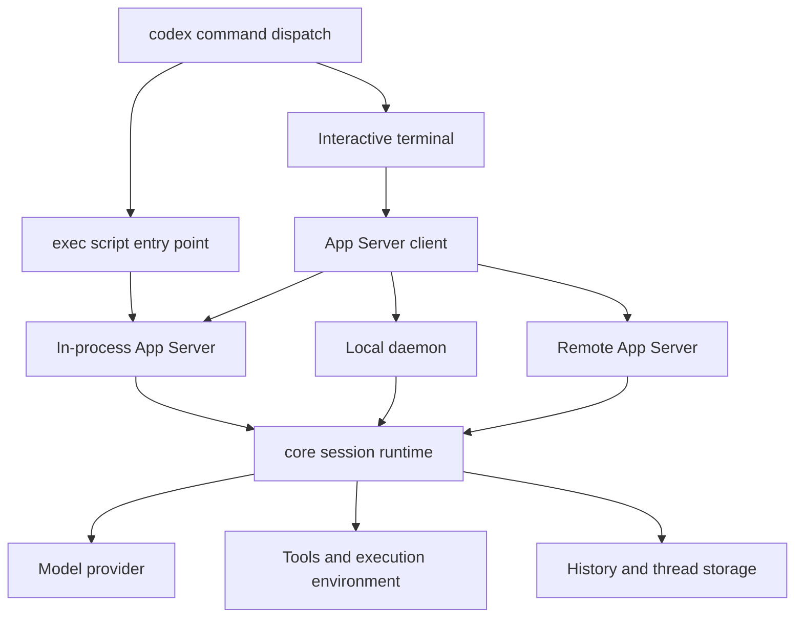

The three service paths are alternative deployment locations; they need not all exist at once. The remote model also remains outside local core. Public client code shows how Codex constructs requests, interprets events, and constrains actions. It cannot explain why the server-side model chose a particular action. Keeping that evidence boundary in view prevents a client branch from becoming an unsupported promise about model capabilities.

<a id="ch01-architecture--read-crates-by-responsibility"></a>

## Read crates by responsibility

The Rust workspace contains many crates. A crate is a compilation and dependency unit, so its name does not necessarily identify a product feature or an independent process. On a first reading, ask what each layer accepts, what state it owns, and what it passes onward.

`cli` selects the operating mode. `tui` and `exec` determine how input and output are used. `app-server` translates external requests into operations on core objects. `core` handles session lifecycles, turn scheduling, model steps, and tool feedback. `protocol` and `app-server-protocol` define the relevant internal messages and external interface types. Model transport continues into client and API code. Actions pass through tool routing, execution environments, policy, and sandboxes; history crosses a persistence boundary. Responsibilities can span directories, so this is a guide to ownership rather than a one-directory-per-feature rule.

A small constraint makes the separation concrete: the top of the `core` crate forbids library code from printing directly to standard output or standard error. User-visible information should go through the interface or tracing abstractions. That dependency rule keeps the event separate from its presentation. A terminal can render a tool result, while a programmatic consumer can inspect the same result without making execution code aware of terminal layout. The [core output rule](https://github.com/openai/codex/blob/e4568a3538c9cab6627d64ff8cdfc7d98b79b7db/codex-rs/core/src/lib.rs#L1-L6) enforces this separation.

These layers add work for a debugger. A single user message crosses several types and adapters, and protocol request IDs, core submission IDs, and model response IDs must be distinguished. In return, each layer can define its own completion condition. The interface does not have to infer whether finishing a model stream also finishes the repair task.

<a id="ch01-architecture--four-lifetimes-within-one-task"></a>

## Four lifetimes within one task

Four lifetimes help organize the core. A thread is an identifiable, discoverable conversation unit; it is distinct from an operating-system thread. `ThreadManager` creates threads and keeps their live instances in memory. Callers receive a `CodexThread` handle containing the session object, communication endpoints, startup metadata, and an optional rollout path. The definitions of [ThreadManager](https://github.com/openai/codex/blob/e4568a3538c9cab6627d64ff8cdfc7d98b79b7db/codex-rs/core/src/thread_manager.rs#L251-L255) and [CodexThread](https://github.com/openai/codex/blob/e4568a3538c9cab6627d64ff8cdfc7d98b79b7db/codex-rs/core/src/codex_thread.rs#L208-L219) establish management and access boundaries.

`Session` is the live runtime for a thread. It holds state, services, the input queue, and the active turn. A turn is an accepted work lifecycle, from processing input until normal completion or abort. One turn can make many model requests. A model step captures the environment, model settings, and capabilities for one sampling request. Locating the pagination bug, reading a file through a tool, and asking the model what to do with the result may all belong to the same turn.

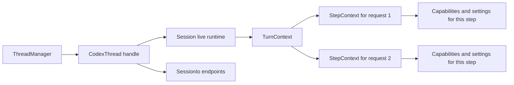

The arrows express management and capture relationships, not exclusively direct struct ownership. `StepContext`, in particular, captures a settings version, environment, MCP binding, final tool router, and the AGENTS.md files seen by that request. This binds the tools visible to the model to the tools used to execute its calls at the request boundary. Some authorization still comes from the parent turn's grant store. A captured snapshot does not freeze every related object forever, as the [StepContext fields](https://github.com/openai/codex/blob/e4568a3538c9cab6627d64ff8cdfc7d98b79b7db/codex-rs/core/src/session/step_context.rs#L24-L73) make explicit.

Separating state by lifetime limits how far a change can spread. Thread preferences can affect future turns. The current turn keeps its identity and output constraints. An issued model request has a record of the tools and environment it used. The cost appears when settings change: the implementation must say which work is affected immediately. Updating one global variable cannot supply that contract. [Chapter 3](#ch03-session) follows this question in detail.

<a id="ch01-architecture--follow-the-repair-request"></a>

## Follow the repair request

The interface or script first collects the repair request as structured user content. The external service interface packages the input, thread settings, and startup options into a `TurnInputRequest`, then calls `start_or_steer_turn`. Core decides whether it can accept the request and which turn should receive it before contacting the model. The [App Server mapping](https://github.com/openai/codex/blob/e4568a3538c9cab6627d64ff8cdfc7d98b79b7db/codex-rs/app-server/src/request_processors/turn_processor.rs#L661-L679) is the handoff from an interface request to the agent lifecycle.

`SessionIo` gives communication a defined shape: a submission sender, an event receiver, a status observation endpoint, and a shared completion future. Startup creates a bounded submission queue and an unbounded event queue, then starts the background `submission_loop`. That loop dispatches queued operations by type. User input, interrupts, approval replies, settings updates, and shutdown have different handlers. The queue orders dispatch of core operations; model requests and tool work need not execute synchronously inside that loop. The [endpoints and background loop](https://github.com/openai/codex/blob/e4568a3538c9cab6627d64ff8cdfc7d98b79b7db/codex-rs/core/src/session/mod.rs#L420-L434) are the starting point for understanding concurrency later.

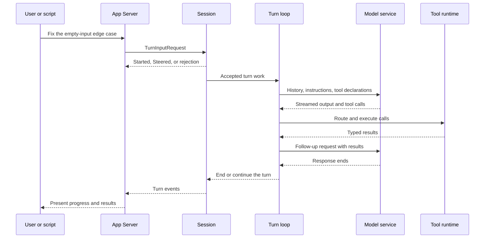

The first receipt confirms a routing decision. The source contract for `Started` and `Steered` says they do not wait for user prompt hooks, in-memory context updates, rollout persistence, or model sampling. Once a client receives Started, it can report that the work was accepted. It cannot report that the input is safely on disk or that the model has already seen it. The [receipt contract](https://github.com/openai/codex/blob/e4568a3538c9cab6627d64ff8cdfc7d98b79b7db/codex-rs/protocol/src/turn_input.rs#L238-L260) separates these confirmation points.

This teaching pseudocode retains those boundaries. It is not a callable API:

```text
# Teaching pseudocode: from input to a turn
request = collect_user_content_and_settings()
decision = core_accept_and_route(request)
display_receipt(decision)
if decision is rejected: return
for each event:
    update_current_turn_display(event)
    if event terminates the turn: stop_waiting
```

Once the turn starts, the runtime shapes the current history into model input, captures the model step, and issues a streaming request. The model may return text or tool calls. Tool results enter the context and become input to the next request. Continuation depends on more than the presence of tool calls: the runtime also considers pending input, budgets, and stop hooks. In `run_turn`, `needs_follow_up` combines the model's request for further work with the existence of pending input. The [continuation check](https://github.com/openai/codex/blob/e4568a3538c9cab6627d64ff8cdfc7d98b79b7db/codex-rs/core/src/session/turn.rs#L560-L611) explains why a finished model response can leave the turn running.

This is how the model participates in the loop. It proposes the next action; the runtime determines how to encode it, whether it may execute, how its result enters history, and when work may stop. [Chapter 8](#ch08-execution) follows actual file changes. [Chapter 9](#ch09-safety) covers approvals and sandboxes, whose enforcement requires runtime mechanisms beyond instructions in a prompt.

<a id="ch01-architecture--three-message-paths"></a>

## Three message paths

The end-to-end diagram carries several kinds of message. Operations from a consumer to the runtime include user input, approval replies, and interrupts. Requests and stream events between runtime and model include model input, tool declarations, output items, text deltas, call arguments, and usage. Events from runtime to consumer report turn starts, tool progress, warnings, errors, and termination. There are more subprotocols in the implementation, but distinguishing these three paths prevents many reading mistakes.

"Keep the function signature" travels on the first path. The model's "I'll find its callers first" may arrive as text deltas on the second. The third path and its adapters organize what the interface displays and how it reports current work. A model sentence that sounds final cannot replace a core turn-termination event. Conversely, the interface can show progress while text is still arriving.

The model stream types preserve these distinctions. `ResponseEvent` includes `OutputTextDelta`, `OutputItemDone`, and `Completed`. Text deltas support incremental display. A completed output item supplies structure that the runtime can process. Response completion carries usage and an optional `end_turn`. The [ResponseEvent definition](https://github.com/openai/codex/blob/e4568a3538c9cab6627d64ff8cdfc7d98b79b7db/codex-rs/codex-api/src/common.rs#L81-L132) lets consumers handle presentation, execution, and control separately.

These boundaries suggest concrete debugging questions. If the terminal shows no text, did the model stream contain deltas, or did the interface fail to project deltas it received? If no patch appeared, was there a complete call item, did routing succeed, or did a permissions boundary block execution? If the response ended but the interface remains busy, is there pending input or follow-up tool work? Each question identifies an owner and an observable event.

Configuration and instructions also have different effects. AGENTS.md can tell the model to keep the public interface stable. Runtime configuration selects the model, environment, permissions, and other executable settings. Calling both "context" hides where an operation was refused. Even when project trust permits a project configuration layer to take effect, sensitive keys are still filtered. A project instruction cannot replace that filter. The [project configuration restrictions](https://github.com/openai/codex/blob/e4568a3538c9cab6627d64ff8cdfc7d98b79b7db/codex-rs/config/src/loader/mod.rs#L85-L102) lead into the next chapter.

<a id="ch01-architecture--failure-exposes-ownership"></a>

## Failure exposes ownership

While the model reads the pagination function, you add "Keep the function signature." This input need not create a second turn. `StartOrSteer` can add it to an active ordinary turn. Explicit steering can also require a target turn ID and return a typed rejection when that ID does not match. This prevents a delayed interface action from silently reaching the next piece of work.

An interrupt introduces another boundary. The runtime must cancel the active task and release work waiting for approval, user input, or a tool result. Stopping an animation would leave those resources active. The source also specifies an ordering: let the task observe cancellation before clearing pending input and waiters. Otherwise, the disappearance of an approval sender could first become a denial visible to the model. The [cancellation order](https://github.com/openai/codex/blob/e4568a3538c9cab6627d64ff8cdfc7d98b79b7db/codex-rs/core/src/tasks/mod.rs#L563-L590) returns in the concurrency chapter.

Failure can occur before a thread finishes starting. Startup may already own a log writer while extension initialization is still blocked, and the caller may then drop the startup future. `SessionStartupGuard` retains cleanup responsibility. Depending on whether control has reached the session loop, it either requests normal shutdown or cleans up partially initialized persistence resources. Without that path, a later resume could encounter resources left occupied by the failed startup. The [startup cleanup branch](https://github.com/openai/codex/blob/e4568a3538c9cab6627d64ff8cdfc7d98b79b7db/codex-rs/core/src/session/startup.rs#L65-L105) gives incomplete initialization its own lifecycle.

```text
# Teaching pseudocode: each stage confirms its own fact
acceptance_receipt != input_persisted
model_response_complete != turn_complete
turn_interrupted != session_closed
if initialization is partial:
    clean_up_according_to_current_resource_ownership()
    retain_lifecycle_responsibility_until_cleanup_handoff_finishes()
```

After reading a successful path, look for cancellation, rejection, and shutdown. Inspect the payload of any event whose name sounds like success. In this snapshot, `TurnComplete` can carry a terminal error, while `TurnAborted` gives an explicit abort reason. A client that treats an enum name alone as task success discards facts already supplied by the runtime.

<a id="ch01-architecture--tests-feature-conditions-and-compatibility"></a>

## Tests, feature conditions, and compatibility

The following chapters expand this request path: how startup assembles trusted configuration and instructions, how a turn owns state, and how model I/O, tools, execution, and context fit together. Later chapters return to interfaces and verification. At each boundary, ask what it protects.

Tests can clarify those contracts even when they are only being read. A core concurrent-input test uses a blockable fake SSE service to arrange two simultaneous submissions. It expects one Started receipt and one Steered receipt sharing the same turn ID, then inspects the follow-up request body for both messages. This connects routing and timing to the actual model input. Here we examine the test design and assertions without running the test or treating it as a production concurrency benchmark.

Also distinguish code that exists from code that is enabled. A tool handler in the repository does not guarantee that the current model request declares that tool. A compiled feature branch need not be enabled in session configuration. Remote-connection code in the TUI does not imply that every terminal launch contacts a remote App Server. Platform, provider, and experimental conditions belong beside the claims they qualify.

Compatibility names require similar care. Core still exports the deprecated `ConversationManager`, `NewConversation`, and `CodexConversation` aliases, mapped to the newer Thread terminology. Searching them can help locate callers. They do not establish another parallel "Conversation runtime." A fixed commit lets us inspect one coherent set of code relationships instead of combining names from different periods.

As you read, keep a timeline of who acquired a resource, accepted work, sent a request, observed a result, and finally released responsibility. That timeline makes a large workspace easier to investigate: each transition has an owner and a contract to check.

<a id="ch01-architecture--reading-the-source"></a>

## Reading the source

- [cli/main.rs: main and subcommand dispatch](https://github.com/openai/codex/blob/e4568a3538c9cab6627d64ff8cdfc7d98b79b7db/codex-rs/cli/src/main.rs#L1035-L1170). Identify the entry point in use.
- [tui/lib.rs: AppServerTarget and connection fallback](https://github.com/openai/codex/blob/e4568a3538c9cab6627d64ff8cdfc7d98b79b7db/codex-rs/tui/src/lib.rs#L577-L635). Check the conditions for in-process, local, and remote paths.
- [exec/lib.rs: in-process client startup](https://github.com/openai/codex/blob/e4568a3538c9cab6627d64ff8cdfc7d98b79b7db/codex-rs/exec/src/lib.rs#L1021-L1026). Follow the service boundary used by the noninteractive entry point.
- [codex_thread.rs: CodexThread](https://github.com/openai/codex/blob/e4568a3538c9cab6627d64ff8cdfc7d98b79b7db/codex-rs/core/src/codex_thread.rs#L208-L219). Separate the public handle from the internal runtime.
- [session/mod.rs: SessionIo](https://github.com/openai/codex/blob/e4568a3538c9cab6627d64ff8cdfc7d98b79b7db/codex-rs/core/src/session/mod.rs#L420-L434). Inspect input, output, status, and completion endpoints.
- [protocol/turn_input.rs: TurnInputSubmission](https://github.com/openai/codex/blob/e4568a3538c9cab6627d64ff8cdfc7d98b79b7db/codex-rs/protocol/src/turn_input.rs#L238-L319). Read each receipt's guarantees and rejection reasons.
- [session/turn.rs: continuation checks](https://github.com/openai/codex/blob/e4568a3538c9cab6627d64ff8cdfc7d98b79b7db/codex-rs/core/src/session/turn.rs#L560-L611). Distinguish a model response from a complete turn.
- [turn_input_submission.rs: concurrent-input test](https://github.com/openai/codex/blob/e4568a3538c9cab6627d64ff8cdfc7d98b79b7db/codex-rs/core/tests/suite/turn_input_submission.rs#L1122-L1227). Follow the fake stream through to assertions on the request body.

<a id="ch01-architecture--design-lessons"></a>

## Design lessons

1. Name state by its lifetime. When preferences, active tasks, and individual requests share one object, consider separate thread, turn, and request snapshots. Updates then need explicit scope; a small one-shot script may not need every layer.
2. Model acceptance and completion separately. An API that returns before work ends needs a routing receipt followed by a termination event. Clients must handle both, and acceptance must not be mistaken for proof of persistence.
3. Let interfaces consume typed events. A shared runtime can serve a terminal and a programmatic API through adapters. This requires event compatibility and a strategy for slow consumers.
4. Assign cleanup ownership during initialization. Startup that acquires writers, connections, and background tasks needs an owner for every partial state. The longer failure path prevents resources from being forgotten when startup never succeeds.
5. Check lifecycle contracts with controlled timelines. Gates and fake events can force concurrent-input and interruption order, then expose the final request or stored result for assertions. That infrastructure needs maintenance; text snapshots alone cannot establish lifecycle behavior.

---

<a id="ch02-bootstrap"></a>

<a id="ch02-bootstrap--chapter-2-startup-configuration-and-trust"></a>

# Chapter 2: Startup, configuration, and trust

Before a request can reach the session runtime, Codex must know where it is working, which model to use, which environments it can access, and which repository instructions to show the model. In the pagination repair, a wrong working directory could select the wrong AGENTS.md. A different configuration source could change the model or permissions. Both decisions precede the first model request.

Startup interprets files, command-line arguments, administrator requirements, authentication state, and user choices as executable configuration. It also needs enough provenance to explain why a value took effect. Codex retains configuration layers, origins, versions, disabled reasons, and independent constraints. These explain a common troubleshooting problem: editing a configuration file does not necessarily change the running behavior.

For this teaching scenario, assume the working directory is `packages/pager` and the task is still to fix the empty-input case. The path illustrates discovery rules; it does not refer to a project created or executed for this book. Most of this chapter follows local configuration assembly. Remote workspaces, enterprise configuration, and platform-specific paths have additional conditions.

<a id="ch02-bootstrap--the-process-identifies-its-role"></a>

## The process identifies its role

The CLI's `main` first enters `arg0_dispatch_or_else`. This layer inspects the executable name and special arguments. The same executable can be invoked as a Linux sandbox helper, a patch tool, or another execution helper. A matching identity selects that helper's entry point; an ordinary invocation creates a runtime and proceeds to the CLI. Linux, Unix, and Windows branches retain their platform conditions. The [identity dispatcher](https://github.com/openai/codex/blob/e4568a3538c9cab6627d64ff8cdfc7d98b79b7db/codex-rs/arg0/src/lib.rs#L61-L88) explains why the executable path is itself part of the execution environment.

The ordinary path builds a Tokio runtime on an operating-system thread named `codex-main`, with a stack budget for top-level asynchronous work. This OS thread is distinct from the conversation threads discussed elsewhere in the book. `Arg0DispatchPaths` carries the executable and helper paths onward. A guard keeps the temporary alias directory alive until the entry-point future finishes, so later execution does not reference a path already removed. [Runtime startup and path retention](https://github.com/openai/codex/blob/e4568a3538c9cab6627d64ff8cdfc7d98b79b7db/codex-rs/arg0/src/lib.rs#L194-L248) document these lifetimes.

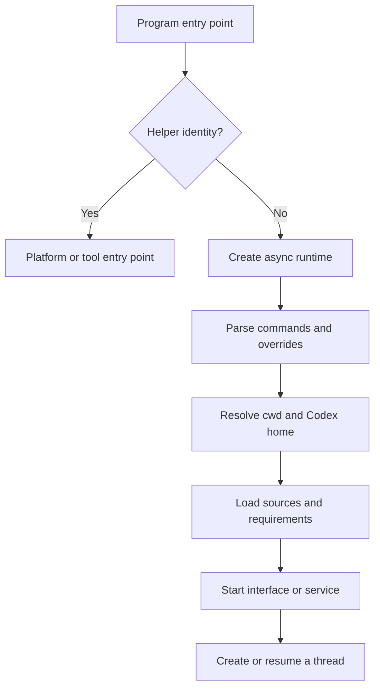

Within `cli_main`, feature enable and disable arguments become configuration overrides passed to the selected subcommand. Converting startup flags early into a representation downstream code already understands avoids implementing feature precedence at every layer. Other inputs remain typed: the core builder also takes harness overrides and loader options. Command-line input is therefore broader than a collection of TOML strings.

<a id="ch02-bootstrap--keep-provenance-with-configuration-values"></a>

## Keep provenance with configuration values

`ConfigBuilder::build_inner` resolves Codex home, makes the explicit or fallback cwd absolute, loads the layer stack, and constructs `Config`. The cwd already affects project discovery here. It is not deferred until a tool reads the process working directory. The [builder's assembly order](https://github.com/openai/codex/blob/e4568a3538c9cab6627d64ff8cdfc7d98b79b7db/codex-rs/core/src/config/mod.rs#L1547-L1595) makes the working directory an input to configuration interpretation.

`ConfigLayerSource::precedence` defines ordinary layer priority. The following order runs from lowest to highest. Whether a source exists depends on the platform, installation, and current options.

| Priority | Configuration source | Conditions |
| --- | --- | --- |
| Lowest | Bundled defaults | Installation bundles can supply them; embedded defaults also exist |
| Higher | MDM and system configuration | The MDM branch requires the relevant platform support |
| Higher | Enterprise cloud configuration | Requires a corresponding bundle source |
| Higher | User configuration and selected user profile | The profile layer has priority over base user settings |
| Higher | Project configuration | Subject to trust checks and sensitive-key filtering |
| Higher | SessionFlags | Current-session overrides from the CLI, UI, and similar callers |
| Highest | Legacy managed file and legacy managed MDM | Compatibility layers for older managed formats still have higher priority |

In this snapshot, legacy managed layers can override SessionFlags, so command-line input does not universally win. Administrator requirements also have an independent channel. Requirements can constrain allowed selections and participate in provider definitions, beyond overwriting ordinary values. After `effective_config` merges enabled layers, it may apply required provider definitions. Final configuration construction continues to apply selection requirements and other constraints. Read the [precedence definition](https://github.com/openai/codex/blob/e4568a3538c9cab6627d64ff8cdfc7d98b79b7db/codex-rs/config/src/config_layer_source.rs#L30-L50) with the [effective configuration calculation](https://github.com/openai/codex/blob/e4568a3538c9cab6627d64ff8cdfc7d98b79b7db/codex-rs/config/src/state.rs#L544-L568).

Each `ConfigLayerEntry` retains its source, content version, and optional `disabled_reason`. Effective configuration and per-key origins use enabled layers. Disabled layers remain available to explain why a file was discovered but not used. The per-key origin map excludes the separate requirements channel, so it cannot explain every policy decision on its own. Provenance may not help the model write a patch, but it helps a person explain the system's behavior.

```text
# Teaching pseudocode: carry values and provenance together
layers = read_applicable_configuration_sources()
for each project_layer:
    record_trust_decision_and_disabled_reason()
    remove_keys_the_project_may_not_supply()
effective = merge_enabled_layers_by_precedence(layers)
config = apply_typed_overrides_and_independent_requirements(effective)
return config, layer_provenance(layers)
```

Suppose the user layer selects one model and a trusted project layer selects another. Higher overrides and requirements still determine the final selection. If the project layer is disabled, its model value never participates in merging. Troubleshooting should trace discovery, layer enablement, key filtering, later overrides, and requirements in that order. Repeatedly editing one value may never reach the decision that controls it.

Merging also has field-specific semantics. The general TOML branch recursively merges tables and overwrites other values. Some features accept either a boolean or a table of parameters; their merge code preserves `enabled` semantics across those representations. Network-domain and shell-filter paths have normalization rules of their own. Precedence establishes which layer has authority, while each field's representation and merge rules establish the resulting value. The [merge implementation](https://github.com/openai/codex/blob/e4568a3538c9cab6627d64ff8cdfc7d98b79b7db/codex-rs/config/src/merge.rs#L77-L150) collects these exceptions at explicit paths.

This matters when configuration evolves. If an old feature was a boolean and a newer version adds parameters, replacing the entire value could make a change to one parameter erase its enablement state. Field-specific rules reconcile those forms. They also make the configuration system a domain model with its own behavior. An editor or administration interface must follow those semantics; structural similarity to JSON is insufficient reason to merge values independently.

Selected values and permitted values are separate. With no explicit approval policy, one source branch chooses a default and checks it against requirements. If the default is disallowed, it records a warning and uses the requirements-provided default. That fallback does not establish that every invalid explicit value is silently repaired. The retired public setting `approval_policy="untrusted"`, for example, is explicitly rejected. An internal compatibility enum does not make it a supported configuration recommendation. The [default-and-requirements branch](https://github.com/openai/codex/blob/e4568a3538c9cab6627d64ff8cdfc7d98b79b7db/codex-rs/core/src/config/mod.rs#L3866-L3906) separates these contracts.

<a id="ch02-bootstrap--a-project-cannot-establish-its-own-trust"></a>

## A project cannot establish its own trust

Discovery has a deliberate order. Applicable non-project sources determine project roots and trust before project layers load. Managed sources participate at their applicable precedence during this stage. Repository content therefore cannot first rewrite the root markers or trust basis and then use that arrangement to authorize itself. The [discovery order](https://github.com/openai/codex/blob/e4568a3538c9cab6627d64ff8cdfc7d98b79b7db/codex-rs/config/src/loader/mod.rs#L350-L420) explains more than a list of possible file locations would.

The loader collects ancestors from cwd toward the project root, reverses them, and checks `.codex` directories from root toward cwd. Trust lookup considers normalized keys for locations including the current directory, project root, and repository root. An explicit Trusted decision passes the relevant project-layer check. Both explicit Untrusted and an unknown decision produce disabled reasons, with different explanations. "No decision yet" and "explicitly refused" have distinct meanings.

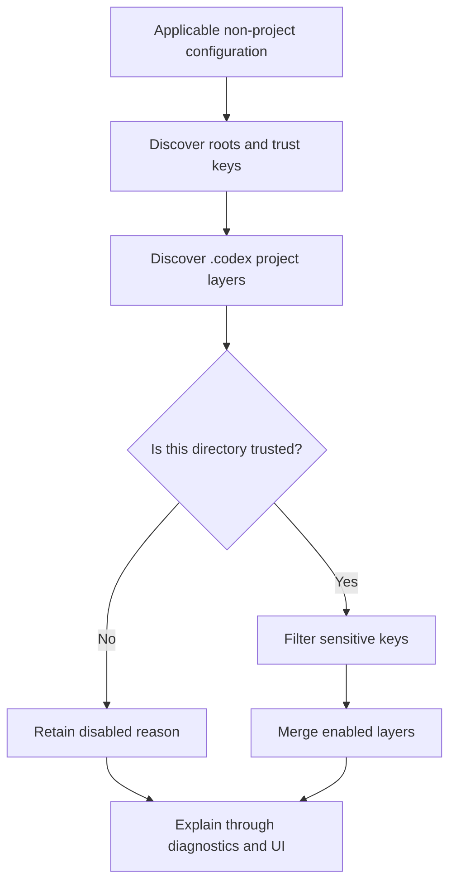

A trusted source still passes through a second filter. The project denylist covers model providers, related base URLs, notify, profiles, otel, and other configuration. Source comments explain that a project file should not decide where user credentials are sent or select arbitrary local commands. Filtering also handles nested fields. Environment-variable rules associated with the credential broker have additional enablement conditions; they do not imply a universal ban on project environment variables. The [sensitive-key entry point](https://github.com/openai/codex/blob/e4568a3538c9cab6627d64ff8cdfc7d98b79b7db/codex-rs/config/src/loader/mod.rs#L85-L102) and `sanitize_project_config` define the actual restriction.

Trust answers whether a source may supply the relevant project capabilities. Key filtering answers which controls that source may exercise even after trust is granted. The allocation of authority suggests a separation between repository work conventions and credential routing. That is an inference from the enforced boundary, not a claim to know every design motive behind it.

Trust also affects parse failures. A trusted project layer with invalid TOML returns an error. An untrusted or undecided layer can remain as an empty disabled layer, so an inactive malformed file does not prevent startup. Unknown-field behavior has another condition: strict checking of CLI overrides runs when `strict_config` is true. Its error behavior must not be generalized to every default load. The [parse branches](https://github.com/openai/codex/blob/e4568a3538c9cab6627d64ff8cdfc7d98b79b7db/codex-rs/config/src/loader/mod.rs#L1731-L1762) and [strict-mode condition](https://github.com/openai/codex/blob/e4568a3538c9cab6627d64ff8cdfc7d98b79b7db/codex-rs/config/src/loader/mod.rs#L253-L263) support separate claims.

<a id="ch02-bootstrap--login-and-trust-can-require-reassembly"></a>

## Login and trust can require reassembly

Startup can revisit configuration. The interactive interface may first obtain initial configuration and a service connection, then handle login, choose a target thread, and establish trust for its actual destination. Folder consent occurs after the picker has chosen that destination. This avoids obtaining consent for one directory and beginning work in another.

After local login, the TUI refreshes the cloud configuration bundle where applicable and rebuilds configuration, so enterprise policy available only after login can participate. A persisted directory-trust change also triggers reloading. Remote workspaces have their own services and authentication policy; changing a local file does not establish that the remote execution environment changed. A narrower branch handles provider changes: when a reload selects a different provider and the current service is Embedded, the code shuts down the old service and starts one from the new configuration. [Post-login rebuilding](https://github.com/openai/codex/blob/e4568a3538c9cab6627d64ff8cdfc7d98b79b7db/codex-rs/tui/src/lib.rs#L1418-L1448) and [destination trust handling](https://github.com/openai/codex/blob/e4568a3538c9cab6627d64ff8cdfc7d98b79b7db/codex-rs/tui/src/lib.rs#L1928-L1984) show this feedback into startup.

Authentication itself lives in service objects such as `AuthManager`. It holds cached state, storage mode, administrator restrictions, external authentication providers, and refresh synchronization. It can notify consumers when authentication or the owner revision changes. `auth_cached()` reads the cache only. `auth()` may resolve external authentication again or perform a protected refresh for credentials requiring proactive renewal. These contracts extend beyond reading an API-key string. See the [authentication state and read methods](https://github.com/openai/codex/blob/e4568a3538c9cab6627d64ff8cdfc7d98b79b7db/codex-rs/login/src/auth/manager.rs#L2366-L2419).

Authentication ownership also affects connection reuse. When the model client starts a new turn session, it compares the auth owner generation. A changed owner clears the old WebSocket cache, protecting the relationship between account identity and connection routing. Token expiry alone would not describe this rule. Providers have different authentication paths; later chapters examine recovery. At startup, keep three facts separate: configuration was assembled, authentication exists, and a particular model request succeeded.

<a id="ch02-bootstrap--agentsmd-follows-the-directory-chain"></a>

## AGENTS.md follows the directory chain

At `packages/pager`, a repository-root AGENTS.md can supply repository conventions, while files in child directories add package-specific requirements. Core follows the directory chain from project root to cwd. Initialization does not recursively read all descendants. If it finds no root marker, it considers cwd alone. An empty root-marker list also disables parent traversal. `.git` is the default marker, subject to applicable configuration. The [discovery rules](https://github.com/openai/codex/blob/e4568a3538c9cab6627d64ff8cdfc7d98b79b7db/codex-rs/core/src/agents_md.rs#L1-L18) define this scope.

Within each directory, only the first existing candidate is selected: `AGENTS.override.md`, then `AGENTS.md`, then configured fallback filenames. An override does not concatenate with the ordinary file in the same directory. Selected files from parent and child directories can still contribute in order. A fallback must be a filename; candidates with unsuitable path syntax are skipped according to the execution environment's path conventions. The [candidate-selection logic](https://github.com/openai/codex/blob/e4568a3538c9cab6627d64ff8cdfc7d98b79b7db/codex-rs/core/src/agents_md.rs#L242-L295) prevents a configurable name from becoming an arbitrary path probe.

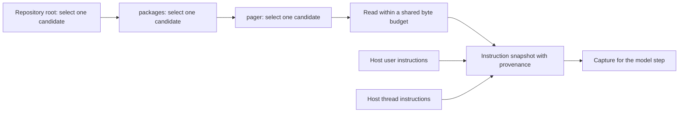

`project_doc_max_bytes` supplies a shared remaining budget consumed in environment and file order. Oversized files are truncated. Text conversion uses lossy UTF-8 decoding, and the result retains its source file and environment identity. An explicitly Untrusted project skips project documents, while host-provided user instructions can remain. This document check is implemented separately from the explicit Trusted requirement for project configuration, so the two trust conditions should not be collapsed into one rule. The [document reader and budget](https://github.com/openai/codex/blob/e4568a3538c9cab6627d64ff8cdfc7d98b79b7db/codex-rs/core/src/agents_md.rs#L56-L178) show the difference.

The budget creates a content tradeoff. Root documents read first can consume space that would otherwise hold instructions closer to `pager`. A truncation boundary need not end at a paragraph. Putting every piece of knowledge in the root file changes what the model can actually see. Short constraints and useful discovery pointers make better use of that space. [Chapter 13](#ch13-extensions) covers on-demand skill and extension loading.

<a id="ch02-bootstrap--cache-invalidation-follows-access-boundaries"></a>

## Cache invalidation follows access boundaries

Loading instructions at startup does not mean loading them only once per process. `AgentsMdManager::refresh` resolves a consistent snapshot at startup or a request boundary. Host providers own their fetching and caching. Repository-instruction caching uses changes in environment selection and project trust level to decide whether to rediscover files. This also does not imply a full disk rescan for every model request. The [refresh conditions](https://github.com/openai/codex/blob/e4568a3538c9cab6627d64ff8cdfc7d98b79b7db/codex-rs/core/src/agents_md_manager.rs#L64-L148) define the actual behavior.

Consider a permission reduction. After an environment-selection change, old instructions may originate somewhere the new environment can no longer read. When rediscovery is needed, the manager clears the repository cache first. If discovery fails or is cancelled, stale content must not remain exposed. Keeping the old value on error is often useful for an ordinary performance cache; after an access-boundary change it can violate the new restriction.

```text
# Teaching pseudocode: refreshing instructions
if environment_selection_changed or project_trust_changed:
    remove_old_repository_cache_immediately()
load_host_user_and_thread_instructions()
validate_new_instructions()
if repository_discovery_needed:
    read_with_current_environment_and_permissions()
publish_only_validated_results_as_the_new_snapshot()
return_warnings_to_the_caller()
```

File-read failures also depend on context. Without a restricted sandbox read context, loading errors can be logged and processing can continue. Errors on the restricted read path propagate upward. These branches have different availability and access semantics. A missing document, exhausted byte budget, and inability to confirm a document under current permissions are distinct outcomes for the repair task.

<a id="ch02-bootstrap--read-failures-as-assembly-contracts"></a>

## Read failures as assembly contracts

Suppose a newly cloned repository contains an incomplete `.codex/config.toml`. Parsing every file and rejecting every error would let an unauthorized source prevent startup. Ignoring every error would conceal a mistake in configuration already trusted to take effect. Codex distinguishes the two: an active source's error needs repair; disabled content should not gain control before activation.

The test `invalid_project_config_ignored_when_untrusted_or_unknown` checks more than a successful return. It creates both Untrusted and unknown-trust cases, writes broken project TOML, and checks that the project layer remains present with a `disabled_reason` and empty content. It also verifies that the effective value comes from the user layer. Those assertions connect availability, provenance, and the assembled result. We read this [test](https://github.com/openai/codex/blob/e4568a3538c9cab6627d64ff8cdfc7d98b79b7db/codex-rs/core/src/config/config_loader_tests.rs#L4258-L4336) without executing it.

Obtaining a `Config` confirms that configuration was assembled successfully. The service connection may still fail, thread storage may be unavailable, or extension startup may be cancelled. At that point, useful feedback identifies the startup phase that could not be established. It should not ask the model to guess a repository failure. The startup guard introduced in Chapter 1 retains cleanup responsibility for resources that have not been fully handed off.


<a id="ch02-bootstrap--reading-the-source"></a>

## Reading the source

- [arg0/lib.rs: identity dispatch and runtime](https://github.com/openai/codex/blob/e4568a3538c9cab6627d64ff8cdfc7d98b79b7db/codex-rs/arg0/src/lib.rs#L194-L248). Follow why helper paths must outlive the entry-point call.
- [core/config/mod.rs: ConfigBuilder](https://github.com/openai/codex/blob/e4568a3538c9cab6627d64ff8cdfc7d98b79b7db/codex-rs/core/src/config/mod.rs#L1547-L1595). Trace cwd, layers, and final `Config` assembly.
- [config_layer_source.rs: source precedence](https://github.com/openai/codex/blob/e4568a3538c9cab6627d64ff8cdfc7d98b79b7db/codex-rs/config/src/config_layer_source.rs#L6-L50). Compare SessionFlags with legacy managed layers.
- [loader/mod.rs: configuration before project discovery](https://github.com/openai/codex/blob/e4568a3538c9cab6627d64ff8cdfc7d98b79b7db/codex-rs/config/src/loader/mod.rs#L350-L420). Follow why root and trust decisions precede project loading.
- [loader/mod.rs: project parsing and filtering](https://github.com/openai/codex/blob/e4568a3538c9cab6627d64ff8cdfc7d98b79b7db/codex-rs/config/src/loader/mod.rs#L1717-L1779). Compare trusted and disabled failure paths.
- [state.rs: effective configuration and origins](https://github.com/openai/codex/blob/e4568a3538c9cab6627d64ff8cdfc7d98b79b7db/codex-rs/config/src/state.rs#L544-L568). Requirements provenance is recorded separately.
- [auth/manager.rs: authentication reads](https://github.com/openai/codex/blob/e4568a3538c9cab6627d64ff8cdfc7d98b79b7db/codex-rs/login/src/auth/manager.rs#L2366-L2419). Distinguish cache access, refresh, and account-bound network configuration.
- [agents_md.rs: document loading](https://github.com/openai/codex/blob/e4568a3538c9cab6627d64ff8cdfc7d98b79b7db/codex-rs/core/src/agents_md.rs#L56-L178). Inspect trust, byte budgets, and read failures.
- [agents_md_manager.rs: snapshot refresh](https://github.com/openai/codex/blob/e4568a3538c9cab6627d64ff8cdfc7d98b79b7db/codex-rs/core/src/agents_md_manager.rs#L64-L148). Check the order of invalidation and publication.
- [agents_md test: overrides and parent-child order](https://github.com/openai/codex/blob/e4568a3538c9cab6627d64ff8cdfc7d98b79b7db/codex-rs/core/tests/suite/agents_md.rs#L318-L353). Continue to the directory-chain assertions after line 449 in the same file. These are source-reading pointers, not reported test results.

<a id="ch02-bootstrap--design-lessons"></a>

## Design lessons

1. Retain configuration provenance. When layered settings make changes hard to explain, store field origins, layer versions, and disabled reasons. The diagnostic interface must evolve with the actual resolver.
2. Separate source trust from source authority. Decide whether a repository source may participate, then filter which keys it may control. This requires maintained filtering rules beyond a trusted boolean.
3. Resolve cwd before discovery. Directory-dependent configuration and instructions need an absolute scope. Changing that scope requires recalculation and invalidation of affected caches.
4. Allow startup to rebuild its configuration. Login, destination selection, and trust can change applicable policy. Rebuilding configuration and services requires a complete resource handoff and cleanup path.
5. Give project instructions a scope and budget. Define directory order, candidate priority, and a total size limit. Since content can be truncated, the most necessary rules should be brief and clear.

---

<a id="ch03-session"></a>

<a id="ch03-session--chapter-3-sessions-threads-and-turns"></a>

# Chapter 3: Sessions, threads, and turns

Configuration is assembled, but the model has not yet begun repairing the pagination function. Which object will own that work? Two consecutive user messages could describe separate tasks or one task with an added constraint. An interface might disconnect while work continues. A settings change might arrive after a request has already been sent. Each case requires a precise answer about state lifetime.

Codex assigns these responsibilities to a thread, its live `Session`, a turn, and a model step. They have different completion conditions, storage, and access paths. Following those objects makes it possible to identify which work can be observed, refused, or cancelled.

This chapter follows acceptance and ownership in the empty-input repair scenario. [Chapter 4](#ch04-model-io) examines model streaming, and [Chapter 5](#ch05-agent-loop) follows how tool feedback drives further work. Here we establish the lifecycle that contains those actions.

<a id="ch03-session--thread-identity-and-live-runtime"></a>

## Thread identity and live runtime

Four objects divide the responsibilities:

| Object | Question it answers | Typical contents |
| --- | --- | --- |
| `ThreadManager` | How are threads created, found, and managed? | Live-thread registry, shared services, startup requests |
| `CodexThread` | How does a caller operate on a thread? | Session, SessionIo, startup metadata |
| `Session` | What does the live thread own? | State, services, active turn, input queue |
| `TurnContext` / `StepContext` | What does a turn or model request use? | Identity, settings, environment, capabilities, authorization relationships |

A conversation thread has a nameable, discoverable identity. It does not require a dedicated operating-system thread. `ThreadManager` maintains live threads through shared state, while `CodexThread` wraps an `Arc<Session>` and communication endpoints. Cloning the handle shares access to the same runtime; it does not copy the history or create another agent. The [handle structure](https://github.com/openai/codex/blob/e4568a3538c9cab6627d64ff8cdfc7d98b79b7db/codex-rs/core/src/codex_thread.rs#L208-L219) exposes that relationship directly.

Inside `Session`, state and services have separate homes. `SessionState` contains configuration, the context manager, usage, and session-level records. `active_turn` has its own lock, and the input queue has a dedicated abstraction. Service objects provide the model client, execution, extensions, and persistence. A source comment limits a Session to at most one running task. Model streams, tools, prewarming, and other background asynchronous work can still run concurrently. The restriction concerns ownership of the session task. The [Session fields and comments](https://github.com/openai/codex/blob/e4568a3538c9cab6627d64ff8cdfc7d98b79b7db/codex-rs/core/src/session/session.rs#L57-L100) establish its scope.

<a id="ch03-session--creating-and-reusing-a-thread"></a>

## Creating and reusing a thread

Ordinary startup calls `start_thread(StartThreadOptions)` on the manager. Options include `Config`, initial history, environments, dynamic tools, and extension-initialization data. The entry point also participates in resume and internal-session creation. The manager turns these inputs into a spawn request and assembles the history and services needed by Session. Creation, resume, and fork can therefore share lifecycle machinery while keeping their own input rules.

Warm resume illustrates the distinction. If initial history names a thread already running in memory, the manager can return its existing `CodexThread` and startup information. It rejects inconsistencies such as a different rollout path and restricts access to special internal reviewers. Cold resume has to rebuild the runtime. Thread identity, live runtime, and disk history are separate enough that resuming need not create a copy of everything. The [live-thread reuse branch](https://github.com/openai/codex/blob/e4568a3538c9cab6627d64ff8cdfc7d98b79b7db/codex-rs/core/src/thread_manager.rs#L2179-L2214) is a useful entry point; [Chapter 11](#ch11-persistence) covers storage.

Startup can still fail before handing over a usable handle. The manager transfers Session and SessionIo together and invokes the startup guard if that process fails. For a caller, a returned `NewThread` confirms completion of this startup operation. Constructing Session internally does not prove that registration and resource handoff succeeded. Configuration completion in the previous chapter was an earlier milestone.

<a id="ch03-session--communication-endpoints-have-their-own-lifetime"></a>

## Communication endpoints have their own lifetime

`SessionIo` holds the submission sender, event receiver, agent-status watch receiver, and a shared future for the background loop's completion. The source explains why these endpoints are separate from Session: when all submission senders are dropped, the loop can end, and multiple callers can observe the same shutdown through the shared completion future. [SessionIo](https://github.com/openai/codex/blob/e4568a3538c9cab6627d64ff8cdfc7d98b79b7db/codex-rs/core/src/session/mod.rs#L420-L434) gives communication capabilities a lifetime distinct from runtime state.

Startup creates a bounded submission queue with capacity 512 and an unbounded event queue. A submitter can wait for the receiver to make room. Event production has no equivalent wait for consumer capacity. The pair therefore has different backlog risks, and consumers need to keep reading events. The [channel creation](https://github.com/openai/codex/blob/e4568a3538c9cab6627d64ff8cdfc7d98b79b7db/codex-rs/core/src/session/mod.rs#L647-L648) and capacity constant define the actual backpressure boundary.

An ordinary `submit` generates a submission ID, wraps the operation in `Submission`, and queues it. Alongside `Op`, that wrapper carries trace information and parent and root turn relationships. Some internal paths also carry a guard that keeps the receiving thread resident. Metadata moves causal information and lifecycle responsibility across asynchronous boundaries. When a new turn starts, App Server exposes the corresponding submission ID as the turn ID; submissions that join existing work need not create turns. Read [Submission](https://github.com/openai/codex/blob/e4568a3538c9cab6627d64ff8cdfc7d98b79b7db/codex-rs/core/src/session/submission.rs#L1-L20) alongside the [ID convention](https://github.com/openai/codex/blob/e4568a3538c9cab6627d64ff8cdfc7d98b79b7db/codex-rs/core/src/session/mod.rs#L1186-L1192).

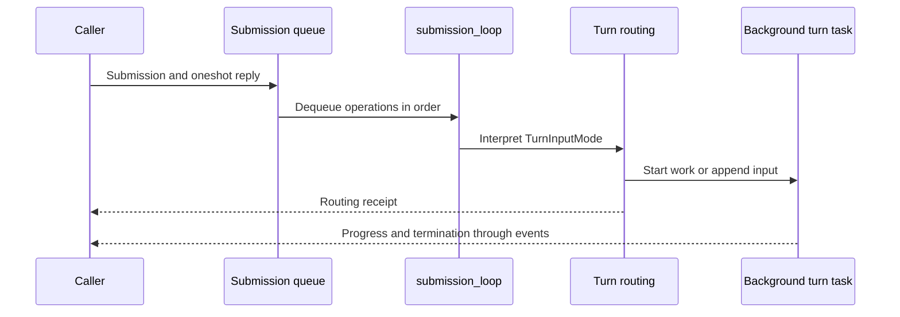

The background `submission_loop` receives and dispatches operations while also watching agent-tree shutdown and mailbox notifications. It waits for the routing handler's decision, not for the entire model turn. Otherwise, a model waiting for approval could block the very operation carrying the user's approval reply. A separate task runs the long-lived turn work; the submission loop sends control operations to the appropriate owner.

<a id="ch03-session--four-input-routing-intentions"></a>

## Four input-routing intentions

The common entry point for the repair request is `start_or_steer_turn`. It starts an ordinary turn when idle or steers an active ordinary turn that can accept input. A later "Keep the function signature" can join the repair without making the interface inspect state and choose between two APIs. Core performs the check and decision together, reducing the race between reading state and submitting work.

The other methods express narrower intentions. `start_turn_if_idle` starts only when idle and cannot automatically become a steer. `steer_turn` requires a particular active turn ID and cannot silently start new work after that target ends. `continue_turn_if_idle` accepts internal response items and requires that newer work has not replaced the preceding turn. Its content is not treated as new user authorization. The [routing methods](https://github.com/openai/codex/blob/e4568a3538c9cab6627d64ff8cdfc7d98b79b7db/codex-rs/core/src/codex_thread.rs#L412-L468) put these intentions in the interface.

Results are `Started`, `Steered`, or `NotSubmitted`. Rejections also have types: not idle, no active turn, target-ID mismatch, a task that cannot be steered, output-schema mismatch, or a server no longer accepting new turns. A client can preserve a draft, report that a target changed, or retry later according to the reason. The [result and rejection types](https://github.com/openai/codex/blob/e4568a3538c9cab6627d64ff8cdfc7d98b79b7db/codex-rs/protocol/src/turn_input.rs#L238-L319) describe both paths.

Input type matters as well. Plan mode restricts automatically started work, while actual user input can start a turn. Internal recovery has a separate entry point and authorization semantics. During server draining, new ordinary turns are generally refused, with limited exceptions for some delegated work already inside a parent task. Acceptance depends on both the input and the lifecycle it is trying to enter. [Chapter 15](#ch15-multi-agent) follows the multi-agent branches.

```text
# Teaching pseudocode: let core interpret the caller's intent
submit_by_mode(input):
    if steer_only: verify_the_target_turn_still_matches()
    if start_only_when_idle: atomically_check_and_reserve_idle_slot()
    if start_or_steer: first_try_the_active_turn()
    check_input_type_output_constraints_and_admission_policy()
    if rejected: return_reason_without_changing_state()
    if accepted: apply_settings_and_start_or_append_work()
    return_owning_turn_identity()
```

`Started` and `Steered` confirm acceptance for turn processing. They do not wait for prompt hooks, model-context updates, rollout writes, or sampling. Queue submission happens earlier still: `SessionIo::submit_turn_input` waits on a oneshot for the routing decision. Dropping that wait after enqueueing does not withdraw the submitted work. If the session loop exits before replying, the waiter receives `InternalAgentDied`. The [post-enqueue contract](https://github.com/openai/codex/blob/e4568a3538c9cab6627d64ff8cdfc7d98b79b7db/codex-rs/core/src/session/mod.rs#L1102-L1132) is part of the API's cancellation semantics.

Continuation and recovery also differ. Continuation starts a new turn from internal response items while idle, checking the expected previous turn so a late background result cannot displace newer work. Recovery resumes an interrupted ordinary turn, preserving its recorded turn ID without manufacturing another user message. Both can run the model again, but they preserve different identity and authorization evidence. The [recovery entry point](https://github.com/openai/codex/blob/e4568a3538c9cab6627d64ff8cdfc7d98b79b7db/codex-rs/core/src/codex_thread.rs#L453-L477) records the distinction.

Parent and root turn IDs add causal coordinates. They associate messages, metrics, and delegated results with the work that initiated them. They do not automatically grant a child every execution permission of its parent. If the repair delegates a caller search, its result should be traceable back to the original task, while environment, configuration, and budget inheritance still follow the child-creation rules.

<a id="ch03-session--commit-settings-with-acceptance"></a>

## Commit settings with acceptance

Suppose you steer a repair turn that has already ended and attach a setting to use another model next time. Changing the setting before checking the target would leave an unexpected configuration change after returning failure. `PreparedTurnInputSettings` first prepares and previews changes. It applies them only when input is accepted. The [prepare and apply phases](https://github.com/openai/codex/blob/e4568a3538c9cab6627d64ff8cdfc7d98b79b7db/codex-rs/core/src/session/turn_input.rs#L91-L129) establish a transaction boundary.

For a new turn, thread settings and startup options contribute to `TurnContext`. Core validates and commits configuration, then constructs the context without holding the state lock. Admission uses current and validated candidate configuration to make a quick, side-effect-free decision under the lock. This keeps invalid configuration out of live state without holding a large lock during slow resource preparation. The [context-construction path](https://github.com/openai/codex/blob/e4568a3538c9cab6627d64ff8cdfc7d98b79b7db/codex-rs/core/src/session/turn_context.rs#L1180-L1229) separates atomic commitment from assembly.

Successful steering can commit persistent thread settings, while the active turn retains its existing context. Future turns see that update. An added message does not rewrite the active turn's starting identity. An attached output schema is a compatibility requirement: it must match the schema the active turn already uses. Thread preferences, turn constraints, and input provenance therefore retain separate rules.

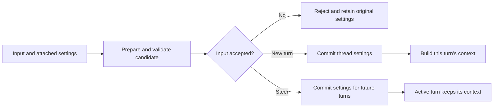

`TurnContext` contains more than a configuration copy. It holds the turn ID, initial settings, next-model-step settings, starting environment, extension state, timing, and terminal error. `StepContext` captures settings and capability versions for one request. Changing a future turn's model preference and changing the next model step within the current turn are separately implemented paths. The steer-setting rule does not imply that every setting change must wait for a future turn.

<a id="ch03-session--reserve-idle-state-and-retain-finishing-ownership"></a>

## Reserve idle state and retain finishing ownership

A caller cannot check for no active turn, release the lock for lengthy preparation, and later start unconditionally. Another input might claim the same idle state. `start_if_idle` checks `active_turn` under the lock, checks the expected previous turn when required, and inserts a reserved `ActiveTurn`. Preparation failure or policy rejection clears that reservation. The [idle reservation](https://github.com/openai/codex/blob/e4568a3538c9cab6627d64ff8cdfc7d98b79b7db/codex-rs/core/src/session/turn_input.rs#L516-L572) joins the check to ownership of the next turn.

Task startup records turn ownership and creates a cancellation token, completion notification, and task handle. When its future returns, `on_task_finished` takes the task from the active turn, changes its state to finishing, records pending input, and organizes terminal events. `ActiveTurn` can represent a reservation before task startup or finishing work after the task returns. Consequently, `task.is_none()` is not a general idle check. The [ActiveTurn and RunningTask types](https://github.com/openai/codex/blob/e4568a3538c9cab6627d64ff8cdfc7d98b79b7db/codex-rs/core/src/state/turn.rs#L29-L105) show those states.

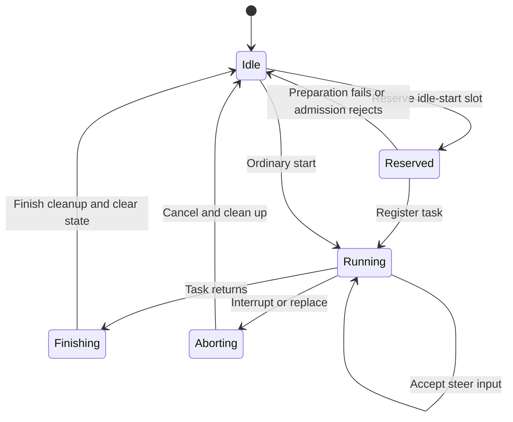

This is a teaching state diagram, not a separate enum copied from the source. During finishing, `Arc::ptr_eq` checks that cleanup still refers to the same turn state, so late-finishing work cannot clear newer state. An ordinary turn generally delivers its terminal event before conditionally clearing the active slot, then continues rollout flushing and pending-work checks. Receiving that event does not prove every background cleanup operation succeeded.

<a id="ch03-session--interrupting-a-turn-and-shutting-down-a-session"></a>

## Interrupting a turn and shutting down a Session

An interrupt cancels the task token, allows time for cooperative exit, aborts the handle if necessary, and invokes task-specific abort cleanup. The Interrupted branch may also record an interruption marker and attempt a flush before emitting `TurnAborted`. Flush failure produces a warning. The code arranges a persistence barrier but does not give the event a fault-independent durability guarantee. The [cancellation and terminal-event path](https://github.com/openai/codex/blob/e4568a3538c9cab6627d64ff8cdfc7d98b79b7db/codex-rs/core/src/tasks/mod.rs#L943-L1046) shows the sequence.

Waiter cleanup has its own ordering. `abort_all_tasks` first lets tasks waiting for approvals or other results observe cancellation, then clears pending input and waiters. Dropping a sender first could make a task interpret the missing reply as a denial and produce an unintended model-visible result. When the user stops the pagination repair, the history should not acquire an invented claim that the user refused a patch.

```text
# Teaching pseudocode: interrupting a turn
remove_current_active_task()
notify_task_of_cancellation()
wait_for_cooperative_exit_or_deadline()
stop_task_handle_and_run_task_cleanup()
record_applicable_interruption_marker()
emit_abort_event_with_turn_identity()
clear_pending_input_and_waiters_for_that_turn()
```

Session shutdown has a broader scope. It stops admission, cancels prewarming and active work, terminates background execution processes, closes hooks and MCP services, closes thread persistence, and reports `ShutdownComplete`. `shutdown_and_wait` waits for the shared background-loop completion future. Even when every submission sender is dropped without an explicit Shutdown operation, leaving the submission loop still schedules teardown. A turn interrupt leaves the live thread available for further work; shutdown closes that runtime. The [shutdown and channel-close branches](https://github.com/openai/codex/blob/e4568a3538c9cab6627d64ff8cdfc7d98b79b7db/codex-rs/core/src/session/handlers.rs#L722-L758) retain cleanup when an interface omits its final command.

<a id="ch03-session--reading-events-accurately"></a>

## Reading events accurately

A core `Event` contains an ID associating it with a submission and an `EventMsg`. Consumers can group progress by work, but must still inspect payloads. `TurnComplete` can carry a terminal error. `TurnAborted` records the reason, timing, and turn identity. End of work and achievement of the requested goal need separate facts.

Event reception also has ownership rules. `CodexThread::next_event` removes the next event from the queue. Multiple readers do not automatically receive broadcast copies. `queued_event_count` supports handoff of a finite queued batch, with a requirement for exactly one reader while consuming that batch. A state watch supplies the latest state; the event queue preserves facts to process in order. A new interface might observe "idle" while missing earlier errors or tool records if it confuses the two. The [consumer contract](https://github.com/openai/codex/blob/e4568a3538c9cab6627d64ff8cdfc7d98b79b7db/codex-rs/core/src/codex_thread.rs#L774-L787) explains why a cloned endpoint is not a full-history subscription.

Relevant tests gate fake model responses to submit two user messages concurrently. They expect exactly one Started and one Steered with the same turn ID, then find both inputs in the second model request body. Another test steers after a turn has ended, expects `NoActiveTurn`, and checks that previous thread settings remain unchanged. These assertions test the relationship between admission and state without requiring a particular model sentence. We have read their implementation, not executed them, and they do not establish coverage of every concurrent schedule.

The repair now has an explicit owner at every level: a thread identity, a live Session, a turn that can accept steering or be aborted, and a captured context for each model step. The next chapter follows requests across the model boundary.

<a id="ch03-session--reading-the-source"></a>

## Reading the source

- [thread_manager.rs: thread startup](https://github.com/openai/codex/blob/e4568a3538c9cab6627d64ff8cdfc7d98b79b7db/codex-rs/core/src/thread_manager.rs#L1097-L1102). Continue through the spawn request and warm-resume branch.
- [codex_thread.rs: input-routing methods](https://github.com/openai/codex/blob/e4568a3538c9cab6627d64ff8cdfc7d98b79b7db/codex-rs/core/src/codex_thread.rs#L412-L468). Compare start-or-steer, idle-start, and internal continuation.
- [session/mod.rs: SessionIo submission and receipts](https://github.com/openai/codex/blob/e4568a3538c9cab6627d64ff8cdfc7d98b79b7db/codex-rs/core/src/session/mod.rs#L1091-L1132). Identify enqueue and receipt failure points.
- [session/handlers.rs: submission_loop](https://github.com/openai/codex/blob/e4568a3538c9cab6627d64ff8cdfc7d98b79b7db/codex-rs/core/src/session/handlers.rs#L444-L502). Follow sequential dispatch alongside background turn work.
- [turn_input.rs: PreparedTurnInputSettings](https://github.com/openai/codex/blob/e4568a3538c9cab6627d64ff8cdfc7d98b79b7db/codex-rs/core/src/session/turn_input.rs#L91-L221). Trace preview, new-turn commit, and steer commit.
- [turn_input.rs: idle reservation and release](https://github.com/openai/codex/blob/e4568a3538c9cab6627d64ff8cdfc7d98b79b7db/codex-rs/core/src/session/turn_input.rs#L516-L572). Inspect how a reservation makes the idle check atomic.
- [state/turn.rs: ActiveTurn and waiters](https://github.com/openai/codex/blob/e4568a3538c9cab6627d64ff8cdfc7d98b79b7db/codex-rs/core/src/state/turn.rs#L29-L105). Read task, cancellation, and turn-local state together.
- [tasks/mod.rs: common finishing path](https://github.com/openai/codex/blob/e4568a3538c9cab6627d64ff8cdfc7d98b79b7db/codex-rs/core/src/tasks/mod.rs#L645-L716). Continue to terminal events and active-state removal.
- [tasks/mod.rs: interruption](https://github.com/openai/codex/blob/e4568a3538c9cab6627d64ff8cdfc7d98b79b7db/codex-rs/core/src/tasks/mod.rs#L943-L1046). Locate cancellation, waiting, abort, recording, and notification.
- [turn_input_submission.rs: settings update after acceptance](https://github.com/openai/codex/blob/e4568a3538c9cab6627d64ff8cdfc7d98b79b7db/codex-rs/core/tests/suite/turn_input_submission.rs#L1232-L1339). Read with the preceding concurrency test to inspect state contracts. These pointers describe assertions, not results from an execution for this book.

<a id="ch03-session--design-lessons"></a>

## Design lessons

1. Separate handles from live state. Multiple interfaces can share controlled access to one runtime. Specify what cloned handles mean for shutdown and event consumption.
2. Route input atomically in core. Explicit start, steer, and idle-start intentions avoid a caller-side read-then-submit race. Clients must handle the resulting typed rejections.
3. Commit attached changes only after acceptance. Validate candidate settings, then bind their application to admission. This needs a preview or commit phase beyond a simple setter.
4. Represent reservations and finishing work. Preparation and final writes can outlive the task handle. Retain ownership across those phases and use a stricter idle predicate than task presence.
5. Define interruption as a protocol. Tasks holding processes or waiting for approval need ordered cancellation, waiter cleanup, and terminal reporting. Session shutdown needs a separate contract, including observable cleanup and persistence failures.

---

<a id="ch04-model-io"></a>

<a id="ch04-model-io--chapter-4-communicating-with-the-model"></a>

# Chapter 4: Communicating with the model

The pagination-repair turn has been accepted. The runtime has user input, repository instructions, and tools, but the model has not seen them yet. Before leaving the local runtime, that working set must become a request supported by the provider. Returning network bytes must become events that can be displayed, executed, and checked for completion.

This round trip includes state beyond an HTTP request. Connections can be reused across requests, while routing state belongs to a turn. Changes to tools or reasoning options can invalidate an incremental-send baseline. Received text does not establish a complete response. A disconnected stream becomes harder to recover when a tool has already changed something outside the runtime.

We will follow `Prompt → ResponsesApiRequest → ResponseEvent`, then examine connection reuse, retries, and authentication recovery. The repair remains a hypothetical scenario. No model was called and no network performance was measured for this chapter.

<a id="ch04-model-io--start-with-a-typed-working-set"></a>

## Start with a typed working set

The core loop takes history suitable for the model's input modalities and calls `run_sampling_request`. The model step has already captured settings, environment, and tool routing. `Prompt` contains a `Vec<ResponseItem>`, tool declarations, a parallel-call setting, base instructions, and optional output-schema and strict-validation settings. The [Prompt definition](https://github.com/openai/codex/blob/e4568a3538c9cab6627d64ff8cdfc7d98b79b7db/codex-rs/core/src/client_common.rs#L21-L54) preserves these parts as distinct values.

For the pagination task, the first working set might contain the repair request, project conventions, and environment information. Later sets include file-search calls and their results. A tool result enters context as a structured item with a different role from assistant text. The runtime can preserve call relationships without searching strings to identify tool output. [Chapter 10](#ch10-context) examines history trimming and compaction.

`build_responses_request` adapts this logical Prompt to a wire request. It processes input according to model capabilities. Some unsupported configuration-update items are filtered only from the request copy, leaving durable history intact. Tool declarations use different encodings for ordinary Responses and `use_responses_lite`. In the latter branch, they can become an AdditionalTools item with developer role, and the ordinary parallel tool-call setting is not used. These branches depend on model metadata. The [request builder](https://github.com/openai/codex/blob/e4568a3538c9cab6627d64ff8cdfc7d98b79b7db/codex-rs/core/src/client.rs#L956-L1007) shows where logical context becomes a provider-compatible payload.

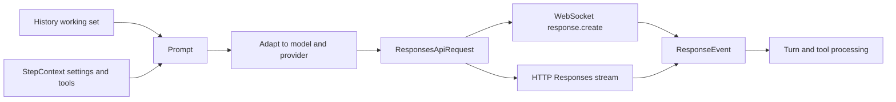

The final request includes model, input, tools, reasoning, service tier, text/output configuration, and metadata. This snapshot constructs it with `stream: true` and `store: false`, adjusting fields for provider and model capabilities. Those settings show what the client sends; they do not establish the server's complete data-handling or retention policy. `ResponsesApiRequest` also places routing fields first. A source comment explains that the gateway may read large request bodies incrementally, so field order can affect transport work. The [wire type](https://github.com/openai/codex/blob/e4568a3538c9cab6627d64ff8cdfc7d98b79b7db/codex-rs/codex-api/src/common.rs#L278-L308) supplies the evidence for these details.

<a id="ch04-model-io--keep-turn-routing-separate-from-connection-reuse"></a>

## Keep turn routing separate from connection reuse

`ModelClient` shares authentication, provider information, thread identity, and transport-fallback state within a Session. `ModelClientSession` belongs to a turn. It connects lazily on the first stream and retains the previous request, response baseline, and turn-local sticky-routing token. Source comments explicitly require a fresh `ModelClientSession` per turn. The [two client lifetimes](https://github.com/openai/codex/blob/e4568a3538c9cab6627d64ff8cdfc7d98b79b7db/codex-rs/core/src/client.rs#L256-L309) continue the lifetime separation from Chapter 3.

The sticky token comes from the `x-codex-turn-state` response header. Retries, appends, and continuation requests within that turn keep it. The next turn must establish its own routing state, even if it takes a cached underlying connection. The expensive connection and the turn's routing identity have different reuse rules.

An account change further restricts reuse. `new_session` compares auth owner generation and clears the connection cache when it changes. `current_client_setup` also checks revisions while resolving authentication, API provider, and routing. Credential refresh can trigger setup reconstruction; an owner change prevents new connections from being labelled with setup from the old identity. The comparison covers authentication and request routing, beyond the bearer string alone.

In the repair scenario, supplemental input within the same turn retains its routing token. A new task after that repair needs a new token even if it reuses the connection. The model client has to preserve that distinction throughout connection management.

<a id="ch04-model-io--prove-that-an-incremental-request-is-valid"></a>

## Prove that an incremental request is valid

The WebSocket path can express a follow-up as `previous_response_id` plus new items. `get_incremental_items` first compares non-input request properties. It then checks whether the previous request input followed by the server's returned output is an exact prefix of the current input. Only after that proof does it extract the suffix. Server-produced items are already part of the baseline and need not be sent again. The [incremental check](https://github.com/openai/codex/blob/e4568a3538c9cab6627d64ff8cdfc7d98b79b7db/codex-rs/core/src/client.rs#L1508-L1542) uses content equality, not message counts.

```text
# Teaching pseudocode: prove that an append is valid
if no_complete_previous_request_and_response: send_full_request()
if model_tools_reasoning_or_output_configuration_changed: send_full_request()
baseline = previous_request_input + previous_response_output
if current_input_does_not_start_with(baseline): send_full_request()
delta = current_input_without(baseline)
send(previous_response_id, delta)
```

Property comparison uses exhaustive destructuring. Differences in model, tools, tool choice, parallel settings, reasoning, include, service tier, cache key, or text configuration each have a reason to prevent reuse. Input and some metadata are handled separately. If the request type gains a field, this implementation forces a decision about its effect on reuse. The [property comparison](https://github.com/openai/codex/blob/e4568a3538c9cab6627d64ff8cdfc7d98b79b7db/codex-rs/core/src/client.rs#L384-L455) puts the optimization's validity conditions in the type-evolution path.

Suppose the first request produces a file-read call and the second input adds its result. With a matching prefix and compatible properties, only the new result needs transmission. Compaction, a tool-catalog change, or input reordering can invalidate the baseline and require a full representation. The logical input remains the complete context in either case. A trace needs to explain that full input; a few transmitted delta items alone are insufficient replay evidence.

A source test sends a user message, then a Prompt containing that message, assistant output, and a new message. It expects the second `response.create` to reference the first response ID and contain only the new suffix. We read this assertion without running it. It establishes the intended payload contract, not a measured byte-saving or latency result.

<a id="ch04-model-io--warmup-and-metadata-follow-request-rules"></a>

## Warmup and metadata follow request rules

Connection preparation can precede an actual user submission. A model-client warmup uses `generate: false` in its WebSocket payload to prepare resources and reusable state. It does not generate an answer. Later reuse still has to pass the input-prefix and request-property checks. The [warmup payload](https://github.com/openai/codex/blob/e4568a3538c9cab6627d64ff8cdfc7d98b79b7db/codex-rs/core/src/client.rs#L2133-L2167) separates preparation from generation.

Warmup affects tracing too. If it has already sent the base input, the actual request may transmit only a suffix. When reusing a warmup response ID that was not traced, the source explicitly records the logical request. Otherwise a diagnostic record could contain a tool output with neither the user request nor declarations that gave it meaning.

Metadata extensions have an explicit entry point. `model_request::prepare` gathers additions and response interceptors from request contributors, then filters the additions. Existing keys are not overwritten, and `parent_response_id` has separate protection. Interceptors wrap the returned stream in composition order. This demonstrates controlled request extension, not unrestricted permission for every plugin to rewrite all fields. The [extension preparation path](https://github.com/openai/codex/blob/e4568a3538c9cab6627d64ff8cdfc7d98b79b7db/codex-rs/core/src/model_request.rs#L10-L46) defines where these participants act.

Wire payloads, logical inputs, and diagnostic records have different responsibilities. Transport can omit previously sent content while diagnostics retain its meaning. Provenance metadata can be added without overwriting routing controls.

<a id="ch04-model-io--require-evidence-that-the-stream-completed"></a>

## Require evidence that the stream completed

On HTTP, SSE parsing reconstructs provider events from network chunks and maps them to `ResponseEvent`. A network chunk is not an event, and a text delta is not a complete output item. `OutputItemAdded`, `OutputTextDelta`, `ToolCallInputDelta`, `OutputItemDone`, and `Completed` represent item start, text display, argument fragments, structured completion, and response termination respectively. Consumers use the [event types](https://github.com/openai/codex/blob/e4568a3538c9cab6627d64ff8cdfc7d98b79b7db/codex-rs/codex-api/src/common.rs#L81-L132) to advance on the right evidence.

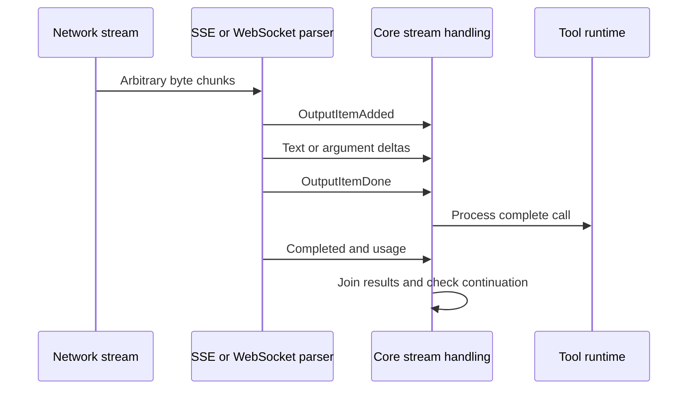

The SSE read loop has an idle timeout and watches for receiver closure. EOF before `response.completed` becomes a stream error. Silence alone does not establish success. Some malformed events are logged and skipped, with completion still governed by terminal-event and parsing rules. Thus malformed input need not fail immediately, but the parser also cannot simply declare an incomplete stream successful. The [EOF and timeout handling](https://github.com/openai/codex/blob/e4568a3538c9cab6627d64ff8cdfc7d98b79b7db/codex-rs/codex-api/src/sse/responses.rs#L548-L603) defines both limits.

`response.incomplete` does not universally become `Completed`. The parser distinguishes content filtering, interruption, and other incomplete outcomes, retaining available response IDs and usage. A truncated answer can consume tokens without completing normally. In the repair task, visible text saying "I will modify..." proves neither arrival of a complete modification call nor a successful check.

At core, `Completed` includes optional `end_turn`. Some providers omit it, so the runtime has fallback logic. This event ends one model response. The turn still has to join tool results, examine pending input, and evaluate stopping conditions, as the next chapter explains.

<a id="ch04-model-io--retry-budgets-and-transport-fallback"></a>

## Retry budgets and transport fallback

Ordinary `stream` prefers Responses WebSocket when the provider supports it and the Session has not disabled it. Otherwise it uses HTTP Responses. Certain connection failures or an exhausted retry budget can activate HTTP fallback. That state lasts for the ModelClient's Session lifetime, so later turns continue over HTTP instead of retrying the unhealthy WebSocket every turn. The [transport-selection path](https://github.com/openai/codex/blob/e4568a3538c9cab6627d64ff8cdfc7d98b79b7db/codex-rs/core/src/client.rs#L2360-L2438) shows the scope.

Connection establishment, stream failure, and authentication recovery need separate retry reasoning. `ResponsesStreamRetryState` handles requests after stream errors. It first asks whether the error supplies a retryable delay; a nonretryable error returns. Within budget, it waits for local backoff or server `Retry-After`. Switching transports still respects the server's deadline. At budget exhaustion, a first successful activation of fallback notifies the consumer and resets that phase's count. Further failure retains the exhausted state and returns an error. See the [stream-retry policy](https://github.com/openai/codex/blob/e4568a3538c9cab6627d64ff8cdfc7d98b79b7db/codex-rs/core/src/responses_retry.rs#L83-L175).

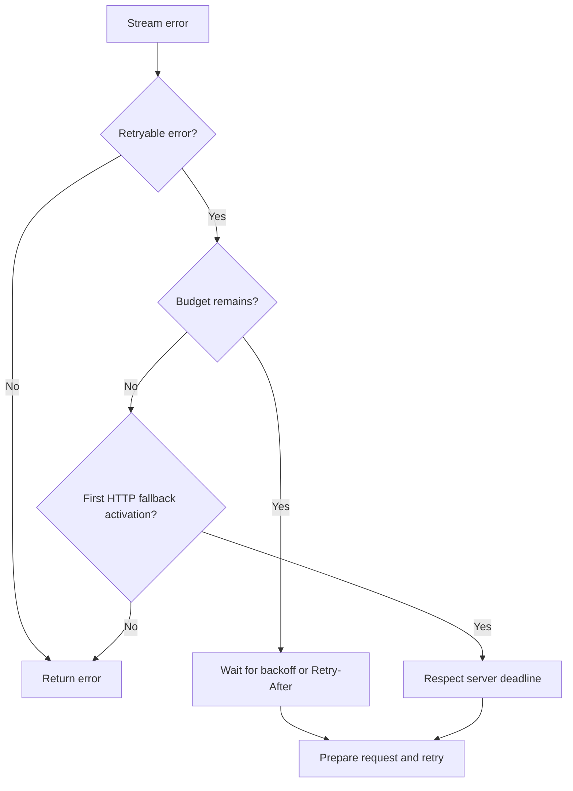

This diagram covers ordinary bounded stream retries. `UnboundedConnectionRetries` is a conditional branch for particular sampling-time `ConnectionFailed` errors, excluding internal sessions and providers such as Amazon Bedrock, with waits that grow according to its settings. Its presence does not make all failures retry forever. The outer wait also responds to cancellation and specific preemption paths, so interruption need not wait for a successful connection.

<a id="ch04-model-io--network-retries-and-tool-side-effects"></a>

## Network retries and tool side effects

Suppose the model emits a complete modification call, the patch executes, and the stream then disconnects. The retry layer has an incomplete response; the filesystem already has a change. Reissuing a model request cannot itself make patches, shell commands, or external operations idempotent. Repeated execution has to be addressed at the side-effect boundary.

On retry, `run_sampling_request` rebuilds input from current history and includes relevant records of executed calls. It does not always resend the original bytes unchanged. `ExecutedToolCalls`, however, explicitly describes itself as a best-effort recorder. It cannot dispatch or wait for tools, allocates no recording state when disabled, and leaves missing evidence incomplete. The [retry-input reconstruction](https://github.com/openai/codex/blob/e4568a3538c9cab6627d64ff8cdfc7d98b79b7db/codex-rs/core/src/session/turn.rs#L1744-L1769) and [recorder boundary](https://github.com/openai/codex/blob/e4568a3538c9cab6627d64ff8cdfc7d98b79b7db/codex-rs/core/src/tools/executed_tool_calls.rs#L1-L65) do not provide a global deduplication transaction.

```text
# Teaching pseudocode: reason about two kinds of retry
on_network_failure:
    retain_confirmed_history_and_tool_results()
    prepare_model_request_under_stream_retry_policy()
if model_proposes_another_action:
    run_normal_tool_checks_and_execution()
for_nonrepeatable_external_side_effects:
    provide_idempotency_keys_transactions_or_result_queries_in_the_action_service()
```

The final line is advice for a system you build, not a claim that Codex supplies transactions for every external tool. When a tool cannot establish whether an operation happened, reporting unknown status and querying the real state may be safer than executing again. A later model call can propose the same semantic action under a different call ID, so call identity alone cannot settle the issue.

Authentication recovery is bounded too. When HTTP reports an authentication error the provider recognizes as recoverable, the client invokes that provider's recovery and prepares a new request. A test explicitly checks that policy denial of refresh-network access stops recovery and preserves stored authentication. Policy denial must not be misclassified as damaged credentials and used to clear user state. The [authentication recovery policy test](https://github.com/openai/codex/blob/e4568a3538c9cab6627d64ff8cdfc7d98b79b7db/codex-rs/core/tests/suite/auth_recovery_policy.rs#L29-L91) records this contract.

Place the failure on the repair timeline. First, a complete file-read call executes and its result is recorded. Next, the model streams text describing a modification, but disconnects before Completed. The read result is known. Completion of the later response is unknown. The text does not establish that a patch ran, and a displayed phrase such as "checks complete" is not machine evidence that a test passed.

If retry is permitted, sampling reads current history again and includes confirmed content in the next request. A nonretryable failure goes back to the turn lifecycle for reporting. New user requirements during backoff can preempt the request on paths where that feature is enabled and create follow-up work. Ordinary cancellation aborts the turn. Both can stop the wait, but their intent and resulting events differ from a network fault.

Retry tests therefore need to inspect actual connection or request counts, subsequent transport, server-advised waits, and the final event seen above the transport layer. An assertion that text eventually appeared could miss an extra authentication refresh or repeated action. The source fallback tests inspect GET/POST counts and behavior across turns; the authentication policy test checks stored content. Fake-model success cannot establish side-effect guarantees for unknown external services.

<a id="ch04-model-io--reading-the-source"></a>

## Reading the source

- [client_common.rs: Prompt](https://github.com/openai/codex/blob/e4568a3538c9cab6627d64ff8cdfc7d98b79b7db/codex-rs/core/src/client_common.rs#L21-L54). Identify input, tools, instructions, and output constraints.
- [client.rs: client lifetimes](https://github.com/openai/codex/blob/e4568a3538c9cab6627d64ff8cdfc7d98b79b7db/codex-rs/core/src/client.rs#L256-L309). Follow the turn scope of sticky routing.
- [client.rs: request construction](https://github.com/openai/codex/blob/e4568a3538c9cab6627d64ff8cdfc7d98b79b7db/codex-rs/core/src/client.rs#L956-L1107). Check Responses Lite and provider conditions.
- [client.rs: incremental-prefix check](https://github.com/openai/codex/blob/e4568a3538c9cab6627d64ff8cdfc7d98b79b7db/codex-rs/core/src/client.rs#L1508-L1542). Include both the previous request and response in the baseline.
- [codex-api/common.rs: ResponseEvent](https://github.com/openai/codex/blob/e4568a3538c9cab6627d64ff8cdfc7d98b79b7db/codex-rs/codex-api/src/common.rs#L81-L132). Distinguish deltas, item completion, and response completion.
- [sse/responses.rs: read loop](https://github.com/openai/codex/blob/e4568a3538c9cab6627d64ff8cdfc7d98b79b7db/codex-rs/codex-api/src/sse/responses.rs#L548-L603). Inspect timeout, EOF, and unparseable events.
- [responses_retry.rs: stream retries and fallback](https://github.com/openai/codex/blob/e4568a3538c9cab6627d64ff8cdfc7d98b79b7db/codex-rs/core/src/responses_retry.rs#L83-L175). Retain experimental conditions and Retry-After handling.
- [session/turn.rs: input reconstruction on retry](https://github.com/openai/codex/blob/e4568a3538c9cab6627d64ff8cdfc7d98b79b7db/codex-rs/core/src/session/turn.rs#L1744-L1842). Read it separately from tool transactions.
- [client_websockets.rs: incremental-request test](https://github.com/openai/codex/blob/e4568a3538c9cab6627d64ff8cdfc7d98b79b7db/codex-rs/core/tests/suite/client_websockets.rs#L1964-L2012). Inspect assertions on the second wire payload.
- [websocket_fallback.rs: fallback across turns](https://github.com/openai/codex/blob/e4568a3538c9cab6627d64ff8cdfc7d98b79b7db/codex-rs/core/tests/suite/websocket_fallback.rs#L210-L254). These references describe test intent, not reported execution results.

<a id="ch04-model-io--design-lessons"></a>

## Design lessons

1. Keep a typed logical request. Adapt a common working set to model-specific encodings. Capability conditions need maintenance; one JSON template cannot represent every provider's contract.
2. Separate connection state from turn state. Reused connections need correct sticky-token, identity, and owner-revision lifetimes. More invalidation rules are preferable to account or routing confusion.
3. Prove prefix compatibility before sending a delta. Compare input and non-input properties and retain the complete baseline. Subtracting message counts cannot prove equivalence.
4. Treat EOF according to the protocol. When completion requires a terminal event, its absence is an error even after text is displayed. Record known usage and let the interface explain the partial result.
5. Handle repetition at side-effect boundaries. Preserve execution evidence and give actions that need it idempotency or status-query support. Each kind of external operation needs its own recovery design.

---

<a id="ch05-agent-loop"></a>

<a id="ch05-agent-loop--chapter-5-continuing-and-stopping-the-agent-loop"></a>

# Chapter 5: Continuing and stopping the agent loop

The model requests the pagination source, a tool returns it, and the next model response proposes a patch. Execution results then enter history. Several contracts connect these separate actions into a continuing repair: input order, model-step capture, tool feedback, budgets, and stopping conditions.

A small agent demonstration can request a model response, execute any tool calls, and return when there are none. An interactive runtime also handles user input arriving during a request, a model explicitly asking to continue without an ordinary tool call, and stop hooks that supply further checks. Compaction failure and interruption must preserve accepted input where possible. These cases account for much of the production loop's complexity.

We will follow the same hypothetical empty-input repair. "The code is fixed" is a task outcome; "the current turn ended" is a runtime outcome. No patch or test was executed for this book, and those outcomes need different evidence.

<a id="ch05-agent-loop--three-nested-kinds-of-progress"></a>

## Three nested kinds of progress

The submission loop routes control operations without synchronously running an entire model task. Work then advances through three more layers. `RegularTask` owns an ordinary turn task, waits for the prewarming handoff, and calls `run_turn`. `run_turn` advances model steps. Within a step, `run_sampling_request` retries eligible stream failures. Calling all of these the agent loop obscures which layer accepts work, continues it, or retries a request.

`RegularTask::run` has a small outer loop of its own. After `run_turn` returns, pending input causes another call with empty initial input if there is no terminal error. With a terminal error, task finishing preserves the pending input instead of immediately restarting the failed work. The [RegularTask finishing logic](https://github.com/openai/codex/blob/e4568a3538c9cab6627d64ff8cdfc7d98b79b7db/codex-rs/core/src/tasks/regular.rs#L100-L124) covers input arriving just after the main loop decides to stop.

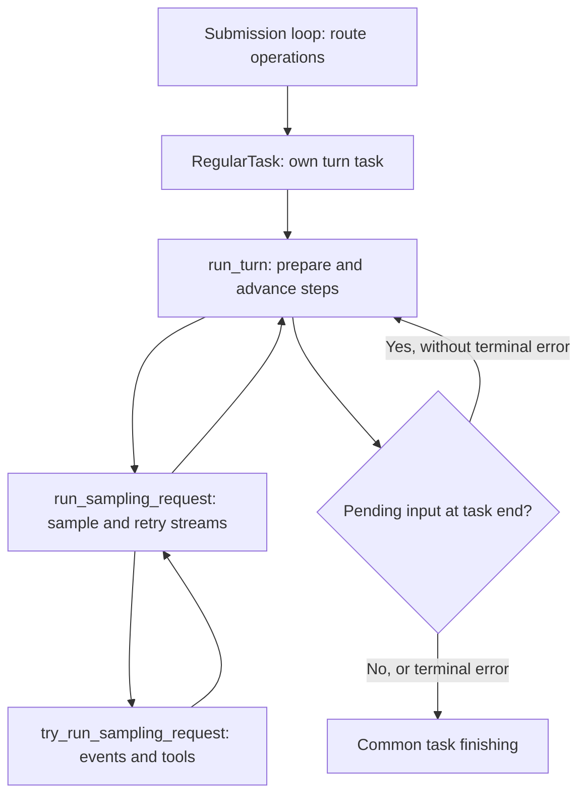

Return arrows represent results and possible continuation. They do not imply every error is retried. Sampling retries depend on error class and budget. Model-step continuation depends on further work and budgets. The task layer handles input accepted in the final timing window.

<a id="ch05-agent-loop--place-input-before-the-first-sample"></a>

## Place input before the first sample

`run_turn` obtains or creates the turn-local ModelClientSession and conditionally performs pre-sampling compaction. It then resolves MCP servers and plugins requested by input, captures the first StepContext, records context changes, assembles skill and plugin injections, runs applicable start hooks, and processes initial input. The [first-step capture](https://github.com/openai/codex/blob/e4568a3538c9cab6627d64ff8cdfc7d98b79b7db/codex-rs/core/src/session/turn.rs#L242-L338) gives the first request a consistent view of environment, tools, and instructions.

Preparation can fail. Pre-sampling compaction runs before the new input is normally recorded, so its failure branch still calls `run_hooks_and_record_inputs` before reporting the error or interruption. Cancellation while acquiring required capabilities also has an input-preservation path. This cannot guarantee persistence through every storage failure. It does show that accepted input is not intentionally discarded merely because sampling has not started. A failed model connection should not silently remove the user's repair request from history.

Input recording itself passes through hooks. `run_hooks_and_record_inputs` checks each item and records permitted input with added context. Blocked input may retain applicable context, and the return value depends on whether the batch lacks any accepted user content. In a mixed batch, tool outputs keep their own persistence barrier. Sharing a batch with steer text must not weaken their recording contract. The [input-recording code](https://github.com/openai/codex/blob/e4568a3538c9cab6627d64ff8cdfc7d98b79b7db/codex-rs/core/src/session/turn.rs#L940-L987) handles those differences.

Preparation, policy, and recording occupy real time between input receipt and sampling. An interface that labels the entire interval as model thinking would hide where work is actually waiting. The acceptance and sampling milestones need separate representations.

<a id="ch05-agent-loop--a-step-snapshot-binds-declarations-to-execution"></a>

## A step snapshot binds declarations to execution

Inside the step loop, code drains pending input when allowed, runs hooks, and records accepted content. It then captures StepContext. With no new input, some prepared snapshots can be reused. Input that names plugins or capabilities can require fresh resolution and capture. The runtime updates context such as World State, derives model-compatible input from history, and calls the sampling layer. [Step preparation](https://github.com/openai/codex/blob/e4568a3538c9cab6627d64ff8cdfc7d98b79b7db/codex-rs/core/src/session/turn.rs#L450-L577) binds input, capabilities, and request construction to one boundary.

```text
# Teaching pseudocode: one model step
drain_pending_input_when_allowed()
run_input_hooks_and_record_permitted_content()
capture_model_environment_instructions_and_tool_router()
record_required_step_context_changes()
request_input = shape_history_for_model_capabilities()
result = sample_stream_and_join_tool_results(request_input)
check_pending_input_budgets_stop_hooks_and_result()
continue_to_next_step_or_finish_turn()
```

Suppose the model saw a file-read tool, and configuration refresh changes the tool catalog before its proposed call executes. That call still needs the router of its originating step. Otherwise an unchanged name could resolve to a different handler or environment, making the record ambiguous about what was available when the model chose it. Capability changes therefore need explicit capture boundaries; mutating live objects is insufficient.

<a id="ch05-agent-loop--feed-completed-calls-back-into-history"></a>

## Feed completed calls back into history

When `OutputItemDone` arrives, `handle_output_item_done` tries to construct a tool call. On success, it records the call item, passes it to ToolCallRuntime, returns a future, and sets `needs_follow_up`. Ordinary processing dispatches immediately. A synchronous post-model hook can require deferred dispatch within the future instead. The [completed-item handler](https://github.com/openai/codex/blob/e4568a3538c9cab6627d64ff8cdfc7d98b79b7db/codex-rs/core/src/stream_events_utils.rs#L316-L369) makes execution timing conditional on hook mode.

A non-tool item is completed as its corresponding turn item and can update the last available assistant message. A call problem that can be reported to the model becomes a tool output and requests follow-up. A fatal error returns directly. Some tool failures give the model useful feedback; others invalidate the current run. [Chapter 6](#ch06-tools) examines that classification.

The sampling handler places tool futures in `FuturesOrdered`. After stream processing ends, it drains in-flight work, records results in history, and returns the sampling outcome. Ordered collection determines retrieval order, not necessarily serial execution. Tool runtime controls actual concurrency admission. The [result collection](https://github.com/openai/codex/blob/e4568a3538c9cab6627d64ff8cdfc7d98b79b7db/codex-rs/core/src/session/turn.rs#L2575-L2602) and [end-of-sampling drain](https://github.com/openai/codex/blob/e4568a3538c9cab6627d64ff8cdfc7d98b79b7db/codex-rs/core/src/session/turn.rs#L3333-L3375) connect the stream back to history.

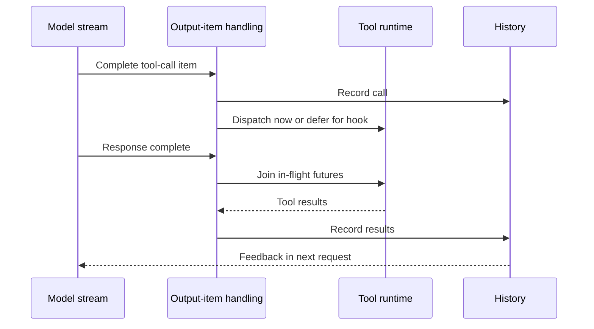

In the repair scenario, a read result might establish that empty input reaches a first-element access. The next request can then propose a boundary fix using that evidence. A successful patch result confirms what the tool reported about the edit. If a later check fails, its result can return to the model. Assistant prose, action receipts, and checking evidence play different roles in history.

<a id="ch05-agent-loop--admit-new-input-at-defined-boundaries"></a>

## Admit new input at defined boundaries

Adding "Keep the function signature" during the first request cannot mutate input already sent to the server. The normal path accepts it into the pending queue and records it before a subsequent request. `can_drain_pending_input` controls timing: initial input must receive its first sample, and certain post-compaction tool-continuation cases defer draining to preserve context order. The [comments and drain logic](https://github.com/openai/codex/blob/e4568a3538c9cab6627d64ff8cdfc7d98b79b7db/codex-rs/core/src/session/turn.rs#L450-L483) identify both exceptions.

A source test streams initial text from a fake model and blocks Completed behind a gate. It submits a second user message, releases the response, then checks that the first request contained only the first message and the second contained both. This is a subsequent-request guarantee, not an in-place rewrite of input already running on the server. The [pending-input test](https://github.com/openai/codex/blob/e4568a3538c9cab6627d64ff8cdfc7d98b79b7db/codex-rs/core/tests/suite/pending_input.rs#L897-L987) is read here as contract evidence; it was not executed.

Some steps support preemption. A preempted sample can yield to new work, return `needs_follow_up`, and drain an available response to maintain connection and history consistency. Turn cancellation instead returns `TurnAborted`. Capabilities such as Responses Lite also affect the specific interrupt message. These conditional paths do not mean every new message immediately stops the model, and a stopped stream need not mean user cancellation.

Mailbox input has a separate delivery phase. A late child-task message should not indefinitely extend an answer the user already saw as final. Code can defer mailbox delivery to the next turn and reopen it if explicit same-turn work arrives. The collaboration chapter follows the complete delivery rules.

<a id="ch05-agent-loop--continue-without-an-ordinary-tool-call"></a>

## Continue without an ordinary tool call

After sampling, `run_turn` combines the model result's follow-up requirement with the existence of pending input. Either can keep work going. `ResponseEvent::Completed` with explicit `end_turn: false` also requests continuation even when there was no ordinary tool call. When the provider omits that field, other established follow-up signals apply. The [continuation check](https://github.com/openai/codex/blob/e4568a3538c9cab6627d64ff8cdfc7d98b79b7db/codex-rs/core/src/session/turn.rs#L580-L611) covers more than tool presence.

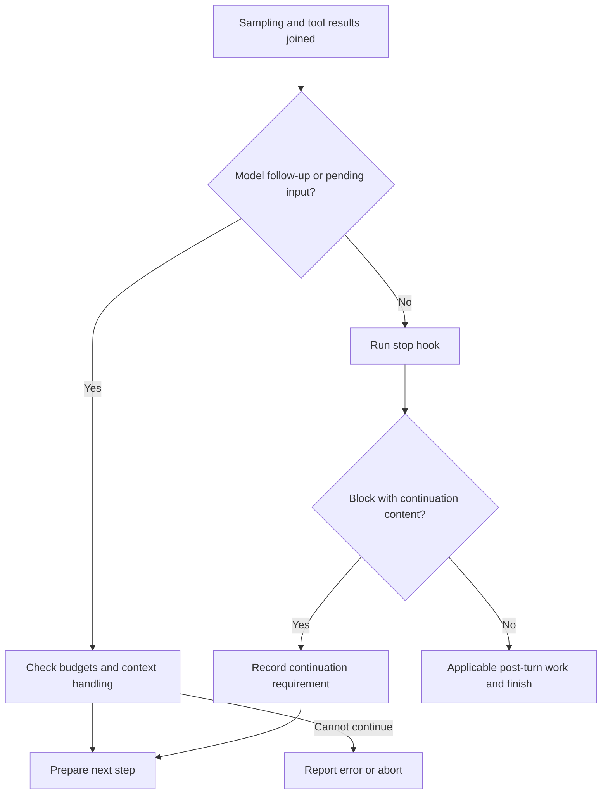

A stop hook can supply another source of work. If it blocks termination with continuation content, the loop records that content and samples again. If it requests continuation with no content, code warns and ignores the block, avoiding an invented input-free continuation. A hook can also request stopping. The [stop branch](https://github.com/openai/codex/blob/e4568a3538c9cab6627d64ff8cdfc7d98b79b7db/codex-rs/core/src/session/turn.rs#L725-L773) interprets a specific return contract rather than treating arbitrary hook output as commands.

For example, after the patch explanation, a hypothetical stop hook might ask: "Explain why the empty-input return value remains compatible with existing callers." That content gives the next request a concrete requirement and can produce more explanation or tool work. This example does not imply that Codex installs such a hook by default. Enablement, authorization, and loading belong to the extension lifecycle.

<a id="ch05-agent-loop--budgets-affect-context-and-continuation"></a>

## Budgets affect context and continuation

When follow-up exists, the loop examines token state, context-window requests, and available compaction results to decide whether to roll over. Successful compaction permits continued work, but model or tool-continuation relationships can affect when new input is drained next. TokenBudget and summary-compaction paths differ; `auto_summarization_enabled` explicitly considers the feature. Budget handling participates in control flow.

[Chapter 10](#ch10-context) follows these mechanisms. Here, retain their timing and failure distinctions. Context handling can occur before steps, between them, and near turn completion. A maintenance failure need not invalidate a completed answer: the post-turn summary-compaction path can preserve the answer and record a warning. Usage limits may also stop automatic work.

A turn can end when no input remains, the model is willing to stop, hooks provide no further work, and lifecycle and budget rules allow finishing. That does not prove the pagination function meets every product requirement. Task verification needs inspectable tool results, diffs, or external acceptance rules. Normal turn termination and correct repair measure different outcomes.

<a id="ch05-agent-loop--trace-a-complete-repair"></a>

## Trace a complete repair

Assume the teaching function accepts a list and page size. Its empty-list behavior should return an empty collection of pages, but the implementation reads the first element before checking emptiness. This function and return contract are hypothetical, not a bug in the Codex repository. The first request contains the repair instruction and project conventions. The model still needs source and caller evidence before choosing a return value such as an empty collection or null.

The first step proposes a search. The runtime records the call, and the tool returns matching locations. The next step reads the function and nearby callers. Their results show callers iterating over the returned collection, supporting an empty collection as the compatible direction. A later step proposes moving the empty-input check before the first-element read. Between those requests, the loop joins results, records history, checks for follow-up, and captures the next step.

```text
# Teaching pseudocode: desired behavior in the hypothetical case
paginate(items, size):
    if items is empty: return_empty_page_collection()
    validate_size()
    construct_pages_for_nonempty_input_using_existing_rules()
    return_page_collection()
```

This example leaves one requirement unresolved: should an invalid `size` still cause an error when `items` is empty? An early return might bypass parameter validation. Existing behavior and requirements must settle that boundary. Fixing the out-of-bounds access alone does not establish preservation of every semantic rule.

If the relevant checks succeed, the final explanation can state the cause, changes, actual checks, and remaining limits. If a missing dependency prevented a command from running, the answer should retain that fact. Either path can end the turn normally, with different task evidence. A failed check revealing skipped size validation returns to history and can prompt an adjustment.

The loop can stop once there is no new input, model follow-up, or hook work and finishing is allowed. It can coordinate this task through common rules without implementing the business meaning of pagination itself. The model and tool feedback carry that meaning; the runtime retains identity, ordering, and results.

<a id="ch05-agent-loop--preserve-facts-on-error-and-at-task-end"></a>

## Preserve facts on error and at task end

Some loop errors become Error events and end the current `run_turn`, leaving the Session available for later input. Cancellation follows the abort path. `terminal_error` tells the outer RegularTask not to restart the same failed work just because input remains queued. The [error-finishing branch](https://github.com/openai/codex/blob/e4568a3538c9cab6627d64ff8cdfc7d98b79b7db/codex-rs/core/src/session/turn.rs#L893-L913) lets the interface report failure while preserving a place for the user's next operation.

```text
# Teaching pseudocode: deciding how work ends
if user_cancelled: enter_abort_lifecycle()
else if unrecoverable_error: record_terminal_error_and_retain_known_facts()
else if model_follow_up or pending_input: continue_work()
else if stop_hook_supplied_work: record_it_and_continue()
else: finish_current_turn()
task_outcome = judge_tool_and_acceptance_evidence_separately()
```

The final input race explains the outer check in RegularTask. New input can be accepted after the main loop's last pending-input check. The task layer checks again to process it, or leaves finishing to preserve it after a terminal error. Similarly, when cancellation and an incomplete response arrive together, code still attempts to record usage already received. Ending control flow must not erase known cost.

The next chapter follows a tool call downward: how a model-produced name and arguments reach a handler, and which boundaries can reject them.

<a id="ch05-agent-loop--reading-the-source"></a>

## Reading the source

- [tasks/regular.rs: outer task progression](https://github.com/openai/codex/blob/e4568a3538c9cab6627d64ff8cdfc7d98b79b7db/codex-rs/core/src/tasks/regular.rs#L100-L124). Inspect final pending input and terminal error handling.
- [session/turn.rs: input processing after pre-sampling failure](https://github.com/openai/codex/blob/e4568a3538c9cab6627d64ff8cdfc7d98b79b7db/codex-rs/core/src/session/turn.rs#L173-L239). Follow early failure paths.
- [session/turn.rs: step preparation](https://github.com/openai/codex/blob/e4568a3538c9cab6627d64ff8cdfc7d98b79b7db/codex-rs/core/src/session/turn.rs#L450-L577). Trace pending input, capture, and model-request input.
- [stream_events_utils.rs: completed output items](https://github.com/openai/codex/blob/e4568a3538c9cab6627d64ff8cdfc7d98b79b7db/codex-rs/core/src/stream_events_utils.rs#L316-L440). Distinguish tool futures, model-visible errors, and fatal errors.
- [session/turn.rs: result drain](https://github.com/openai/codex/blob/e4568a3538c9cab6627d64ff8cdfc7d98b79b7db/codex-rs/core/src/session/turn.rs#L2575-L2602). Check when tool results enter history.
- [session/turn.rs: post-sampling decision](https://github.com/openai/codex/blob/e4568a3538c9cab6627d64ff8cdfc7d98b79b7db/codex-rs/core/src/session/turn.rs#L580-L611). Combine model follow-up with pending input.
- [session/turn.rs: stop hooks](https://github.com/openai/codex/blob/e4568a3538c9cab6627d64ff8cdfc7d98b79b7db/codex-rs/core/src/session/turn.rs#L725-L773). Compare blocks with and without continuation content.
- [session/turn.rs: input hooks and recording](https://github.com/openai/codex/blob/e4568a3538c9cab6627d64ff8cdfc7d98b79b7db/codex-rs/core/src/session/turn.rs#L940-L987). Inspect mixed-input persistence semantics.
- [session/turn.rs: preemption and cancellation](https://github.com/openai/codex/blob/e4568a3538c9cab6627d64ff8cdfc7d98b79b7db/codex-rs/core/src/session/turn.rs#L2791-L2825). Keep yielding separate from turn cancellation.
- [pending_input.rs: input during streamed deltas](https://github.com/openai/codex/blob/e4568a3538c9cab6627d64ff8cdfc7d98b79b7db/codex-rs/core/tests/suite/pending_input.rs#L897-L987). Follow a controlled gate to the next actual request. This test was not executed for the book.

<a id="ch05-agent-loop--design-lessons"></a>

## Design lessons

1. Give each loop a completion rule. Separate retries, model steps, and task admission when one `while` obscures their behavior. Additional layers help prevent work from being retried at the wrong scope.
2. Place accepted input before advancing. Record applicable input before sampling and on preparation-failure paths. Define the ordering among hooks, history updates, and persistence barriers.
3. Bind declarations and execution to a step. A request and its tool calls should share a routing snapshot when capabilities refresh dynamically. Changes then need a defined capture boundary.
4. Represent every source of follow-up. Pending input and extension requirements can require work without a tool call. Guard against empty continuations and automatic restarts after terminal failure.
5. Report stopping and verification separately. Tool results and acceptance evidence determine task outcomes. The interface needs to express partial work, blocked verification, and runtime failure as well as success.

---

<a id="ch06-tools"></a>

<a id="ch06-tools--chapter-6-from-tool-definitions-to-tool-calls"></a>

# Chapter 6: From tool definitions to tool calls

A repository repair soon needs facts that the model does not have. It may need to locate an implementation, read its tests, and submit a patch. The model can describe those actions. The tool runtime gives those descriptions access to a filesystem, terminal, or external service.

Consider an `exec_command` call that searches for a boundary check. Looking up a function by name and passing it JSON covers only part of the job. The runtime must also know whether the current request declared that capability, whether an external tool can claim the same name, and whether the call came directly from the model or from Code Mode. Hooks may change its input. After execution, the runtime must choose which representation of the result enters model history. These responsibilities form the tool contract.

This chapter follows the fixed source snapshot from tool planning to result packaging. [Chapter 7](#ch07-concurrency) covers concurrency and cancellation; [Chapter 8](#ch08-execution) follows commands and patches into execution. Here, the unit to follow is the tool plan for a model step. It connects the declaration sent to the model with the behavior available to the runtime.

<a id="ch06-tools--a-plan-for-the-model-and-the-runtime"></a>

## A plan for the model and the runtime

The `codex-tools` crate defines the shared contract. An implementation of `ToolExecutor<Invocation>` supplies a name, a specification, and `handle`. It can also declare exposure, search metadata, and concurrency support. The object that describes a capability therefore also knows how to execute it. In core, `CoreToolRuntime` adds readiness, hook input, lifecycle notifications, telemetry, and streaming argument deltas. Shared tool behavior and host-specific behavior have separate interfaces, avoiding a single function signature crowded with optional fields. [Shared contract and defaults](https://github.com/openai/codex/blob/e4568a3538c9cab6627d64ff8cdfc7d98b79b7db/codex-rs/tools/src/tool_executor.rs#L101-L129)

`build_tool_router` assembles that contract for a particular step. It receives the Session, turn context, model information, and environment snapshot. It creates a registry constrained by `ToolPolicy`, then adds core tools, MCP tools, extension executors, and client-provided dynamic tools. `finalize_tool_router` applies the effective tool mode and other conditions to produce a `ToolRouter`. The router retains the executable registry, model-visible specifications, and Code Mode name mapping. [Building the step's tool plan](https://github.com/openai/codex/blob/e4568a3538c9cab6627d64ff8cdfc7d98b79b7db/codex-rs/core/src/tools/spec_plan.rs#L121-L185)

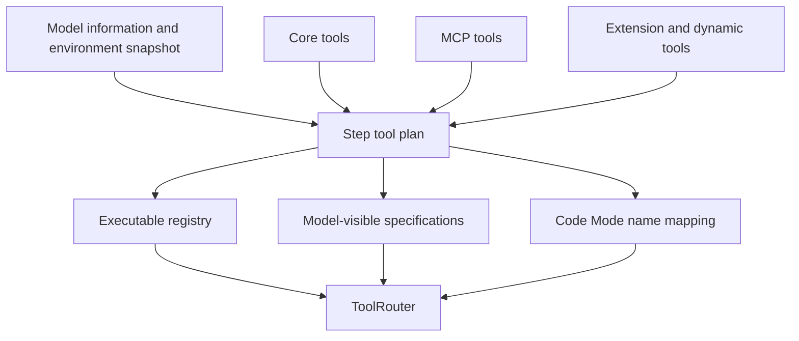

Some declarations describe tools hosted by the model service. The plan collects these hosted specs separately, including web search declarations. The dispatch path in this chapter handles calls that the client must execute. A hosted search does not enter the same local handler.

The tool set can change between steps. Model capabilities, features, the environment, and policy all affect assembly. Registration of `apply_patch`, for example, depends on the tool type present in model information; TTY support has its own conditions. Finding a handler in the source does not establish that a particular model step received it. Retaining the step context also lets a call that finishes later use the state under which it was declared.

Two kinds of change need separate treatment. A policy may exclude an identity from registration altogether. An exposure rule may keep a registered tool out of the initial list and place it in a search catalog instead. Treating a deferred tool as forbidden could reject a valid nested call. Treating registration as proof of model authorization would ignore the capability surface selected by the plan. The separate registry and `model_visible_specs` let the runtime answer both questions.

Observability follows the finalized plan too. Tool namespace information comes from that same result, rather than from a separate global catalog. A log field saying that terminal access is enabled would be misleading if the request lacked `write_stdin`. The router's `has_terminal_controls` checks exposure of both the launch and interaction tools. A useful design inference is to describe a capability in terms of the operation a user can complete, then verify the tools needed to complete it. [Checking combined terminal capability](https://github.com/openai/codex/blob/e4568a3538c9cab6627d64ff8cdfc7d98b79b7db/codex-rs/core/src/tools/router.rs#L171-L216)

<a id="ch06-tools--how-the-model-reaches-a-tool"></a>

## How the model reaches a tool

Registration is followed by an exposure decision. `Direct` can enter the initial tool list and, when Code Mode is enabled, participate in nested calls. `Deferred` enters a discoverable catalog and can be loaded through tool search. `CodeModeOnly` permits nested calls from scripts. Other variants restrict a tool to direct model calls or model search. `Hidden` preserves runtime registration without exposing the tool to the model. [Exposure definitions](https://github.com/openai/codex/blob/e4568a3538c9cab6627d64ff8cdfc7d98b79b7db/codex-rs/tools/src/tool_executor.rs#L14-L99)

A repair may need one external documentation search tool. Sending every external tool in the initial request consumes description budget and presents unrelated choices. Deferred exposure allows discovery when needed. It also makes discovery stateful: tools need search metadata, the model needs the relevant search capability, and planning must handle exposure conditions and name collisions. 

The comment on `Hidden` explicitly preserves dispatch registration. Separately, `exposes_tool` checks direct declarations, the Code Mode mapping, and the presence of tool search to decide whether the plan provides a model call route. Exposure distributes capabilities to the model; it is not an operating system security boundary. [Chapter 9](#ch09-safety) examines authorization and isolation.

<a id="ch06-tools--tool-identity-includes-the-namespace"></a>

## Tool identity includes the namespace

A tool identity contains both namespace and name. Aliases of the default namespace are normalized; other namespaces remain distinct. A default `lookup` can coexist with `lookup` in an MCP namespace. An unregistered MCP namespace cannot acquire an internal implementation merely by using the same leaf name.

Trusted and external registrations have different collision rules. A duplicate trusted tool is a programming or configuration error. When an external registration collides, the registry retains the earlier entry, records the conflict, and skips the later one. In the default namespace, `exec_command` and `shell_command` are reserved: an external runtime cannot register either name. Without that rule, an integration could change the core runtime's interpretation of a command by reusing a terminal tool name. [Registration and reserved names](https://github.com/openai/codex/blob/e4568a3538c9cab6627d64ff8cdfc7d98b79b7db/codex-rs/core/src/tools/registry.rs#L422-L495)

This detects collisions during plan construction and avoids ambiguous dispatch. It also limits extension authors: replacing a core capability requires an explicit extension design. Registration order does not give the last function an automatic right to replace a built-in command.

The test `handler_normalizes_only_the_default_namespace` constructs ordinary and MCP tools with the same name. Its assertions make the default alias resolve to the ordinary tool and leave another MCP namespace unresolved. Other tests cover default alias collisions, reserved command names, and matching leaf names across namespaces. These are observations about the test setup and assertions; the tests were not run for this book. [Identity tests](https://github.com/openai/codex/blob/e4568a3538c9cab6627d64ff8cdfc7d98b79b7db/codex-rs/core/src/tools/registry_tests.rs#L193-L242)

<a id="ch06-tools--turning-a-stream-item-into-a-call"></a>

## Turning a stream item into a call

When streaming produces a complete output item, `ToolRouter::build_tool_call` identifies its protocol type. A function call becomes `ToolPayload::Function`; a freeform tool call becomes `Custom`; a client-executed tool search becomes `ToolSearch`. The call retains `call_id` and its namespace-normalized name. Server-executed search items are excluded from client dispatch. [Protocol items and tool calls](https://github.com/openai/codex/blob/e4568a3538c9cab6627d64ff8cdfc7d98b79b7db/codex-rs/core/src/tools/router.rs#L256-L309)

The stream handler records the complete call in history before scheduling execution. Recovery then has a record of what the model requested. Each call receives a child of the turn's cancellation token. Scheduling normally starts execution immediately. If a synchronous post-model hook requires delayed dispatch, the future starts during collection instead. If cancellation has already occurred by then, the system still adds an aborted output paired with the original call. [Recording before dispatch](https://github.com/openai/codex/blob/e4568a3538c9cab6627d64ff8cdfc7d98b79b7db/codex-rs/core/src/stream_events_utils.rs#L324-L369)

This teaching pseudocode compresses the control flow; it is not a callable Rust API:

```text
Teaching pseudocode: accept a complete output item
call = decode_tool_call(item)
if call exists:
    record_history(item)
    token = turn_token.child()
    future = dispatch_using_advertising_step(call, token)
    remember_future_in_response_order(future)
else:
    finish_non_tool_item(item)
```

The router packages the call as a `ToolInvocation`. Alongside arguments, it carries the Session, StepContext, turn, cancellation token, diff tracker, and call source. The source distinguishes a direct model call from a nested Code Mode call; the latter also carries cell identity. The handler can obtain request ownership from the invocation instead of reconstructing it from global state.

<a id="ch06-tools--the-registry-owns-the-surrounding-lifecycle"></a>

## The registry owns the surrounding lifecycle

Registry dispatch first updates the active turn's tool call count, looks up the full identity, and checks the payload type. An unknown name is a call error that can be reported to the model. A known tool receiving an incompatible payload is `Fatal`. The model may recover from choosing an unavailable capability. A mismatch between protocol and runtime contracts requires a different response.

`PreToolUse` runs before the handler. A hook can block the action or rewrite input according to the tool's hook contract. Rewritten input becomes a new invocation and follows the normal handler path. The registry also wraps lifecycle start notification, telemetry, execution, and `PostToolUse` after success. [The shared dispatch path](https://github.com/openai/codex/blob/e4568a3538c9cab6627d64ff8cdfc7d98b79b7db/codex-rs/core/src/tools/registry.rs#L615-L759)

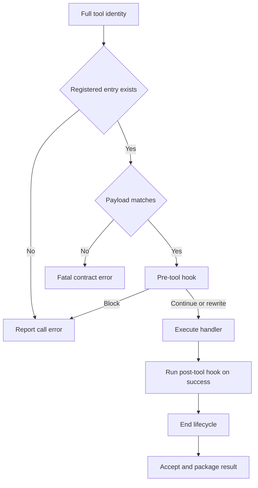

A post-tool hook runs after the side effect. Suppose a patch changes a file and the hook then rejects its result. The registry's comment states that the hook rejects the result, not the completed execution. The caller may receive hook feedback while the file remains changed. A design that treats post-tool validation as transaction rollback would make the agent's account diverge from the filesystem. Execution, result acceptance, and side effects need separate representations. [The post-tool hook boundary](https://github.com/openai/codex/blob/e4568a3538c9cab6627d64ff8cdfc7d98b79b7db/codex-rs/core/src/tools/registry.rs#L811-L889)

<a id="ch06-tools--representing-a-result-for-its-consumer"></a>

## Representing a result for its consumer

A handler returns an object implementing `ToolOutput`. `AnyToolResult` retains the call ID, original payload, and concrete result. For model history it calls `to_response_item`; for Code Mode it calls `code_mode_result`. Those representations can differ. The model needs content that fits its context budget, while a script may need structured fields. Formatting one string for logs, scripts, and model input would discard type and budget information too early.

Errors also have different destinations. A handler that finds an invalid field while parsing JSON can request a report to the model. Ordinary tool errors generally become tool outputs with `success=false`, retaining the original `call_id` so the model can adjust its arguments. A fatal error becomes a turn error. Making every error a global exception would prevent recovery from a misspelled working directory; converting every error to ordinary text would conceal a broken runtime contract.

<a id="ch06-tools--code-mode-runs-orchestration-in-a-cell"></a>

## Code Mode runs orchestration in a cell

On the Code Mode path, the model submits raw JavaScript. `CodeModeExecuteHandler` derives the permitted nested tool definitions from the current tool plan and submits an execution request to `CodeModeService`. The script does not go directly to the repository shell. Model information and features such as CodeMode and CodeModeOnly affect the tool mode. The effective mode and configuration also determine the fallback when a host is unavailable.

In this snapshot, ThreadManager constructs a separate `codex-code-mode-host` provider only when `CodeModeHost` is enabled or `disable_in_process_fallback` is true. Otherwise it uses a Disabled provider. A gRPC host is another option. The host holds an `InProcessCodeModeSession`; JavaScript runs on a V8 thread created by the runtime crate. Here, InProcess is relative to the host. It does not mean that the core runtime runs an arbitrary Node program. The runtime installs its tool object and helpers for output, stored values, and timers, and removes some global capabilities. [Host selection](https://github.com/openai/codex/blob/e4568a3538c9cab6627d64ff8cdfc7d98b79b7db/codex-rs/core/src/thread_manager.rs#L578-L588), [V8 runtime thread](https://github.com/openai/codex/blob/e4568a3538c9cab6627d64ff8cdfc7d98b79b7db/codex-rs/code-mode-runtime/src/runtime/mod.rs#L90-L142)

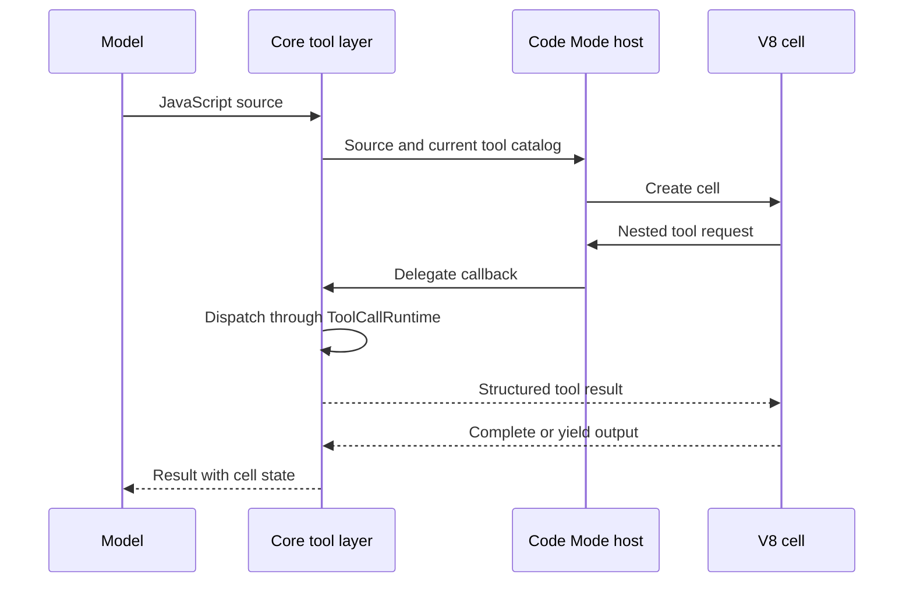

A script might search implementation and tests concurrently, filter the returned fields, and print only relevant lines for the model. Each nested call returns through the delegate to core. Core creates a `ToolCall` with `ToolCallSource::CodeMode`, the cell ID, and the runtime call ID within that cell, then uses `ToolCallRuntime`. Scripts can reduce sampling round trips and transform results while retaining each tool's handler, concurrency control, and approval boundary. A runtime call ID need only be unique within its cell; it cannot replace Codex's global tool call identity. [Nested calls reenter the tool runtime](https://github.com/openai/codex/blob/e4568a3538c9cab6627d64ff8cdfc7d98b79b7db/codex-rs/core/src/tools/code_mode/mod.rs#L336-L414)

Cells have their own lifecycle. A first observation may be `Yielded`, with the script still running. Completion and failure close the cell's dispatch ownership. The handler records the relationship between cell and outer call before opening the nested dispatch gate, preventing a callback from arriving before its identity is registered. Code Mode applies its own output budget and records the raw runtime response separately from model-visible output. A yield does not establish that the script has completed. [Cell identity, dispatch gate, and first result](https://github.com/openai/codex/blob/e4568a3538c9cab6627d64ff8cdfc7d98b79b7db/codex-rs/core/src/tools/code_mode/execute_handler.rs#L86-L172)

Cancellation crosses both layers. The session service can terminate active cells; the cell actor uses its cancellation token and child tokens to coordinate V8 termination and pending tool callbacks. The outer tool call, script cell, and nested tools have different lifetimes. Terminating the script does not undo external side effects. Their separate identities let the host trace a real action to its cell and model call, including how it ended. [Cell actor cancellation cleanup](https://github.com/openai/codex/blob/e4568a3538c9cab6627d64ff8cdfc7d98b79b7db/codex-rs/code-mode-runtime/src/cell_actor/mod.rs#L123-L169)

One integration test uses `Promise.all` to call two synchronous test tools with barriers, then outputs their result array with `text`. Its assertions inspect two `ok` values in the next model request and a time range. This exercises nested concurrent requests returning through the tool runtime and being combined into model-visible output. Runtime contract tests hold a notification callback open, terminate the cell, observe callback cancellation, and then wait for cleanup to release it. Their coverage includes host callbacks during termination; stopping V8 bytecode alone would not establish that resources had been released. [Nested orchestration test](https://github.com/openai/codex/blob/e4568a3538c9cab6627d64ff8cdfc7d98b79b7db/codex-rs/core/tests/suite/code_mode.rs#L4199-L4288), [Callback cleanup test](https://github.com/openai/codex/blob/e4568a3538c9cab6627d64ff8cdfc7d98b79b7db/codex-rs/code-mode-runtime/src/service_contract_tests.rs#L507-L552)

<a id="ch06-tools--following-failures-through-the-contract"></a>

## Following failures through the contract

In the book's teaching scenario, a pagination function produces a next-page marker for empty input. The model first needs to find the implementation. It proposes `exec_command` with identity `call-search-1` and arguments such as `{"cmd":"rg -n 'normalize_limit|next_cursor' src","workdir":"/repo/pager"}`. This repository and command are hypothetical; they were not executed for the book. The specification lets the model select the name, `ToolCall` preserves its identity, the handler parses its arguments into a command request, and execution returns the search evidence.

If the result contains two matches, the next model step can associate both with `call-search-1` and request the surrounding code. Another search in the same response has its own identity. An empty output also needs its exit status and context: it does not prove that the implementation is absent.

Suppose the first search uses a nonexistent working directory. Several checks precede a usable result. The declaration describes the expected arguments. Handler deserialization checks that the arguments form a local type. Environment resolution checks whether the working directory is compatible with the selected execution environment. A schema cannot prove that a directory exists, and successful JSON parsing cannot establish command approval.

The failed output retains `call-search-1`. The model can then use the repository root reported by the environment and issue `call-search-2`. The history shows the first argument error and the later search as separate actions. If the model instead invents an unregistered name such as `search_repository`, the registry can report an unknown tool and let it select an available capability.

A different failure occurs if an `apply_patch` registration accepts freeform patch text while the protocol supplies ordinary function arguments. The registry detects that payload mismatch before entering the handler and raises `Fatal`.

The model may also reuse an external tool name from an earlier turn after that tool has disappeared from the current plan. Exact lookup then produces a reportable error. Guessing a similar registered identity could route a documentation read to an interface with different side effects and leave history unable to explain what ran. The error gives the model evidence that its view of available capabilities needs updating.

A later failure can follow successful execution. A pre-tool hook may rewrite a search into a permitted alternative; the handler succeeds; a post-tool hook then asks the model to interpret the result in another format. The registry can wrap the output in feedback while preserving capabilities of the original result object. The text ultimately shown to the model does not describe every property of that object. The test `post_tool_use_feedback_output_keeps_code_mode_result_typed` checks that Code Mode values retain their types after feedback wrapping. [Feedback wrapper test](https://github.com/openai/codex/blob/e4568a3538c9cab6627d64ff8cdfc7d98b79b7db/codex-rs/core/src/tools/registry_tests.rs#L643-L697)

These failure paths suggest practical questions when reading a tool implementation. Does it return `ToolOutput`, allowing consistent logging and model budgeting? Does it use the invocation's step context, so a delayed execution preserves request meaning? Does it let the common lifecycle owner emit terminal events, avoiding duplicate endings when cancellation also runs?

Start at the specification and its exposure conditions, follow a stream item into call identity, then read argument parsing, result conversion, and error branches. A teaching shape for the two result consumers looks like this; the fields illustrate the distinction and do not promise an actual API:

```text
Teaching pseudocode: two representations of one command result
history_item = {
    call_id: "call-search-2",
    output: "Process exited with code 0\nOutput:\nsrc/page.rs:41:..."
}
code_mode_value = {
    exit_code: 0,
    output: "src/page.rs:41:...",
    wall_time_seconds: 0.02
}
```

History provides readable evidence within a context budget. The structured value lets a script inspect fields and plan its next action. The interface separation is reusable; the example field names are illustrative.

```text
Teaching pseudocode: preserve the uses of an output
result = handler.handle(invocation)
if result is fatal_error:
    stop_turn(result)
else if result is ordinary_error:
    return failed_output(original_call_id, result.message)
else:
    log(result.log_view())
    return result.history_view_or_code_mode_view()
```

For the pagination search, a zero exit code is one part of a successful tool round trip. The runtime must also select the right tool, apply the relevant input handling and hooks, and return evidence under the correct call identity so the next model step can use it. Failure needs the same traceability.


<a id="ch06-tools--reading-the-source"></a>

## Reading the source

- [ToolExecutor: the shared declaration, exposure, and execution contract](https://github.com/openai/codex/blob/e4568a3538c9cab6627d64ff8cdfc7d98b79b7db/codex-rs/tools/src/tool_executor.rs#L49-L129)
- [build_tool_router: assembling the step's capability sources](https://github.com/openai/codex/blob/e4568a3538c9cab6627d64ff8cdfc7d98b79b7db/codex-rs/core/src/tools/spec_plan.rs#L121-L185)
- [finalize_tool_router: resolving exposure and the tool plan](https://github.com/openai/codex/blob/e4568a3538c9cab6627d64ff8cdfc7d98b79b7db/codex-rs/core/src/tools/spec_plan.rs#L368-L552)
- [ToolRegistry: external registration and reserved names](https://github.com/openai/codex/blob/e4568a3538c9cab6627d64ff8cdfc7d98b79b7db/codex-rs/core/src/tools/registry.rs#L422-L495)
- [ToolRouter: converting protocol output items into calls](https://github.com/openai/codex/blob/e4568a3538c9cab6627d64ff8cdfc7d98b79b7db/codex-rs/core/src/tools/router.rs#L256-L309)
- [stream_events_utils: recording calls before dispatch](https://github.com/openai/codex/blob/e4568a3538c9cab6627d64ff8cdfc7d98b79b7db/codex-rs/core/src/stream_events_utils.rs#L324-L369)
- [dispatch_any_with_state: the lifecycle around a handler](https://github.com/openai/codex/blob/e4568a3538c9cab6627d64ff8cdfc7d98b79b7db/codex-rs/core/src/tools/registry.rs#L615-L895)
- [AnyToolResult: representations for history and scripts](https://github.com/openai/codex/blob/e4568a3538c9cab6627d64ff8cdfc7d98b79b7db/codex-rs/core/src/tools/registry.rs#L207-L237)
- [registry_tests: identity normalization and collisions](https://github.com/openai/codex/blob/e4568a3538c9cab6627d64ff8cdfc7d98b79b7db/codex-rs/core/src/tools/registry_tests.rs#L193-L375)
- [Code Mode: nested calls, provenance, and structured returns](https://github.com/openai/codex/blob/e4568a3538c9cab6627d64ff8cdfc7d98b79b7db/codex-rs/core/src/tools/code_mode/mod.rs#L336-L414)

<a id="ch06-tools--design-lessons"></a>

## Design lessons

1. When declarations drift from execution code, let one runtime object provide both specification and handler, then choose exposure in the request's plan. The planning layer must own capability selection.
2. When several integrations supply tools, use namespace and name as identity and reserve core command names. Replacing a built-in implementation needs an explicit extension interface.
3. As the catalog grows, distinguish initial exposure, discovery, and nested script access. Discovery needs its own contract, and hiding a declaration does not authorize or forbid execution by itself.
4. Let the model recover from reportable errors while escalating runtime contract failures. Preserve `call_id` in failure outputs so retries remain separate, traceable actions.
5. Define input rewriting, execution completion, and result acceptance separately when hooks surround an action. Post-tool checks cannot undo side effects without an additional transaction design.

---

<a id="ch07-concurrency"></a>

<a id="ch07-concurrency--chapter-7-concurrency-ordering-and-cancellation"></a>

# Chapter 7: Concurrency, ordering, and cancellation

The model has located the pagination function and wants to read its boundary tests and callers. Those reads can start together. A patch should wait until the model has understood both results. This small repair raises three questions: which actions may overlap, how their results enter history, and who finishes outstanding calls when the user interrupts.

An `await` can hide those questions in an ordinary script. An agent runtime needs explicit answers. A tool may start while the model is still streaming. The interface may show the second tool completing while history still waits for the first result. Cancellation may arrive after a side effect has finished but before its terminal notification has been delivered.

Admission order, completion order, and history order can differ. Each call still needs one explainable terminal state. In this chapter, a thread remains a conversation thread. Tokio schedules the underlying asynchronous tasks; the tool runtime defines an additional concurrency contract.

<a id="ch07-concurrency--tools-declare-concurrency-support"></a>

## Tools declare concurrency support

`ToolExecutor::supports_parallel_tool_calls` defaults to false. An implementation must opt in to a shared execution window. The router queries the current registration, and a hidden tool cannot gain concurrency permission solely from its underlying runtime declaration. This gives unknown tools a conservative default without attempting to analyze every possible command.

Both `exec_command` and `write_stdin` explicitly return true. Commands can write files, share directories, and race over resources. Their declaration permits a scheduling mode; it does not establish purity or independence from every other call in the response. [Command tool concurrency declaration](https://github.com/openai/codex/blob/e4568a3538c9cab6627d64ff8cdfc7d98b79b7db/codex-rs/core/src/tools/handlers/unified_exec/exec_command.rs#L107-L144)

MCP tools have another source of permission. Their handler accepts a server configuration opt-in or the tool annotation `read_only_hint`. The code comment states the assumption: a correctly implemented server should tolerate concurrent read-only calls. The runtime trusts that declaration; it does not verify the absence of side effects. A state-changing interface incorrectly marked read-only remains unsafe to overlap. [MCP concurrency decision and tests](https://github.com/openai/codex/blob/e4568a3538c9cab6627d64ff8cdfc7d98b79b7db/codex-rs/core/src/tools/handlers/mcp.rs#L133-L152)

For the pagination repair, searching implementation and tests together is usually reasonable. Applying a patch while another read still depends on the old file can mix evidence from different versions. The model or orchestration script must express those dependencies. The tool layer provides concurrency eligibility, not a dependency graph inferred from the user's goal.

<a id="ch07-concurrency--shared-and-exclusive-admission"></a>

## Shared and exclusive admission

`ToolCallRuntime` retains the Session, the StepContext that advertised the tool, a diff tracker, and a shared `RwLock<()>`. Clones share the lock. Its empty protected value is deliberate: the lock controls admission to execution rather than access to a data structure. [Call runtime and shared gate](https://github.com/openai/codex/blob/e4568a3538c9cab6627d64ff8cdfc7d98b79b7db/codex-rs/core/src/tools/parallel.rs#L45-L65)

A call first obtains the exact tool's readiness future. An integration may need time to become ready. Waiting before acquiring the execution lock keeps an unavailable tool from occupying the execution window. A parallel-capable tool then takes a read lock; an exclusive tool takes a write lock. Readers can overlap, while a writer requires exclusive access. Readiness and lock waits are cancellation-aware, including for handlers that perform their own cancellation cleanup. Such a handler cannot hold admission open indefinitely before it has entered. [Readiness, admission, and dispatch](https://github.com/openai/codex/blob/e4568a3538c9cab6627d64ff8cdfc7d98b79b7db/codex-rs/core/src/tools/parallel.rs#L202-L239)

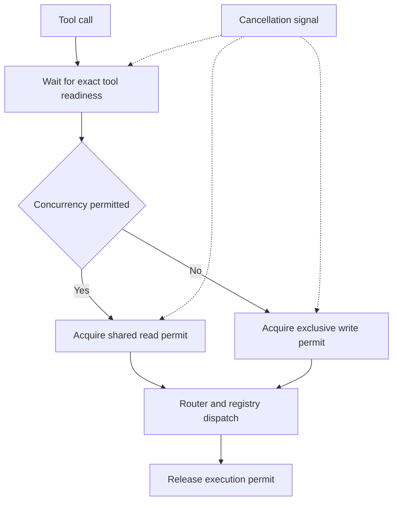

The lock covers registry dispatch, including the relevant hooks and output processing. A slow post-tool hook can therefore extend an exclusive window. The benefit is a complete admission boundary around the host lifecycle. The cost is that later calls wait for that host work too. Measuring only the underlying command would miss the delay.

The lock belongs to this `ToolCallRuntime`. It is not a filesystem lock shared by every session, agent, or process in Codex. Several conversation threads may still access one repository. Tool admission also cannot replace terminal-specific locks or the synchronization used by Git, a database, or the application being run.

```text
Teaching pseudocode: acquire execution eligibility
runtime = registry.find(call.name)
await cancellable(runtime.readiness())
permit = if runtime.supports_parallel:
    await cancellable(gate.read())
else:
    await cancellable(gate.write())
result = await router.dispatch(call, original_step)
drop(permit)
return result
```

<a id="ch07-concurrency--two-searches-and-three-timelines"></a>

## Two searches and three timelines

Suppose one model response requests search A, then search B. A scans `src` and takes longer; B reads a small test file. Unless a synchronous post-model hook requires delayed dispatch, each tool starts after its complete stream item arrives. It does not wait for the final collection of futures. Execution can overlap the remaining model stream.

Receipt order is A, B. Completion may be B, A. History output order still follows the order in which the calls were registered. The sampling function keeps in-flight futures in `FuturesOrdered`; after the stream ends, `drain_in_flight` waits for each envelope and records it in order. [Ordered collection and draining](https://github.com/openai/codex/blob/e4568a3538c9cab6627d64ff8cdfc7d98b79b7db/codex-rs/core/src/session/turn.rs#L2574-L2602)

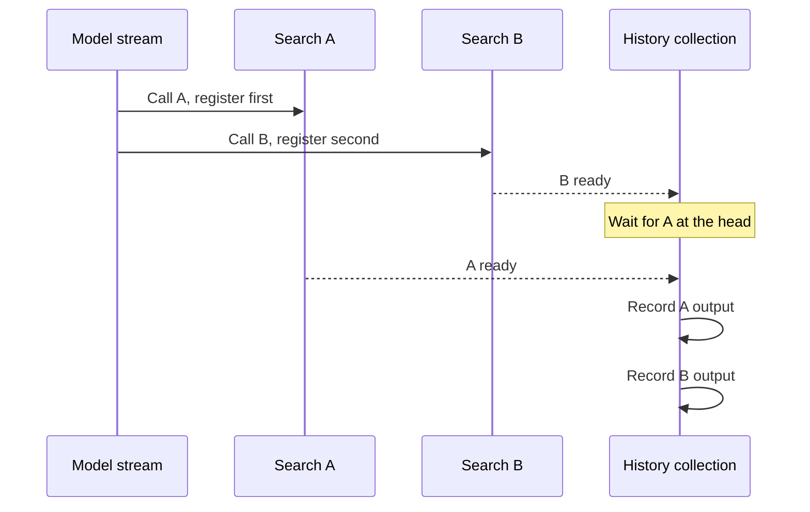

B remains concurrent even while its envelope waits to be written. Events and traces can report its completion earlier. In `parallel.rs`, `result_ready` is recorded inside the scheduled task so that ordered collection does not distort completion time. If A adds two seconds of waiting, B should not appear two seconds slower in monitoring.

Ordered collection introduces head-of-line blocking: B's evidence is ready, but the next model step waits for the batch to drain. On this response-oriented path, the tradeoff gives history a stable order that is easier to replay. The source does not implement a general dataflow executor that starts independent sampling as soon as each tool finishes.

An interface's display order therefore cannot establish when the model consumed a result. Seeing B complete first does not mean the model has used B. Seeing A first in history does not mean A finished first. Diagnosis needs the event boundary relevant to the question.

Give the example concrete identities. `call-src` searches `src` for every `next_cursor`; `call-test` reads `tests/empty_page.rs`. In this hypothetical timeline, B is ready after two hundred milliseconds and reports that an empty array should produce an empty cursor. A returns three implementation locations after one second. Their execution overlaps and B's completion event can arrive first. The next model request still pairs outputs with their original call identities in registration order, allowing the model to decide which implementation to change.

Now suppose the same response also contains C, a patch that sets `next_cursor` to a fixed empty value. C depends on understanding A and B. The runtime cannot infer that reasoning dependency merely because C appears later. Even an exclusive permit only waits for earlier execution windows to clear. C's arguments were already generated and cannot acquire evidence the model had not seen. The model should first receive the search results, or a script must explicitly await and inspect them before constructing the patch.

Serial execution prevents overlap of side effects. It does not prove that later arguments were derived from earlier results when all arguments were fixed in one model response. The pagination patch could still encode the wrong guess and write it in an orderly sequence.

<a id="ch07-concurrency--cancellation-must-finish-the-protocol-exchange"></a>

## Cancellation must finish the protocol exchange

The user interrupts after deciding that the repair is going in the wrong direction. A is running, B has completed but has not been collected, and C is waiting for exclusive admission. The runtime must handle their different states while retaining every call's identity.

`AbortOnDropHandle` owns each dispatch task. An outer `select!` waits for either the task or cancellation. For an ordinary unfinished handler, the runtime can abort the task and synthesize an aborted output. Cancellation before admission also has a result indicating that the user aborted the call before dispatch. Since the complete call was already recorded, the output closes a history exchange that would otherwise contain a request without a response. [Cancellation branches and aborted results](https://github.com/openai/codex/blob/e4568a3538c9cab6627d64ff8cdfc7d98b79b7db/codex-rs/core/src/tools/parallel.rs#L258-L318)

Some handlers declare `finishes_on_cancellation`: they observe the token and publish their own terminal state. Once admitted, they must be allowed to finish that cleanup. The outer layer also accepts an original result if the call has already claimed its terminal state or its dispatch task has completed. These rules follow lifecycle ownership.

A delicate race occurs after the side effect finishes. B may be sending an end notification to extension observers when cancellation arrives. Checking the token alone could publish `Aborted` as well, leaving the interface, telemetry, and history with conflicting endings. `ToolCallState`, held outside the call, uses an atomic exchange at terminal notification to claim ownership once. [Atomic terminal-state ownership](https://github.com/openai/codex/blob/e4568a3538c9cab6627d64ff8cdfc7d98b79b7db/codex-rs/core/src/tools/registry.rs#L899-L909)

```mermaid
stateDiagram-v2
    state "Waiting for readiness" as 等待就绪
    state "Waiting for permit" as 等待许可
    state "Executing" as 执行
    state "Aborted" as 中止
    state "Completed" as 完成
    state "Failed" as 失败
    state "Cancellation cleanup" as 取消收尾
    [*] --> 等待就绪
    等待就绪 --> 等待许可
    等待许可 --> 执行
    等待就绪 --> 中止
    等待许可 --> 中止
    执行 --> 完成
    执行 --> 失败
    执行 --> 取消收尾
    取消收尾 --> 中止
    取消收尾 --> 完成: Completion already claimed
    取消收尾 --> 失败: Failure already claimed
    完成 --> [*]
    失败 --> [*]
    中止 --> [*]
```

There is no completed-to-aborted transition. Cleanup respects an already claimed terminal state. `finishes_on_cancellation` requires the outer layer to wait; that declaration alone does not determine the eventual result. If the handler ends during cancellation without having claimed a terminal state, the registry still considers the token when deciding whether it was aborted.

The diagram describes host lifecycle ownership. It does not make external actions atomic. Cancelling a future cannot restore a written file or retract a sent message. Interactive terminal requests can also have shorter return windows than the process they manage, as the next chapter explains.

Receipt of a cancellation request and cessation of effects are separate observations. The token establishes the former. The latter depends on the handler and its resources. An action crossing a process, network, or client response may already have issued an external request by the time local waiting stops. An aborted output describes the host call's ending; it cannot prove that the outside world remained unchanged.

For the repository scenario, a sensible recovery is to reread the target function and diff before retrying a side-effecting action. This is a recommendation derived from the cancellation boundary. The source does not promise arbitrary rollback or idempotent retries for every tool.

<a id="ch07-concurrency--tests-arrange-the-races-explicitly"></a>

## Tests arrange the races explicitly

`cancellation_before_dispatch_admission_logs_dispatch_only_timing` holds the gate's write lock, starts a tool, and cancels it immediately. Its assertions require one timing record with `execution_started=false` and `handler_duration_ms=0`. The setup distinguishes cancellation in a queue from cancellation after execution begins. [Cancellation before admission test](https://github.com/openai/codex/blob/e4568a3538c9cab6627d64ff8cdfc7d98b79b7db/codex-rs/core/src/tools/parallel.rs#L612-L710)

Another test makes the handler finish immediately but blocks its end observer. It cancels the call, releases the observer, and asserts a successful result with exactly one `Completed { success: true }`. By arranging this interleaving, the test checks terminal ownership without relying on a race happening under load. It does not assert that cancellation always defeats completion. [Cancellation during completion test](https://github.com/openai/codex/blob/e4568a3538c9cab6627d64ff8cdfc7d98b79b7db/codex-rs/core/src/tools/parallel.rs#L804-L878)

The test named `read_file_tools_run_in_parallel` uses a two-participant barrier in `test_sync_tool` to establish overlap, supplemented by timing assertions. It does not establish that all real file reads use one dedicated read-file tool. Separate shell tests issue two `exec_command` calls. The test file excludes Windows, and some tests check network conditions. These tests were read, not executed for the book; their POSIX setup is not an all-platform performance promise.

In the same file, `tool_results_grouped` has a fake model issue three commands in one response. It checks that the next request places all three calls before their outputs and pairs them by `call_id`. A separate test withholds response completion from the stream and uses command-written timing evidence to observe execution before the response ends. Together, these tests cover early start and later ordered collection as distinct behaviors. [Grouped results and delayed stream tests](https://github.com/openai/codex/blob/e4568a3538c9cab6627d64ff8cdfc7d98b79b7db/codex-rs/core/tests/suite/tool_parallelism.rs#L225-L355)

A second concurrency boundary exists inside terminal management. Two `write_stdin` calls can both pass the shared gate. If they target one terminal, the process manager takes that process's interaction lock: draining the same output buffer and writing the same input stream need ordering. Different terminals can overlap. The tool scheduler handles admission across tools; each resource manager handles its own finer synchronization. [Per-terminal interaction lock](https://github.com/openai/codex/blob/e4568a3538c9cab6627d64ff8cdfc7d98b79b7db/codex-rs/core/src/unified_exec/process_manager.rs#L895-L928)

```text
Teaching pseudocode: exercise cancellation at admission
hold(execution_gate)
call = start_tool()
cancel(call)
assert one_terminal_output(call.id)
assert timing(call).execution_started == false
release(execution_gate)
assert no_late_completion(call.id)
```

<a id="ch07-concurrency--timing-follows-the-same-boundaries"></a>

## Timing follows the same boundaries

A call has dispatch waiting time, handler work, and total elapsed time. The runtime records `execution_started_at` after admission and samples the end once to compute waiting and working durations. A call cancelled before its permit has zero handler time but nonzero waiting time. Combining those values would make queueing behind an exclusive tool look like slow execution in every later tool. [Timing boundaries](https://github.com/openai/codex/blob/e4568a3538c9cab6627d64ff8cdfc7d98b79b7db/codex-rs/core/src/tools/parallel.rs#L419-L465)

If reading the test file takes tens of milliseconds but the user waits several seconds, the delay could be MCP readiness, exclusive admission, command execution, or ordered collection behind A. Optimizing the command helps only one of those causes. Stable call identities and phase-specific times allow logs from different layers to answer the same question.

Ordinary call errors still become model-visible failure outputs. Fatal errors propagate as runtime errors.

<a id="ch07-concurrency--reading-the-source"></a>

## Reading the source

- [ToolCallRuntime: shared execution gate and original step context](https://github.com/openai/codex/blob/e4568a3538c9cab6627d64ff8cdfc7d98b79b7db/codex-rs/core/src/tools/parallel.rs#L45-L65)
- [Admission and execution: readiness before read or write permits](https://github.com/openai/codex/blob/e4568a3538c9cab6627d64ff8cdfc7d98b79b7db/codex-rs/core/src/tools/parallel.rs#L202-L254)
- [Cancellation: wait for handler cleanup or synthesize aborted output](https://github.com/openai/codex/blob/e4568a3538c9cab6627d64ff8cdfc7d98b79b7db/codex-rs/core/src/tools/parallel.rs#L258-L318)
- [drain_in_flight: history in registration order](https://github.com/openai/codex/blob/e4568a3538c9cab6627d64ff8cdfc7d98b79b7db/codex-rs/core/src/session/turn.rs#L2574-L2602)
- [MCP: read_only_hint and server opt-in](https://github.com/openai/codex/blob/e4568a3538c9cab6627d64ff8cdfc7d98b79b7db/codex-rs/core/src/tools/handlers/mcp.rs#L880-L914)
- [tool_parallelism: barriers, shell calls, and grouped results](https://github.com/openai/codex/blob/e4568a3538c9cab6627d64ff8cdfc7d98b79b7db/codex-rs/core/tests/suite/tool_parallelism.rs#L84-L245)
- [Cancellation test: zero handler time before admission](https://github.com/openai/codex/blob/e4568a3538c9cab6627d64ff8cdfc7d98b79b7db/codex-rs/core/src/tools/parallel.rs#L612-L710)
- [Cancellation test: a completed call publishes only completion](https://github.com/openai/codex/blob/e4568a3538c9cab6627d64ff8cdfc7d98b79b7db/codex-rs/core/src/tools/parallel.rs#L804-L878)
- [ToolCallTimingGuard: separate waiting and handler work](https://github.com/openai/codex/blob/e4568a3538c9cab6627d64ff8cdfc7d98b79b7db/codex-rs/core/src/tools/parallel.rs#L419-L465)

<a id="ch07-concurrency--design-lessons"></a>

## Design lessons

1. Require an explicit concurrency declaration from tool implementations and use a conservative default. A read-only hint still depends on the integration's honesty and cannot replace dependency analysis.
2. Use shared and exclusive admission when some operations need an exclusive execution window. Define its scope, including hooks, because host lifecycle work can prolong the permit.
3. Record completion order separately from history order when results need stable replay. Ordered draining introduces head-of-line blocking that final history alone cannot reveal.
4. Give each call one owner for terminal-state publication and provide outputs for calls already recorded in history. Handlers that finish their own cancellation must implement that lifecycle contract.
5. Separate readiness, admission, execution, and collection when investigating latency. Their timing boundaries must follow the control flow; a total duration cannot identify the source of waiting.

---

<a id="ch08-execution"></a>

<a id="ch08-execution--chapter-8-commands-terminal-sessions-and-patches"></a>

# Chapter 8: Commands, terminal sessions, and patches

The model has read the pagination boundary condition and is ready to change the implementation and run a focused test. The tool layer gives those intentions call identities. Execution adds resource lifetimes: a test can keep printing, a terminal can wait for input, and a patch can change one file before failing on another. A tool returning does not establish that an operating system process has exited.

Unified Exec manages command startup, interaction, output collection, and process cleanup as one lifecycle. It shares approval and sandbox orchestration with the patch tool, giving execution location and permission checks common entry points. This chapter follows the resources; [Chapter 9](#ch09-safety) examines authorization and isolation.

The teaching command is `cargo test empty_page -- --nocapture`, intended to check cursor behavior for empty input. It was not run in a target repository for this book. Its purpose is to follow process creation, observation windows, and the facts that remain to be checked after failure.

<a id="ch08-execution--a-command-belongs-to-an-environment"></a>

## A command belongs to an environment

`ExecCommandHandler` parses the function arguments, chooses the step's execution environment, and resolves its working directory. An environment may be remote, so a path remains a `PathUri` rather than becoming a local `PathBuf` everywhere. A native directory following host conventions is required when a local host sandbox needs it. Turning a Windows path into something absolute-looking on POSIX would not make it a valid host repository directory. [Environment, directory, and native path checks](https://github.com/openai/codex/blob/e4568a3538c9cab6627d64ff8cdfc7d98b79b7db/codex-rs/core/src/tools/handlers/unified_exec/exec_command.rs#L172-L233)

The shell also belongs to the environment. When a remote environment reports a shell, the handler prefers it. The current implementation requires a requested remote shell type to match the reported type, avoiding interpretation of another machine's command with the controller's defaults. TTY creation has a feature check too. `tty=true` alone does not guarantee a pseudo-terminal: the specification, configuration, and backend capabilities determine the final request.

In the teaching command, `--`, shell interpretation, and working directory affect the test that actually runs. The wrong directory may select a different crate; another shell can change quoting and variable expansion. The handler therefore establishes the environment, builds command arguments and shell information, and only then reserves process identity. Preparation remains cancellable. Allocating the process ID after preparation avoids recording a resource for a request that never reached startup.

```mermaid
flowchart TD
    I[Command tool arguments] --> E[Select step environment]
    E --> W[Resolve PathUri and shell]
    W --> V[Validate permissions and runtime conditions]
    V --> A[Allocate process identity]
    A --> O[Approval and sandbox orchestration]
    O --> L[Local or remote process]
    L --> B[Output collection and state management]
    B --> R[Tool result]
```

<a id="ch08-execution--yield-is-an-observation-window"></a>

## Yield is an observation window

Unified execution has two lifetimes. An interactive command can survive one tool return. A one-shot command waits for completion and terminates its process on timeout or cancellation. One-shot mode forces TTY off, uses a completion timeout, and does not expose a process that the caller can continue interacting with. [Lifetimes and timeout selection](https://github.com/openai/codex/blob/e4568a3538c9cab6627d64ff8cdfc7d98b79b7db/codex-rs/core/src/tools/handlers/unified_exec/exec_command.rs#L293-L300)

For an interactive call, `yield_time_ms` controls how long this observation waits before returning collected evidence. If the command still runs when the window ends, the result can include a process ID for `write_stdin`. Yield does not kill the process. The next step must inspect whether the result contains an exit code or a continuing session before reporting that the test has completed.

This snapshot bounds the waiting windows. Initial yield is generally limited to 250 through 30,000 milliseconds; Windows also has a 10,000-millisecond initial minimum. Empty `write_stdin` polling waits at least five seconds, and the default background wait has a five-minute upper bound. Nonempty input uses a different upper bound. These are implementation conditions in this snapshot, not service-level promises for every backend. [Waiting windows and budget constants](https://github.com/openai/codex/blob/e4568a3538c9cab6627d64ff8cdfc7d98b79b7db/codex-rs/core/src/unified_exec/mod.rs#L68-L77)

Suppose the focused test prints compilation output in its first second and is still running in its second. When the observation window ends, the model retains the returned session identity and can send empty input to collect later output. That poll observes the same managed process; it does not rerun the test. Once the result includes an exit code, an old ID should not be treated as a permanent terminal address.

```text
Teaching pseudocode: continue an execution session
r = exec(command, observation_window)
show(r.output)
while r.has_resumable_process:
    r = write_stdin(r.process_id, input="")
    show(r.output)
inspect(r.exit_code)
```

One-shot cancellation retains the exact process handle published by normal startup. If cancellation arrives after creation, cleanup confirms termination through that handle, then waits for the original execution path to finish. If creation has not happened, it drops execution and releases the reserved ID. Cleanup therefore does not kill a process solely through an integer that might have been reused. [One-shot cancellation and exact handles](https://github.com/openai/codex/blob/e4568a3538c9cab6627d64ff8cdfc7d98b79b7db/codex-rs/core/src/unified_exec/oneshot.rs#L41-L123)

<a id="ch08-execution--process-exit-can-precede-the-last-output"></a>

## Process exit can precede the last output

`UnifiedExecProcessManager` retains the process together with its original call identity, working directory, TTY setting, environment identity, permissions, network approval state, and recent-use time. A process session is an owned resource with a permission snapshot, rather than an integer-to-process lookup alone.

After startup, the manager collects output within the observation window and constructs `ExecCommandToolOutput`. That output includes raw text, truncation policy, output budget, process identity, and exit code. The manager also handles a remote race: the execution endpoint can report process exit before the output pipe closes. The final bytes may still be in transit. Deleting the record on exit could lose the lines that explain the failure.

For backends that require output closure, an exited process remains available for collection while output is not closed or buffered data remains pending. The manager does not hold the shared process-table lock while waiting for output, so a slow pipe cannot block all terminal state access. [Exit and trailing output](https://github.com/openai/codex/blob/e4568a3538c9cab6627d64ff8cdfc7d98b79b7db/codex-rs/core/src/unified_exec/process_manager.rs#L1140-L1185)

```mermaid
stateDiagram-v2
    state "Preparing startup" as 启动准备
    state "Running" as 运行
    state "Startup failed" as 启动失败
    state "Exited with output pending" as 已退出仍有输出
    state "Output collection complete" as 输出收集完成
    state "Termination cleanup" as 终止收尾
    state "Reclaimed" as 回收
    [*] --> 启动准备
    启动准备 --> 运行
    启动准备 --> 启动失败
    运行 --> 运行: Continue after yield
    运行 --> 已退出仍有输出
    已退出仍有输出 --> 输出收集完成
    运行 --> 终止收尾
    终止收尾 --> 输出收集完成
    输出收集完成 --> 回收
    启动失败 --> 回收
    回收 --> [*]
```

The model needs evidence of both process exit and collection of available output. The interface needs a stable relationship between terminal-end and final interaction events. Maintainers must follow each backend's output-closure protocol; local pipe behavior cannot establish the semantics of remote push events.

<a id="ch08-execution--separate-memory-and-context-budgets"></a>

## Separate memory and context budgets

An unbounded test log or error loop can exhaust an agent's resources. Unified Exec's internal output buffer has a one-MiB limit. `HeadTailBuffer` divides capacity roughly between a stable prefix and the newest suffix, discards excess middle bytes, and accumulates an omitted-byte count. It inserts an explicit omission marker. [Bounded head-and-tail buffer](https://github.com/openai/codex/blob/e4568a3538c9cab6627d64ff8cdfc7d98b79b7db/codex-rs/core/src/unified_exec/head_tail_buffer.rs#L5-L124)

The prefix often contains the command, build context, and first errors. The suffix often contains final status or a failure summary; repetitive progress may lie between them. This is a practical heuristic, not a guarantee that the most useful evidence survives. An omission marker should prompt a narrower inspection or a separately searchable output artifact. It cannot support a claim that every log line was read.

The byte limit protects internal storage. Model input also has `max_output_tokens` and a model truncation policy. Formatting must reserve space for exit information, warnings, and omission markers. Filling the budget with content and then adding headers can trigger a second truncation in history, possibly removing the warning that evidence was omitted. Raw observed volume, retained bytes, and model-visible content need separate accounting.

Tests repeatedly produce and drain a buffer with capacity of only ten bytes, comparing its final result with a single insertion of the same total content. Another test checks that a prior omission count survives draining. They cover budgets and counts across several observations. The book reads these tests; it does not report an execution of them. [Repeated-drain buffer tests](https://github.com/openai/codex/blob/e4568a3538c9cab6627d64ff8cdfc7d98b79b7db/codex-rs/core/src/unified_exec/process_manager_tests.rs#L345-L430)

Successful delivery of a tool output is also distinct from command success. `ExecCommandToolOutput` can normally deliver output from a process with a nonzero exit code. The tool layer has completed its observation duty; the command's exit code remains inside the result for the model to inspect. Otherwise, a properly delivered failure summary could be mistaken for a passing test. [Execution output protocol packaging](https://github.com/openai/codex/blob/e4568a3538c9cab6627d64ff8cdfc7d98b79b7db/codex-rs/core/src/tools/context.rs#L379-L445)

A nonzero focused test could indicate a type error introduced by the patch, a missing environment dependency, or a failed assertion. Each requires a different next step. If output was omitted, the model may need to narrow it before locating the relevant error. The runtime preserves evidence for that diagnosis; it does not itself attribute the failure to application logic.

<a id="ch08-execution--stdin-input-is-a-new-action"></a>

## Stdin input is a new action

Sending characters to an interactive shell can start a new command. `write_stdin` first locates the exact process object and acquires its interaction lock. Different terminals can operate concurrently. Input and draining for one terminal need serialization; otherwise two polls could split the same buffer and each return incomplete evidence.

After taking the lock, the manager checks current strict auto-review conditions and the terminal's retained permissions to determine whether this input needs approval. It bounds the full serialized action submitted for review. Oversized input is rejected, avoiding review of a prefix followed by execution of an unreviewed suffix. After approval, it rechecks the process object's `Arc` identity in case the old process was removed and its integer ID reused while the review was pending. [Interaction locking, complete input review, and identity recheck](https://github.com/openai/codex/blob/e4568a3538c9cab6627d64ff8cdfc7d98b79b7db/codex-rs/core/src/unified_exec/process_manager.rs#L895-L998)

Approval to start a test shell does not inherently approve a later command that deletes a directory. The terminal may retain broad execution capability, but current rules still govern whether new input may use it. Approval caches, discussed next chapter, must describe the action and permission scope rather than merely remember that a terminal was once approved.

Non-TTY mode has a separate limit. It does not accept arbitrary later text. Interrupt control characters have a special path; ordinary input returns a stdin-closed error. TTY selects an interaction capability, with backend requirements. It is not a display option to add merely to make output look like a terminal.

<a id="ch08-execution--managed-sessions-need-eviction-rules"></a>

## Managed sessions need eviction rules

The snapshot sets a capacity threshold of 64 managed processes. Cleanup protects the eight most recently used and prefers exited processes outside that set, falling back to older candidates. The limit is soft. A process actively interacting or publishing a terminal state cannot simply be evicted. If an exited process briefly holds a lock, the manager can exceed the limit rather than kill a live process to satisfy a count. [Process cleanup and soft capacity](https://github.com/openai/codex/blob/e4568a3538c9cab6627d64ff8cdfc7d98b79b7db/codex-rs/core/src/unified_exec/process_manager.rs#L1750-L1820)

Session IDs are therefore temporary resources. A long task that creates many terminals may later find an old ID unavailable. The appropriate result is an unknown-process error, after which the caller must recreate the needed environment. Cleanup affects which future actions remain possible, so it must coordinate with interaction locks, exit notifications, and permission cleanup.

<a id="ch08-execution--a-patch-becomes-an-inspectable-change"></a>

## A patch becomes an inspectable change

The freeform `apply_patch` input is parsed, associated with the environment filesystem, and validated into executable file changes. The handler prepares the safety decision, sends a start event, and calls `ApplyPatchRuntime` through `ToolOrchestrator`. Recognizable shell-form patches can be intercepted into this path too. The source does not establish that every shell string containing `apply_patch` is recognized.

Streaming patch preview is separate from application. With the relevant feature enabled, a parser can emit updates before the full patch arrives and coalesce frequent updates over short intervals. This lets the interface show proposed changes. Preview lines have not yet been written to disk. Generation, validated intent, and committed changes need distinct states. [Patch parsing, validation, and execution entry](https://github.com/openai/codex/blob/e4568a3538c9cab6627d64ff8cdfc7d98b79b7db/codex-rs/core/src/tools/handlers/apply_patch.rs#L301-L381)

```mermaid
flowchart LR
    S[Patch text stream] --> P[Preview events]
    S --> C[Complete patch]
    C --> V[Environment filesystem validation]
    V --> A[Safety decision and approval]
    A --> X[Commit file changes]
    X --> D[Actual committed delta]
    D --> F[Completion or failure event]
```

For a move, both source and destination enter the affected-file set. Extra write permissions are calculated from actual needs. A destination already writable does not lead the runtime to request broader permissions for its parent. Sandbox conditions also affect symlink handling. A patch's constrained format does not remove the relationship between paths, permissions, and the environment.

Patches are not cross-file transactions. `apply_patch_with_options` can return a committed delta even on failure. The runtime appends it to `committed_delta`, and the handler includes the actual delta in the completion event on its error path. If the first of two files changes and writing the second fails, the first is not automatically restored. [Committed changes survive overall failure](https://github.com/openai/codex/blob/e4568a3538c9cab6627d64ff8cdfc7d98b79b7db/codex-rs/core/src/tools/runtimes/apply_patch.rs#L170-L258)

```text
Teaching pseudocode: failure still carries observed changes
result = apply_files(patch)
if result.failed:
    committed = result.changes_before_failure
else:
    committed = result.all_changes
record_actual_delta(committed)
report_status_and_delta(result.status, committed)
```

Suppose the repair changes `src/page.rs` and a test file, but writing the latter fails. The next step should inspect the real diff to see whether the implementation changed, then complete or adjust the test change. Replaying the whole patch immediately may fail because its expected old text has already changed.

The apply-patch crate includes a direct partial-failure test. A patch first adds `created.txt`, then attempts to update nonexistent `missing.txt`. The CLI is expected to fail. The test still reads the created file and asserts that it contains `hello`. This fixes the partial-completion case without relying on incidental concurrency. Its useful pattern is to inspect both the final error and the state committed before that error; the exit status alone cannot establish which files remain.

Command return, process exit, complete output collection, and successful application goals describe different facts. Patch failure adds another: it may coexist with committed changes. Completion reports should name the observed exit state, test evidence, and actual changes. An issued action or an observation-window return is insufficient evidence that the user's goal has been achieved.

<a id="ch08-execution--reading-the-source"></a>

## Reading the source

- [ExecCommandHandler: environment, paths, and shell](https://github.com/openai/codex/blob/e4568a3538c9cab6627d64ff8cdfc7d98b79b7db/codex-rs/core/src/tools/handlers/unified_exec/exec_command.rs#L172-L280)
- [Preparation, patch interception, and process allocation](https://github.com/openai/codex/blob/e4568a3538c9cab6627d64ff8cdfc7d98b79b7db/codex-rs/core/src/tools/handlers/unified_exec/exec_command.rs#L358-L424)
- [Unified Exec: windows, budgets, and process state](https://github.com/openai/codex/blob/e4568a3538c9cab6627d64ff8cdfc7d98b79b7db/codex-rs/core/src/unified_exec/mod.rs#L68-L199)
- [oneshot: exact cleanup on timeout and cancellation](https://github.com/openai/codex/blob/e4568a3538c9cab6627d64ff8cdfc7d98b79b7db/codex-rs/core/src/unified_exec/oneshot.rs#L41-L123)
- [write_stdin: serialized interaction, approval, and identity recheck](https://github.com/openai/codex/blob/e4568a3538c9cab6627d64ff8cdfc7d98b79b7db/codex-rs/core/src/unified_exec/process_manager.rs#L895-L998)
- [HeadTailBuffer: retained ends and omitted-byte counts](https://github.com/openai/codex/blob/e4568a3538c9cab6627d64ff8cdfc7d98b79b7db/codex-rs/core/src/unified_exec/head_tail_buffer.rs#L5-L124)
- [Output tests: bounded storage across repeated drains](https://github.com/openai/codex/blob/e4568a3538c9cab6627d64ff8cdfc7d98b79b7db/codex-rs/core/src/unified_exec/process_manager_tests.rs#L345-L430)
- [Patch handler: validation before shared execution](https://github.com/openai/codex/blob/e4568a3538c9cab6627d64ff8cdfc7d98b79b7db/codex-rs/core/src/tools/handlers/apply_patch.rs#L301-L381)
- [Patch runtime: committed delta on failure](https://github.com/openai/codex/blob/e4568a3538c9cab6627d64ff8cdfc7d98b79b7db/codex-rs/core/src/tools/runtimes/apply_patch.rs#L170-L258)
- [Partial-failure test: changes are not rolled back automatically](https://github.com/openai/codex/blob/e4568a3538c9cab6627d64ff8cdfc7d98b79b7db/codex-rs/apply-patch/tests/suite/tool.rs#L378-L396)

<a id="ch08-execution--design-lessons"></a>

## Design lessons

1. Let an execution environment own directory, shell, and path conventions. Convert to native paths at the boundary that needs them; controller-side strings cannot represent every remote path safely.
2. Separate observation windows from completion timeouts for long commands. Return either a continuing session or terminal evidence, and give those sessions a cleanup policy.
3. Bound internal storage and model input independently, retaining omission information. Discarded evidence needs another retrieval path; truncation cannot be treated as complete inspection.
4. Review new terminal input as a new action and recheck resource identity after waiting. This prevents stale IDs or earlier approval from silently authorizing different work.
5. Report actual committed file changes even when a multi-file patch fails. Callers must handle partial completion, and rollback requires a separate transaction mechanism.

---

<a id="ch09-safety"></a>

<a id="ch09-safety--chapter-9-approval-policy-and-sandboxing"></a>

# Chapter 9: Approval, policy, and sandboxing

The model has prepared the patch and chosen a test. Running it may require a build directory or a dependency that has not been cached. Authorization to repair the bug leaves several execution questions open: what permissions this action requests, how policy evaluates them, and whether the execution backend can enforce the resulting limits.

Approval authorizes an action. Command policy turns rules and a request into execution requirements. A sandbox enforces a permitted scope through the operating system or execution endpoint. A model's claim that it will only read cannot replace kernel restrictions, and approval of a command need not remove existing denied-read rules.

This chapter follows a test from default permissions through a failure and a possible escalation. The source contains several platform and backend paths. The claims here describe the fixed snapshot's control flow, without treating one local configuration as the default for every product.

<a id="ch09-safety--policy-produces-an-execution-requirement"></a>

## Policy produces an execution requirement

Execution does not treat the model's `justification` as approval. `ExecPolicyManager` evaluates the command first. Shell commands are organized into assessable segments. Rule checks, together with fallback behavior for unmatched commands, produce `Forbidden`, `Prompt`, or `Allow`; these become the `ExecApprovalRequirement` variants `Forbidden`, `NeedsApproval`, and `Skip`. [Command policy and execution requirements](https://github.com/openai/codex/blob/e4568a3538c9cab6627d64ff8cdfc7d98b79b7db/codex-rs/core/src/exec_policy.rs#L339-L463)

`Forbidden` blocks the action. `NeedsApproval` requires a concrete review action. `Skip` usually avoids the regular approval round and also carries whether the first attempt should bypass the sandbox. With `strict_auto_review` enabled, the orchestrator still constructs an action for review even when the requirement is `Skip`. [Skip and strict auto-review](https://github.com/openai/codex/blob/e4568a3538c9cab6627d64ff8cdfc7d98b79b7db/codex-rs/core/src/tools/orchestrator.rs#L164-L225)

```mermaid
flowchart TD
    C[Concrete command and permission request] --> P[Evaluate rules and fallback]
    P --> F[Forbidden]
    P --> N[NeedsApproval]
    P --> S[Skip]
    F --> R[Reject]
    N --> A[Construct approval action]
    S --> T{Strict auto-review}
    T -->|Enabled| A
    T -->|Disabled| X[Select execution isolation]
    A --> D{Approved}
    D -->|Yes| X
    D -->|No| R
```

Unmatched commands have conditions that the configuration names alone do not express. `Never` prevents approval prompts; dangerous-command detection can still make a request forbidden, while ordinary unmatched commands may execute within existing sandbox limits. Under `OnRequest`, an ordinary command in a restricted environment can first run inside the sandbox, while an explicit escalation request changes the decision. When the Windows sandbox backend is disabled but managed filesystem restrictions remain, the code is conservative because the platform mechanism cannot guarantee the requested restriction shape. [Unmatched commands and platform conditions](https://github.com/openai/codex/blob/e4568a3538c9cab6627d64ff8cdfc7d98b79b7db/codex-rs/core/src/exec_policy.rs#L777-L860)

The final decision depends on the command, rule source, approval setting, environment permissions, and backend. A mode name cannot accurately summarize it as “always prompts” or “never refuses.”

<a id="ch09-safety--preserve-the-reason-for-an-allow-decision"></a>

## Preserve the reason for an allow decision

`cargo test empty_page` might match an explicit allow rule. It might instead pass fallback evaluation because it is not recognized as dangerous and the current sandbox constrains its effects. Both can yield `Allow`, but only when every parsed segment matches an explicit allow rule does the source set `bypass_sandbox=true` on `Skip`. Heuristic allowance does not grant the same authority.

A compound shell line can change directory, run a test, and perform an additional action. Checking only its first safe-looking executable would miss the rest. Rule amendment suggestions also consider all segments, avoiding a prefix recommendation that appears to cover the full action while leaving part unmatched. This is a conservative rule-evaluation structure, not an assertion that shell parsing understands arbitrary program semantics.

Later retries, cache lookups, and explanations need to know why an action was allowed. Explicit rules, remaining sandbox constraints, and reviewer approval have different implications. Reducing them to a boolean too early loses information needed when permissions change.

Approval policy also differs from available permissions. Disabling prompts changes whether the runtime can wait for a human decision. It does not create a writable directory or enable a platform sandbox. Conversely, a sandbox that permits workspace writes does not require command policy to accept every program that writes there. The execution path consumes both decisions.

<a id="ch09-safety--review-the-actual-action-and-authority"></a>

## Review the actual action and authority

For approval, the unified runtime constructs `ApprovalAction::ExecCommand` with command arguments, environment identity, directory, TTY setting, sandbox permissions, extra permissions, and a proposed rule amendment. `request_approval` first runs PermissionRequest hooks. If the hooks do not decide, configuration selects Guardian auto-review or user approval. [Shared approval entry and precedence](https://github.com/openai/codex/blob/e4568a3538c9cab6627d64ff8cdfc7d98b79b7db/codex-rs/core/src/tools/approvals.rs#L454-L550)

Guardian is a visible runtime review path. Its call chain establishes what action it receives and how rejection returns to execution. It does not establish the review model's accuracy or provide operating system isolation. Human and automatic review produce authorization decisions; subsequent permission profiles, transformations, and backends determine actual file access.

Approval caching describes concrete actions too. A command cache key contains environment, executable, normalized command, cwd, TTY, sandbox permissions, and extra permissions. User command approval also includes an environment policy fingerprint. Only `ApprovedForSession` populates this session cache. A one-time approval does not silently become continuing authorization. [Action cache keys](https://github.com/openai/codex/blob/e4568a3538c9cab6627d64ff8cdfc7d98b79b7db/codex-rs/core/src/tools/approvals.rs#L224-L260)

```text
Teaching pseudocode: cache an equivalent authorization
key = (environment, executable, command, cwd,
       tty, sandbox_permissions, extra_permissions, policy_fingerprint)
if cache[key] is approved_for_session:
    use_cached_decision()
else:
    decision = review(actual_action)
    if decision is approved_for_session:
        cache[key] = decision
```

The directory matters because `./scripts/check` can be a different program in another repository. Permissions matter because the same command has different consequences inside a read-only sandbox and with broader access. Environment identity prevents local and remote workspaces from sharing authorization merely because command text matches. These fields make equivalence conservative and inspectable.

<a id="ch09-safety--isolation-must-reach-an-enforcing-backend"></a>

## Isolation must reach an enforcing backend

After authorization, the orchestrator selects the first attempt's isolation. `SandboxManager` uses permissions and platform information to decide whether to add a local wrapper. macOS uses Seatbelt. Linux's enum variant is called LinuxSeccomp. Windows has a platform sandbox only when its relevant backend is enabled. The common enum does not imply a common mechanism. [Platform sandbox selection](https://github.com/openai/codex/blob/e4568a3538c9cab6627d64ff8cdfc7d98b79b7db/codex-rs/sandboxing/src/manager.rs#L43-L64)

On Linux, this snapshot normally uses bubblewrap for filesystem isolation, then applies seccomp and `no_new_privs` inside it. The old Landlock path is an explicitly selected compatibility option. The LinuxSeccomp name therefore does not mean that syscall filtering alone handles the filesystem or that Landlock is the default. [The Linux helper pipeline](https://github.com/openai/codex/blob/e4568a3538c9cab6627d64ff8cdfc7d98b79b7db/codex-rs/linux-sandbox/src/linux_run_main.rs#L55-L94)

With executor-managed sandboxing, the controller's concrete `SandboxType` can be `None` while `sandbox_requested` and permissions sent to the executor still apply. `None` can mean that the controller adds no local wrapper. It does not prove the absence of remote isolation. Equally, a policy object without a capable enforcing backend is insufficient evidence of isolated execution.

```mermaid
flowchart LR
    A[Authorized action] --> P[Permission profile and environment]
    P --> L[Host platform transformation]
    P --> R[Executor-managed sandbox]
    L --> O[Operating system restrictions]
    R --> E[Executor enforces permissions]
    O --> C[Actual command]
    E --> C
```

A permission object expresses scope; approval accepts the action; sandbox transformation turns scope into enforceable constraints. Backend capabilities determine whether that transformation can be carried out.

<a id="ch09-safety--escalation-must-preserve-denied-reads"></a>

## Escalation must preserve denied reads

Suppose project policy denies access to sensitive files while the test only needs a broader write scope. Removing the sandbox entirely would also remove the read restrictions. The source first checks whether unsandboxed execution can represent the current filesystem policy. Denied-read restrictions make that impossible.

An approved explicit escalation can instead use `EscalatedSandboxWithRestrictions`, widening the appropriate access while preserving denied reads. Explicit allow rules cannot erase them either. If no local filesystem sandbox is available, `ensure_native_sandbox` rejects the escalation. If a remote executor cannot establish support for escalation that preserves restrictions, the orchestrator rejects it and requests an executor upgrade. [Denied reads and retained sandboxing](https://github.com/openai/codex/blob/e4568a3538c9cab6627d64ff8cdfc7d98b79b7db/codex-rs/core/src/tools/sandboxing.rs#L234-L309)

Permissions have several independent dimensions. Adding write access to a build cache need not grant read access to sensitive files outside the project. A platform must be able to express that combination. When it cannot, this path rejects the request rather than silently dropping a restriction.

Unit tests construct a `**/*.env` denied-read rule and check that explicit escalation retains the restricted sandbox. They assert rejection without a native sandbox and check that a bypass recommendation still cannot override denied reads. The assertions cover the composition of permissions, beyond an undifferentiated “escalated” label.

<a id="ch09-safety--failure-does-not-automatically-widen-permissions"></a>

## Failure does not automatically widen permissions

A first-attempt failure must be classified. An ordinary nonzero exit differs from `SandboxErr::Denied`. Compilation errors, failed assertions, and tool refusal do not inherently trigger an unsandboxed retry. After an explicit sandbox denial, the orchestrator checks whether the tool supports escalation on failure, whether approval policy permits it, whether network-denial context is meaningful, and whether denied-read restrictions can survive. [Retry admission conditions](https://github.com/openai/codex/blob/e4568a3538c9cab6627d64ff8cdfc7d98b79b7db/codex-rs/core/src/tools/orchestrator.rs#L394-L472)

The default Approvable behavior disallows general unsandboxed approval retries for both `Never` and `OnRequest`. Network denials have a controlled exception, and individual tools can override defaults. Failure type, approved scope, and tool policy all participate.

Approval provenance matters too. Guardian's approval of the restricted first attempt does not preapprove the broader retry. The orchestrator rebuilds the actual retry action with `RequireEscalated`, clears the narrower extra-permission description, and submits it for review. Human or hook approval can preserve an existing retry scope under applicable policy; strict auto-review still affects whether another review can be bypassed. [Rebuilding approval for actual retry authority](https://github.com/openai/codex/blob/e4568a3538c9cab6627d64ff8cdfc7d98b79b7db/codex-rs/core/src/tools/orchestrator.rs#L484-L533)

```mermaid
sequenceDiagram
    participant T as Tool runtime
    participant A as Reviewer
    participant E as Executor
    T->>A: Review restricted action
    A-->>T: Allow
    T->>E: First sandboxed attempt
    E-->>T: Explicit sandbox denial
    T->>T: Check retry and restriction conditions
    T->>A: Review broader authority
    A-->>T: Deny
    Note over T,E: No second process start
```

The integration test `guardian_rechecks_unsandboxed_retry_after_sandboxed_approval` implements this sequence. A fake executor reports a sandbox denial; a fake model allows the first review and denies the second. The test asserts exactly one `process/start` and compares the review actions, checking that the second uses `require_escalated`. It covers the runtime's handling of approval scope. It neither establishes that the reviewer recognizes every dangerous operation nor reports a test run performed for this book. [Escalation review integration test](https://github.com/openai/codex/blob/e4568a3538c9cab6627d64ff8cdfc7d98b79b7db/codex-rs/core/tests/suite/guardian_sandbox_retry.rs#L160-L208)

<a id="ch09-safety--following-the-test-through-approval"></a>

## Following the test through approval

Return to `cargo test empty_page -- --nocapture`. The model supplies the selected repository environment and default sandbox permissions, with no extra writable directory. Policy evaluates the complete parsed command. Suppose no dangerous-command match or blocking rule applies and the current policy permits execution under restrictions. The permission decision depends on those restrictions remaining in force; later code cannot reinterpret it as an unrestricted launch.

The test stops because it cannot write a build directory. Nonzero exit and an error message do not by themselves grant escalation. The runtime still needs to identify a sandbox denial, check tool support for the corresponding retry, and determine whether the current mode can request that approval. The model's explanation that this is “only a test cache” does not replace those checks.

A new request for one writable directory must name that scope. A retry without the sandbox describes broader authority. The reviewer must receive the changed action. In the Guardian test, the command stays the same while permission fields change; denying the second action prevents a second process from starting.

If the user approves a scope for the session, an equivalent command in the same environment and directory may later use the cache. Changing environment or authority changes the key. This can produce a new wait that looks repetitive to the user, but it prevents permission for a check script in one directory from transferring to a different script with the same relative name elsewhere.

A terminal can retain permissions acquired at startup after the original test has ended or no longer needs network access. Later input still follows the stdin review path from the previous chapter. Retaining a process avoids recreating it for every interaction; it does not make every subsequent command equivalent to its launch. Command arguments, terminal input, network destinations, and patch file sets each describe concrete actions with their own scope.

Failure reports should retain that provenance. Policy rejection means the action was not allowed. Sandbox denial means an execution attempt encountered an enforced restriction. A failed assertion can mean the process ran successfully while the application behavior was wrong. Automatic review rejection means the current action did not receive authorization from that review path. The next step may be a code change, command correction, narrower permission request, or a statement that verification cannot be completed in the current environment.

<a id="ch09-safety--network-authorization-has-a-lifecycle"></a>

## Network authorization has a lifecycle

Dependency downloads introduce another boundary. A managed proxy is more than an environment variable. The orchestrator registers network approval for an execution attempt and passes its cancellation token and execution proxy into that attempt. After startup, the registration can remain with the process session as deferred approval until exit or later cleanup. A network denial can therefore arrive after the command starts, requiring the manager to stop the process and finish the registration.

Command approval does not authorize every future destination. Network approval context includes the destination host; policy updates and rejections have their own completion path. Long-running terminals may also span several inputs. These behaviors apply when the managed network path is enabled, rather than to every execution environment automatically. [Network approval registration and deferred cleanup](https://github.com/openai/codex/blob/e4568a3538c9cab6627d64ff8cdfc7d98b79b7db/codex-rs/core/src/tools/network_approval.rs#L55-L127)

```text
Teaching pseudocode: a bounded retry
requirement = evaluate(command, policy, requested_permissions)
approve_if_required(requirement, strict_review)
result = run_with_effective_sandbox()
if result.is_sandbox_denial and retry_is_allowed:
    retry_action = describe_actual_retry_authority()
    approve_retry_if_required(retry_action)
    return run_retry_preserving_required_restrictions()
return result
```

<a id="ch09-safety--reading-the-source"></a>

## Reading the source

- [ExecPolicyManager: rules and three execution requirements](https://github.com/openai/codex/blob/e4568a3538c9cab6627d64ff8cdfc7d98b79b7db/codex-rs/core/src/exec_policy.rs#L339-L463)
- [Unmatched commands: Never, OnRequest, and platform limits](https://github.com/openai/codex/blob/e4568a3538c9cab6627d64ff8cdfc7d98b79b7db/codex-rs/core/src/exec_policy.rs#L777-L860)
- [ToolOrchestrator: strict review of Skip requirements](https://github.com/openai/codex/blob/e4568a3538c9cab6627d64ff8cdfc7d98b79b7db/codex-rs/core/src/tools/orchestrator.rs#L164-L225)
- [request_approval: hooks, Guardian, and user review](https://github.com/openai/codex/blob/e4568a3538c9cab6627d64ff8cdfc7d98b79b7db/codex-rs/core/src/tools/approvals.rs#L454-L550)
- [Approval keys: concrete environment, action, and authority](https://github.com/openai/codex/blob/e4568a3538c9cab6627d64ff8cdfc7d98b79b7db/codex-rs/core/src/tools/approvals.rs#L224-L260)
- [Sandbox permissions: denied reads prevent a full bypass](https://github.com/openai/codex/blob/e4568a3538c9cab6627d64ff8cdfc7d98b79b7db/codex-rs/core/src/tools/sandboxing.rs#L234-L309)
- [Linux sandbox: bubblewrap and inner seccomp](https://github.com/openai/codex/blob/e4568a3538c9cab6627d64ff8cdfc7d98b79b7db/codex-rs/linux-sandbox/src/linux_run_main.rs#L55-L94)
- [Escalation retries: approval provenance and rebuilt actions](https://github.com/openai/codex/blob/e4568a3538c9cab6627d64ff8cdfc7d98b79b7db/codex-rs/core/src/tools/orchestrator.rs#L484-L533)
- [Guardian retry test: first approval does not cover broader authority](https://github.com/openai/codex/blob/e4568a3538c9cab6627d64ff8cdfc7d98b79b7db/codex-rs/core/tests/suite/guardian_sandbox_retry.rs#L32-L208)
- [Denied-read tests: filesystem restrictions survive escalation](https://github.com/openai/codex/blob/e4568a3538c9cab6627d64ff8cdfc7d98b79b7db/codex-rs/core/src/tools/sandboxing_tests.rs#L190-L250)

<a id="ch09-safety--design-lessons"></a>

## Design lessons

1. Turn command rules into explicit forbidden, review-required, and skip requirements, retaining the reason. A boolean safety field cannot preserve the distinctions needed for execution and retries.
2. Cache equivalent approvals by environment, directory, command, and authority, and only when session authorization is explicit. Conservative cache keys avoid transferring narrow approval to a broader action.
3. Record permission intent separately from the enforcing sandbox mechanism across platforms and executors. Backend capability is part of the evidence for isolation.
4. Preserve independent constraints such as denied reads when expanding other permissions. Reject combinations the backend cannot express rather than use full sandbox removal as a general repair.
5. Rebuild the actual action when a retry changes authority, then apply review rules for its provenance and policy. The first approval alone cannot establish authorization of the new scope.

---

<a id="ch10-context"></a>

<a id="ch10-context--chapter-10-managing-the-context-budget"></a>

# Chapter 10: Managing the context budget

Suppose Codex is fixing an edge case in a repository. It spends one turn finding the entry point, another reading the implementation, and a third examining thousands of lines of command output. The edit is still ahead. To the user, this is one continuous task. The next model request, however, has to fit inside a finite window. Appending everything forever will eventually exceed it. Deleting old messages carelessly can leave tool results without calls, remove the original constraints, or suggest that an unfinished command succeeded.

Here, context means model-visible input: the working set that Codex keeps, trims, and sometimes replaces between steps. The [rollout log in the next chapter](#ch11-persistence) supplies recovery material, while [cross-session memory in Chapter 12](#ch12-memory) supplies selected historical experience to future threads.

<a id="ch10-context--the-working-set-takes-shape-on-entry"></a>

## The working set takes shape on entry

Codex starts managing the budget before the window fills. `ContextManager::record_item_with_metadata` first checks whether a response item belongs in API messages, then clones it into history. For function and custom tool outputs, it truncates the payload according to policy. Metadata can override the history token limit for a tool output; otherwise the policy includes room for serialization. The long command output in our example may therefore be shortened before it enters the model's working set. The [history insertion code](https://github.com/openai/codex/blob/e4568a3538c9cab6627d64ff8cdfc7d98b79b7db/codex-rs/core/src/context_manager/history.rs#L517-L597) limits this truncation to live history. The original envelope can still go to persistence.

Persistence has its own filtering and output budgets, so the log does not preserve everything indefinitely either. The two consumers need different representations: the next inference needs compact material, while recovery and history browsing need their own record. Truncating the only object would destroy content that a later browsing or summarization strategy might have used.

```mermaid
flowchart LR
    A[Response item and origin metadata] --> B[Persistence path]
    A --> C[Clone for working set]
    C --> D[Truncate tool output]
    D --> E[In-memory history]
    E --> F[Normalize before request]
    F --> G[Model input]
```

Before a request, Codex checks the structure again. Each tool call must have a matching output, and each paired output must have a call. Named external tool events may stand alone. If an ordinary function call lacks a result, normalization inserts a synthetic output containing `aborted`. It also removes images and audio that the model does not support. This repairs the request contract. It does not undo an external action. Whether a command changed files is a question for the execution layer; normalization gives the model an interpretable history. [Request normalization](https://github.com/openai/codex/blob/e4568a3538c9cab6627d64ff8cdfc7d98b79b7db/codex-rs/core/src/context_manager/history.rs#L964-L981) and [missing-output handling](https://github.com/openai/codex/blob/e4568a3538c9cab6627d64ff8cdfc7d98b79b7db/codex-rs/core/src/context_manager/normalize.rs#L21-L97) define that boundary together.

Cancellation therefore affects context too. If the user stops a turn while a tool is running, the next request cannot present every call as having completed normally. An unfinished call from the source thread may also be inherited by a forked snapshot. Some missing-output checks for custom tools account for that inherited marker. Removing every incomplete pair would erase the reason a result is absent, which the runtime needs to represent.

<a id="ch10-context--estimates-and-hard-limits-answer-different-questions"></a>

## Estimates and hard limits answer different questions

The current token count is more than the sum of string lengths. The history manager starts from the latest server-reported usage and estimates local material added after the most recent model-generated items. Whether the server already included earlier reasoning tokens changes the adjustment. This fills the gap while tool results and newly injected content have yet to appear in server usage. It is a runtime estimate for making decisions, not evidence that every step has been measured again with the same tokenizer.

`context_window_token_status` models usage separately from thresholds. With `Total` scope, the automatic compaction budget covers the whole active context. `BodyAfterPrefix` subtracts the prefill baseline of the window's initial prefix. Both scopes still have an independent full-window limit, calculated from the effective window percentage. A body budget with room left cannot conceal a prefix that has consumed most of the window. An optional fallback buffer is reserved only when configuration provides a usable fallback prompt. Post-turn compaction has a separate percentage threshold. The [budget calculation](https://github.com/openai/codex/blob/e4568a3538c9cab6627d64ff8cdfc7d98b79b7db/codex-rs/core/src/session/context_window.rs#L53-L129) gathers these relationships in one status object.

This teaching pseudocode separates the questions those thresholds answer:

```text
active = latest_server_usage + estimate_of_unaccounted_local_items
scope = total ? active : active - initial_prefix_baseline
hard_full = active >= effective_full_window
compact_due = scope >= automatic_threshold_plus_buffer or hard_full
remaining = min(remaining_body_budget, remaining_full_window_budget)
post_turn_due = post_turn_policy_enabled and percentage_threshold_reached
```

A window holds stable instructions, tool declarations, and environment state as well as the growing task conversation. They change at different rates. One useful interpretation of budget scope is that it lets the runtime observe the cost of establishing the run separately from the work accumulated in this window. The full-window limit still applies to their sum.

Threshold checks cannot predict every input. Pre-turn compaction runs before this turn's context updates and new user message enter history. A source TODO explicitly calls out the need to estimate that incoming material. The proactive check therefore coexists with recovery from a server-side context-limit error. The [start of the turn](https://github.com/openai/codex/blob/e4568a3538c9cab6627d64ff8cdfc7d98b79b7db/codex-rs/core/src/session/turn.rs#L181-L205) exposes this limitation.

<a id="ch10-context--compaction-is-a-scheduled-state-transition"></a>

## Compaction is a scheduled state transition

When the repair task approaches its limit, Codex can compact before sampling in a new turn. It also checks after model steps that add context, so it can compact and continue. Where configuration allows, it can prepare space after answering. The post-turn path requires no pending input and no cancellation: maintenance should not take priority over an instruction the user has already submitted. An ordinary post-turn compaction failure leaves the completed turn intact and records the error. Interruptions and other termination cases retain their cancellation semantics.

The name `compact` covers several strategies. `run_auto_compact` checks the `TokenBudget` feature first. That branch installs a new context window without asking a model to summarize. Other branches choose remote V2 compaction or the ordinary Responses summary path according to the provider's capabilities. A compaction-started event alone does not tell a client that a natural-language summary is being generated. Read the [strategy dispatch](https://github.com/openai/codex/blob/e4568a3538c9cab6627d64ff8cdfc7d98b79b7db/codex-rs/core/src/session/turn.rs#L1514-L1618) alongside the [TokenBudget window switch](https://github.com/openai/codex/blob/e4568a3538c9cab6627d64ff8cdfc7d98b79b7db/codex-rs/core/src/compact_token_budget.rs#L16-L68).

```mermaid
flowchart TD
    A[Checkpoint requires a smaller working set] --> B{TokenBudget enabled}
    B -->|Yes| C[Install new context window]
    B -->|No| D{Provider supports remote V2}
    D -->|Yes| E[Remote compaction and retention policy]
    D -->|No| F[Ordinary Responses summary]
    C --> G[Update window and rollout checkpoint]
    E --> G
    F --> G
```

The ordinary summary path clones history, appends a summary prompt, and reuses a model client session for the request. Retryable stream errors trigger reconnects with backoff within the provider's limits. Interruptions, turn termination, budget exhaustion, and incomplete responses do not receive unconditional retries here. If the summary request itself exceeds the context window, the code removes the oldest history item and tries again. Removing one half of a paired tool call also removes the other half. Discarding old material to make a summary possible is a recovery measure with information loss.

After a successful summary, this path collects user messages, favors recent content within a separate budget, adds the summary, and rebuilds the standard initial context. The constructor gives user messages a budget of 20,000 approximate tokens; an oversized message can still be truncated. Environment context goes before the last real user or agent message when possible, with a fallback position near the summary. This keeps roles and relative positions interpretable without restoring all original tool output. Codex then warns the user that long threads and repeated compaction can reduce accuracy. Neither the [failure and retry path](https://github.com/openai/codex/blob/e4568a3538c9cab6627d64ff8cdfc7d98b79b7db/codex-rs/core/src/compact.rs#L294-L445) nor the [retention budget used for reconstruction](https://github.com/openai/codex/blob/e4568a3538c9cab6627d64ff8cdfc7d98b79b7db/codex-rs/core/src/compact.rs#L650-L760) promises semantic fidelity.

Remote V2 also selects among old items. The client filters message groups with retention rules, applies token and image budgets, then appends compaction output. Real user messages and some agent messages have their own rules. Retaining client developer messages or tool outputs depends on the relevant feature. Some child-agent progress and completion messages are excluded from the retained original-item representation. A summary may still convey their information, but that depends on its contents. The existence of retention rules does not establish completeness.

<a id="ch10-context--background-summaries-must-preserve-new-work"></a>

## Background summaries must preserve new work

Synchronous compaction makes the user wait. The implementation also supports speculative asynchronous compaction, under specific conditions: `AsyncCompaction` must be enabled, `TokenBudget` disabled, the provider must support remote V2, and the configured early-start threshold must have been reached. It captures a prefix snapshot and sends a background request while the foreground continues adding steps and tool results. The [asynchronous state](https://github.com/openai/codex/blob/e4568a3538c9cab6627d64ff8cdfc7d98b79b7db/codex-rs/core/src/session/async_compaction.rs#L23-L155) records the history generation, model, compatibility hash, and authentication-owner generation.

Ordinary appends do not have to change the history generation, so foreground work can continue while a candidate is being prepared. The dangerous changes are history replacement, rollback, or incompatible model and identity conditions. At installation, the runtime validates the captured generation, prefix length, and authentication generation, replaces that prefix, and reattaches the suffix added afterward. A fresh test result received during the background request can therefore survive in the new working set. A rollback, by contrast, prevents blind installation of an old candidate. The [prefix installation checks](https://github.com/openai/codex/blob/e4568a3538c9cab6627d64ff8cdfc7d98b79b7db/codex-rs/core/src/session/mod.rs#L4253-L4298) make this possible.

```mermaid
sequenceDiagram
    participant F as Foreground step
    participant S as Session state
    participant B as Background compaction
    F->>S: Capture generation and prefix length
    S->>B: Send prefix snapshot
    F->>S: Continue appending suffix
    B-->>S: Return candidate
    F->>S: Reach checkpoint
    S->>S: Validate generation, length, identity
    S->>S: Replace prefix and reattach suffix
```

At installation, the runtime rechecks the captured generation, prefix length, and identity before accepting the candidate. In teaching pseudocode:

```text
candidate = process_in_background(captured_prefix)
at_installation_checkpoint:
    lock session_state
    if generation_mismatch or prefix_shortened or identity_changed:
        discard candidate
    else:
        suffix = current_history[captured_length:]
        current_history = rebuild_prefix(candidate) + suffix
        create_new_window_and_recovery_metadata
```

Cancellation has two owners here. Stopping the current turn prevents new background requests from starting; the Session still owns requests already running. Closing the Session cancels remaining network work and waits for usage accounting that has already completed. Discarding a candidate does not make the request free. It may have consumed tokens even when the foreground never adopts the result. Reduced waiting comes with extra request cost, version validation, and lifecycle management.

<a id="ch10-context--checkpoints-describe-the-new-current-state"></a>

## Checkpoints describe the new current state

A new window needs more recovery material than a visible “compaction complete” message. The runtime supplies IDs for items that lack them and saves `replacement_history` corresponding to live history. It also records window number and ID, retained context, review checkpoints, recent token usage, and recovery metadata. Environment world state and current settings are written as related rollout items. A later resume can then locate the working set's new starting point without interpreting UI text.

Prefix stability matters to state comparisons as well as request caching. Compaction rebuilds the current environment baseline so later updates can express differences. If rollback or replacement invalidates that baseline, the runtime should inject it again instead of computing changes against stale state. Persistence still has a failure boundary: replacing live history and successfully writing the related records are not one atomic transaction across storage. [Checkpoint construction](https://github.com/openai/codex/blob/e4568a3538c9cab6627d64ff8cdfc7d98b79b7db/codex-rs/core/src/session/mod.rs#L4325-L4385) prepares the recovery material. Chapter 11 follows it to disk and examines failures that can leave it missing.

<a id="ch10-context--following-the-budget-through-the-repair"></a>

## Following the budget through the repair

Give the opening task a concrete teaching scenario: a pagination function accesses the first element even when its input is empty. All numbers below illustrate the algorithm. They are neither Codex measurements nor model defaults. Suppose the effective full window is 100,000 tokens, the base automatic threshold is 40,000, and a configured fallback prompt makes a 10,000-token buffer available. This window has a 60,000-token prefix baseline and 92,000 active tokens.

With `Total` scope, 92,000 has passed the buffered threshold of 50,000, so compaction is due. With `BodyAfterPrefix`, the automatic threshold sees 32,000 and has not been crossed. The remaining body budget measured against the base threshold is 8,000; the full window also has 8,000 left. These configurations deliberately make different decisions about body growth. A display of remaining body budget cannot stand in for the full input's physical capacity.

The model has already seen a search result. Numerous matches caused truncation when that tool output entered live history. A useful path may remain while an earlier match has disappeared. Suppose the model then reads the pagination function and observes a failed check for empty input. The failure, relevant path, and current hypothesis now belong to the captured prefix. If the asynchronous conditions hold, background compaction can begin from this snapshot. A logged failure does not prove that a summary retains every assertion and stack frame: keeping original items and summarizing their contents are separate operations.

The foreground keeps working. While the proposed edit is still under discussion, another tool returns 9,000 tokens, bringing active context to 101,000. The body count of 41,000 remains below the buffered threshold of 50,000, but the full-window limit has been crossed. A buffer reserves space for policy decisions; it cannot enlarge the model's window. The available candidate and the active policy determine whether Codex waits for background work or takes a foreground path. The illustrative numbers do not prescribe the network sequence.

Suppose the candidate returns successfully with compatible model, identity, and history generation. The runtime replaces the old captured prefix and attaches the later 9,000-token suffix. The fresh result survives even though it did not exist when summarization began. If the user has rolled back to a point before the edit, the changed history generation prevents installing the same candidate. That check establishes which state owns the candidate. It cannot detect a summary that incorrectly generalizes “empty list” into “all empty values.”

As work resumes, the model may need an exact old branch, the original failing assertion, or confirmation that the latest output supports the proposed fix. It still needs to read current files and the necessary records. The summary supplies leads, the suffix supplies recent evidence, and the files establish their present contents. Persistence truncation or a failed write may mean even the log lacks the full original text.

A later failure can happen after the answer is complete, when post-turn compaction encounters a network error. The answer should remain in history. The current path preserves the completed result and records the maintenance failure. Keeping task completion separate from preparation for the next turn allows the UI to describe both accurately.


<a id="ch10-context--design-lessons"></a>

## Design lessons

1. Give model input and history browsing separate representations when they require different budgets. Truncate a working-set copy on entry. Multiple data paths then need consistent origin and identity metadata, and the log still needs a capacity policy.
2. Validate call/output pairs at the request boundary when tools can be cancelled or lack results. Express incompletion explicitly. A synthetic failure repairs the input contract without cleaning up external side effects.
3. Track both body growth and the full-window limit when stable prefixes are large. Estimates and model metadata inform thresholds, so retain a recovery path for incoming material near the limit and server-side overflow.
4. Background prefix compaction can reduce waiting while foreground work appends a suffix. Validate generations at installation and preserve that suffix. Account for extra request cost and for cancellation, identity, and model compatibility.
5. Save replacement history and state baselines when a compacted session must resume. A checkpoint can establish a reconstructible structure; summary completeness still needs task-specific evaluation.

<a id="ch10-context--reading-the-source"></a>

## Reading the source

- [Working-set insertion and request normalization](https://github.com/openai/codex/blob/e4568a3538c9cab6627d64ff8cdfc7d98b79b7db/codex-rs/core/src/context_manager/history.rs#L507-L617): truncating tool-output copies and constructing the prompt view.
- [Usage and budget status](https://github.com/openai/codex/blob/e4568a3538c9cab6627d64ff8cdfc7d98b79b7db/codex-rs/core/src/session/context_window.rs#L53-L129): scope, full-window limits, and post-turn thresholds.
- [Automatic compaction dispatch](https://github.com/openai/codex/blob/e4568a3538c9cab6627d64ff8cdfc7d98b79b7db/codex-rs/core/src/session/turn.rs#L1514-L1618): branches for TokenBudget, remote V2, and ordinary summaries.
- [Summary failures and installation](https://github.com/openai/codex/blob/e4568a3538c9cab6627d64ff8cdfc7d98b79b7db/codex-rs/core/src/compact.rs#L294-L445): retries, overflow trimming, replacement history, and the accuracy warning.
- [V2 original-item retention rules](https://github.com/openai/codex/blob/e4568a3538c9cab6627d64ff8cdfc7d98b79b7db/codex-rs/core/src/compact_remote_v2.rs#L480-L577): budgets and feature conditions.
- [Asynchronous compaction lifecycle](https://github.com/openai/codex/blob/e4568a3538c9cab6627d64ff8cdfc7d98b79b7db/codex-rs/core/src/session/async_compaction.rs#L40-L201): starting, claiming candidates, waiting, and shutdown.
- [Prefix validation and checkpoint writes](https://github.com/openai/codex/blob/e4568a3538c9cab6627d64ff8cdfc7d98b79b7db/codex-rs/core/src/session/mod.rs#L4253-L4385): retaining the concurrent suffix and saving recovery material.

---

<a id="ch11-persistence"></a>

<a id="ch11-persistence--chapter-11-persistence-recovery-and-forks"></a>

# Chapter 11: Persistence, recovery, and forks

The terminal process exits halfway through a repair. When the user opens it again, they want to discuss the proposed edit, inspect tool output, or fork an earlier turn to try another approach. Saving the conversation text is only part of that job. Thread identity, turn boundaries, the compacted working set, environment baselines, provenance, and recent settings can all affect the next model request.

[Chapter 10](#ch10-context) examined the current working set inside a finite window. This chapter follows material across process lifetimes, focusing on the local storage implementation in the examined source. Recovery reconstructs a runtime that can continue working. It does not rewind the external world or execute a command again merely because that command appears in history.

<a id="ch11-persistence--sessions-use-storage-handles"></a>

## Sessions use storage handles

The current implementation separates three responsibilities. The core Session appends rollout items through `LiveThread`. `LiveThread` owns the active thread's persistence lifecycle and delegates operations to `ThreadStore`. The local implementation, `LocalThreadStore`, combines files and SQLite. The [live-thread handle](https://github.com/openai/codex/blob/e4568a3538c9cab6627d64ff8cdfc7d98b79b7db/codex-rs/thread-store/src/live_thread.rs#L33-L56) explicitly allows either local files or a service as the backend. The JSONL and SQLite behavior below therefore belongs to the local backend, not every possible store.

Locally, a JSONL file is the canonical rollout record. SQLite supplies a queryable metadata index and, in paginated history mode, materializes turns and items. Streaming text deltas, raw model response items, and UI completion events have different persistence value. A dedicated policy selects content and limits outputs before storage. Execution markers such as compaction checkpoints, turn context, world state, and retained provenance also have retention rules. A rollout is a selected record with recovery semantics; it does not serialize every internal event or reproduce everything displayed on screen. The [local store's responsibilities](https://github.com/openai/codex/blob/e4568a3538c9cab6627d64ff8cdfc7d98b79b7db/codex-rs/thread-store/src/local/mod.rs#L133-L145) and [persistence policy](https://github.com/openai/codex/blob/e4568a3538c9cab6627d64ff8cdfc7d98b79b7db/codex-rs/rollout/src/policy.rs#L16-L99) define the storage and content boundaries.

```mermaid
flowchart TD
    A[Core Session] --> B[LiveThread]
    B --> C[ThreadStore]
    C --> D[Single local writer]
    D --> E[Canonical JSONL]
    E --> F[Paginated history projection]
    F --> G[SQLite turns and items]
    C --> H[Thread metadata and query index]
```

Consider command output. The model's copy may already have been truncated to fit its inference budget. Persistence separately limits some command and MCP display results, with a current constant of 64 KiB. The log can retain more material than the working set on particular paths, but it does not retain every output byte. A recovery protocol needs to specify whether a fact belongs to its persistence contract. Prior display in the UI is insufficient evidence of continued retention.

<a id="ch11-persistence--a-single-writer-makes-ordering-explicit"></a>

## A single writer makes ordering explicit

`RolloutRecorder` exposes a cloneable handle. Internally, a channel carries commands such as `AddItems`, `Persist`, `Flush`, and `Shutdown` to one writer task. Adding items and confirming their write are separate operations. A return from `record_canonical_items` means the command entered the queue. `flush` sends a barrier with a oneshot response and waits for preceding writes to be processed. The state machine also supports delayed file creation: initial metadata and queued items are written when materialization becomes necessary. Callers can choose among these meanings through the [recorder commands and barriers](https://github.com/openai/codex/blob/e4568a3538c9cab6627d64ff8cdfc7d98b79b7db/codex-rs/rollout/src/recorder.rs#L1048-L1102).

The local `write_and_project` append path enqueues items, waits for recorder flush, and only then projects them. Completing an append through that path provides more confirmation than a low-level `AddItems` call alone. The [local write order](https://github.com/openai/codex/blob/e4568a3538c9cab6627d64ff8cdfc7d98b79b7db/codex-rs/thread-store/src/local/live_writer.rs#L327-L383) supplies that evidence.

The writer owns `pending_items`. As it writes a batch, it removes only the successfully written prefix. An I/O error causes it to discard the file handle, retain the unwritten suffix, reopen the file, and retry once. If the second attempt fails, the barrier returns an error. A later flush or shutdown can still retry. The object that owns the writer task also records terminal failure, so callers can receive something more useful than an unexplained channel error after the background task disappears. This [failure recovery state](https://github.com/openai/codex/blob/e4568a3538c9cab6627d64ff8cdfc7d98b79b7db/codex-rs/rollout/src/recorder.rs#L1795-L1958) preserves unwritten in-process data through a temporary file failure.

In teaching pseudocode, the same component owns both the queue and its retries:

```text
on AddItems(batch):
    pending += batch
on Flush:
    try to open the file and write pending
    for each successful item, advance ordinal and remove the item
    on failure, close the handle and retain the unwritten suffix
    reopen and retry once
    reply with success or the final error
```

Two limits remain. Pending items live in process memory, so an abrupt process exit ends their retries. Also, the relevant JSONL writer path calls `write_all` and asynchronous file `flush`; it does not call `sync_all` here. The barrier confirms that the writer processed and flushed the batch. It does not promise lossless recovery after power failure. Partial writes, filesystem faults, and device behavior do not acquire exactly-once semantics through this queue.

<a id="ch11-persistence--sqlite-can-lag-behind-the-log"></a>

## SQLite can lag behind the log

Suppose a repair result reaches JSONL while SQLite is temporarily unwritable. The local paginated path writes the canonical log first, then derives a projection from it. Projection failure produces a warning and allows the database to lag. A later materialization can resume at the committed checkpoint. The log retains the material; the database makes turn lists and paginated reads efficient.

A projection checkpoint contains both a byte offset and an ordinal. The offset locates a file position; the ordinal describes record order. Retaining only one would make progress harder to interpret when bad lines are skipped, formats change, or history is shared. `apply_projection` writes projection rows and advances both positions in a single SQLite transaction. Failure rolls them all back, preventing a checkpoint from claiming that a partially written projection is complete. The [projection transaction](https://github.com/openai/codex/blob/e4568a3538c9cab6627d64ff8cdfc7d98b79b7db/codex-rs/thread-store/src/local/thread_history.rs#L104-L239) gives the projection internal consistency. It does not include JSONL in a transaction spanning both stores.

```mermaid
sequenceDiagram
    participant W as Local writer
    participant J as JSONL
    participant P as Projector
    participant D as SQLite
    W->>J: Append and wait for flush
    J-->>W: Writer confirmation
    W->>P: Read complete log prefix
    P->>D: Begin transaction
    P->>D: Update items and positions together
    alt Projection succeeds
        D-->>P: Commit
    else Projection fails
        D-->>P: Roll back
        P-->>W: Warn and retain log
    end
```

Each projection read is bounded by a captured file end and processes complete records in limited batches. A final partial record without a newline waits for the next pass. A complete malformed line follows the error path, is skipped, and still advances progress. This prevents an in-progress append from being mistaken for definite corruption and prevents one damaged line from blocking history queries forever. Bounded batches also avoid loading the entire unprocessed suffix into memory during catch-up.

<a id="ch11-persistence--recovery-reconstructs-an-interpreted-current-state"></a>

## Recovery reconstructs an interpreted current state

The legacy resume entry point reads a complete rollout, finds the file's identity, and passes it to `resume_thread_with_history`. The code distinguishes that path from paginated history. Paginated threads cannot resume through the full-file entry point. They obtain model context through `ThreadStore::load_latest_model_context` before core startup. The store also selects recovery material under writer ownership, coordinating the read with future appends.

The JSONL reader skips and counts some JSON and decoding failures. It rejects formats it cannot safely interpret, including an unknown history mode in the current thread's metadata. The first `SessionMeta` supplies the rollout's canonical identity; later metadata can have arrived through copied fork history. Tolerant reading makes a valid portion useful without reconstructing the missing information. The [read and identity rules](https://github.com/openai/codex/blob/e4568a3538c9cab6627d64ff8cdfc7d98b79b7db/codex-rs/rollout/src/recorder.rs#L1104-L1187) keep a successful read distinct from a complete history.

`ContextManager::reconstruct_rollout` performs the semantic reconstruction. It first asks whether the newest compaction checkpoint safely bounds the input. That requires replacement history and a window number; non-paginated history also needs metadata for the newer recovery contract. If the newest checkpoint is incomplete, the algorithm uses a broader replay path. It does not arbitrarily choose an older checkpoint and ignore later state. It then scans backward for still-valid turn state and forward to build model history, applying raw response items, retained provenance, and rollback markers. [Checkpoint selection](https://github.com/openai/codex/blob/e4568a3538c9cab6627d64ff8cdfc7d98b79b7db/codex-rs/core/src/session/rollout_reconstruction.rs#L54-L91) and [model-history reconstruction](https://github.com/openai/codex/blob/e4568a3538c9cab6627d64ff8cdfc7d98b79b7db/codex-rs/core/src/session/rollout_reconstruction.rs#L492-L574) form parts of the same algorithm.

This teaching pseudocode shows the interpretation needed beyond reading the last few lines:

```text
checkpoint = select the latest checkpoint meeting the recovery contract
base = checkpoint.replacement_history, or empty history
tail = corresponding suffix, or all input
scan tail backward to identify surviving turns and settings
scan selected history forward:
    response item -> rebuild model working set
    retained origin -> restore provenance record
    rollback marker -> remove corresponding instruction turns
rebuild world state and comparison baselines
```

Rollback makes the difference between log and working set particularly visible. An append-only log can retain earlier records and append markers that change their role in the current interpretation. Taking only the final text segment could select a compaction that was later rolled back or apply an environment delta to the wrong baseline. Legacy compaction lacks newer replacement-history material. Its compatibility reconstruction clears some comparison baselines so later steps can inject standard context again. It cannot recover an exact shape that the old format never saved.

Replay here builds data structures and model input. It does not rerun recorded shell commands. Changed files, sent network requests, and processes still running elsewhere retain their own lifecycles. A resumed repair needs fresh observations where facts matter; the old log does not establish that the workspace still matches its earlier state.

<a id="ch11-persistence--forks-preserve-boundaries-and-lineage"></a>

## Forks preserve boundaries and lineage

A fork reuses reconstruction but creates a new thread identity. The implementation supports copied history and reference-backed history. The first passes selected material to a new thread. The paginated path prepares a `PreparedFork` with the source thread, `history_base`, and model context, then starts it through `fork_prepared_thread` with reference-based persistence. The [two fork entry points](https://github.com/openai/codex/blob/e4568a3538c9cab6627d64ff8cdfc7d98b79b7db/codex-rs/core/src/thread_manager.rs#L1558-L1662) share snapshot semantics while incurring different storage costs.

Paginated fork preparation first reserves the source lifecycle, persists the source, resolves lineage, fills necessary projections, and determines the cutoff. `Latest` uses the currently confirmed position. `ThroughTurn` requires the target turn to have ended. `BeforeTurn` needs a reliable start position. Each boundary records an exclusive ordinal and byte offset and must stay inside the already inherited history range. “Try another approach before turn two” thus selects a named semantic boundary without asking the user to guess a log line number.

```mermaid
flowchart LR
    A[Bounded prefix of source log] --> B[Child history_base]
    B --> C[Child's own log suffix]
    A --> D[Another child history_base]
    D --> E[Another independent suffix]
    C --> F[Read combined history through lineage]
    E --> G[Read combined history through lineage]
```

References save copying but create dependencies. A reservation preserves the source until the child's reference is persisted, preventing lifecycle operations such as deletion or archival from destroying needed material first. This reservation is separate from the writer lock, allowing the source to keep accepting writes while the child initializes. A started resolution retains its required resources even if the caller cancels preparation. A shared lineage reader follows `history_base`, validates thread identity, paginated mode, managed directories, and cutoffs, and produces bounded log segments. Centralizing that work avoids reproducing boundary checks in every reader. The [fork preparation and boundary code](https://github.com/openai/codex/blob/e4568a3538c9cab6627d64ff8cdfc7d98b79b7db/codex-rs/thread-store/src/local/paginated_fork.rs#L15-L178) shows the coordination that makes the optimization safe.

Session startup can itself be cancelled. `LiveThreadInitGuard` owns both acquired handles and acquisition still in progress. If later startup fails, it waits for acquisition to finish and discards the writer. Otherwise, a caller could stop waiting just as a background acquisition installs a writer, leaving the resource behind. The guard and the fork reservation address the same ownership problem: asynchronous resources need an owner after their original waiter disappears.

<a id="ch11-persistence--what-can-be-trusted-after-an-interruption"></a>

## What can be trusted after an interruption

Return to the teaching repair of a pagination function. Its empty-input check has failed, Codex has read the implementation, and it has proposed a change. This is a hypothetical timeline, not an execution of the repository. A tool result becomes history items, travels through `LiveThread` to local storage, reaches canonical JSONL, and receives a writer barrier response. Database projection then fails, so the paginated UI temporarily lacks that result. Its absence from the list does not prove that the command never ran. The writer's confirmation does not prove that every query is already current. The two views have different progress positions.

The discussion continues and the model working set is compacted. If its checkpoint is saved successfully, a later resume can start from replacement history and interpret the suffix. If live history is replaced but the checkpoint write fails before the process exits, recovery has only the material actually saved earlier. A working set's former presence in memory does not make it recoverable. Compaction and confirmation of its records have a failure gap between them.

On reopening, the store coordinates writer ownership before loading available rollout material. Reconstruction applies the usable checkpoint, suffix, and rollback markers. Paginated projection catches up from its own position. A partial final record waits for a later pass; a complete invalid record is reported and skipped. A valid prefix remains useful, but a skipped user constraint or tool result cannot be recreated. A product that needs to report recovery quality must expose these anomalies on a suitable observation surface in addition to saying that it found the thread.

The filesystem may now need the closest attention. Suppose the patch changed the pagination function before exit, but its descriptive log record was never confirmed. The recovered working set may still say “ready to edit,” while the file already contains the new version. Applying the same patch again can fail or duplicate the change. History reconstruction did not participate in a filesystem transaction. A sensible continuation uses the log as evidence and planning context, then reads the current diff, source, and relevant execution state.

The user next forks through the completed second turn to compare another fix. Preparation resolves that turn's end position into `history_base`. Subsequent third and fourth turns on the source do not extend the child's inherited range. The reference identifies a prefix with a cutoff; each child adds its own suffix under a separate identity. Asking for `ThroughTurn` on an active turn is rejected, so a race cannot decide what “through this turn” means.

Child startup may still wait for environment and tool-service initialization. Releasing the source too early would allow another operation to delete it before the child's reference is durable. Holding the writer lock throughout initialization would prevent continued source work. Separate lifecycle reservations and writer locks meet both needs. When the waiting caller cancels, a guard or the started task must still own cleanup; dropping the caller's future alone proves little about resources already acquired.

<a id="ch11-persistence--design-lessons"></a>

## Design lessons

1. Put active-thread lifecycle above a storage interface when an agent must both continue inference and browse history. Identify the canonical record and query projections, and document each backend's guarantees.
2. Distinguish enqueueing from persistence and flush barriers. Let one writer own the unwritten queue and retry state. In-process retries do not replace crash recovery or power-loss durability.
3. Choose the authoritative material before writing both logs and a database. Let projections catch up through position checkpoints, committing rows and positions together. Temporary query lag then needs observability and a catch-up path.
4. Reconstruct checkpoints and history semantically across compaction and rollback. Make missing old-format data an explicit downgrade. Rebuilding model input does not restore external processes or a filesystem snapshot.
5. Use bounded references for shared history when copying makes forks too expensive. Reserve the source until the child reference is confirmed, and account for lineage validation, deletion constraints, and cancellation cleanup.

<a id="ch11-persistence--reading-the-source"></a>

## Reading the source

- [LiveThread and initialization guard](https://github.com/openai/codex/blob/e4568a3538c9cab6627d64ff8cdfc7d98b79b7db/codex-rs/thread-store/src/live_thread.rs#L33-L130): the persistence interface and resource ownership on failed startup.
- [Rollout retention policy](https://github.com/openai/codex/blob/e4568a3538c9cab6627d64ff8cdfc7d98b79b7db/codex-rs/rollout/src/policy.rs#L16-L124): separate filters for canonical history and memory input.
- [Recorder barriers and reads](https://github.com/openai/codex/blob/e4568a3538c9cab6627d64ff8cdfc7d98b79b7db/codex-rs/rollout/src/recorder.rs#L1048-L1187): queueing, flush, malformed-line tolerance, and thread identity.
- [The writer's unwritten suffix](https://github.com/openai/codex/blob/e4568a3538c9cab6627d64ff8cdfc7d98b79b7db/codex-rs/rollout/src/recorder.rs#L1795-L1993): reopening and retrying after failure.
- [Canonical writes before projection](https://github.com/openai/codex/blob/e4568a3538c9cab6627d64ff8cdfc7d98b79b7db/codex-rs/thread-store/src/local/live_writer.rs#L327-L383): the ordering boundary between JSONL and SQLite.
- [Projection transactions and positions](https://github.com/openai/codex/blob/e4568a3538c9cab6627d64ff8cdfc7d98b79b7db/codex-rs/thread-store/src/local/thread_history.rs#L104-L239): committing rows, byte offset, and ordinal together.
- [Rollout reconstruction](https://github.com/openai/codex/blob/e4568a3538c9cab6627d64ff8cdfc7d98b79b7db/codex-rs/core/src/session/rollout_reconstruction.rs#L207-L265): selecting the input range and surviving turns; continue to the forward history builder.
- [Fork preparation](https://github.com/openai/codex/blob/e4568a3538c9cab6627d64ff8cdfc7d98b79b7db/codex-rs/thread-store/src/local/paginated_fork.rs#L15-L178): source reservations, materialization, and named boundaries.
- [Shared rollout lineage](https://github.com/openai/codex/blob/e4568a3538c9cab6627d64ff8cdfc7d98b79b7db/codex-rs/thread-store/src/local/rollout_lineage.rs#L125-L201): identity, directory, and cutoff validation.

---

<a id="ch12-memory"></a>

<a id="ch12-memory--chapter-12-how-memory-reaches-the-next-request"></a>

# Chapter 12: How memory reaches the next request

Yesterday, Codex helped fix the empty-input case in a pagination function. Today, the user is changing another interface in the same repository. Yesterday's rollout can restore that thread, but the new task may have little use for tens of thousands of tokens of searches, failed attempts, and tool output. A few observations could help: which command checks edge cases, where compatibility constraints live, or the user's request to report the failure before editing. Cross-session memory extracts potentially reusable clues from old work and supplies them to future tasks within a budget.

Its semantics differ from [working-set compaction](#ch10-context) and [thread recovery](#ch11-persistence). Compaction changes the context representation of one ongoing run. Recovery reconstructs a saved thread. Memory selects material from multiple old threads and produces new, derived records for future threads to consult. That can save investigation, while also carrying stale facts, incorrect summaries, or assumptions that escape their original scope.

<a id="ch12-memory--follow-one-cross-session-timeline"></a>

## Follow one cross-session timeline

The following teaching scenario connects the source mechanisms; the book did not execute this model task. After the first day's repair, the original rollout reaches local storage. Thread metadata indicates whether the thread may contribute to memory generation. Completing an answer does not immediately inject the whole conversation into every new session. A later trigger starts a pipeline that filters material by source, time, idle duration, thread memory mode, and existing job state.

On the second day, the new task starts a turn with user input. In the current app-server path, `turn_processor` calls `start_memories_startup_task` only after confirming that the input-bearing turn has started and the primary environment is configured. That function checks ephemeral status, the `MemoryTool` feature, and whether this is a non-root agent. Background work then checks the state DB, prepares directories, cleans old data, checks quota, and runs two stages in sequence. The [actual trigger](https://github.com/openai/codex/blob/e4568a3538c9cab6627d64ff8cdfc7d98b79b7db/codex-rs/app-server/src/request_processors/turn_processor.rs#L705-L718) is more specific than learning automatically at process startup.

Suppose yesterday's thread has been idle long enough. Phase 1 leases it, reads filtered rollout material, requests structured extraction from a model, and stores a successful output in the memory database. Phase 2 acquires a global consolidation lease for that version, synchronizes the currently selected extractions into a memory workspace, computes changes against the last successful baseline, and uses an internal agent to update summaries. When a later thread constructs memory context, a read extension supplies a limited summary and reading instructions. The model can retrieve details if it needs more evidence. This sequence does not synchronously promise the current task newly generated memory at its start.

```mermaid
flowchart TD
    A[Old thread logs and metadata] --> B[Phase 1 selection and claims]
    B --> C[Structured extraction per thread]
    C --> D[Versioned memory database]
    D --> E[Phase 2 global consolidation]
    E --> F[Summary and detail files]
    F --> G[New-thread context contribution]
    G --> H[Retrieve details as needed]
```

Reading and generating are separate preferences. `use_memories` controls whether the read extension contributes content. `generate_memories` affects whether the thread is eligible as a generation source, recorded through its memory mode. Excluding the current thread as a source does not delete existing memory. Declining existing memory does not automatically exclude every historical thread from background processing. When debugging unexpected old information, first locate the behavior in the read path, source eligibility, or already generated artifacts.

<a id="ch12-memory--phase-1-decides-which-history-to-process"></a>

## Phase 1 decides which history to process

Resummarizing every log at startup would grow more expensive with use and would repeatedly process tasks still changing. Codex delegates candidate selection to the database. The current query requires enabled `memory_mode`, excludes the current working thread, filters allowed interaction sources, and applies both maximum age and minimum idle time. Scans and claims are bounded. Each job has an ownership token and lease so competing background starts do not process the same source unchecked. The [candidate rules](https://github.com/openai/codex/blob/e4568a3538c9cab6627d64ff8cdfc7d98b79b7db/codex-rs/state/src/runtime/memories.rs#L153-L259) make eligibility part of explicit state.

Claiming does not create unlimited parallelism. Phase 1 uses `buffer_unordered` with a current concurrency constant of eight. Failed jobs receive a retry delay. Completion is marked under ownership, with a separate outcome for empty output. Empty output can be correct: a simple exchange may contain nothing reusable. Requiring every extraction to produce long-term material would encourage the model to invent significance for routine activity.

In teaching pseudocode, extraction is a bounded background queue:

```text
candidates = database_filter(source, age, idle_time, memory_mode)
jobs = atomically_claim_limited_candidates_with_ownership_tokens
process_each_job_with_concurrency_limit:
    evidence = version_specific_filtered_and_bounded_rollout
    output = structured_model_extraction(evidence)
    if invalid_format: record_failure_and_retry_time
    else if nothing_useful: mark_success_without_output
    else: save_extraction_with_ownership_token
```

The evidence is filtered too. V1 constructs input from response items and agent communication while excluding material unsuitable for memory. Developer messages, reasoning, and some runtime markers do not enter extraction verbatim. V2 uses layered input with its own budgets. Redaction runs before model submission and again on generated fields before storage. These transformations are visible in code. They do not establish that every possible secret will be recognized or that the model cannot infer a wrong lesson from allowed material.

<a id="ch12-memory--versions-have-different-material-contracts"></a>

## Versions have different material contracts

The snapshot contains both Memory V1 and V2. The enum defaults to V1, which does not establish that the memory feature is enabled in a running environment. The versions use separate `memories` and `memories_v2` directories and matching database paths. When V1 is selected, configuration can dual-write V2 to prepare its artifacts. Selecting V2 stops using that warm-write logic. Separate namespaces allow cleanup and rollback without both algorithms rewriting the same material.

Their Phase 1 protocols differ substantially. V1 requires `raw_memory`, `rollout_summary`, and nullable `rollout_slug`. V2 requires only summary and slug and does not decode raw memory. After redaction, V2 also truncates its summary to 9,000 bytes. Requests carry a strict JSON schema, and decoding rejects unknown fields before the job can complete successfully. The [versioned output contract](https://github.com/openai/codex/blob/e4568a3538c9cab6627d64ff8cdfc7d98b79b7db/codex-rs/memories/write/src/phase1_output.rs#L1-L83) is a reliable way to distinguish the versions. V1's raw memory is not a shared intermediate representation for every pipeline.

A strict schema limits parsing and storage ambiguity without checking whether an observation is true. A well-formed extraction could say “all pagination interfaces return an empty list for empty input” when only one interface does. Format validation can reject extra fields and missing keys, but it cannot establish the scope of that generalization. Prompts, source references, later verification, and invalidation policy still have to address semantic risk.

<a id="ch12-memory--phase-2-consolidates-a-shared-workspace"></a>

## Phase 2 consolidates a shared workspace

Phase 1 can run in parallel because each job mainly processes one thread. Phase 2 edits shared artifacts and acquires a global lease before touching the workspace. It loads a bounded input set from the database. Previously used records are checked against the retention window using `last_usage`; unused records fall back to `source_updated_at`. Selection ranks records by usage count, recency of use, or source update time, chooses the top N, then emits them in stable thread-ID order. The [selection SQL](https://github.com/openai/codex/blob/e4568a3538c9cab6627d64ff8cdfc7d98b79b7db/codex-rs/state/src/runtime/memories.rs#L440-L493) identifies source update time as the fallback for unused records.

Ranking allocates a limited consolidation budget. Stable output order has a separate purpose: small ranking changes need not move large amounts of text. That makes a workspace diff more likely to express added or removed content instead of ordering noise. Usage frequency remains a resource-allocation signal, not evidence of correctness.

Both versions synchronize per-thread Markdown summaries and delete summaries no longer selected. V1 also rebuilds `raw_memories.md`; V2 skips it. Summary files include locating information such as thread ID, source update time, original rollout path, and cwd. They are derived Markdown. The original rollout is a different JSONL record, despite the shared word in their names. [Artifact synchronization](https://github.com/openai/codex/blob/e4568a3538c9cab6627d64ff8cdfc7d98b79b7db/codex-rs/memories/write/src/storage.rs#L22-L41) and [summary file contents](https://github.com/openai/codex/blob/e4568a3538c9cab6627d64ff8cdfc7d98b79b7db/codex-rs/memories/write/src/storage.rs#L110-L135) make the distinction concrete.

A Git baseline records the last successful workspace state. After synchronization and cleanup, the pipeline computes a diff. It skips the consolidation agent only when there is no change and required artifacts are structurally valid. Otherwise it writes `phase2_workspace_diff.md` as evidence for the internal agent. A database watermark records how far input time has been processed, but workspace changes are the principal indication that consolidation is needed. The [Phase 2 sequence](https://github.com/openai/codex/blob/e4568a3538c9cab6627d64ff8cdfc7d98b79b7db/codex-rs/memories/write/src/phase2.rs#L49-L191) also catches missing artifacts, deletions, and changes in extension input.

```mermaid
flowchart TD
    A[Acquire global lease] --> B[Sync selected inputs]
    B --> C[Clean old summaries and extension material]
    C --> D{Changes or invalid artifacts}
    D -->|No| E[Record completion]
    D -->|Yes| F[Write diff and start consolidation agent]
    F --> G[Monitor state and renew lease]
    G --> H{Completed, valid, and still owns lease}
    H -->|Yes| I[Reset baseline and register input snapshot]
    H -->|No| J[Fail or await a later retry]
```

An agent saying “done” is insufficient. The runtime waits for terminal state, closes the internal agent, checks required files, and verifies that it still owns the lease before resetting the baseline and marking success. It removes the generated diff before resetting the baseline, preventing deleted memory content from lingering in that prompt material or Git objects. If agent shutdown has not completed, the lease remains until expiry so the next worker cannot consolidate the same workspace alongside it.

Validation has a limited scope. V1 requires artifacts including `MEMORY.md`. Both versions impose a format on `memory_summary.md`; V2 additionally checks size and four fixed headings. The summary's initial `v1` is an artifact-format marker, not proof that the Memory V1 pipeline produced it. Structural validity does not establish accurate experience, and failure does not transactionally roll back every file edit. This is a retryable derived workspace with separate file and job state.

<a id="ch12-memory--consolidation-permissions-depend-on-the-parent"></a>

## Consolidation permissions depend on the parent

The consolidation agent is ephemeral. Memory generation and reading are disabled, along with capabilities such as collaboration, Apps, and Plugins. MCP servers are cleared, and approval policy is set to Never. These settings reduce recursive background work and keep consolidation output from becoming its own extraction source. Never asking for approval does not itself grant every permission; the permission profile still controls execution.

Only when the parent profile is `Managed` does the current code explicitly configure workspace-write for the memory root, disable networking, and exclude common temporary directories from writable access. With `Disabled`, it preserves the choice to disable Codex-managed sandboxing. With `External`, it preserves external mode and its network settings. Consolidation therefore does not universally imply local-only writes without networking. The [agent configuration](https://github.com/openai/codex/blob/e4568a3538c9cab6627d64ff8cdfc7d98b79b7db/codex-rs/memories/write/src/phase2.rs#L294-L353) contains all three branches.

<a id="ch12-memory--reading-begins-with-a-small-summary"></a>

## Reading begins with a small summary

The read path is implemented by the `ContextContributor` in `ext/memories`. It attempts to load the selected version's `memory_summary.md` only when both `MemoryTool` and `use_memories` are enabled. An unreadable or empty file, or template-rendering failure, can result in no contribution. The summary is limited to 2,500 tokens, then combined with version-specific reading instructions into developer-policy content. V2 splits the combined content into typed fragments no larger than 8,900 bytes each. That does not inject the entire memory directory. [Context contribution](https://github.com/openai/codex/blob/e4568a3538c9cab6627d64ff8cdfc7d98b79b7db/codex-rs/ext/memories/src/extension.rs#L45-L104) and the [summary loading budget](https://github.com/openai/codex/blob/e4568a3538c9cab6627d64ff8cdfc7d98b79b7db/codex-rs/ext/memories/src/prompts.rs#L31-L64) bound the initial cost.

In the teaching scenario, the new thread might receive a pointer to a summary about the repository's pagination constraints and checks. That can guide investigation without replacing a read of current source. The V2 prompt treats memory as historical context. For facts that can change or judgments with substantial consequences, it asks the model to consult the source that owns the current fact, considering drift risk and verification cost. It also asks for detail retrieval only when needed, avoiding a tour of all history merely to demonstrate memory use.

If `dedicated_tools` is also enabled, the extension exposes `memories.list`, `read`, `search`, and a tool for adding ad hoc notes. The dedicated backend confines paths to the memory root, rejects parent traversal, absolute paths, and hidden components, and checks symbolic links along traversal. Reading instructions alone do not establish that these tools are available. On thread-configuration updates, the extension keeps the memory version selected at startup, so its summary and retrieval tools continue using one namespace throughout the task.

This teaching pseudocode gives the summary a routing role while current evidence supports decisions:

```text
build_thread_context:
    if feature_enabled and reading_allowed:
        inject_bounded_summary_and_reading_rules
handle_task:
    find_relevant_leads_in_summary
    if details_change_the_answer: retrieve_a_few_relevant_records
    if facts_may_have_changed: read_the_current_owner_of_those_facts
    cite_only_historical_material_actually_used
```

<a id="ch12-memory--citations-and-deletions-feed-later-work"></a>

## Citations and deletions feed later work

Memory citation blocks in model answers are parsed into file locations, descriptions, and rollout IDs. Valid thread IDs can update Phase 1 records' `usage_count` and `last_usage`, affecting future consolidation selection. This [citation usage registration](https://github.com/openai/codex/blob/e4568a3538c9cab6627d64ff8cdfc7d98b79b7db/codex-rs/core/src/stream_events_utils.rs#L186-L213) consumes citation claims in model output. It cannot independently prove that the model read every cited line or validate the resulting answer.

```mermaid
flowchart LR
    A[Model uses historical lead] --> B[Emit citation]
    B --> C[Parse thread ID]
    C --> D[Update usage count and time]
    D --> E[Select later consolidation input]
    E --> F[Update summaries and details]
    F --> A
```

Feedback can repeatedly preserve stale or incorrect information, so the system also needs an update path. Version-specific read prompts instruct the model to add a small Markdown note under `extensions/ad_hoc/notes/` only when the user explicitly asks it to remember, forget, or correct something. Generated files should not be edited directly. The dedicated tool validates the filename, creates a new file, and rejects overwrites. Later consolidation applies the request to derived artifacts. This retains a source for the change, using a combination of prompt rules and tool behavior; it is not a general runtime proof of user authorization.

Deleting an input is only part of forgetting. When a selected record drops out, old summaries are cleaned up and the diff exposes a deletion to the consolidation agent. Derived statements in higher-level summaries still need removal or correction. Until the pipeline completes, a new task may encounter the prior summary. A stronger promise of immediate forgetting would need an additional read barrier and defined consistency semantics.

Suppose the pagination extraction overgeneralizes: “Empty input should always return an empty list.” In a new task the user corrects it: “Remember that this applies only to the pagination interface in this repository. The other project should report an argument error.” The read prompt directs the model to write a short note containing that project scope and the meaning to replace. Successfully creating the note establishes that the change request was recorded. It does not establish that all summaries are already corrected.

After acquiring the lease, a later consolidation sees the new material in the workspace diff. It must apply the scope correction to the summary or details so future tasks are less likely to reuse the old rule. If consolidation fails, unconfirmed changes remain work for another attempt. If files changed before completion registration failed, file state and database job state can differ. The user's correction, the recorded correction request, and updated generated artifacts are three observable facts.

While propagation is pending, the current turn still follows the user's new constraint. Historical memory cannot override a current explicit instruction. Conversely, an answer saying “remembered” without writing the request or observing the result lacks evidence that the memory operation completed. Product language tied to concrete state helps locate the failure if the same misunderstanding appears in the next task.

<a id="ch12-memory--design-lessons"></a>

## Design lessons

1. Build cross-session memory as derived material when a new task needs experience without inheriting an old conversation. Give it provenance, update, and invalidation contracts separate from compaction and recovery.
2. Bound background extraction through source eligibility, idle windows, limited claims, and leases. Allow successful empty output so ordinary work does not have to become invented long-term experience.
3. Separate parallel extraction from serialized consolidation of shared memory. Stable inputs and workspace diffs carry additions and deletions. Files, model work, and database state need explicit retry semantics because they share no automatic transaction.
4. Inject a budgeted routing summary, retrieve details when they affect the task, and verify mutable facts at their current source. Retrieval counts and citation counts do not establish correctness.
5. Preserve sourced change requests when users ask to remember, forget, or correct information, and propagate deletions into derived summaries. Immediate forgetting needs additional read-consistency controls beyond background consolidation.

<a id="ch12-memory--reading-the-source"></a>

## Reading the source

- [Pipeline trigger on input-bearing turns](https://github.com/openai/codex/blob/e4568a3538c9cab6627d64ff8cdfc7d98b79b7db/codex-rs/app-server/src/request_processors/turn_processor.rs#L705-L718): the current app-server call site.
- [Background write prerequisites](https://github.com/openai/codex/blob/e4568a3538c9cab6627d64ff8cdfc7d98b79b7db/codex-rs/memories/write/src/start.rs#L20-L95): features, root and ephemeral status, dual-write, DB, and quota.
- [Phase 1 claims and concurrency](https://github.com/openai/codex/blob/e4568a3538c9cab6627d64ff8cdfc7d98b79b7db/codex-rs/memories/write/src/phase1.rs#L119-L190): turning history into bounded background jobs.
- [Versioned structured output](https://github.com/openai/codex/blob/e4568a3538c9cab6627d64ff8cdfc7d98b79b7db/codex-rs/memories/write/src/phase1_output.rs#L1-L83): fields, strict schema, redaction, and V2 summary limits.
- [Consolidation input selection](https://github.com/openai/codex/blob/e4568a3538c9cab6627d64ff8cdfc7d98b79b7db/codex-rs/state/src/runtime/memories.rs#L440-L493): ranking by use signals and source update time.
- [Phase 2 workspace flow](https://github.com/openai/codex/blob/e4568a3538c9cab6627d64ff8cdfc7d98b79b7db/codex-rs/memories/write/src/phase2.rs#L49-L191): global claims, diffs, the internal agent, and completion handoff.
- [Permissions and success conditions](https://github.com/openai/codex/blob/e4568a3538c9cab6627d64ff8cdfc7d98b79b7db/codex-rs/memories/write/src/phase2.rs#L294-L472): parent permission branches, shutdown, artifacts, and lease validation.
- [Read extension and namespaces](https://github.com/openai/codex/blob/e4568a3538c9cab6627d64ff8cdfc7d98b79b7db/codex-rs/ext/memories/src/extension.rs#L45-L161): independent conditions for context, configuration updates, and dedicated tools.
- [V2 reading and correction rules](https://github.com/openai/codex/blob/e4568a3538c9cab6627d64ff8cdfc7d98b79b7db/codex-rs/ext/memories/templates/memories/read_path_v2.md#L1-L44): historical context, verification as needed, citations, and user-request notes.

---

<a id="ch13-extensions"></a>

<a id="ch13-extensions--chapter-13-instructions-skills-plugins-and-hooks"></a>

# Chapter 13: Instructions, skills, plugins, and hooks

A team may require the pagination repair to locate existing tests before editing and record affected files afterward. Project instructions can state those rules. A reusable skill can explain the procedure. A plugin can distribute that skill together with an external search tool and a review hook. These extensions enter the runtime at different boundaries.

Skill text mainly becomes working instructions for the model. A plugin can combine skills, MCP servers, and hooks. A hook runs a program or calls MCP at a specific event and returns structured decisions to the host. Loading a text file and granting a program an execution opportunity are different operations.

[Chapter 2](#ch02-bootstrap) covers project instruction discovery. Here, the questions are when extension content is discovered and loaded, who executes it, and how updates or failures affect the current turn.

<a id="ch13-extensions--what-each-extension-changes"></a>

## What each extension changes

Suppose a `boundary-check` skill tells the model to find empty-input tests before preparing a minimal patch. After reading it, the model still calls search and patch tools. Writing “run the tests” in a skill does not create a process. Actions continue through the routing, execution, and authorization paths in [Chapter 6](#ch06-tools) through [Chapter 9](#ch09-safety).

A plugin might also declare an MCP documentation tool and a PreToolUse hook. The MCP tool needs connection, discovery, and approval, discussed in the next chapter. The event engine selects and executes the hook. Sharing a package does not merge these mechanisms into one unrestricted script entry point.

```mermaid
flowchart TD
    P[Plugin package and configuration] --> S[Skill catalog]
    P --> M[MCP server declarations]
    P --> H[Hook declarations]
    S --> C[Load content into context on demand]
    C --> A[Model proposes an action]
    A --> T[Shared tool runtime]
    M --> T
    H --> E[Lifecycle event engine]
    E --> X[Dedicated command or MCP runner]
    X --> O[Structured decisions and context]
    O -.-> T
```

The hook connections show participation, not a requirement that hooks use model tool calls. Command hooks have their own runner; MCP hooks have a dedicated adapter. The extension framework supplies context, input, tool, and lifecycle contributors at defined points. The consumer of an extension determines its execution path; a directory name such as `skills` or `plugins` does not establish authority.

<a id="ch13-extensions--discovery-produces-a-skill-catalog"></a>

## Discovery produces a skill catalog

The main loader lives in `ext/skills`. Core's `skills.rs` bridges discovery inputs with the captured environment filesystem and a plugin skill snapshot. The repository may reside on the executor, so discovery must retain both a directory and the filesystem that owns it. [Environment and skill-loading input](https://github.com/openai/codex/blob/e4568a3538c9cab6627d64ff8cdfc7d98b79b7db/codex-rs/core/src/skills.rs#L45-L74)

Discovery has limits. The loader budgets traversal depth, directories, and entries. It distinguishes recursive discovery from direct-child scanning and handles hidden directories and directory symlinks under specific conditions. A missing root can yield an empty catalog. Permission errors and traversal limits produce warnings. Absence from a catalog can therefore mean incomplete observation rather than absence of the skill. [Bounded skill discovery](https://github.com/openai/codex/blob/e4568a3538c9cab6627d64ff8cdfc7d98b79b7db/codex-rs/ext/skills/src/loader/discovery.rs#L54-L177)

Catalog metadata and skill bodies also have different context costs. Installing ten skills need not send ten full procedures with every request. Rendering calculates metadata cost, allocates description space, and compresses descriptions or reports omissions when needed. The model first receives names, purposes, and locations; it can then read the body it needs. Accurate descriptions matter, and compression can reduce selection quality.

Providers can draw from more than host files. A query can include a host snapshot, executor-selected capability roots, an MCP resource client, and conditionally enabled bundled or cloud inputs. Some discovery paths remain experimental or incompletely supported. The shared provider contract does not give every backend identical file access or enumeration. Catalog entries retain the authority of their owning source.

<a id="ch13-extensions--explicit-mentions-select-content-to-load"></a>

## Explicit mentions select content to load

When the user requests `$boundary-check`, TurnInputContributor collects explicit mentions against the turn's catalog. It reads the selected entry's main prompt and produces context fragments. It does not inject every body as soon as discovery sees a file. Read failure produces a warning, and successful loading is recorded separately from mention. [Selection and body injection](https://github.com/openai/codex/blob/e4568a3538c9cab6627d64ff8cdfc7d98b79b7db/codex-rs/ext/skills/src/extension.rs#L357-L476)

Paths make selection more precise than names. The selector first handles structured Skill inputs and Mentions with skill paths, suppressing later bare-name matches for the same name. It then handles textual paths and names, selects only enabled entries, and deduplicates by catalog identity. With identically named skills in different packages, the name alone cannot identify which content was read. Retaining source also lets a loading error point to its actual location.

The text parser recognizes `$tool-name` and resource links carrying that name. An arbitrary bare name in natural language does not automatically trigger this explicit injection path. The model's decision to choose a skill from ordinary language is a separate behavior. [Explicit mention precedence](https://github.com/openai/codex/blob/e4568a3538c9cab6627d64ff8cdfc7d98b79b7db/codex-rs/ext/skills/src/selection.rs#L21-L104), [Text mention syntax](https://github.com/openai/codex/blob/e4568a3538c9cab6627d64ff8cdfc7d98b79b7db/codex-rs/skills/src/mentions.rs#L79-L86)

```mermaid
sequenceDiagram
    participant U as User input
    participant C as Skill catalog
    participant L as Content loader
    participant M as Model context
    U->>C: Name or explicit path
    C->>C: Match enabled entry and source
    C->>L: Selected main prompt
    L-->>M: Loaded content fragment
    L-->>M: Failure or truncation warning
    M->>M: Plan actions from instructions
```

In the repair scenario, the injected body tells the model to inspect tests before editing. The model then requests a search for `empty_page`; the loader does not run that search. Any unsuitable command suggested by the body still reaches the normal tool runtime and authorization checks.

Implicit use detection is narrower than automatic skill execution. Core can infer some skill usage from commands and paths, deduplicate it using a per-turn seen set, and record events. That is evidence of use, not proof that the model followed the full procedure. Mention, successful loading, and detected use should remain distinct metrics.

```text
Teaching pseudocode: separate catalog and body
catalog = discover_with_source_and_budget()
publish_metadata(catalog)
selected = match_explicit_mentions(input, catalog.enabled_entries)
for skill in selected:
    text_or_error = read_from_owning_source(skill)
    add_prompt_fragment_or_warning(text_or_error)
```

<a id="ch13-extensions--plugin-loading-preserves-snapshot-identity"></a>

## Plugin loading preserves snapshot identity

The plugin manager resolves capability packages into an effective set for configuration. `plugins_for_config` checks enablement and looks in a cache keyed by configuration and authentication identity. On a miss, it acquires a loading semaphore and calls `load_plugins_from_layer_stack`. It publishes only if the cache generation and authentication revision still match the relevant state. [Plugin loading and authentication revision](https://github.com/openai/codex/blob/e4568a3538c9cab6627d64ff8cdfc7d98b79b7db/codex-rs/core-plugins/src/manager.rs#L821-L928)

Loading may span an account change. A plugin set acquired for the old account cannot become the current set for the new account. The code distinguishes account identity changes, which discard the old pass, from token revision within one account, which can cause a retry. A late load cannot unconditionally overwrite a newer cache, and every authentication change does not simply empty the catalog.

Like tool planning, this asynchronous work carries its starting identity and checks it again before publication. Configuration updates can occur while an old read is still completing, especially with more remote sources. The manifest parser is only one part of maintaining a valid effective set.

Thread settings can filter that set. `thread_disabled_plugins_filter_skills_and_tools_without_changing_shared_plugins` changes thread-disabled entries while using the same shared manager. It checks skill and tool exposure while retaining the shared plugin collection. A temporary choice in one conversation does not rewrite another's shared collection. Consumers must use the current thread's effective view. [Thread filtering test](https://github.com/openai/codex/blob/e4568a3538c9cab6627d64ff8cdfc7d98b79b7db/codex-rs/core/tests/suite/plugins.rs#L891-L1035)

Installation, discovery, activation, and exposure are different states. A package on disk establishes resource presence. Discovery establishes catalog membership. Current thread activation places it in effective configuration. A model-visible tool still needs tool planning and exposure. When an installed plugin cannot be used, these states provide specific places to investigate before reinstalling it.

<a id="ch13-extensions--hooks-turn-events-into-an-execution-protocol"></a>

## Hooks turn events into an execution protocol

A hook runs at a defined event. Public events include before and after model requests, tool use, permission requests, compaction, session start and end, child-agent start and end, stopping, and interruption. Matchers are meaningful only for events with a corresponding match target. A tool-name matcher attached to an unrelated event does not create tool filtering. [Event and matcher scope](https://github.com/openai/codex/blob/e4568a3538c9cab6627d64ff8cdfc7d98b79b7db/codex-rs/hooks/src/lib.rs#L24-L56)

Core adapts its internal objects into stable hook inputs. Terminal tools can use compatible command names. MCP tools supply their own identity and arguments. Handlers define input rewriting and result representation. This adapter prevents user hooks from needing to understand every internal Rust structure and lets refactoring preserve existing matchers and logs, at the cost of maintaining the compatibility layer.

For the repair, PreToolUse can inspect a proposed patch before execution, block it, or return rewritten arguments under its contract. PermissionRequest can approve or deny an authorization request. PostToolUse can add context or reject the result after execution; it cannot undo a completed file change. Their timing and output contracts differ. [Core tool and permission hook entry points](https://github.com/openai/codex/blob/e4568a3538c9cab6627d64ff8cdfc7d98b79b7db/codex-rs/core/src/hook_runtime.rs#L188-L328)

<a id="ch13-extensions--synchronous-decisions-and-asynchronous-work"></a>

## Synchronous decisions and asynchronous work

The engine selects handlers by event and matcher. A handler matched by several compatible aliases still runs once. Local synchronous handlers can run concurrently; their collected returns are organized in configuration order. Asynchronous handlers enter a separate path. These are hook-engine rules, distinct from the model tool collection rules in [Chapter 7](#ch07-concurrency). [Hook selection and result collection](https://github.com/openai/codex/blob/e4568a3538c9cab6627d64ff8cdfc7d98b79b7db/codex-rs/hooks/src/engine/dispatcher.rs#L41-L190)

The asynchronous command-hook runtime owns a task set and eight concurrency permits. When work completes, it retains applicable context, warnings, and errors, while discarding stop or feedback that can no longer affect the passed synchronous boundary. A background result arriving after patch execution cannot retroactively block it. A check that must decide whether execution proceeds needs a synchronously consumable event and output contract.

```mermaid
flowchart TD
    E[Lifecycle event] --> M[Select matching handlers]
    M --> S[Synchronous execution and structured decisions]
    M --> A[Asynchronous task queue]
    S --> D[Continue or block current boundary]
    A --> B[Bounded concurrency]
    B --> R[Deliver context and diagnostics later]
```

MCP hooks substitute event fields into argument templates and call the configured tool through `HookMcpExecutor`. A whole-field placeholder preserves the JSON type. A placeholder embedded in text becomes a string, and a missing field fails the hook. MCP hooks have their own timeout and trust checks. They do not ask the model to generate a fresh ordinary tool call, and their integration must suppress recursive hook or approval triggering.

```text
Teaching pseudocode: event timing determines the effect
event_input = adapt_stable_hook_contract(invocation)
outcomes = run_matching_handlers(event_input)
if event == pre_tool and outcomes.block:
    return rejected_before_execution
if event == post_tool and outcomes.block:
    reject_model_visible_result()
record_additional_context(outcomes.context)
```

<a id="ch13-extensions--content-changes-can-invalidate-trust"></a>

## Content changes can invalidate trust

Plugin hooks retain declaration hashes and trusted content hashes, then verify package content before execution. A file changed after approval needs renewed trust. Cancellation also reaches queued blocking fingerprint work, allowing an obsolete check to stop scanning. Approval is tied to a particular content state, rather than an indefinitely trusted plugin name. [Plugin content verification before execution](https://github.com/openai/codex/blob/e4568a3538c9cab6627d64ff8cdfc7d98b79b7db/codex-rs/hooks/src/engine/plugin_trust.rs#L18-L69)

Failure behavior depends on the event. Some outputs can block; some only diagnose. Whether an unavailable service blocks execution also follows the implemented event path. MCP hook tests include blocking, rewriting, recursion suppression, and continuation when a service is unavailable. An extension intended as a hard check must use an event, return field, and failure behavior that actually support enforcement.

One rewriting test has a fake model submit an echo with original arguments. PreToolUse replaces the content. The assertions check that the external tool returns the replacement, the original value was not executed, and hook logs still retain the initial input. Observed input, executed input, and returned output are checked separately. The book reads this coverage without running it. [MCP input rewriting test](https://github.com/openai/codex/blob/e4568a3538c9cab6627d64ff8cdfc7d98b79b7db/codex-rs/core/tests/suite/hooks_mcp.rs#L1084-L1155)

<a id="ch13-extensions--reconstructing-extension-effects-during-a-repair"></a>

## Reconstructing extension effects during a repair

Suppose both a user skill and a plugin skill are named `boundary-check`. An explicit path supplied by the interface lets the selector match path and source. A textual name uses the current enabled catalog. If reading the selected body fails, catalog presence cannot support a report that the procedure was followed.

After successful injection, the model proposes the skill's minimal observation command. PreToolUse receives adapted input and may narrow the search or demand a preceding check. It blocks the current tool only when the event's output contract permits blocking and the hook returns a valid decision. Feedback should explain that the original action did not run; a hook's own output is not the original command's result.

Later, a patch changes the implementation. PostToolUse adds a reminder to inspect the test file. This can expose an omission, but the committed implementation change still exists. Even if the result is rejected, the next step must inspect the real diff. A skill's procedural advice and a hook's programmatic feedback have different completion semantics.

Now a background plugin update changes hook code. Pre-execution hash validation prevents new content from inheriting trust in old content. If an account switch occurs at the same time, plugin loading must also discard unpublished work owned by the old account. One invalidation concerns content equivalence; the other concerns authentication ownership. A plugin version printed in a log cannot replace either check.

These states make diagnosis specific. The catalog may not have discovered the skill; the body may not have loaded; the model may not have adopted its instructions; a pre-tool hook may have blocked execution; or a post-tool hook may have replaced the result. A useful diagnostic view connects source, current activation, successful reads, and actual execution for the same turn. A static installation list cannot explain changes caused by updates, thread filtering, or a temporarily unavailable remote directory.

<a id="ch13-extensions--reading-the-source"></a>

## Reading the source

- [Core skill bridge: environment filesystem and plugin snapshot](https://github.com/openai/codex/blob/e4568a3538c9cab6627d64ff8cdfc7d98b79b7db/codex-rs/core/src/skills.rs#L45-L74)
- [Skill discovery: traversal budgets and incomplete-scan warnings](https://github.com/openai/codex/blob/e4568a3538c9cab6627d64ff8cdfc7d98b79b7db/codex-rs/ext/skills/src/loader/discovery.rs#L54-L177)
- [Skill input contribution: catalog, selection, and main prompt reads](https://github.com/openai/codex/blob/e4568a3538c9cab6627d64ff8cdfc7d98b79b7db/codex-rs/ext/skills/src/extension.rs#L357-L476)
- [Plugin loading: authentication revisions, semaphore, and cache publication](https://github.com/openai/codex/blob/e4568a3538c9cab6627d64ff8cdfc7d98b79b7db/codex-rs/core-plugins/src/manager.rs#L821-L928)
- [Thread-disabled plugin test: filtering without changing the shared set](https://github.com/openai/codex/blob/e4568a3538c9cab6627d64ff8cdfc7d98b79b7db/codex-rs/core/tests/suite/plugins.rs#L891-L1035)
- [hook_runtime: stable input and pre-tool, permission, and post-tool entry points](https://github.com/openai/codex/blob/e4568a3538c9cab6627d64ff8cdfc7d98b79b7db/codex-rs/core/src/hook_runtime.rs#L188-L328)
- [Hook dispatcher: selection, concurrency, and asynchronous routing](https://github.com/openai/codex/blob/e4568a3538c9cab6627d64ff8cdfc7d98b79b7db/codex-rs/hooks/src/engine/dispatcher.rs#L41-L190)
- [Asynchronous command hooks: bounded concurrency and result filtering](https://github.com/openai/codex/blob/e4568a3538c9cab6627d64ff8cdfc7d98b79b7db/codex-rs/hooks/src/engine/command_runner.rs#L53-L180)
- [Plugin hook trust: content hash verification](https://github.com/openai/codex/blob/e4568a3538c9cab6627d64ff8cdfc7d98b79b7db/codex-rs/hooks/src/engine/plugin_trust.rs#L18-L69)
- [Rewriting test: original input and actual call checked separately](https://github.com/openai/codex/blob/e4568a3538c9cab6627d64ff8cdfc7d98b79b7db/codex-rs/core/tests/suite/hooks_mcp.rs#L1084-L1155)

<a id="ch13-extensions--design-lessons"></a>

## Design lessons

1. Distinguish instructional content, capability packages, and event programs as extension mechanisms. Their separate interfaces prevent a text file from silently acquiring execution authority.
2. Publish a budgeted skill catalog and load bodies by source and explicit mention. Preserve warnings and successful injection records because discovery and reads can be incomplete.
3. Capture identity and revisions when loading spans configuration or account changes, then recheck before publication. Discarding or retrying stale work prevents a late cache result from replacing current state.
4. Use a synchronously consumable event protocol for decisions that must control the current action. Asynchronous paths can carry applicable follow-up work, but cannot block an action after its boundary has passed.
5. Bind plugin trust to declaration and content state. Check observed input, actual execution, and returned output separately; an unchanged name cannot establish equivalent code after an update.

---

<a id="ch14-mcp"></a>

<a id="ch14-mcp--chapter-14-mcp-and-external-tool-bindings"></a>

# Chapter 14: MCP and external tool bindings

The pagination repair may need API documentation held in a team service. An MCP search tool can return field definitions, resource methods can list readable documents, and authentication may ask the user for more information. The integration also introduces catalog refreshes, reconnection, and changing authorization during a turn.

In this chapter, an MCP server is usually an external service to which Codex connects as a client. App Server is a separate JSON-RPC protocol through which frontends use Codex. It can manage and forward MCP operations without becoming that external MCP server. This snapshot's CLI has MCP management commands and App Server. It does not have the older `mcp-server` and `codex-reply` entry points. `codex-mcp/src/server.rs` describes effective external service configuration; its filename does not establish the older architecture. [Current CLI command surface](https://github.com/openai/codex/blob/e4568a3538c9cab6627d64ff8cdfc7d98b79b7db/codex-rs/cli/src/main.rs#L142-L245)

Once the model chooses from a catalog, execution needs to retain the selected service, capability, and authorization scope. Sending the network request comes after those decisions.

<a id="ch14-mcp--locate-the-protocol-boundaries"></a>

## Locate the protocol boundaries

A user interface or program uses Codex through App Server. Core manages MCP clients from configuration. Those clients communicate with external stdio or Streamable HTTP services. The model sees core's tool adapter, which forwards the call through a prepared MCP binding. [Contents of McpBinding](https://github.com/openai/codex/blob/e4568a3538c9cab6627d64ff8cdfc7d98b79b7db/codex-rs/codex-mcp/src/binding.rs#L33-L99)

```mermaid
flowchart LR
    U[Frontend or program] --> A[App Server protocol]
    A --> C[Codex core]
    C --> R[MCP tool adapter]
    R --> B[Captured MCP binding]
    B --> T[stdio or HTTP client]
    T --> S[External MCP service]
    S --> T
```

These boundaries locate different failures. A frontend unable to display an authentication form has a product-protocol or interaction problem. MCP initialization failure concerns connection startup. A model attempting a hidden tool concerns exposure. Their logs need identities at the relevant layer, even if the user encounters all of them through one operation.

Client-provided dynamic tools have a different owner. A thread host can supply them, and core's dynamic handler asks the client to execute them. MCP has service connections, catalogs, and protocol methods. Both enter the shared registry, but they do not thereby share transport or authentication. The final model tool name alone cannot identify who executes it.

<a id="ch14-mcp--connections-change-captured-bindings-retain-identity"></a>

## Connections change; captured bindings retain identity

`McpConnectionSet` manages connections, startup, and catalogs. `McpBinding` captures a configuration and tool set. Its `tools()` comment calls this a frozen model-visible catalog. `prepare_call` selects an exact service and tool from its mapping and checks whether the model is permitted to use it. `PreparedMcpCall` retains the connection set, concrete client, configuration, catalog snapshot, and tool information.

Suppose the model selects `docs/search` and configuration refreshes while approval is pending. The name remains, but the address or tool behavior changes. Looking up the latest client at execution would risk sending an approved action to a different target. Captured binding preserves the original identity. That connection may fail; the runtime does not silently replace it with a same-name service.

Tests cover prepared calls retaining captured connections and authorization after refresh, and closed captured connections failing without rerouting. Other tests require an old call to fail after an explicit catalog refresh. The rule combines exact identity with a current authority check; it is not an unconditional preference for either old or latest state. [Binding and refresh tests](https://github.com/openai/codex/blob/e4568a3538c9cab6627d64ff8cdfc7d98b79b7db/codex-rs/codex-mcp/src/binding_tests.rs#L159-L337)

For a query about whether empty arrays return `next_cursor`, the intended target is the documentation tool the model just saw. A newly installed plugin with the same name cannot take over during a wait. Rediscovery or another model step may be necessary after failure, but the original call remains attributable.

<a id="ch14-mcp--discovered-tools-can-have-different-audiences"></a>

## Discovered tools can have different audiences

A service's catalog is not automatically the model's catalog. When MCP apps visibility metadata exists, it must explicitly include model visibility for a tool to enter the model-facing surface. Without that metadata, the applicable default rule is used. App-only tools may retain permitted metadata mappings for host application paths; model `prepare_call` cannot borrow those mappings to execute them. [Model visibility filtering](https://github.com/openai/codex/blob/e4568a3538c9cab6627d64ff8cdfc7d98b79b7db/codex-rs/codex-mcp/src/connection_manager/tool_catalog.rs#L44-L65)

Core planning then applies enablement, disabled entries, policy, budgets, and exposure modes. A tool may be declared directly, discovered by search, or used through Code Mode. Namespace normalization retains ownership, and [Chapter 6](#ch06-tools)'s registration collision rules still apply.

The external catalog, model tool list, and interface actions are therefore different sets. A button can expose an operation that is unsuitable for arbitrary model composition. A discoverable tool need not occupy schema space in the initial request. Diagnosis needs filtering reasons as well as the final count.

<a id="ch14-mcp--readiness-can-mean-a-catalog-or-a-live-connection"></a>

## Readiness can mean a catalog or a live connection

MCP startup can create a process, perform an HTTP handshake, authenticate, and fetch the catalog. Required-service validation gathers missing or failed services into explicit errors. Some readiness paths can accept a qualifying cached catalog. A service or plugin explicitly requested by the user may instead require a live connection. A cached catalog can improve startup without proving that calls are already executable. [Required services and cached readiness](https://github.com/openai/codex/blob/e4568a3538c9cab6627d64ff8cdfc7d98b79b7db/codex-rs/codex-mcp/src/connection_manager/required.rs#L13-L62)

The source also identifies a startup deadlock risk. MCP runtime must be reachable before waiting for required services. Initialization can issue elicitation and wait for an answer; without an interaction route, service startup and the upper layer can wait on each other indefinitely. Handshake itself may require interaction.

An optional documentation service failing is different from a user-designated required source being unavailable. The latter cannot be silently represented as an empty successful search. Required status, explicit requirement, and cached readiness define which services a path waits for. A test that starts one service cannot establish that all services are awaited synchronously or all start in the background.

<a id="ch14-mcp--check-catalog-authority-before-preparation"></a>

## Check catalog authority before preparation

The MCP handler parses arguments, verifies model availability of the prepared call, and computes approval mode for an app or custom tool. Invalid arguments and unavailable tools produce reportable results, with lifecycle events explaining why no call occurred. Approval leads to `handle_approved_mcp_tool_call`, where catalog authority still needs checking.

`PreparedMcpCall::call_with_preparation` operates within the captured catalog's authority. `run_with_snapshot` first checks whether the catalog is stale, then runs the preparation closure and call. Preparation can apply approved state, rewrite file arguments, or attach access metadata. Those steps can change host state, so the stale check precedes them as well as network transmission. [Snapshot validation before preparation](https://github.com/openai/codex/blob/e4568a3538c9cab6627d64ff8cdfc7d98b79b7db/codex-rs/codex-mcp/src/binding.rs#L377-L439)

```mermaid
sequenceDiagram
    participant M as Model step
    participant A as Approval path
    participant C as Catalog authority
    participant S as External service
    M->>A: Call from captured catalog
    A-->>M: Approval result
    M->>C: Enter captured snapshot
    alt Catalog remains valid
        C->>C: Prepare call
        C->>S: tools/call
        S-->>M: Tool result
    else Replaced by refresh
        C-->>M: Reject stale call
    end
```

`stale_prepared_call_does_not_run_preparation` places an atomic flag in the preparation closure. It refreshes the catalog, attempts the call, and asserts that the flag remains false. This checks the absence of preparation side effects, beyond the final error text. Neighboring tests keep preparation unfinished while observing refresh and execution authority. These are readings of test arrangements and assertions, not test runs for this book. [Stale-call preparation side-effect test](https://github.com/openai/codex/blob/e4568a3538c9cab6627d64ff8cdfc7d98b79b7db/codex-rs/codex-mcp/src/binding_tests.rs#L338-L415)

```text
Teaching pseudocode: validate the catalog before side effects
prepared = binding.prepare(server, tool)
decision = await approve(prepared.action)
with catalog.authority(prepared.snapshot):
    if snapshot_is_stale:
        return retry_from_new_tool_plan
    args, meta = prepare_approved_call(decision)
    return await prepared.client.call(args, meta)
```

<a id="ch14-mcp--credentials-retain-their-source"></a>

## Credentials retain their source

Configured transports include stdio and Streamable HTTP. HTTP tool calls can refresh managed OAuth before execution. Arguments and `_meta` must be JSON objects, and authentication failure becomes an interpretable reconnection signal. Compatibility branches handle different protocol modes; arbitrary MCP returns cannot all be treated as one standard string. [Tool call and authentication entry](https://github.com/openai/codex/blob/e4568a3538c9cab6627d64ff8cdfc7d98b79b7db/codex-rs/rmcp-client/src/rmcp_client.rs#L832-L912)

Effective server configuration distinguishes host-owned configuration from executor-discovered configuration. If an executor supplies an environment-variable credential name, the controller must not look up a secret with that name in its own environment. `ExecutorOnly` explicitly prevents that elevation. Host configuration retains its applicable host or compatibility credential resolution. A shared service name does not establish shared credential authority. [Credential source boundary](https://github.com/openai/codex/blob/e4568a3538c9cab6627d64ff8cdfc7d98b79b7db/codex-rs/codex-mcp/src/server.rs#L26-L63)

A variable name is an identifier, and an executor catalog is a declaration of capabilities. Neither grants access to controller secrets. Reconnection must preserve source authority too; otherwise guest configuration could gain permission after reconnecting that it lacked initially. The source retains credential policy independently of executor capabilities to avoid that migration error.

<a id="ch14-mcp--timeouts-cancellation-and-output"></a>

## Timeouts, cancellation, and output

A caller-provided prepared-call timeout can shorten the configured service timeout but cannot extend it. The method establishes a tool-call deadline after the preparation closure completes. Later trusted-access metadata preparation consumes remaining time, and the client receives only the remainder. This does not establish one uninterrupted clock spanning the user click, authentication, and all preparation.

The lower client also has timing rules for interaction waits and transport retries. Outer tool lifecycle cancellation can stop local waiting. It does not prove that the remote tool rolled back its effects. Retrying read-only search is often straightforward. Retrying document updates or record creation after a timeout can duplicate work. MCP standardizes call shape without making external operations idempotent.

Results can contain text, images, audio, and resources. Core output objects support logs, structured Code Mode values, and budgeted model history separately. Image detail and related model capabilities affect model input. A large response is still subject to output policy and context limits.

For the pagination query, a matching summary may or may not establish the empty-input contract. Truncation or a returned resource locator may require reading the specific resource. Receiving a tool result establishes access to evidence; the task determines whether that evidence is sufficient.

<a id="ch14-mcp--resources-have-a-separate-reading-path"></a>

## Resources have a separate reading path

`resources/list`, `resources/templates/list`, and `resources/read` are distinct from `tools/call`. Resource lists can paginate, and enumeration across services can partially fail. The connection manager uses a page collector with independent tasks per service. Request failures produce warnings; unavailable connections may be skipped; other complete results survive. A short final list cannot prove complete successful enumeration of every configured service. [Resource pagination and partial failure](https://github.com/openai/codex/blob/e4568a3538c9cab6627d64ff8cdfc7d98b79b7db/codex-rs/codex-mcp/src/connection_manager/resources.rs#L37-L81)

Here, partial success is across services. A single service's first pages are not published as a successful catalog. The automatic collector succeeds only when no next cursor remains. More than 100 pages or 2,048 entries, an excessively long cursor, a repeated cursor, or an overall timeout makes that service fail. Its entry is absent from the success mapping while other services' complete results can remain. An external search tool's own pagination contract is separate. [Pagination completion and budgets](https://github.com/openai/codex/blob/e4568a3538c9cab6627d64ff8cdfc7d98b79b7db/codex-rs/codex-mcp/src/pagination.rs#L9-L79)

```mermaid
flowchart TD
    Q[Need external knowledge] --> T[Tool call]
    Q --> R[Resource read]
    T --> A[Concrete action and approval]
    R --> L[Paginate lists and templates]
    L --> U[Select service and resource URI]
    U --> C[Read content]
    A --> C
    C --> B[Budgets and source attribution]
    B --> M[Next model step]
```

Skills can also obtain content through resources. Their client needs service identity, URI, cache generation, and read errors. A same-name resource in another service is not necessarily the same content. A cross-session cache keyed only by URI could carry content from a prior authorization context into the current one.

<a id="ch14-mcp--use-failure-location-to-choose-the-next-step"></a>

## Use failure location to choose the next step

A documentation query expects a passage explaining cursor behavior for empty arrays. If argument parsing fails, the service did not receive a valid request and the model should correct the arguments. If the catalog snapshot is stale, it needs a new tool plan. If authentication requires reconnection, increasing the tool timeout will not resolve the missing authorization.

A visible catalog can coexist with a connection still starting from cached metadata. Displaying choices establishes selection information, while execution may still wait for the exact service or report its startup failure. Treating catalog loading as live connection readiness would hide the real startup wait and produce misleading connection status.

Preparation side effects also affect diagnosis. For steps that upload files, alter approval state, or add access context, checking only that the external service received no request is insufficient. The stale-call test also checks that local preparation did not run. Otherwise the next call might inherit host state for an approval that was never consumed. Catalog authority needs to cover that preparation.

Captured binding makes some failures deliberately explicit. When the original connection closes, the runtime reports failure instead of replaying through a new configuration. Even if the current documentation tool is read-only, the shared mechanism may also carry messages or record creation. A replacement connection can use another account and change the execution principal. A fresh plan gives the upper layer a chance to assess that change.

Resource results need the same precision about coverage. The service-to-resource mapping contains complete successful service results, not proof that every configured source was queried. Unavailable connections may be omitted and failed requests may only leave diagnostics. If the repair requires an authoritative specification, the model can follow an exact service and URI. If that source remains unavailable, it must retain the evidence gap rather than infer completeness from list length.

In one possible repair sequence, approval waits while the documentation catalog refreshes. The old call is rejected before preparation, and a new plan issues the query against the new catalog. Expired authentication can then require reconnection. A search tool can return its own continuation token, governed by that tool's contract. If an eventual call times out, retry decisions still depend on whether the remote action could already have occurred.

<a id="ch14-mcp--reading-the-source"></a>

## Reading the source

- [CLI: current MCP management and App Server commands](https://github.com/openai/codex/blob/e4568a3538c9cab6627d64ff8cdfc7d98b79b7db/codex-rs/cli/src/main.rs#L142-L245)
- [McpBinding: frozen catalog and exact call binding](https://github.com/openai/codex/blob/e4568a3538c9cab6627d64ff8cdfc7d98b79b7db/codex-rs/codex-mcp/src/binding.rs#L33-L99)
- [Tool visibility: application and model surfaces](https://github.com/openai/codex/blob/e4568a3538c9cab6627d64ff8cdfc7d98b79b7db/codex-rs/codex-mcp/src/connection_manager/tool_catalog.rs#L44-L65)
- [Required services: live connection and cached readiness](https://github.com/openai/codex/blob/e4568a3538c9cab6627d64ff8cdfc7d98b79b7db/codex-rs/codex-mcp/src/connection_manager/required.rs#L13-L62)
- [PreparedMcpCall: snapshot authority, preparation, and remaining timeout](https://github.com/openai/codex/blob/e4568a3538c9cab6627d64ff8cdfc7d98b79b7db/codex-rs/codex-mcp/src/binding.rs#L377-L439)
- [Binding tests: old connections do not reroute; stale catalogs do not execute](https://github.com/openai/codex/blob/e4568a3538c9cab6627d64ff8cdfc7d98b79b7db/codex-rs/codex-mcp/src/binding_tests.rs#L159-L415)
- [rmcp-client: authentication and tools/call argument boundaries](https://github.com/openai/codex/blob/e4568a3538c9cab6627d64ff8cdfc7d98b79b7db/codex-rs/rmcp-client/src/rmcp_client.rs#L832-L912)
- [EffectiveMcpServer: credential source and executor isolation](https://github.com/openai/codex/blob/e4568a3538c9cab6627d64ff8cdfc7d98b79b7db/codex-rs/codex-mcp/src/server.rs#L26-L63)
- [Core MCP calls: file arguments and metadata after approval](https://github.com/openai/codex/blob/e4568a3538c9cab6627d64ff8cdfc7d98b79b7db/codex-rs/core/src/mcp_tool_call.rs#L463-L565)
- [Resource listing: pagination and failures across services](https://github.com/openai/codex/blob/e4568a3538c9cab6627d64ff8cdfc7d98b79b7db/codex-rs/codex-mcp/src/connection_manager/resources.rs#L37-L81)

<a id="ch14-mcp--design-lessons"></a>

## Design lessons

1. Identify clients, external services, and product access protocols separately when one process consumes several protocols. Management interfaces and execution protocols have different owners and identities.
2. Capture the concrete connection and catalog snapshot when catalogs can refresh. Reject stale authority before execution, accepting that a fresh plan may be needed instead of rerouting to a same-name service.
3. Validate snapshot authority before running a preparation closure that can change state. A final error alone cannot establish the absence of local preparation effects.
4. Retain credential source when configuration comes from remote environments. Reconnection and migration must not turn a guest-provided variable name into permission to read host secrets.
5. Separate partial observation from complete success for paginated, truncated, or timed-out results. Use operation idempotency when deciding retries; a uniform protocol cannot supply that business judgment.

---

<a id="ch15-multi-agent"></a>

<a id="ch15-multi-agent--chapter-15-child-agents-and-collaboration"></a>

# Chapter 15: Child agents and collaboration

For the pagination repair, a parent agent can ask one collaborator to inspect callers and another to investigate tests. Those investigations can proceed independently before the parent combines their evidence and writes a patch. The runtime must still define each collaborator's owner, inherited state, mailbox, resource use, and cleanup when the user interrupts.

This snapshot manages a tree of conversation threads, configuration preparation, task paths, mailboxes, running and resident capacity, persistent edges, and cancellation cleanup. A collaborator can complete a turn while retaining a logical identity for later work. Created, working, completed, unloaded, and closed are distinct states.

The main path here is V2 with the local backend, with V1 comparisons where they affect semantics. An agent thread is a conversation thread, not a permanently allocated operating system thread. The runtime manages its model state, tools, environment, and ownership.

<a id="ch15-multi-agent--v1-and-v2-have-different-tool-semantics"></a>

## V1 and V2 have different tool semantics

Tool planning selects Disabled, V1, or V2. V1 provides spawn, send_input, resume, target-specific wait, and close. V2 uses task paths for spawn, send_message, followup_task, list, interrupt, and an optionally enabled wait. V1 registration has depth conditions. V2 native tool exposure depends on configuration and model capabilities; V1's depth condition is not a universal V2 rule. [Version selection and tool registration](https://github.com/openai/codex/blob/e4568a3538c9cab6627d64ff8cdfc7d98b79b7db/codex-rs/core/src/tools/spec_plan.rs#L724-L739)

V1 wait subscribes to specified target states. V2 wait observes activity in the current thread's input queue. V1 close ends a logical object and reachable live descendants; V2 interrupt stops current work. Combining both generations into one unconditional tool list would invent capabilities that a particular step might never expose.

```mermaid
flowchart TD
    P[Multi-agent version for this step] --> D[Disabled]
    P --> V1[V1 target-state interface]
    P --> V2[V2 task-path interface]
    V1 --> A[spawn and send_input]
    V1 --> B[wait, resume, and close]
    V2 --> C[spawn, messages, and followup]
    V2 --> E[list and interrupt]
    V2 --> W[Optional activity wait]
```

The teaching task names `/root/tests` and `/root/callers` identify positions in the agent tree. They are not filesystem paths. A handler appends a relative name to the caller's canonical task path; the backend resolves it to a ThreadId. The model can use a stable short name while the runtime retains exact thread identity.

<a id="ch15-multi-agent--capture-configuration-before-spawning"></a>

## Capture configuration before spawning

V2 `spawn_agent` parses a nonempty message and fork options, then enters shared `thread_spawn::spawn`. `prepare_agent_spawn_config` derives child configuration from the calling StepContext. The path establishes parent, depth, and canonical task path before calling `AgentControl.spawn`. The result's comment distinguishes acceptance of a child task from completion of its turn. [Shared spawn entry](https://github.com/openai/codex/blob/e4568a3538c9cab6627d64ff8cdfc7d98b79b7db/codex-rs/core/src/thread_spawn.rs#L58-L166)

Configuration starts with the parent's effective configuration, then refreshes model, reasoning, and provider settings captured by the call's step, plus approval policy, cwd, and permission profile from the live turn. Role configuration is layered according to version rules. Runtime permissions are applied again afterward so role settings or stale configuration do not change the authorization the child inherits. [Configuration inheritance and runtime overrides](https://github.com/openai/codex/blob/e4568a3538c9cab6627d64ff8cdfc7d98b79b7db/codex-rs/core/src/agent/child_config.rs#L52-L201)

The environment snapshot and thread-disabled plugin choices travel too. An omitted plugin selection can inherit even without copied history; an explicit empty list is an affirmative selection. Inheritance does not create an isolated repository. If parent and children use the same workspace, they can observe or overwrite the same files. Forking history does not automatically create a Git worktree.

Model overrides depend on this source version. V2 configuration preparation can apply a requested model and reasoning effort, validated against the available model catalog and supported levels. Full-history forks are not categorically excluded from those overrides here. V1 full fork explicitly rejects an agent_type override, while V2 has a branch permitting an explicit role. A chat host's tool instructions may impose additional constraints; they cannot be assumed to describe every backend's source behavior.

<a id="ch15-multi-agent--forking-copies-context-with-cleanup"></a>

## Forking copies context, with cleanup

V2 `fork_turns` defaults to all, and none starts fresh context. A compatible positive integer maps to FullHistory; it does not mean the most recent N turns. This V2 path rejects the old `fork_context` argument. [Fork argument interpretation](https://github.com/openai/codex/blob/e4568a3538c9cab6627d64ff8cdfc7d98b79b7db/codex-rs/core/src/tools/handlers/multi_agents_v2/spawn.rs#L201-L239)

To prepare inherited history, the backend verifies the parent thread and spawn-call identity, materializes and flushes the parent's rollout, then loads its model context. It removes metadata, parent-only usage hints, and some baselines that should not be inherited, rebuilding child instructions where necessary. This preserves task background without presenting the parent's control state as the child's current state. [Persistence and model context before fork](https://github.com/openai/codex/blob/e4568a3538c9cab6627d64ff8cdfc7d98b79b7db/codex-rs/core/src/agent/control/spawn.rs#L1023-L1114)

```mermaid
flowchart LR
    S[Calling step configuration] --> C[Child configuration and role rules]
    P[Parent model context] --> F[Flush and clean inherited items]
    C --> N[New conversation thread]
    F --> N
    E[Inheritable environment selection] --> N
    N --> I[Initial task input]
```

A full fork provides prior assumptions at a greater context cost and requires removal of parent-specific controls. A fresh task is smaller, but the parent must supply the question, evidence locations, and acceptance criteria. “Inspect callers and report file locations and empty-input effects” can be a bounded assignment that does not need the entire preceding discussion.

<a id="ch15-multi-agent--creation-can-be-cancelled-midway"></a>

## Creation can be cancelled midway

The local backend first acquires agent-tree membership, checks execution capacity, reserves V2 residency or a registry slot, then creates the thread, writes its parent-child edge, and submits initial input. It commits reservations and releases provisional ownership only at the end. A child can therefore exist and have accepted input before the parent receives a successful receipt.

`PendingSpawn` owns that provisional child. If dropped before commitment, it initiates cleanup: remove the thread, await shutdown, discard applicable persistent state, wait for an outstanding Open edge write, write Closed, and finally release tree membership. Cleanup has its own completion record so a cancelled caller cannot abandon ownership halfway through. [Spawn failure and cancellation cleanup](https://github.com/openai/codex/blob/e4568a3538c9cab6627d64ff8cdfc7d98b79b7db/codex-rs/core/src/agent/control/spawn_guard.rs#L56-L103)

```text
Teaching pseudocode: cancellable child creation
membership = admit_tree_start()
reservation = reserve_resources()
pending = own_provisional_child(membership)
child = create_thread(captured_config)
pending.attach(child)
persist_parent_edge()
accept_initial_input(child)
commit(reservation)
pending.disarm()
return accepted_child
```

A test cancels after initial input has entered the queue but before the final state query returns. It checks that no accepted child remains in the registry, the thread terminates and unloads, and tree shutdown can wait for membership release. That placement exercises the ownership gap after input acceptance. The test was read, not executed for this book. [Cancellation after input acceptance test](https://github.com/openai/codex/blob/e4568a3538c9cab6627d64ff8cdfc7d98b79b7db/codex-rs/core/src/agent/control_tests.rs#L829-L889)

<a id="ch15-multi-agent--capacity-has-several-dimensions"></a>

## Capacity has several dimensions

The system tracks registered identities, loaded resident runtimes, and actively working turns. V2's local running count is held by an execution guard and released on drop. Root and V1 turns do not consume this V2 child running count. Capacity checking and incrementing are separate operations; the source calls the check advisory. It is not an atomic hard reservation across every scheduling race. [Local running capacity](https://github.com/openai/codex/blob/e4568a3538c9cab6627d64ff8cdfc7d98b79b7db/codex-rs/core/src/agent/control/execution.rs#L17-L88)

Registry reservations constrain registered slots; residency reservations constrain loaded objects. A completed resident agent may release its running count while retaining memory. An unloaded logical agent may keep its task identity and mailbox without a live Session. Calling all three “concurrency” would obscure which resource has been exhausted.

A shared rollout budget separately records reasoning usage and reports exhaustion. A budget reminder is acknowledged as delivered only after it actually enters history. [Shared budget and reminder acknowledgment](https://github.com/openai/codex/blob/e4568a3538c9cab6627d64ff8cdfc7d98b79b7db/codex-rs/core/src/agent/control/budget.rs#L1-L37) More worker slots do not increase that budget, and unloading an idle runtime does not refund consumed tokens.

For the repair, independent research tasks should return concrete locations and evidence. Two workers searching the same directory can duplicate spending; two workers modifying the same file can conflict even below every capacity limit. Task division remains a collaboration responsibility.

<a id="ch15-multi-agent--a-message-need-not-start-work"></a>

## A message need not start work

V2 `send_message` uses QueueOnly; `followup_task` uses TriggerTurn. QueueOnly adds mail without starting a new turn for an idle target. TriggerTurn can restart an idle child, but rejects a root target. A working target receives input at processing boundaries, rather than in the middle of an individual model token. [Sending and triggering work](https://github.com/openai/codex/blob/e4568a3538c9cab6627d64ff8cdfc7d98b79b7db/codex-rs/core/src/agent/control/api.rs#L100-L178)

If `/root/tests` has finished, sending “also consider a fully filtered empty result” leaves a message in its mailbox. Starting that new investigation requires followup semantics. Keeping notification distinct from task activation prevents ordinary information updates from continually waking an idle tree.

Completion also returns through messaging with `trigger_turn=false`. The parent can observe it, but delivery does not automatically create a parent turn. The interface documents local completion delivery as best effort without global deduplication. It does not promise exactly-once delivery or immediate parent activation. Stronger business guarantees need acknowledgments, retries, and deduplication above this layer. [Completion message path](https://github.com/openai/codex/blob/e4568a3538c9cab6627d64ff8cdfc7d98b79b7db/codex-rs/core/src/agent/control/completion.rs#L92-L128), [Interface guarantees](https://github.com/openai/codex/blob/e4568a3538c9cab6627d64ff8cdfc7d98b79b7db/codex-rs/core/src/agent/api.rs#L127-L139)

```mermaid
sequenceDiagram
    participant P as Parent agent
    participant W as Collaborator
    P->>W: Spawn task
    W-->>P: Completion message, no new turn
    P->>W: Queue send_message
    Note over W: Retain mail while idle
    P->>W: followup_task triggers work
    W->>W: Consume mail and task in input order
    W-->>P: New completion message
```

V2 wait subscribes to the current input queue, so it is not a join on one worker. It can wake for mailbox activity, new user input, or timeout. `timed_out` describes that wait window; it cannot establish that all children failed or all tasks finished. Configuration bounds the wait. An oversized request errors, while a short one can be raised to the minimum. After waking, the caller must inspect received messages and actual states.

<a id="ch15-multi-agent--unloading-retains-identity-closing-ends-ownership"></a>

## Unloading retains identity; closing ends ownership

V2 can unload eligible idle runtimes to limit resident memory. It acquires the exclusive residency gate, verifies that the thread object is still current, materializes its rollout, and shuts it down. Unread mail moves into the local agent runtime, the environment selection is retained, and the object leaves the loaded table. The logical agent remains available for later reloading. [Idle residency reclamation](https://github.com/openai/codex/blob/e4568a3538c9cab6627d64ff8cdfc7d98b79b7db/codex-rs/core/src/agent/control/residency.rs#L34-L100)

QueueOnly mail to a locally unloaded target can remain queued without reloading it. A followup that triggers work uses the loading path. Cold recovery of a previously recorded child has separate rules from eviction in the current run. Residency pins coordinate sending, unloading, and reloading so mail is not lost while ownership moves between objects.

`idle_mail_survives_eviction_and_preserves_followup_order` creates a worker, queues old mail, and uses another task to cause eviction. It sends more mail after eviction and checks that the worker remains unloaded. Before followup, the test explicitly calls `ensure_multi_agent_v2_child_loaded` and pauses dispatch with a configuration-contributor gate, then interleaves followup and newer mail. Assertions observe old mail, eviction-period mail, the new task, and new mail in order, while the loaded-thread count remains bounded. This arrangement covers both memory limits and mailbox semantics. [Eviction and mailbox ordering test](https://github.com/openai/codex/blob/e4568a3538c9cab6627d64ff8cdfc7d98b79b7db/codex-rs/core/tests/suite/agent_mailbox.rs#L18-L196)

V2 interrupt rejects root and self targets. For a known unloaded target or dead runtime, it can return the previously observed snapshot successfully without loading the target just to interrupt it. The agent identity remains. Completion, idle status, and interruption do not establish deletion of every slot and persistent relationship. [V2 interrupt targets and unloaded behavior](https://github.com/openai/codex/blob/e4568a3538c9cab6627d64ff8cdfc7d98b79b7db/codex-rs/core/src/agent/control/interrupt.rs#L15-L50)

V1 close and underlying tree closure end a different ownership scope. They mark persistent parent-child edges Closed and close reachable live descendants in the in-memory tree. Tree shutdown first closes admission to new members, then waits for existing cleanup. Its scope is the applicable reachable runtime objects, not every historical conversation. The native V2 tool set has no corresponding close tool.

```mermaid
stateDiagram-v2
    state "Registered" as 已登记
    state "Working" as 正在工作
    state "Idle after completion" as 空闲完成
    state "Idle after interruption" as 中断后空闲
    state "Unloaded" as 已卸载
    state "Closed" as 已关闭
    [*] --> 已登记
    已登记 --> 正在工作
    正在工作 --> 空闲完成
    正在工作 --> 中断后空闲
    空闲完成 --> 已卸载
    中断后空闲 --> 已卸载
    已卸载 --> 正在工作: Followup and reload
    空闲完成 --> 正在工作: Followup task
    已登记 --> 已关闭: Applicable closure path
    已卸载 --> 已关闭: Applicable closure path
    已关闭 --> [*]
```

<a id="ch15-multi-agent--combining-two-investigations-into-one-repair"></a>

## Combining two investigations into one repair

The parent creates `tests` to locate existing empty-input assertions and `callers` to report dependencies on the cursor field. Each assignment asks for file locations and observations. Neither needs authority to edit the same implementation concurrently. Accepted spawn receipts let the parent continue independent reading; they do not supply the children's eventual evidence.

Suppose `tests` finishes first and sends a result while `callers` continues. V2 wait can wake on that first message. The parent needs to retain which evidence is still missing, rather than interpreting one wakeup as completion of both investigations. A coordinator's task list can track that state; wait itself does not maintain all acceptance criteria.

The caller report later finds a distinction between an absent cursor field and an empty string. The parent can follow up with `tests` to investigate it, retaining related queued notes in input order. If `tests` was unloaded under capacity pressure, the backend reloads that logical child when needed. It does not create an unrelated same-name child with no history.

If the direction changes, interrupting a child stops work on the previous plan. Its returned prior snapshot is not a final research report. File observations or external calls already issued may also remain. The parent must decide which evidence still applies and what needs reassignment.

One explicit owner then forms the patch, examines the actual diff, and collects whatever test evidence the task requires. A child's recommendation to modify a file does not establish that it has changed. Reading tests does not establish that they pass. More natural-language reports increase the need to distinguish recommendations, observations, committed changes, and executed checks.

Runtime and task contracts answer different questions. The runtime tracks identity, capacity, mail, and cleanup. The task contract describes deliverables, edit ownership, and acceptance evidence. Neither can supply the other's missing guarantees.

Troubleshooting can follow the same distinctions. A missing report may mean unfinished work, undelivered completion mail, or a parent that has not consumed its mailbox. Inability to continue may come from running capacity, residency capacity, or budget exhaustion. A visible name may represent a retained logical identity or a still-resident runtime. Each observation leads to a different next action.

<a id="ch15-multi-agent--reading-the-source"></a>

## Reading the source

- [Tool version selection: Disabled, V1, and V2 conditions](https://github.com/openai/codex/blob/e4568a3538c9cab6627d64ff8cdfc7d98b79b7db/codex-rs/core/src/tools/spec_plan.rs#L724-L739)
- [thread_spawn: shared V2 preparation and acceptance boundary](https://github.com/openai/codex/blob/e4568a3538c9cab6627d64ff8cdfc7d98b79b7db/codex-rs/core/src/thread_spawn.rs#L58-L166)
- [child_config: step settings, roles, and runtime permission inheritance](https://github.com/openai/codex/blob/e4568a3538c9cab6627d64ff8cdfc7d98b79b7db/codex-rs/core/src/agent/child_config.rs#L52-L260)
- [PendingSpawn: provisional child and edge cleanup on cancellation](https://github.com/openai/codex/blob/e4568a3538c9cab6627d64ff8cdfc7d98b79b7db/codex-rs/core/src/agent/control/spawn_guard.rs#L56-L103)
- [Spawn cancellation test: cleanup after accepted input](https://github.com/openai/codex/blob/e4568a3538c9cab6627d64ff8cdfc7d98b79b7db/codex-rs/core/src/agent/control_tests.rs#L829-L889)
- [AgentControl sending: QueueOnly and TriggerTurn](https://github.com/openai/codex/blob/e4568a3538c9cab6627d64ff8cdfc7d98b79b7db/codex-rs/core/src/agent/control/api.rs#L100-L178)
- [V2 wait: mail, steering, and timeout](https://github.com/openai/codex/blob/e4568a3538c9cab6627d64ff8cdfc7d98b79b7db/codex-rs/core/src/tools/handlers/multi_agents_v2/wait.rs#L52-L173)
- [Residency reclamation: save mail and environment before unloading](https://github.com/openai/codex/blob/e4568a3538c9cab6627d64ff8cdfc7d98b79b7db/codex-rs/core/src/agent/control/residency.rs#L34-L100)
- [Mailbox test: message and followup order across eviction](https://github.com/openai/codex/blob/e4568a3538c9cab6627d64ff8cdfc7d98b79b7db/codex-rs/core/tests/suite/agent_mailbox.rs#L18-L196)
- [V1 closure: marking edges and closing reachable live descendants](https://github.com/openai/codex/blob/e4568a3538c9cab6627d64ff8cdfc7d98b79b7db/codex-rs/core/src/agent/control/legacy.rs#L49-L124)

<a id="ch15-multi-agent--design-lessons"></a>

## Design lessons

1. Explain tools and wait semantics by version when collaboration interfaces coexist. Similar names can describe different lifecycles and exposure conditions.
2. Capture configuration, environment, and permissions from the calling step, and handle history inheritance separately. Clean parent-specific context; copied history does not isolate a workspace.
3. Retain provisional ownership through asynchronous creation until the final acceptance receipt. Cancellation cleanup must supervise threads, reservations, and persistent edges; dropping a future alone cannot reclaim them.
4. Separate queued information from work-triggering tasks, and make waiting report its actual wakeup reason. Delivery, activation, and task completion need their own evidence.
5. Manage running turns, residency, logical identity, and budget independently for continuing collaboration. Retaining mailbox and environment across unloading requires explicit restoration and closure rules.

---

<a id="ch16-tui"></a>

<a id="ch16-tui--chapter-16-the-terminal-as-an-event-driven-interface"></a>

# Chapter 16: The terminal as an event-driven interface

The user asks Codex to repair the pagination function's empty-input case. The terminal starts showing streamed explanation, command status, and perhaps an approval choice. The model does not draw those elements. Its output passes through the runtime as items with identities and lifecycles. The terminal interprets events into something a user can read, select, and interrupt.

While the user types, an earlier request may still be running. After a thread switch, an old delta may arrive. During reconnection, the server may have accepted a submission whose response never reached the client. The interface has to remain usable while distinguishing cached views, displayed text, and backend facts. Its submission, rendering, and recovery paths give those distinctions concrete form.

<a id="ch16-tui--choose-the-backend-first"></a>

## Choose the backend first

The current TUI uses a typed app-server client through `AppServerSession`; it is not a direct wrapper around the core `Session`. Its target can be Embedded, LocalDaemon, or Remote. Embedded starts `InProcessAppServerClient`. The other targets establish a connection, after which all provide the interface with common request and event entry points. The [target and startup branches](https://github.com/openai/codex/blob/e4568a3538c9cab6627d64ff8cdfc7d98b79b7db/codex-rs/tui/src/lib.rs#L300-L341) place the model loop behind the service boundary.

The common interface does not make backend selection interchangeable. A failed LocalDaemon connection falls back to an in-process service only when `allow_embedded_fallback` permits it. Otherwise startup fails. An explicitly selected remote backend does not silently become a local task here. Backend selection determines visible threads, workspace, and runtime resources. Switching data sources merely to establish some connection could leave the user's intended task behind. The [connection and fallback rules](https://github.com/openai/codex/blob/e4568a3538c9cab6627d64ff8cdfc7d98b79b7db/codex-rs/tui/src/lib.rs#L577-L635) therefore affect interaction correctness.

```mermaid
flowchart TD
    A[Terminal input and UI] --> B[AppServerSession]
    B --> C{Startup target}
    C --> D[Embedded client]
    C --> E[LocalDaemon connection]
    C --> F[Remote connection]
    D --> G[App Server protocol and runtime]
    E --> G
    F --> G
    G --> H[Responses and asynchronous events]
    H --> B
```

`AppServerSession` keeps JSON-RPC request/response details outside `App` and `ChatWidget`. It constructs turn input, converts path and permission settings, and returns structured results. UI components can submit a user turn without repeating request IDs, method names, and deserialization throughout the code. The facade is broad, but its dependency direction is useful: product state depends on protocol capabilities, while the protocol need not know every terminal widget.

<a id="ch16-tui--a-submission-response-does-not-finish-the-turn"></a>

## A submission response does not finish the turn

The main loop in `app/startup.rs` uses `select!` to receive local `AppEvent`s, active-thread events, terminal key and paste input, app-server events, and reconnection results. Its branches have explicit conditions. Some input waits for initialization. Offline state stops consumption of the current service stream. An unfinished thread-switch reset also changes which terminal input can be handled. The [selection loop](https://github.com/openai/codex/blob/e4568a3538c9cab6627d64ff8cdfc7d98b79b7db/codex-rs/tui/src/app/startup.rs#L1293-L1408) makes responsiveness a scheduling problem.

When input becomes `AppCommand::UserTurn`, the TUI does not always create a turn. The shared submission path checks for an active turn in that thread. If one exists, it calls `turn/steer` to send the new instruction to ongoing work. Otherwise it constructs `turn/start`. If the locally observed turn has just ended, a server error can redirect submission to a new turn. If the server reports a different actual turn ID, the path retries within a limit. It does not resend indefinitely when the outcome is unclear. [User-input submission](https://github.com/openai/codex/blob/e4568a3538c9cab6627d64ff8cdfc7d98b79b7db/codex-rs/tui/src/app/user_turn_submission.rs#L7-L91) centralizes these races.

The message includes `client_user_message_id`, allowing the TUI to mark its local recovery record acknowledged after a response. Turn requests contain structured input, working directory, model, permission overrides, and optional output schema. A successful `turn/start` response identifies the accepted turn. Items, tool execution, and terminal status arrive later as events. Mapping the response directly to task completion would close progress before the first result appeared.

This teaching pseudocode keeps intent, acknowledgement, and outcome separate:

```text
on_user_submission:
    save_local_message_identity
    if thread_has_active_turn:
        try_steer_and_handle_bounded_turn_races
    else:
        request_turn_start
    on_response -> mark_submission_acknowledged
on_turn_or_item_notification -> update_display_and_runtime_state
on_turn_completed -> display_terminal_status
```

During the pagination repair, the user might add “explain why empty input fails before editing” while a search is still running. A spinner alone cannot decide whether that is steering. The submission path uses active-turn state and lets the server correct a briefly stale view. Likewise, clearing the composer does not establish delivery of an unacknowledged submission. The state model has to retain ownership of the user's intent through those gaps.

<a id="ch16-tui--text-deltas-and-stable-display-have-different-lifecycles"></a>

## Text deltas and stable display have different lifecycles

`ChatWidget` consumes structured notifications. `TurnStarted` updates turn lifecycle; `ItemStarted` and `ItemCompleted` update items; `AgentMessageDelta` feeds the text stream. Command-output deltas update execution display by item ID. History replay carries `ReplayKind`, allowing recovery to avoid treating old events as new actions. Raw reasoning display also has configuration conditions, so internal reasoning events are not all equivalent to user-facing text. The [notification mapping](https://github.com/openai/codex/blob/e4568a3538c9cab6627d64ff8cdfc7d98b79b7db/codex-rs/tui/src/chatwidget/protocol.rs#L89-L179) interprets the protocol for display.

Streaming Markdown makes the distinction tangible. A model can emit a table header before its separator or split a closing code fence across deltas. Appending each fragment immediately to the terminal's immutable scrollback would make temporary formatting errors difficult to undo. `StreamCore` separates committed source text, stable rendering, queued display, and discardable preview. It mainly commits source to stable rendering when a newline completes. An unfinished ordinary paragraph can have a bounded preview, while an ambiguous table tail cannot safely become stable lines yet.

The amount of text received can therefore differ from the number of lines permanently displayed. Terminal width changes wrapping; later table content can affect column widths; the current tail remains available for recalculation. At the end, `finalize` returns remaining cells and raw Markdown for completed-state integration. Keeping source text also supports reflow. [Stream input and stability](https://github.com/openai/codex/blob/e4568a3538c9cab6627d64ff8cdfc7d98b79b7db/codex-rs/tui/src/streaming/controller.rs#L142-L178) and [stream finalization](https://github.com/openai/codex/blob/e4568a3538c9cab6627d64ff8cdfc7d98b79b7db/codex-rs/tui/src/streaming/controller.rs#L629-L657) describe this display state machine.

```mermaid
flowchart LR
    A[Model text delta] --> B[Collect source text]
    B --> C[Preview unfinished tail]
    B --> D[Commit complete source]
    D --> E[Stable rendering and display queue]
    E --> F[Emit cells on ticks]
    B --> G[finalize]
    G --> H[Completed source and remaining lines]
```

A large burst from the server can leave smooth line-by-line display far behind the model. A chunking policy switches between Smooth and CatchUp according to queued lines and waiting time, consuming larger batches under pressure. Exit hysteresis and a short reentry hold reduce oscillation near thresholds. This speeds consumption of output already received, not inference. Confusing display animation with model latency would send a performance investigation to the wrong component.

The implementation pays for this behavior with source text, rendering caches, queues, tails, and invalidation when width or mode changes. A product showing a single structured status line may not need it. Codex streams explanations, code, tables, and long output through the same terminal, making stability a useful explicit concept.

<a id="ch16-tui--thread-caches-have-bounded-coverage"></a>

## Thread caches have bounded coverage

Switching threads does not necessarily stop the old thread. Per-thread event stores and buffers let states accumulate for later replay. Adjacent text deltas for the same thread, turn, and item can merge. The buffer limits both event count and delta bytes: the current adjacent-merge cap is 4 KiB, with an overall delta budget of 256 KiB. This bounds recent UI replay cost. It does not provide the persistence described in [Chapter 11](#ch11-persistence).

Overflow can evict the oldest events. Evicted interactive requests also enter separate pending-replay tracking. Without that distinction, a long answer could push an unanswered approval out of the ordinary queue and leave the server waiting forever. Disposable text increments and requests needing a reply require different retention. The [bounded thread buffer](https://github.com/openai/codex/blob/e4568a3538c9cab6627d64ff8cdfc7d98b79b7db/codex-rs/tui/src/app/thread_event_buffer.rs#L8-L75) preserves the distinction at eviction.

A `Lagged` event refreshes affected caches such as expected servers, agent lists, and usage state. The TUI does not pretend to retain every missed event locally. Reloaded history also needs coordination with the live stream: an older snapshot must not overwrite later content, and a repeated item-completion event must not duplicate the answer. The projected view always has a boundary describing how far it has synchronized.

<a id="ch16-tui--backend-identity-comes-before-thread-identity"></a>

## Backend identity comes before thread identity

The pinned commit contains a production-oriented fix: rejecting TUI events from another backend. `BackendId` identifies a logical backend inside the process and does not appear on the wire. Reconnection and auxiliary picker connections to the same backend reuse it. Selecting another backend creates a new identity. It is neither a thread ID nor a generation that changes for every connection. The [identity definition](https://github.com/openai/codex/blob/e4568a3538c9cab6627d64ff8cdfc7d98b79b7db/codex-rs/tui/src/backend_id.rs#L1-L12) spells out these semantics.

A thread UUID alone cannot establish backend ownership. In a teaching failure scenario, the interface first connects to backend A and then switches to B. Both contain the same native thread ID, perhaps through copied data. An old A notification remains queued. Looking up current state by thread ID first could let A's completion end B's progress, present A's approval on B's task, or let A's disconnect mark B offline. UUID generation does not resolve this ownership problem.

`AppServerSession::next_event` attaches its own BackendId to arriving events. `handle_backend_event` checks it before touching thread caches or UI handlers. It rejects foreign notifications, server requests, lag events, and disconnections. The special loop waiting for a thread revert applies the same check. Validation only inside ordinary message rendering would miss events that change connection or approval state without displaying text. The [event wrapper and entry check](https://github.com/openai/codex/blob/e4568a3538c9cab6627d64ff8cdfc7d98b79b7db/codex-rs/tui/src/app/backend_events.rs#L1-L18) operate earlier.

In teaching pseudocode, ownership is checked before nested identities are interpreted:

```text
on_session_event:
    if event.backend_id != current_session.backend_id:
        discard_and_record_reason
    else:
        dispatch_notification_request_lag_or_disconnect
        update_state_by_thread_turn_item_and_request
```

Suppose A's pagination repair is waiting for command approval when the user selects B. A's notification enters an auxiliary connection buffer and is only consumed after B's view is ready. If dispatch created a thread-cache entry before checking origin, suppressing the eventual text would still leave a wrong thread or pending request. Checking at the entry prevents those cache side effects too.

Now suppose B's transport briefly disconnects and a new client rejoins the same logical backend. Reusing BackendId preserves that ownership through recovery. A different TCP connection or in-process client object does not make recovery material foreign. Conversely, silently starting A or a new local service while retaining B's logical identity would defeat the check. Identity allocation has to follow backend selection, rather than being guessed at receipt time.

This check does not validate every old event from the same backend. Thread-loading generations, turn state, and pending request identity still matter. An old runtime's close notification could arrive after the same thread has been resumed; the interface also checks whether the thread remains unloaded before exiting its current view. Identity layers address different races.

<a id="ch16-tui--approvals-wait-for-a-specific-reply"></a>

## Approvals wait for a specific reply

When the runtime needs approval, the TUI receives a server request carrying request ID, thread, turn, item, and other locating information. Pending maps associate command approvals with thread and approval ID, falling back to item ID when no separate approval ID exists. File changes and permission requests have their own maps. A user choice is then routed to the original request as a structured response. The [pending-request maps](https://github.com/openai/codex/blob/e4568a3538c9cab6627d64ff8cdfc7d98b79b7db/codex-rs/tui/src/app/app_server_requests.rs#L118-L169) prevent similarly named items in different threads from approving one another.

Pending entries also retain reply handles. If the user visits another thread and returns to approve, the reply still belongs to the original communication context. The TUI presents and returns the decision. The runtime boundaries in [Chapter 9](#ch09-safety) still determine authorization and sandbox construction. Button wording needs to reflect the actual approval scope and backend decision.

Approval modals also change key meaning. A cancel key can dismiss a local popup, withdraw an image submission, or send an interrupt to an active turn, depending on focus. It does not kill the task from every location. Input routing first decides whether the key is text editing, a UI action, or a runtime command.

<a id="ch16-tui--interrupts-and-reconnection-preserve-uncertainty"></a>

## Interrupts and reconnection preserve uncertainty

After sending an interrupt, the TUI records the pending target turn to avoid duplicate submissions. If the server reports an active-turn race, it can make a bounded retry with the actual turn ID. Failure produces a warning and keeps an interpretable state. The keystroke, sent request, and stopped backend turn occur at different times. The interface cannot declare external commands undone at the first step. The [interrupt path](https://github.com/openai/codex/blob/e4568a3538c9cab6627d64ff8cdfc7d98b79b7db/codex-rs/tui/src/app/thread_routing.rs#L668-L736) models that wait explicitly.

Out-of-process connections can reconnect by creating a client, initializing it, and rejoining known threads with ordinary resume/history semantics. Logical BackendId stays the same. Embedded has no equivalent connection to restore. If an initial creation request may have succeeded but no thread ID was received, the code deliberately avoids automatically retrying creation and asks the user to inspect tasks. Otherwise a transport failure could create two real repair jobs. The [reconnection entry](https://github.com/openai/codex/blob/e4568a3538c9cab6627d64ff8cdfc7d98b79b7db/codex-rs/tui/src/app/reconnect.rs#L1-L126) treats unknown outcomes as state.

In the running example, the user submits the empty-input repair, sees search items, output, and approval, visits another thread, and returns. Thread buffers and history rebuild the view. If the network then drops, an old approval cannot simply be sent on a new connection, and unacknowledged input cannot automatically be considered unexecuted. Recovery establishes thread facts before reconciling acknowledged submissions and queued input. A processing indicator should reflect that state.

History changes need similar care. A rollback might already be committed on the server while its refresh notification is delayed. While waiting for `ThreadReverted`, the TUI checks backend identity and requires a history reload on timeout. Some validation or unsupported-operation errors establish that no change occurred. Other failures do not prove nonexecution. Continuing to accept input against an old transcript could conceal the user's changed history.

<a id="ch16-tui--design-lessons"></a>

## Design lessons

1. Use a protocol facade for a product that connects to local and remote runtimes, and make fallback conditions explicit. Backend choice changes ownership of resources and data.
2. Distinguish new turns, steering, and submission acknowledgement when input can affect ongoing work. Handle active-turn races with bounded retries. A submission response does not complete the task.
3. Separate discardable tails, stable source, and display queues for streaming Markdown. The resulting caches and reflow state are a cost that simpler status panels may not need.
4. Check logical backend ownership before accessing thread state, then validate thread, turn, item, and request identities. One UUID cannot cover all connection and runtime lifecycles.
5. Preserve unknown outcomes through cancellation, reconnection, and history changes. Recover backend facts before reconciling input; automatic retries can duplicate effects, and a restored display does not establish server confirmation.

<a id="ch16-tui--reading-the-source"></a>

## Reading the source

- [TUI backend targets](https://github.com/openai/codex/blob/e4568a3538c9cab6627d64ff8cdfc7d98b79b7db/codex-rs/tui/src/lib.rs#L331-L341): Embedded, LocalDaemon, and Remote.
- [Main event-selection loop](https://github.com/openai/codex/blob/e4568a3538c9cab6627d64ff8cdfc7d98b79b7db/codex-rs/tui/src/app/startup.rs#L1293-L1408): scheduling input, internal messages, backend events, and reconnection.
- [User turns and steering](https://github.com/openai/codex/blob/e4568a3538c9cab6627d64ff8cdfc7d98b79b7db/codex-rs/tui/src/app/user_turn_submission.rs#L7-L179): one submission path and bounded race recovery.
- [Streaming render state](https://github.com/openai/codex/blob/e4568a3538c9cab6627d64ff8cdfc7d98b79b7db/codex-rs/tui/src/streaming/controller.rs#L80-L178): stable source, queues, and preview.
- [Thread-event buffer](https://github.com/openai/codex/blob/e4568a3538c9cab6627d64ff8cdfc7d98b79b7db/codex-rs/tui/src/app/thread_event_buffer.rs#L8-L75): merging, capacity, and interactive-request eviction.
- [Backend-event ownership](https://github.com/openai/codex/blob/e4568a3538c9cab6627d64ff8cdfc7d98b79b7db/codex-rs/tui/src/app/backend_events.rs#L1-L18): rejecting foreign backends before cache access.
- [Service events and disconnection](https://github.com/openai/codex/blob/e4568a3538c9cab6627d64ff8cdfc7d98b79b7db/codex-rs/tui/src/app/app_server_events.rs#L94-L158): lag, notifications, requests, and connection errors.
- [Out-of-process reconnection](https://github.com/openai/codex/blob/e4568a3538c9cab6627d64ff8cdfc7d98b79b7db/codex-rs/tui/src/app/reconnect.rs#L1-L126): reinitialization, resume, and unknown creation outcomes.
- [Refresh confirmation after rollback](https://github.com/openai/codex/blob/e4568a3538c9cab6627d64ff8cdfc7d98b79b7db/codex-rs/tui/src/app/event_dispatch.rs#L797-L830): stopping use of an old view when a change may already be committed.

---

<a id="ch17-app-server"></a>

<a id="ch17-app-server--chapter-17-the-app-server-protocol"></a>

# Chapter 17: The App Server protocol

The same pagination repair can start in a terminal, run inside an editor, or be driven by a script waiting for a result. App Server exposes runtime capabilities as threads, turns, items, and interactive requests, allowing those hosts to share task semantics and the underlying model loop.

The interface has to specify when work is accepted, who initiates approval, what disconnection cleans up, and which failures permit retries. Each decision can affect external side effects. This chapter follows incoming requests, outgoing events, and connection shutdown. The underlying thread model is in [Chapter 3](#ch03-session), and persistence and recovery are in [Chapter 11](#ch11-persistence).

<a id="ch17-app-server--separate-the-four-message-shapes"></a>

## Separate the four message shapes

The wire layer defines requests with an ID and method, notifications without an expected reply, successful responses with ID and result, and error responses with ID and error. Request IDs may be strings or integers. `rpc.rs` explicitly says that this implementation neither sends nor requires the `"jsonrpc":"2.0"` field. We follow the source's JSON-RPC terminology without claiming strict, complete JSON-RPC 2.0 compliance. The [base message definitions](https://github.com/openai/codex/blob/e4568a3538c9cab6627d64ff8cdfc7d98b79b7db/codex-rs/app-server-protocol/src/rpc.rs#L1-L87) are the first contract a client author should read.

Direction matters too. A client requests `thread/start` or `turn/start` and receives a result. The server can also request command approval from the client, which must return a decision. `item/agentMessage/delta` is a notification with no paired ordinary RPC success response. Treating every server output as an event can leave approval requests unanswered; treating every output as a request result loses the evolving turn state.

Protocol declarations gather method names, parameter and response types, experimental conditions, and serialization scopes. Thread start, resume, and fork manage thread lifecycle. Turn start, steer, and interrupt manage input and stopping. Item and delta notifications report progress. Those declarations also support type and schema export, sharing shapes between Rust and external clients. They do not validate business facts such as whether a turn ID is still active.

```mermaid
flowchart LR
    A[Client request] --> B[Wire decoding or typed entry]
    B --> C[Connection initialization and capability checks]
    C --> D[Scope scheduling and handler]
    D --> E[Core runtime]
    D --> F[Response or error]
    E --> G[Item and turn notifications]
    E --> H[Server interactive request]
    H --> I[Client reply]
    I --> E
```

The protocol is not tied to one transport. Current transport types include Stdio, UnixSocket, WebSocket, and Off. Stdio reads and writes line-delimited JSON using dedicated I/O threads so blocking pipes do not occupy the asynchronous runtime indefinitely. In-process hosts can pass typed requests directly, bypass JSON decoding, and meet the wire path at `handle_client_request`. They share request semantics without requiring an encode/decode round trip. This [typed convergence point](https://github.com/openai/codex/blob/e4568a3538c9cab6627d64ff8cdfc7d98b79b7db/codex-rs/app-server/src/message_processor.rs#L637-L704) helps the TUI, exec, and external clients reuse the runtime.

<a id="ch17-app-server--initialization-defines-connection-capabilities"></a>

## Initialization defines connection capabilities

The client begins with initialize, providing its name, version, and capabilities. The server validates them and records experimental API opt-in, opted-out notification methods, and extension capabilities in connection state. Repeated initialization is rejected. Ordinary requests before initialization receive `Not initialized`. A process having served another client does not initialize a new connection. The [initialization commit](https://github.com/openai/codex/blob/e4568a3538c9cab6627d64ff8cdfc7d98b79b7db/codex-rs/app-server/src/request_processors/initialize_processor.rs#L61-L145) stores this one-time state.

Older examples may also send an `initialized` notification. The name remains in the protocol, but the current `process_notification` and corresponding typed method only log it. They do not make it a mandatory second state transition. Request admission depends on the session state established by initialize. The state-changing code, rather than the notification name, determines the handshake requirement.

Experimental opt-in is checked at specific boundaries. A request or individual parameter field can be marked experimental. Dispatch checks whether the current connection opted in. Outbound notifications have related filtering, and some server-request fields are removed according to connection capabilities. A capability declaration does not grant sandbox access, external-account eligibility, or a particular product-host identity. Negotiation chooses protocol shapes; actual operations still need authorization.

Experimental state is per connection. Source comments acknowledge complicated interactions when multiple clients sharing a thread choose different capabilities. Compatibility therefore involves more than comparing version strings. A new client may choose a stable subset; a client that cannot interpret experimental notifications should not receive them indiscriminately. Explicit negotiation makes routing and compatibility more involved, while giving each connection a defined view.

<a id="ch17-app-server--threads-turns-and-items-complete-separately"></a>

## Threads, turns, and items complete separately

A thread owns continuing conversation and configuration. A turn represents work in progress. An item represents trackable content or action within that turn. `turn_start_inner` loads the thread, checks direct-input eligibility and provider configuration, and submits input to the core. The core can return Started, Steered, or NotSubmitted. App Server constructs its response from that result instead of assuming every call created an independent task.

The start response's `Turn` is InProgress, with empty items and `items_view` set to NotLoaded. An empty array may mean the item view was not loaded, rather than that no items exist. A completion notification can contain a Summary of only the last agent message instead of the full execution. Clients needing complete history must use the relevant read and pagination capabilities. The [start response](https://github.com/openai/codex/blob/e4568a3538c9cab6627d64ff8cdfc7d98b79b7db/codex-rs/app-server/src/request_processors/turn_processor.rs#L665-L735) and [completion view](https://github.com/openai/codex/blob/e4568a3538c9cab6627d64ff8cdfc7d98b79b7db/codex-rs/app-server/src/bespoke_event_handling.rs#L1326-L1362) define that convention.

```mermaid
sequenceDiagram
    participant C as Client
    participant A as App Server
    participant R as Runtime
    C->>A: turn/start
    A->>R: Submit input
    R-->>A: Started or Steered
    A-->>C: Turn identity and InProgress response
    R-->>A: Items and text deltas
    A-->>C: Item notifications
    R-->>A: Complete, fail, or interrupt
    A-->>C: turn/completed terminal status
```

This diagram shows semantic phases. Clients must not infer that every asynchronous notification arrives after the start response. Network reads, background listeners, and response delivery have independent scheduling. A client can temporarily retain notifications it cannot yet associate with a local call and later merge them by thread and turn identity. The Python SDK in [the next chapter](#ch18-sdk) handles this routing problem explicitly.

Steering carries an `expected_turn_id` precondition. If the user meant to constrain a searching turn that just ended, the server must not silently send that input to another task. The precondition exposes the race as an error, leaving the client to retry, queue, or start a turn. The client consequently needs to retain the active identity it intended to address.

<a id="ch17-app-server--schedule-by-resource-without-blocking-every-thread"></a>

## Schedule by resource without blocking every thread

Different RPCs can execute concurrently, while operations such as resume, revert, and turn start on one thread need coordination. Method declarations provide serialization scopes, which the scheduler maps to queue keys. Keys can identify global domains, threads, thread paths, process handles, file watches, or other resources. Some global reads use SharedRead; other related operations use Exclusive. Process keys also include connection identity so identical string handles from separate clients do not collide. The [serialization keys](https://github.com/openai/codex/blob/e4568a3538c9cab6627d64ff8cdfc7d98b79b7db/codex-rs/app-server/src/request_serialization.rs#L24-L108) express these scopes as types.

Unrelated threads can continue while changes to the same resource are coordinated. Method authors still have to choose the correct scope. Too broad a scope reduces responsiveness; too narrow a scope permits settings and turn startup to interleave in confusing ways. A declaration centralizes the decision without proving it correct.

Shutdown has separate admission controls. A connection's RPC gate controls whether its handlers may start. Turn admission controls whether the service accepts new runtime work. Turn work already admitted but still queued checks draining again before execution, preventing it from crossing a closed new-work boundary. Handlers that have started can finish cleanup.

This teaching pseudocode separates permission to enter from resource ordering:

```text
on_client_request:
    bind_connection_and_request_identity
    check_initialize_and_experimental_conditions
    obtain_runtime_work_admission
    enter_queue_for_declared_scope
    check_connection_validity_before_handler_start
    recheck_service_draining_when_required
    execute_and_return_response_or_structured_error
```

<a id="ch17-app-server--approval-returns-through-a-reverse-request"></a>

## Approval returns through a reverse request

Suppose the pagination repair needs a command constrained by current policy. A core approval event causes App Server to construct `item/commandExecution/requestApproval` with thread, turn, item, command, cwd, reason, available decisions, and related information. It assigns a server request ID and saves a callback. After sending, a task waits for the client response and converts its decision into the core's `ReviewDecision`. [Approval dispatch](https://github.com/openai/codex/blob/e4568a3538c9cab6627d64ff8cdfc7d98b79b7db/codex-rs/app-server/src/bespoke_event_handling.rs#L793-L831) gives the reverse path a result to await.

```mermaid
sequenceDiagram
    participant R as Core approval waiter
    participant A as App Server
    participant C as Host UI
    R->>A: Command approval event
    A->>A: Create request ID and callback
    A->>C: requestApproval
    C-->>A: Decision response with same ID
    A->>A: Validate and decode decision
    A-->>R: ReviewDecision
    R-->>A: Execution or stop events
    A-->>C: Item and turn notifications
```

Accept, accept for the session, policy amendment, decline, and cancel are distinct decisions. The adapter converts them individually. An undecodable result follows an approval-failure and denial path; a client error is not acceptance either. Turn transitions clean pending requests tied to an old turn so they cannot affect the next one. Once a callback is taken, a late reply cannot complete the waiter again.

There are also two request-ID spaces. A client request is located using `ConnectionRequestId`, combining connection and request ID. Reverse requests use server-assigned IDs and a callback table. Ordinary approval can be sent to multiple subscribed clients, so reverse requests are not universally bound to one connection. Some user-verification requests have an exclusive owner and authentication-generation validation, which are stronger rules for those particular interactions.

An accepted approval only establishes that the decision returned to the runtime. The command can still fail to start, be cancelled, or exit nonzero. A client continues observing item completion and turn status after the click. Keeping the decision separate from action outcome lets the host explain an allowed command that failed.

<a id="ch17-app-server--errors-and-disconnection-need-scoped-decisions"></a>

## Errors and disconnection need scoped decisions

Request errors contain code, message, and optional data. Constants distinguish invalid request, method not found, invalid params, internal error, and overload. Service draining adds `data.reason = serverShuttingDown`. The same error code can occur at different stages, so a rule that resends every `-32600` would discard relevant context. [Error construction](https://github.com/openai/codex/blob/e4568a3538c9cab6627d64ff8cdfc7d98b79b7db/codex-rs/app-server/src/error_code.rs#L3-L36) supplies structured information for client policy.

Task failure occurs at another layer. Once `turn/start` is accepted and its RPC has returned, a later model or tool failure can appear as an error and Failed status in turn notifications. It need not become an error response to the original request. Combining transport exceptions, request rejection, and task failure into one string leaves the caller unable to choose among resuming a thread, correcting parameters, or rerunning an action.

A repair script needs distinct branches. If parameter validation rejects input, it corrects the request shape. If a start response provides a turn ID and that turn later fails, it saves the identity and observed evidence. If the connection breaks after sending but before a response, it marks submission outcome unknown and investigates existing thread state. All three can raise an exception to the calling function, but their next actions differ. A fresh request ID identifies new communication; it does not make a repeated action idempotent.

Errors also need the correct resource scope. Failure of a query on another thread must not mark the current repair Failed. A command item exiting nonzero may allow the model to analyze the failure and continue. Associating errors with request, item, turn, or connection gives the host enough information to display the right state. Structured code and data are better inputs to deterministic branches than human-readable message wording. An unrecognized condition should retain uncertainty. These are client design implications of the protocol, not claims that App Server automatically implements every host's recovery policy.

Cancellation semantics depend on the method path. Ordinary `turn/interrupt` registers a pending reply, submits core Interrupt, and waits for `TurnAborted` or another terminal path before responding. A startup interruption without an active turn can acknowledge immediately after submission. Even a terminal Interrupted state does not reverse file edits or completed network effects. The [interrupt implementation](https://github.com/openai/codex/blob/e4568a3538c9cab6627d64ff8cdfc7d98b79b7db/codex-rs/app-server/src/request_processors/turn_processor.rs#L1622-L1683) needs to be read alongside execution-layer cancellation.

Connection closure first shuts the RPC gate, preventing unstarted handlers, clears associated streams and request contexts, waits within a limit for started work to drain, and asks processors to clean connection resources. The thread processor removes subscriptions; it does not unconditionally destroy every thread when a client leaves. In single-client stdio mode, however, EOF can end the service loop and lead to global thread shutdown. A departing network client and an exiting service process have different lifetimes.

This teaching pseudocode keeps connection cleanup separate from thread shutdown:

```text
on_connection_close:
    close_this_connections_rpc_gate
    discard_queued_requests_that_cannot_start
    wait_for_started_handler_cleanup_or_timeout
    clean_connection_resources_and_thread_subscriptions
if_single_client_service_is_also_exiting:
    drain_background_tasks
    shut_down_loaded_threads
```

Outbound streams have capacity limits too. For connections supporting active disconnection, a full writer queue disconnects a slow consumer. Another connection class waits for send capacity. Notifications are also filtered by initialization, experimental opt-in, and opt-out. A client cannot assume it receives every runtime event, or infer nonexecution from a method no longer arriving. Thread and history reads provide recovery without an endlessly growing local event array. [Outbound routing](https://github.com/openai/codex/blob/e4568a3538c9cab6627d64ff8cdfc7d98b79b7db/codex-rs/app-server/src/transport.rs#L105-L244) combines capacity and capability conditions.

<a id="ch17-app-server--a-repair-with-approval-and-a-dropped-connection"></a>

## A repair with approval and a dropped connection

In the teaching task, the client initializes, creates or resumes the target thread, and submits the pagination repair. The start response provides turn identity, while searches and file reads arrive as item notifications. A command requests approval. The user declines, the backend receives that decision, and subsequent status reflects it. The client handles this as a replied interactive request rather than a transport error.

On a second attempt, the user approves, but the connection drops before the command result arrives. The client has not observed terminal state; it does not know that the command never ran. After reconnecting, it restores thread and history views and checks completed items, active turns, and pending requests before deciding what to do. Resending `turn/start` immediately could duplicate the repair. Declaring success could conceal a backend failure.

<a id="ch17-app-server--design-lessons"></a>

## Design lessons

1. Define requests, notifications, successful responses, and errors separately for external hosts, including reverse requests where interaction requires them. A continuous output endpoint alone cannot express every pending decision.
2. Negotiate protocol visibility per connection and, where needed, per field. Capability flags do not grant operational permissions, and clients sharing a thread can have different capabilities.
3. Coordinate requests by resource scope while separating connection admission from new-work admission. Global serialization harms responsiveness; unrestricted concurrency can break task semantics.
4. Give threads, turns, and items independent identities when calls return before work finishes. Distinguish loaded, complete, and summary views, and keep acceptance, approval, and execution outcomes separate.
5. Recover identities and history before deciding whether to retry an unknown outcome. Clean connection and thread resources according to their own lifetimes. A stopped transport cannot establish that no side effects occurred.

<a id="ch17-app-server--reading-the-source"></a>

## Reading the source

- [Wire message shapes](https://github.com/openai/codex/blob/e4568a3538c9cab6627d64ff8cdfc7d98b79b7db/codex-rs/app-server-protocol/src/rpc.rs#L1-L87): four message classes, request IDs, and the JSON-RPC field boundary.
- [Connection initialization](https://github.com/openai/codex/blob/e4568a3538c9cab6627d64ff8cdfc7d98b79b7db/codex-rs/app-server/src/request_processors/initialize_processor.rs#L61-L145): capabilities and one-time state.
- [Admission and dispatch](https://github.com/openai/codex/blob/e4568a3538c9cab6627d64ff8cdfc7d98b79b7db/codex-rs/app-server/src/message_processor.rs#L942-L1042): initialization, experimental conditions, draining, and scope.
- [Resource serialization scopes](https://github.com/openai/codex/blob/e4568a3538c9cab6627d64ff8cdfc7d98b79b7db/codex-rs/app-server/src/request_serialization.rs#L24-L108): global, thread, path, and connection-resource keys.
- [Start-turn response](https://github.com/openai/codex/blob/e4568a3538c9cab6627d64ff8cdfc7d98b79b7db/codex-rs/app-server/src/request_processors/turn_processor.rs#L665-L735): Started, Steered, and the InProgress view.
- [Server-request callbacks](https://github.com/openai/codex/blob/e4568a3538c9cab6627d64ff8cdfc7d98b79b7db/codex-rs/app-server/src/outgoing_message.rs#L336-L449): reverse-request identity, waiters, and send failure.
- [Approval decision adaptation](https://github.com/openai/codex/blob/e4568a3538c9cab6627d64ff8cdfc7d98b79b7db/codex-rs/app-server/src/bespoke_event_handling.rs#L2003-L2073): decisions, malformed responses, and core ReviewDecision.
- [Turn interruption](https://github.com/openai/codex/blob/e4568a3538c9cab6627d64ff8cdfc7d98b79b7db/codex-rs/app-server/src/request_processors/turn_processor.rs#L1622-L1683): different response timing for startup and active-turn interruptions.
- [Outbound filtering and backpressure](https://github.com/openai/codex/blob/e4568a3538c9cab6627d64ff8cdfc7d98b79b7db/codex-rs/app-server/src/transport.rs#L105-L244): notification conditions, writer queues, and slow consumers.
- [Connection cleanup](https://github.com/openai/codex/blob/e4568a3538c9cab6627d64ff8cdfc7d98b79b7db/codex-rs/app-server/src/message_processor.rs#L876-L911): RPC draining and processor-specific cleanup.

---

<a id="ch18-sdk"></a>

<a id="ch18-sdk--chapter-18-driving-codex-from-a-script"></a>

# Chapter 18: Driving Codex from a script

The pagination repair now needs to run from a script: accept a repository and problem, record tool activity, and return a structured result. Calling a model API and rebuilding search, commands, patches, and retries would also put permission, cancellation, context, and persistence responsibilities in that script. Codex's programmatic entry points reuse the runtime described in the preceding chapters.

Those entry points use different communication paths in this snapshot. The TypeScript SDK launches `codex exec --experimental-json` and consumes exec JSONL. The Python SDK defaults to `codex app-server --listen stdio://` and bidirectional JSON-RPC. Exec itself enters the same runtime through an in-process App Server. These differences determine what each interface controls, what happens when iteration stops, and when a thread is actually resumed.

<a id="ch18-sdk--one-runtime-can-expose-several-event-views"></a>

## One runtime can expose several event views

Exec hosts a command-line task. It prepares configuration and input, starts `InProcessAppServerClient`, creates, resumes, or forks a thread through existing lifecycle APIs, and submits a turn. It then consumes server notifications and reverse requests while listening for interrupts. Its [runtime entry point](https://github.com/openai/codex/blob/e4568a3538c9cab6627d64ff8cdfc7d98b79b7db/codex-rs/exec/src/lib.rs#L1021-L1048) connects scripts to the protocol capabilities from [Chapter 17](#ch17-app-server).

Exec exposes a deliberately narrower JSONL event view: `thread.started`, `turn.started`, `item.started`, `item.updated`, `item.completed`, `turn.completed`, `turn.failed`, and `error`. It does not expose ordinary JSON-RPC request envelopes that require paired replies. Its event processor converts app-server items into exec types and can remap item IDs to local ones. Scripts therefore cannot assume that an exec item ID is a native identity usable in arbitrary app-server calls. The [exec event declarations](https://github.com/openai/codex/blob/e4568a3538c9cab6627d64ff8cdfc7d98b79b7db/codex-rs/exec/src/exec_events.rs#L8-L73) define this consumption interface.

```mermaid
flowchart TD
    A[TypeScript SDK] --> B[exec child process]
    B --> C[In-process App Server client]
    D[Python SDK] --> E[app-server stdio child process]
    C --> F[App Server request semantics]
    E --> F
    F --> G[Core Session and tool runtime]
    B --> H[exec JSONL view]
    E --> I[Bidirectional JSON-RPC]
```

Exec has no terminal approval panel. Command and file-change approval requests follow an unsupported-interaction denial path; MCP elicitation is automatically cancelled. An unattended environment does not make approval automatic. Execution still depends on policy, reviewer, and sandbox configuration. The [noninteractive request handling](https://github.com/openai/codex/blob/e4568a3538c9cab6627d64ff8cdfc7d98b79b7db/codex-rs/exec/src/lib.rs#L2086-L2140) explains why changing hosts can change a task's interaction path.

<a id="ch18-sdk--typescript-wraps-a-run-in-a-generator"></a>

## TypeScript wraps a run in a generator

`Codex.startThread()` creates a local `Thread` object without starting a child process. `resumeThread(id)` also only stores the ID; it has not asked the runtime whether the thread exists. Work begins when `run` or `runStreamed` is consumed. `CodexExec.run` constructs arguments for model, working directory, sandbox, configuration, and other settings. A known thread ID adds `resume` and that ID. The [local thread object](https://github.com/openai/codex/blob/e4568a3538c9cab6627d64ff8cdfc7d98b79b7db/sdk/typescript/src/codex.ts#L25-L37) and [exec argument prefix](https://github.com/openai/codex/blob/e4568a3538c9cab6627d64ff8cdfc7d98b79b7db/sdk/typescript/src/exec.ts#L94-L105) belong to separate stages.

The input is written to child stdin, which is then closed. Readline consumes stdout one line at a time, and stderr is collected separately. `runStreamedInternal` applies `JSON.parse` to each line and yields it as `ThreadEvent`. A `thread.started` event saves the actual thread ID. The TypeScript assertion is not full runtime-schema validation of every event. Invalid JSON fails, while some field-level business semantics still rely on the event contract and caller.

For a final result, `Thread.run` consumes that same generator. It collects `item.completed`, records agent-message text as `finalResponse`, takes usage from `turn.completed`, and throws on `turn.failed`. It aggregates the streaming path rather than issuing a separate model request. Scripts retaining tool activity consume events; scripts needing aggregation use run. The [two consumption forms](https://github.com/openai/codex/blob/e4568a3538c9cab6627d64ff8cdfc7d98b79b7db/sdk/typescript/src/thread.ts#L65-L141) share the underlying lifecycle.

In teaching pseudocode, activity and final aggregation use one stream:

```text
thread = create_local_handle_or_attach_existing_id
for event in consumed_run_events:
    thread.started -> save_thread_id
    item.completed -> record_action_result
    turn.completed -> save_usage_and_mark_completion
    turn.failed -> report_task_failure
after_stream_end_check_child_exit_result
```

The generator also owns cleanup. Spawn errors, missing stdout, nonzero exit, and signal termination can fail a run. Exit errors include collected stderr. Its `finally` closes readline, removes listeners, and attempts to terminate a child that has not already been killed. Both normal exhaustion and early generator closure pass through cleanup. The stream is attached to process resources rather than being an independent text feed.

<a id="ch18-sdk--typescript-cancellation-targets-this-exec-process"></a>

## TypeScript cancellation targets this exec process

`TurnOptions.signal` reaches Node's `spawn`. Cancelling its AbortSignal affects the current exec child, and closing the event generator early also enters the `finally` kill path. Exec has its own interruption and runtime-shutdown logic, but the SDK interface does not establish that every external action has been reversed. A file already written is not restored by closing a JavaScript generator. [Process handling and cleanup](https://github.com/openai/codex/blob/e4568a3538c9cab6627d64ff8cdfc7d98b79b7db/sdk/typescript/src/exec.ts#L203-L264) show the control boundary.

The same `Thread` can use its saved ID in a later run, but every run launches a new exec invocation. Conversation continuity comes from storage and resume semantics, not a core Session held continuously in Node. Termination before `thread.started` may leave the caller without a recoverable identity. Receiving an ID still requires the corresponding saved material and environment to remain available. A returned resume object does not mean recovery has completed.

This fits short scripts: one input, JSONL output, and an exit code integrate with ordinary process management. It incurs process startup and recovery costs on each invocation and does not expose the complete bidirectional JSON-RPC surface through this SDK. Applications needing a lasting connection, multiple concurrent waiters, and reverse interaction have a different client structure to consider.

<a id="ch18-sdk--python-routes-one-connection-through-one-reader"></a>

## Python routes one connection through one reader

Low-level Python `CodexClient` resolves the executable and by default launches `app-server --listen stdio://`, with stdin, stdout, and stderr pipes. A launch override can change that command. The client owns a persistent connection, explicitly initializes it, and sends string request IDs. High-level `Codex` starts and initializes during construction, closing resources on failure. Its context manager closes them on exit too. [Python client startup](https://github.com/openai/codex/blob/e4568a3538c9cab6627d64ff8cdfc7d98b79b7db/sdk/python/src/openai_codex/client.py#L214-L281) bypasses exec's JSONL view.

One stdout stream carries responses to multiple requests, notifications for different turns, and server approval requests. Separate `run()` calls reading that stream independently would steal one another's messages. The implementation gives a single reader thread ownership. A message with method and ID is a reverse request; method without ID is a notification; other messages go to response routing. A write lock keeps concurrent calls from interleaving JSON lines. The [single reader](https://github.com/openai/codex/blob/e4568a3538c9cab6627d64ff8cdfc7d98b79b7db/sdk/python/src/openai_codex/client.py#L855-L920) centralizes communication ownership.

```mermaid
flowchart LR
    A[app-server stdout] --> B[Single reader thread]
    B --> C[Response-ID wait queues]
    B --> D[Turn notifications and cursors]
    B --> E[Global notifications]
    B --> F[Server-request handler]
    F --> G[Write response under lock]
    H[Sync or async call] --> I[Register waiter first]
    I --> G
    C --> H
    D --> H
```

`_request_raw` registers a one-shot waiter before writing to stdin, so a fast response cannot arrive before its destination exists. The router takes the waiter by ID and delivers a result or mapped error. If the reader unexpectedly exits, `fail_all` wakes response, turn, and other subscription waiters. They need not remain blocked on an impossible response. Error propagation thus handles connection lifecycle as well as reporting a problem.

Turn notifications use independent consumer cursors. Several consumers can refer to one turn state and advance independently. Events become removable after all consumers have passed them. This reduces competition and copying without keeping all history forever. State with no subscriber and no pending turn association can be released. A caller retaining a subscription without consuming it still needs to consider its lifetime. The [router's consumption and cleanup](https://github.com/openai/codex/blob/e4568a3538c9cab6627d64ff8cdfc7d98b79b7db/sdk/python/src/openai_codex/_message_router.py#L144-L206) supports concurrent callers.

<a id="ch18-sdk--early-notifications-survive-the-start-response-race"></a>

## Early notifications survive the start-response race

A script submits `turn/start`. The server quickly sends item notifications before the request thread receives the start response and learns its turn ID. Cleaning events immediately because there is no consumer could lose the first answer fragment or even completion. Python uses `pending_turn(thread_id)` before sending to retain relevant events, then builds a subscription from the captured cursor after the response.

A per-thread start lock also coordinates local starts that could change the pending association. It does not imply that the server creates a fresh turn for each call. The public high-level `turn()` can start or join an active regular turn. Whatever identity returns, its handle consumes its own routed stream. The [start and early-event path](https://github.com/openai/codex/blob/e4568a3538c9cab6627d64ff8cdfc7d98b79b7db/sdk/python/src/openai_codex/client.py#L650-L699) handles a protocol race that async/await syntax alone cannot remove.

High-level `TurnHandle` exposes `stream`, `steer`, and `interrupt`. `run` consumes the stream into a `TurnResult` with status, error, timing, items, and usage. Final text prefers the `final_answer` phase, using a compatibility fallback when phase is absent. Failed raises a runtime error, while Interrupted can remain a result status. Receiving an object is consequently insufficient evidence of repair success. Python's app-server result and TypeScript's exec aggregation also have different structures; similarly named usage fields are not automatically interchangeable.

<a id="ch18-sdk--closing-a-python-stream-does-not-interrupt-a-turn"></a>

## Closing a Python stream does not interrupt a turn

The synchronous stream closes its subscription in `finally`; the asynchronous stream does likewise. Breaking a `for` or `async for` loop does not itself guarantee immediate generator finalization, particularly when the caller retains the generator. Callers needing prompt subscription release should explicitly close or aclose it, or use a consumption pattern with guaranteed cleanup. Closing the stream does not send `turn/interrupt`. To stop the real turn, call the handle's interrupt method and observe terminal status. An observer can then stop displaying a shared task without cancelling it for other observers. The [handle lifecycle](https://github.com/openai/codex/blob/e4568a3538c9cab6627d64ff8cdfc7d98b79b7db/sdk/python/src/openai_codex/api.py#L790-L901) keeps those operations separate.

The asynchronous client mainly reuses synchronous transport through `asyncio.to_thread`; it is not a separate asynchronous socket implementation. Turn start uses a dedicated executor, giving the blocking request and a late result their own lifetimes. Cancelling the asyncio waiter may occur after the underlying request was written. A completion callback closes an unclaimed subscription without automatically interrupting a server turn during ordinary-start cleanup. Goal operations have separate cancellation logic that does not generalize to every API. [Asynchronous start cancellation](https://github.com/openai/codex/blob/e4568a3538c9cab6627d64ff8cdfc7d98b79b7db/sdk/python/src/openai_codex/async_client.py#L292-L330) shows this policy.

In teaching pseudocode, choose which lifetime to end:

```text
start_turn_and_obtain_handle
consume_notifications_for_handle
if_user_only_leaves_the_view:
    close_subscription_and_release_local_wait
if_user_requests_execution_stop:
    call_handle_interrupt
    update_task_from_terminal_turn_status
if_start_wait_was_cancelled:
    clean_up_late_subscription
    retain_uncertainty_about_submission_outcome
```

Closing the entire Python client is a third action. It closes stdin, attempts to terminate and wait for the child, kills after timeout, then briefly joins reader and stderr threads. Tying every page switch to `client.close` would tie a persistent connection to a short-lived view. Merely dropping a handle at program exit could leave child-process resources alive.

<a id="ch18-sdk--host-approval-defaults-need-separate-attention"></a>

## Host approval defaults need separate attention

Python's low-level default approval handler accepts command and file-change requests. High-level `thread_start` instead defaults to `ApprovalMode.auto_review`, mapped to on-request with the auto-review reviewer. Another mode, `deny_all`, maps to never. That SDK name addresses permission-escalation requests: never does not prohibit actions already allowed without approval. [Chapter 9](#ch09-safety) covers the runtime semantics. High-level configuration chooses how the runtime processes requests; the low-level callback chooses a reply when a reverse request arrives. Neither is the sandbox. Read both the [mode mapping](https://github.com/openai/codex/blob/e4568a3538c9cab6627d64ff8cdfc7d98b79b7db/sdk/python/src/openai_codex/_approval_mode.py#L13-L35) and the [callback default](https://github.com/openai/codex/blob/e4568a3538c9cab6627d64ff8cdfc7d98b79b7db/sdk/python/src/openai_codex/client.py#L833-L839).

Exec rejects interactive approvals, so two Codex SDKs do not imply identical options, approval defaults, or cancellation semantics. An unattended application needs an explicit configuration and reviewer policy. A human-facing application needs clear ownership of callbacks and UI decisions. A callback returning acceptance is not proof that the runtime verified a user's authorization.

The callback also executes on the sole reader thread. A slow callback can delay other responses and notifications. If it synchronously calls the same client and waits for a response that only this reader can consume, it creates a waiting cycle. Centralized transport reading constrains how callers can compose blocking callback work.

<a id="ch18-sdk--structured-output-has-several-validation-boundaries"></a>

## Structured output has several validation boundaries

Both SDKs pass output schemas to the runtime through different carriers. TypeScript checks that the schema is an ordinary JSON object, writes it to `schema.json` in a temporary directory, and supplies the path through exec's `--output-schema`. Generator cleanup removes the directory. Python places the schema directly in `turn/start`. Normal encoding then includes it in the model Prompt. Strict handling for special sources has additional conditions, so strictness is not unconditional for every request. The [TypeScript schema file](https://github.com/openai/codex/blob/e4568a3538c9cab6627d64ff8cdfc7d98b79b7db/sdk/typescript/src/outputSchemaFile.ts#L10-L35) shows the adaptation required by a process wrapper.

Suppose the script requests `changed_files`, `observed_failure`, and `verification_status`. A schema constrains shape without proving that a file changed, a failure was observed, or a check ran. TypeScript's `finalResponse` remains a string, and the application must also parse Python's final text according to its agreement. These fields need to be associated with tool items and acceptance evidence before the application relies on them.

Python provides typed JSON-RPC errors and a helper with limited backoff for overload errors. It does not retry every transport failure by default. TypeScript can encounter both `turn.failed` in the stream and a nonzero child exit. A script should preserve thread identity and observed actions before choosing recovery, parameter correction, or another run. Repeating every exception as a new request can duplicate effects.

<a id="ch18-sdk--comparing-the-two-lifetimes-in-one-task"></a>

## Comparing the two lifetimes in one task

A TypeScript teaching script creates a local Thread and consumes run events. It saves the ID from `thread.started`, records exec items for the pagination implementation and tools, collects final text and usage, then checks process outcome. Continuing the next day creates a resume object with that ID; actual recovery occurs in a new exec invocation. The script owns one process at a time and a persistent identifier.

A Python teaching application keeps its client connection, creates or resumes a server thread, obtains a turn handle, and gives each consumer its own notifications. Leaving a view does not automatically stop the repair; a user stop sends interrupt separately. Resume's `include_turns` controls whether history is included in the response, not the model context restored. Past items can be inspected through the appropriate read APIs. The application owns a connection, server threads, and local subscriptions with different lifetimes.

A delivery record can preserve thread ID, requested schema, completed action items, final turn state, and parsed structured output. If the text claims an empty-input check passed but no corresponding execution evidence exists, the application retains that gap. If interrupted, completed edits still belong in the record even without a final natural-language answer.

Suppose the caller wants only the first explanation and then properly closes the stream. TypeScript cleanup may terminate this exec process. Python handle-stream cleanup mainly releases a subscription, and the server turn can continue. Python callers must also avoid retaining a generator after an early break without closing it. Similar consumption syntax thus controls different resources. A business interface can make “preview,” “continue in background,” and “stop task” explicit choices.

Finally, a saved thread ID remains a locating clue. Recovery also needs the correct backend, storage directory, account, and environment. The ID does not package the runtime state into a string. Python resume has made an app-server request; the TypeScript resume handle waits until the next run for validation. The application should present a thread as ready after the actual recovery request succeeds.

<a id="ch18-sdk--design-lessons"></a>

## Design lessons

1. Reuse runtime and protocol behavior for script entry points, then define an appropriate consumption view. Different SDK transports can share the runtime without sharing event formats or identity spaces.
2. Make a run generator's ownership of processes, temporary files, and exit results explicit. Early stream closure can terminate resources without rolling back external effects.
3. Give one reader ownership of a connection carrying several turns. Route by request ID and consumer cursor, register waiters before sending, and design early-event retention and subscription cleanup.
4. Separate stopping observation, interrupting a turn, and closing a client when cancellation cannot recall a sent request. Clean up late results without treating a cancelled asyncio wait as proof of server termination.
5. Validate output shape, business meaning, and execution evidence separately, and inspect host approval defaults. Valid JSON, callback acceptance, and task correctness establish different facts.

<a id="ch18-sdk--reading-the-source"></a>

## Reading the source

- [Exec reusing App Server](https://github.com/openai/codex/blob/e4568a3538c9cab6627d64ff8cdfc7d98b79b7db/codex-rs/exec/src/lib.rs#L1021-L1048): the in-process client and recovery entry.
- [Exec noninteractive requests](https://github.com/openai/codex/blob/e4568a3538c9cab6627d64ff8cdfc7d98b79b7db/codex-rs/exec/src/lib.rs#L2086-L2140): approval denial and elicitation cancellation.
- [TypeScript process stream](https://github.com/openai/codex/blob/e4568a3538c9cab6627d64ff8cdfc7d98b79b7db/sdk/typescript/src/exec.ts#L169-L264): resume arguments, AbortSignal, JSONL, and finally.
- [TypeScript result aggregation](https://github.com/openai/codex/blob/e4568a3538c9cab6627d64ff8cdfc7d98b79b7db/sdk/typescript/src/thread.ts#L65-L141): event parsing, thread ID, final text, and usage.
- [Python stdio startup](https://github.com/openai/codex/blob/e4568a3538c9cab6627d64ff8cdfc7d98b79b7db/sdk/python/src/openai_codex/client.py#L214-L281): the persistent App Server client.
- [Python early turn notifications](https://github.com/openai/codex/blob/e4568a3538c9cab6627d64ff8cdfc7d98b79b7db/sdk/python/src/openai_codex/client.py#L650-L699): the pending window and per-thread start lock.
- [Python reader and default approval](https://github.com/openai/codex/blob/e4568a3538c9cab6627d64ff8cdfc7d98b79b7db/sdk/python/src/openai_codex/client.py#L833-L920): one reader, callbacks, errors, and the write lock.
- [Python consumer cursors](https://github.com/openai/codex/blob/e4568a3538c9cab6627d64ff8cdfc7d98b79b7db/sdk/python/src/openai_codex/_message_router.py#L144-L206): retaining early events and removing consumed content.
- [Python asynchronous cancellation](https://github.com/openai/codex/blob/e4568a3538c9cab6627d64ff8cdfc7d98b79b7db/sdk/python/src/openai_codex/async_client.py#L292-L330): late start results and explicit interrupt.
- [Python turn handles](https://github.com/openai/codex/blob/e4568a3538c9cab6627d64ff8cdfc7d98b79b7db/sdk/python/src/openai_codex/api.py#L790-L901): stream, steer, interrupt, and local subscription lifetime.

---

<a id="ch19-engineering"></a>

<a id="ch19-engineering--chapter-19-tests-observability-and-performance"></a>

# Chapter 19: Tests, observability, and performance

A fluent explanation of the pagination fix cannot establish that the runtime behaved correctly. Did a tool execute twice? Did supplemental input enter the right request? Did an interruption event arrive before required cleanup? Was a slow turn waiting on the model, a tool, or preparation between samples? Each question needs more specific evidence.

Codex's engineering code supplies fake model events, controlled waits, request-body assertions, context snapshots, lifecycle notifications, and phase timing. These techniques protect stable runtime contracts while allowing model output to vary.

This chapter analyzes tests and observation code at the fixed snapshot. We did not run Codex tests or benchmarks, and report no unmeasured latency, cost, or correctness figures. A test's assertions show intended coverage. Execution in a particular environment and general production behavior are separate claims requiring their own evidence.

<a id="ch19-engineering--choose-outcomes-that-can-expose-a-failure"></a>

## Choose outcomes that can expose a failure

Asking a real model to repair a repository and checking whether it says "done" can serve a product evaluation. It gives much less help when diagnosing thread admission, stream retries, or interruption order. Model responses, networks, and account conditions vary, leaving a failure difficult to attribute to a particular runtime contract.

Core test support can manufacture Responses events. `sse` encodes event sequences, with helpers for response creation, completion, assistant messages, text deltas, and complete function calls. A test can require a tool call followed by response completion without asking a model to choose that sequence. The [event constructors](https://github.com/openai/codex/blob/e4568a3538c9cab6627d64ff8cdfc7d98b79b7db/codex-rs/core/tests/common/responses.rs#L753-L784) make control-flow input deterministic.

These tests ask how the runtime responds to a specified protocol input. For the pagination scenario, fixed read and patch calls plus a checking result can expose the resulting history and events. They do not establish whether a real model would choose those actions well. Model-strategy quality needs a separate evaluation.

```mermaid
flowchart LR
    Fixture["Deterministic model events"] --> Runtime["Real runtime path"]
    Runtime --> Request["Follow-up request body"]
    Runtime --> State["History and stored state"]
    Runtime --> Event["External events"]
    Request --> Assertion["Contract assertions"]
    State --> Assertion
    Event --> Assertion
```

Useful assertions inspect observable consequences. After rejected input, are settings unchanged? After fallback, does an actual request use HTTP? After tool completion, does the next request contain its result? An assertion that merely mirrors an internal helper call can break during harmless refactoring while missing an incorrect external result.

<a id="ch19-engineering--control-timing-with-gates"></a>

## Control timing with gates

Concurrency bugs often depend on a narrow interval. Sleeping for a fixed number of milliseconds introduces machine load and scheduling into the test. Many source tests use oneshot channels, Notify, or barriers to hold an explicit stage: wait until the runtime reaches it, submit a control operation, then release the next stage. The test can then check a defined partial order.

The concurrent-input test from Chapter 3 starts two submissions together and gates completion of the fake response. It expects one Started and one Steered, then inspects the next request body. Either message may win the race. The invariant is one turn identity with neither message lost from subsequent context. The [concurrency test](https://github.com/openai/codex/blob/e4568a3538c9cab6627d64ff8cdfc7d98b79b7db/codex-rs/core/tests/suite/turn_input_submission.rs#L1122-L1227) distinguishes permissible scheduling variation from required results.

Abort-lifecycle tests register an abort callback that waits for release, let a tool enter that wait, and separately exercise interrupt, conditional interrupt, and shutdown. While the callback is blocked, no terminal event should arrive. After release, the tests inspect turn ID, abort reason, and exactly-once callback completion. The [abort-order test](https://github.com/openai/codex/blob/e4568a3538c9cab6627d64ff8cdfc7d98b79b7db/codex-rs/core/tests/suite/abort_lifecycle.rs#L26-L149) specifies which responsibilities precede notification.

```mermaid
sequenceDiagram
    participant Test as Test
    participant Task as Active turn
    participant Hook as Abort callback
    participant Events as Event consumer
    Test->>Task: Request interruption
    Task->>Hook: Run abort lifecycle
    Hook-->>Test: Entered and waiting for release
    Test->>Events: No terminal event should arrive yet
    Test->>Hook: Release
    Hook-->>Task: Complete
    Task->>Events: TurnAborted
    Test->>Test: Check identity and one completion
```

A short timeout still observes that something must not happen within a controlled interval, so environmental sensitivity remains. The improvement is that the test first knows the callback entered the relevant stage. Systems built for such testing benefit from explicit stage signals with a concrete reason to wait.

```text
# Teaching pseudocode: create a concurrency failure window
start_task_and_wait_for_stage_signal()
hold_target_stage_at_test_gate()
submit_interrupt_or_second_input()
check_invariants_before_gate_release()
release_gate()
wait_for_termination_and_check_final_state_and_request_body()
```

Startup cancellation uses the same technique at a different handoff. `startup_cancellation` blocks resume at MCP initialization, confirms that a writer is open, drops the startup future, waits for writer release, and resumes the same thread. A successful startup followed by shutdown would not exercise this partially initialized ownership path.

<a id="ch19-engineering--combine-snapshots-with-semantic-assertions"></a>

## Combine snapshots with semantic assertions

Context is a long, ordered structure. Checking that one word exists can miss repeated injection, a changed role, or a moved prefix. `format_context_snapshot` formats and annotates several actual request bodies. A pending-input test saves first and second requests together for an insta snapshot comparison. The [context-snapshot entry point](https://github.com/openai/codex/blob/e4568a3538c9cab6627d64ff8cdfc7d98b79b7db/codex-rs/core/tests/suite/pending_input.rs#L879-L892) makes the complete model working set reviewable.

Timestamps, random IDs, and environment paths may need normalization. An overly broad rule can also erase a genuine source or ordering error. Accepting a new snapshot needs an explanation of why the changed output still satisfies the contract. This is especially relevant for permission messages and user instructions, where order can affect what the model sees.

Explicit assertions complement the snapshot. A test can preserve the full request while requiring that only the second request contains new input, or that rejected steering leaves thread settings unchanged. The snapshot exposes structural changes; the assertion identifies the invariant that failed.

<a id="ch19-engineering--carry-lifecycle-identity-into-observations"></a>

## Carry lifecycle identity into observations

Production has no test gates, so asynchronous work needs thread, turn, and request identity. Session submissions can carry traces. Task spans establish a scope containing thread ID, turn ID, model, and reasoning effort. The scope remains attached to the task after submission dispatch returns. The [task-span construction](https://github.com/openai/codex/blob/e4568a3538c9cab6627d64ff8cdfc7d98b79b7db/codex-rs/core/src/tasks/mod.rs#L347-L395) supports following one task across layers.

Metrics summarize counts and durations. Detailed logs can expose arguments and results. Traces connect the boundaries one task crosses. The tool-result event code separates these outputs: shared fields include tool, call ID, duration, and success; detailed logs may contain arguments and a bounded preview; traces retain structural fields such as length, line count, and source. The [tool-result events](https://github.com/openai/codex/blob/e4568a3538c9cab6627d64ff8cdfc7d98b79b7db/codex-rs/otel/src/tool_result.rs#L35-L80) do not send an identical raw payload through every outlet unconditionally.

Content handling depends on configuration, outlet, and enablement. User-prompt logging [defaults to false](https://github.com/openai/codex/blob/e4568a3538c9cab6627d64ff8cdfc7d98b79b7db/codex-rs/core/src/config/otel.rs#L9-L31). When disabled, the detailed prompt field uses masked text, while [traces can still retain length and input counts](https://github.com/openai/codex/blob/e4568a3538c9cab6627d64ff8cdfc7d98b79b7db/codex-rs/otel/src/events/session_telemetry.rs#L1173-L1192). Tool-output previews have a byte limit, truncate at character boundaries, and include a truncation flag. That flag describes the telemetry preview, not the completeness of the original tool result.

Raw arguments added for debugging may contain repository paths, code, or service responses. Using them as high-cardinality metric labels can add another kind of cost. Define the purpose and retention scope of observations before choosing summary fields and controlled detailed records.

<a id="ch19-engineering--read-the-measurement-definition"></a>

## Read the measurement definition

"Slow" can mean delayed first output, a blocked tool, or excessive work between model calls. `TurnTimingState` records turn start, first token, first message, and a phase profile. Phases cover time before first sampling, sampling, compaction, tool blocking, between-sampling overhead, and time after final sampling. It also counts requests, retries, and tool changes. The [timing state](https://github.com/openai/codex/blob/e4568a3538c9cab6627d64ff8cdfc7d98b79b7db/codex-rs/core/src/turn_timing.rs#L43-L81) offers a more actionable breakdown than total duration alone.

```mermaid
flowchart LR
    Begin["Turn starts"] --> Before["Before first sample"]
    Before --> Sample1["Sample 1"]
    Sample1 --> Tools["Tool blocking or between-step preparation"]
    Tools --> Sample2["Sample 2"]
    Sample2 --> After["After final sample"]
    After --> End["Turn terminates"]
    Sample1 -.-> First["First output by event definition"]
```

This schematic does not imply that all tool time adds serially to sampling time. The implementation permits one active classified phase, ended when its phase guard is released. Concurrent tools can execute within a sampling phase. Tool blocking is closer to the time spent waiting for in-flight results. Adding every tool's duration to full sampling duration can double-count wall-clock time. The [phase accumulation code](https://github.com/openai/codex/blob/e4568a3538c9cab6627d64ff8cdfc7d98b79b7db/codex-rs/core/src/turn_timing.rs#L244-L310) defines how to interpret the categories.

TTFT starts at turn start here. Control events such as Created, rate limits, and Completed do not trigger it; text and some reasoning events can. First message has a separate recording condition. Neither metric can be compared directly with server-side inference TTFT or time to the first complete answer without explaining those differences. The [first-output logic](https://github.com/openai/codex/blob/e4568a3538c9cab6627d64ff8cdfc7d98b79b7db/codex-rs/core/src/turn_timing.rs#L363-L408) is the measurement's definition.

Tests reject recording before turn start is marked, ignore Created, record the first text once, and avoid recording again. They check first message separately. These assertions protect measurement semantics through refactoring; they do not say how long a typical user waits. Without stable definitions, a performance comparison might compare different metrics under the same name.

<a id="ch19-engineering--state-what-a-benchmark-measures"></a>

## State what a benchmark measures

The repository includes Cargo/Divan benchmarks and Bazel-driven end-to-end entry points. `codex_help` invokes the actual binary with `--help` and checks exit status. Its comment calls it a cheap, deterministic exercise of the benchmark framework. It includes process startup and the help path, with no basis for a claim about model-turn speed, network performance, or tool throughput. See the [end-to-end benchmark example](https://github.com/openai/codex/blob/e4568a3538c9cab6627d64ff8cdfc7d98b79b7db/codex-rs/cli/e2e_benches/codex_help.rs#L11-L25).

Image preprocessing benchmarks distinguish fresh attachments from repeated ones. Fresh input varies content to avoid the digest cache; repeated input warms the cache before repeated processing. `with_inputs` keeps input cloning outside the measured interval. Cache state, input construction, and image size therefore belong to the result's definition. The [cache-hit and cache-miss benchmarks](https://github.com/openai/codex/blob/e4568a3538c9cab6627d64ff8cdfc7d98b79b7db/codex-rs/utils/image/benches/prompt_images.rs#L39-L105) provide a reproducible measurement pattern.

We did not execute these benchmarks and report no improvement percentage. A comparison for another system should fix the commit, build mode, hardware, scenario, model, and network conditions, then report distributions for cases such as cold startup, warm connections, and cache hits. A smoke run confirms that a benchmark starts; it does not establish a credible statistical result. Remote-model changes can require a more careful experimental design.

Cost has similar requirements. Input tokens, cached tokens, output tokens, retries, and turn duration describe different resources. A fee estimate also needs applicable pricing and billing rules. Prefix stability and connection reuse may reduce some work, but an optimization path's existence does not prove a benefit under a particular load. Record workload before attributing a cost change to a mechanism.

<a id="ch19-engineering--investigate-the-same-task-path"></a>

## Investigate the same task path

If the pagination repair feels slow, total time alone cannot attribute it to inference. A large pre-sampling phase suggests inspecting capability discovery, configuration, and context preparation. More sampling requests could reflect additional tool-feedback steps or repeatedly reopened stop conditions. More retries call for transport-error and network evidence. These are investigation directions derived from phase definitions, not automatic causal diagnoses supplied by the metrics.

Tool blocking also needs a timeline. A check command might await process exit, an approval reply, or an external service. All appear as ongoing work to the user, with different remedies. A longer tool duration establishes a longer measured interval. Approval events, process state, or request records are needed to identify what consumed the time.

After optimizing, observe the same complete task path. Prewarming may shorten the first request while doing unused work for a user who never submits. A cache can improve repeated attachments without helping fresh ones. Concurrency can reduce duration while increasing peak processes or output backlog. Separate phases and request counts let these tradeoffs be investigated beyond one improved number.

<a id="ch19-engineering--replay-and-quality-evaluation-answer-different-questions"></a>

## Replay and quality evaluation answer different questions

Rollouts, model-request records, and snapshots can reconstruct what the runtime saw. They do not label a repair correct. Even replaying identical tool outputs leaves possible differences in model version, backend handling, or the external environment. Runtime replay is useful for protocol and state evolution. Product evaluation needs requirements, initial repository state, expected results, and a judging method.

For pagination, quality evaluation could cover empty input, ordinary input, invalid page size, and public-interface compatibility. A runtime test can deliberately make the checking tool fail and inspect whether the next model request receives that failure. It does not require a real pagination bug. Keeping these targets separate helps distinguish a broken feedback path from inadequate task strategy or acceptance criteria.

A telemetry `success` field also belongs to its call boundary. Successful model communication, a zero-exit command, patch application, and passing task assertions are four distinct events. A task-quality report needs to identify where each label comes from, which labels have machine evidence, which require review, and which remain unresolved.

<a id="ch19-engineering--report-the-scope-actually-verified"></a>

## Report the scope actually verified

The root justfile provides formatting checks, clippy, nextest, and benchmark entry points. CI selects work according to changed areas. Platform tests distinguish host, target, remote, and Wine environments, with skip macros explained in the core README. A local pass does not automatically cover another sandbox backend or remote executor. [Engineering commands](https://github.com/openai/codex/blob/e4568a3538c9cab6627d64ff8cdfc7d98b79b7db/justfile#L49-L92) provide reproduction entry points; environment conditions determine their scope.

```text
# Teaching pseudocode: report one verification
record_commit_environment_and_contract()
choose_smallest_scenario_that_crosses_target_boundary()
preserve_command_actual_status_and_relevant_artifacts()
if failed: distinguish_assertion_failure_from_missing_environment()
if skipped: record_uncovered_conditions()
claim_completion_only_for_observed_results()
```

A repair report should distinguish patch-tool success, an executed and passing check, a check not run because a dependency is absent, and interface compatibility awaiting review. All can accompany a normally ended turn. Each completion claim needs a path back to an observed artifact.

The same distinction governs this book's evidence: cited source, read test assertions, and executed checks have separate records. Tests not executed describe intended coverage. Performance not measured remains mechanism analysis.

<a id="ch19-engineering--reading-the-source"></a>

## Reading the source

- [tests/common/responses.rs: fake model events](https://github.com/openai/codex/blob/e4568a3538c9cab6627d64ff8cdfc7d98b79b7db/codex-rs/core/tests/common/responses.rs#L753-L784). Continue to the complete tool-call constructors.
- [turn_input_submission.rs: concurrency invariants](https://github.com/openai/codex/blob/e4568a3538c9cab6627d64ff8cdfc7d98b79b7db/codex-rs/core/tests/suite/turn_input_submission.rs#L1122-L1227). Separate allowed schedules from fixed outcomes.
- [abort_lifecycle.rs: responsibilities before termination](https://github.com/openai/codex/blob/e4568a3538c9cab6627d64ff8cdfc7d98b79b7db/codex-rs/core/tests/suite/abort_lifecycle.rs#L26-L149). Follow the gated abort callback.
- [startup_cancellation.rs: partial-startup cleanup](https://github.com/openai/codex/blob/e4568a3538c9cab6627d64ff8cdfc7d98b79b7db/codex-rs/core/tests/suite/startup_cancellation.rs#L54-L123). Check writer lifetime.
- [pending_input.rs: context snapshots](https://github.com/openai/codex/blob/e4568a3538c9cab6627d64ff8cdfc7d98b79b7db/codex-rs/core/tests/suite/pending_input.rs#L879-L892). Inspect normalization alongside semantic assertions.
- [turn_timing.rs: phase accumulation](https://github.com/openai/codex/blob/e4568a3538c9cab6627d64ff8cdfc7d98b79b7db/codex-rs/core/src/turn_timing.rs#L244-L359). Read classification and rounding rules.
- [turn_timing_tests.rs: first-output definitions](https://github.com/openai/codex/blob/e4568a3538c9cab6627d64ff8cdfc7d98b79b7db/codex-rs/core/src/turn_timing_tests.rs#L19-L87). Inspect exactly-once recording and separate first-message conditions.
- [otel/tool_result.rs: log and trace fields](https://github.com/openai/codex/blob/e4568a3538c9cab6627d64ff8cdfc7d98b79b7db/codex-rs/otel/src/tool_result.rs#L35-L110). Distinguish detailed previews from structural records.
- [cli/e2e_benches/codex_help.rs: benchmark scope](https://github.com/openai/codex/blob/e4568a3538c9cab6627d64ff8cdfc7d98b79b7db/codex-rs/cli/e2e_benches/codex_help.rs#L11-L25). This benchmark does not call the model.
- [justfile: check and test entry points](https://github.com/openai/codex/blob/e4568a3538c9cab6627d64ff8cdfc7d98b79b7db/justfile#L49-L119). We describe command definitions without executing Codex tests or benchmarks.

<a id="ch19-engineering--design-lessons"></a>

## Design lessons

1. Fix runtime scenarios with protocol input. Fake events can drive real control paths when model variability obstructs diagnosis. They cannot assess model-choice quality, which needs separate product evaluation.
2. Use stage signals to create race windows. Gates let a test assert before-and-after relationships. Test interfaces require maintenance, and timeout-based absence checks retain environmental assumptions.
3. Pair snapshots with invariants. Preserve normalized long requests while explicitly checking important origins and ordering. Snapshot updates require semantic review.
4. Define metric starts, ends, and overlap. Encode phase and trigger conditions so performance numbers can guide action. Measurement definitions become engineering interfaces that need protection.
5. Match verification claims to their scope. Record execution, skips, and uncovered platform or provider conditions. A more precise report avoids turning a local observation into a universal guarantee.

---

<a id="ch20-epilogue"></a>

<a id="ch20-epilogue--chapter-20-applying-the-design-to-your-own-system"></a>

# Chapter 20: Applying the design to your own system

The empty-input pagination repair has led through startup, threads, model streams, tools, permissions, context, storage, collaboration, and interfaces. To the user it is one continuous task. In the source, it crosses objects with different lifetimes, confirmation points, and failure modes. A production runtime needs to retain clear facts through those handoffs.

The Codex snapshot uses typed input and events, Session-owned services, turn-owned tasks, and model-step captures of capabilities and settings. Execution, authorization, and persistence constrain what actions can occur and what can be claimed afterward. After continuation, rejection, cancellation, or failure, those boundaries help the system distinguish known facts from unresolved state.

Your runtime may read reports, modify code, control a device, or connect to enterprise services. Its actual side effects, lifetimes, and recovery requirements should determine which of these mechanisms it needs.

<a id="ch20-epilogue--start-with-a-small-complete-lifecycle"></a>

## Start with a small complete lifecycle

A small runtime can begin with five responsibilities: a task boundary that accepts input, a context that constructs model requests, a tool entry point that interprets structured calls, a history that retains known facts, and an event that clearly reports termination. The interface and model adapter can be thin. The lifecycle still needs to identify who accepted work, which calls occurred, where results belong, and how failure exits.

```mermaid
flowchart LR
    Input["Input and acceptance"] --> Context["Bounded working set"]
    Context --> Model["Model request"]
    Model --> Action["Structured action"]
    Action --> Execute["Check and execute"]
    Execute --> History["Record result"]
    History --> Context
    Model --> Finish["Decide continuation or termination"]
    Finish --> Events["Observable outcome"]
```

This is a teaching starting point proposed by the book, not a ready-made reduced Codex mode. It needs failure semantics too. Can a failed model connection retry? After a tool timeout, is the action known to have occurred? Which work stops when a user cancels? Adding tools without answering those questions enlarges the undefined behavior.

Codex's input receipts provide a useful pattern. Started, Steered, and NotSubmitted describe where work was routed. They do not claim sampling or persistence completed. A system without conversation threads can still distinguish receipt, task acceptance, and result completion, giving callers a basis for waiting and retrying. The [acceptance contract](https://github.com/openai/codex/blob/e4568a3538c9cab6627d64ff8cdfc7d98b79b7db/codex-rs/protocol/src/turn_input.rs#L238-L260) is one recurring reference throughout the book.

```text
# Teaching pseudocode: a minimal task with defined boundaries
accept_input_and_assign_task_identity()
capture_available_capabilities_and_context_at_each_step()
request_model_and_interpret_structured_output()
if action_proposed: check_execute_and_record_result()
if follow_up_exists: continue_work()
if cancelled_or_failed: retain_known_facts_and_clean_up()
publish_terminal_result_with_identity()
```

<a id="ch20-epilogue--add-mechanisms-when-a-problem-requires-them"></a>

## Add mechanisms when a problem requires them

For short read-only work without recovery, an in-memory history may suffice. Continuing after process exit requires defined persistence objects and barriers. Forking from earlier history also requires a boundary and provenance. Tools returning deterministic data have relatively simple recovery. Nonrepeatable external effects introduce unknown status, idempotency, and result queries into the interface.

Several consumers sharing a runtime need explicit input and event ownership. A terminal, App Server, and SDK can use the same core while retaining their own compatibility and handoff requirements. Sharing reduces behavioral divergence and increases the importance of core methods and events as contracts. A field change can affect several consumers.

When context exceeds the model window, decide what to retain, how to compact it, and when to inject it again. Current model input, recoverable history, and memory selected for future tasks serve different time scales. Keeping all three in one growing array combines cost, recovery, and staleness problems. [Context](#ch10-context), [persistence](#ch11-persistence), and [memory](#ch12-memory) examine their separate tradeoffs.

Before parallelizing work, ask whether tasks can advance independently, how results merge, when the parent continues, and who cancels children. Multiple agents add entry points and costs in budgets, identity, messaging, permission inheritance, and cleanup. Reliable collaboration needs those lifecycles in addition to prompts for each participant.

```mermaid
flowchart TD
    Need["Which problem has appeared?"] --> Long["Continue across process exits"]
    Need --> Effects["Actions have real side effects"]
    Need --> Shared["Multiple consumers or parallel tasks"]
    Need --> Window["Input exceeds a finite window"]
    Long --> Store["Persistence and recovery contracts"]
    Effects --> Permission["Authorization, isolation, result confirmation"]
    Shared --> Ownership["Identity, ordering, resource ownership"]
    Window --> Context["Separate working set, history, and memory"]
```

These needs can coexist. Each added state still needs rules for creation, observation, invalidation, and termination. A mature project's support for a feature is insufficient reason to copy its entire implementation before that need appears.

<a id="ch20-epilogue--give-changes-an-explicit-effective-boundary"></a>

## Give changes an explicit effective boundary

Snapshots recur in several forms. Configuration layers have origins and versions. Model steps capture environments and tools. Authorization attaches to actions. Writer barriers confirm a defined amount of persistence progress. These mechanisms let model-visible declarations, executed actions, and later records be associated with a consistent view.

The system can still change. Thread settings can affect future turns, and a subsequent model step can use updated selections. MCP bindings and instructions can refresh. Storage projections can catch up with the canonical log. Each change needs an effective point; old work retains cleanup responsibility, and an invalid cache must not continue presenting old content under new access rules. [StepContext](https://github.com/openai/codex/blob/e4568a3538c9cab6627d64ff8cdfc7d98b79b7db/codex-rs/core/src/session/step_context.rs#L24-L73) and [instruction refresh](https://github.com/openai/codex/blob/e4568a3538c9cab6627d64ff8cdfc7d98b79b7db/codex-rs/core/src/agents_md_manager.rs#L64-L148) demonstrate capture and invalidation.

A concrete race is a useful starting point for your own boundary: permissions change between configuration read and execution; a tool edits a file before a network retry; or a terminal event is emitted while a writer remains unfinished. Draw the timeline, assign resource owners, and choose the smallest atomic operation, barrier, or version check that protects the required relationship.

<a id="ch20-epilogue--enforce-authority-where-actions-execute"></a>

## Enforce authority where actions execute

User intent, action review, policy, and execution isolation have separate responsibilities. Project trust does not authorize credential redirection. Command approval does not establish that an executor can enforce every requested read restriction. Absence of an approval dialog does not imply unrestricted actions. A runtime that writes files or calls external services needs these distinctions at each action boundary.

Examine permission changes during recovery. A test assertion failure and sandbox denial should not automatically trigger the same retry with broader access. A failed network exchange does not establish that the tool action never occurred. Changing permissions, environment, or scope during recovery changes the action being authorized and needs its own explanation. [Chapter 9](#ch09-safety) provides the implementation details behind these rules.

A small system can have simple policy and few actions. Its restrictions still need to take effect at the real execution boundary. Prompts express work conventions, types describe valid inputs, and operating systems or execution services enforce resource access. Claims about each layer should stay within what it can actually guarantee.

<a id="ch20-epilogue--require-evidence-for-completion-claims"></a>

## Require evidence for completion claims

The repair should leave reviewable evidence of changes, checks actually run, and conditions still unconfirmed. Turn termination is a lifecycle fact. Repair correctness is a task conclusion. Model output organizes an explanation, while tool and external acceptance results provide observations. Cancellation, missing dependencies, and failed checks each need a clear outcome.

Engineering tests can first protect fragile relationships: rejected input leaves settings unchanged, required interrupt cleanup precedes notification, incremental requests have the correct prefix, and persistence failures do not produce false completion claims. Fake models and gates can exercise these contracts without real-model variability. Product evaluation separately covers task success, code quality, and user experience.

Observation needs defined scopes too. Define first output, model steps, and tool blocking before comparing performance. Record token and retry workload before estimating cost. Check provider and platform capabilities before generalizing. An optimization's presence in source is not evidence that it benefits the workload under discussion. The preceding chapter analyzes mechanisms without inventing benchmark results.

<a id="ch20-epilogue--revisit-the-same-questions-in-a-newer-snapshot"></a>

## Revisit the same questions in a newer snapshot

Every source conclusion here depends on the fixed commit. New code can change names, defaults, or boundaries. When reading an upgrade, follow how threads exist, input is accepted, actions are authorized, results enter history, and resources are released. The implementation can move while those questions remain useful.

Public code exposes local requests, protocol handling, and runtime decisions. It cannot supply a complete explanation of remote model internals, server policy, or product effectiveness. Label inference as inference and distinguish test coverage from execution evidence so later work can assess those claims accurately.

To apply the material, choose a frequent failure in your system: lost input, repeated actions, incomplete stopping, unexplained configuration, or difficult recovery. Draw its ownership and event timeline. Repair the gap with a small mechanism, then inspect an actual artifact that shows the required relationship holds.

<a id="ch20-epilogue--reading-the-source"></a>

## Reading the source

- [TurnInputSubmission: acceptance guarantees](https://github.com/openai/codex/blob/e4568a3538c9cab6627d64ff8cdfc7d98b79b7db/codex-rs/protocol/src/turn_input.rs#L238-L260). Revisit acceptance versus completion.
- [Session: state and service lifetimes](https://github.com/openai/codex/blob/e4568a3538c9cab6627d64ff8cdfc7d98b79b7db/codex-rs/core/src/session/session.rs#L57-L100). Identify active-turn ownership.
- [StepContext: request capture](https://github.com/openai/codex/blob/e4568a3538c9cab6627d64ff8cdfc7d98b79b7db/codex-rs/core/src/session/step_context.rs#L24-L73). Follow consistency among tools, environments, and instructions.
- [ConfigLayerSource: configuration sources](https://github.com/openai/codex/blob/e4568a3538c9cab6627d64ff8cdfc7d98b79b7db/codex-rs/config/src/config_layer_source.rs#L6-L50). Inspect explicit precedence.
- [AgentsMdManager: invalidation and publication](https://github.com/openai/codex/blob/e4568a3538c9cab6627d64ff8cdfc7d98b79b7db/codex-rs/core/src/agents_md_manager.rs#L64-L148). Check stale-cache handling after access changes.
- [SessionStartupGuard: incomplete startup](https://github.com/openai/codex/blob/e4568a3538c9cab6627d64ff8cdfc7d98b79b7db/codex-rs/core/src/session/startup.rs#L65-L142). Follow cleanup when resource handoff fails.
- [run_turn: continuation and stopping](https://github.com/openai/codex/blob/e4568a3538c9cab6627d64ff8cdfc7d98b79b7db/codex-rs/core/src/session/turn.rs#L580-L611). Combine model results with remaining runtime work.
- [abort_lifecycle test: responsibilities before notification](https://github.com/openai/codex/blob/e4568a3538c9cab6627d64ff8cdfc7d98b79b7db/codex-rs/core/tests/suite/abort_lifecycle.rs#L26-L149). Use timing contracts to investigate your implementation. This book did not execute the test.

<a id="ch20-epilogue--design-lessons"></a>

## Design lessons

1. Choose mechanisms for actual failures. Short read-only tasks may need only input, actions, results, and termination. Future evolution has a cost, as does copying unnecessary infrastructure now.
2. Place state according to lifetime. Separate Session, turn, and step state when settings and requests interfere with one another. Updates then need explicit effective points.
3. Give each layer guarantees it can enforce. Separate intent, authorization, policy, and isolation. Their contracts must compose; success at one layer does not establish all of them.
4. Preserve known and unknown state for recovery. Retain action results and uncertainty, then design queries or idempotency for the relevant service. Recovery interfaces become more detailed but avoid blind repetition.
5. Tie completion reports to evidence. Distinguish runtime termination, tool success, and task acceptance, recording actual verification scope. The product needs a way to represent unresolved outcomes.

---

<a id="appendix-glossary"></a>

<a id="appendix-glossary--glossary-and-source-map"></a>

# Glossary and source map

Definitions follow the pinned source snapshot. Chapter links lead to the full explanations, where defaults, conditions, and failure behavior are described.

<a id="appendix-glossary--lifecycles-and-protocols"></a>

## Lifecycles and protocols

| Term | Definition | Main chapter |
| --- | --- | --- |
| Thread | An identifiable interaction unit that can be created, found, resumed, or forked. Distinct from an operating-system thread. | [Sessions, threads, and turns](#ch03-session) |
| `ThreadManager` | The core manager that creates and maintains live threads and organizes startup and shared services. | [Sessions, threads, and turns](#ch03-session) |
| `CodexThread` | A caller-held thread handle connecting runtime state and communication endpoints. | [Sessions, threads, and turns](#ch03-session) |
| `Session` | The core runtime of a live thread, owning state, services, the active turn, and the input queue. | [Sessions, threads, and turns](#ch03-session) |
| `SessionIo` | Endpoints for submissions, events, status observation, and runtime-completion notification. | [Sessions, threads, and turns](#ch03-session) |
| Turn | The lifecycle of accepted work, potentially containing several model requests and tool results, ending in completion or abort. | [Sessions, threads, and turns](#ch03-session) |
| Model step | The settings, environment, and capability view for one model sampling request. A turn may contain several steps. | [The agent loop](#ch05-agent-loop) |
| `TurnContext` | Context for turn identity, starting constraints, and turn-local state. | [Sessions, threads, and turns](#ch03-session) |
| `StepContext` | Model settings, environment, MCP binding, tool routing, and instructions captured for one request. Associated authorization still has an owning turn. | [The agent loop](#ch05-agent-loop) |
| Submission | An operation entering the core queue with its association metadata. A submission need not create a turn. | [Sessions, threads, and turns](#ch03-session) |
| Steer | Accept input into an active turn that can still receive it. This does not mutate a network request already sent. | [Sessions, threads, and turns](#ch03-session) |
| Continuation | A path for internal follow-up work that can start a subsequent turn when preceding-identity requirements hold. | [Sessions, threads, and turns](#ch03-session) |
| Turn recovery | Resuming a recorded interrupted turn under applicable conditions while preserving its identity. Distinct from starting a continuation. | [Sessions, threads, and turns](#ch03-session) |
| `Event` / `EventMsg` | Facts core reports to consumers with association identity. Distinct from raw provider stream events. | [Following a request through Codex](#ch01-architecture) |
| Preemption | Yielding current sampling to new work on paths that support it, usually producing a follow-up step. Distinct from turn cancellation. | [The agent loop](#ch05-agent-loop) |
| Cancellation / interrupt | Notifying active work to stop and enter cleanup. Interrupting a turn has a narrower scope than shutting down Session. | [Concurrency, ordering, and cancellation](#ch07-concurrency) |

<a id="appendix-glossary--configuration-instructions-and-permissions"></a>

## Configuration, instructions, and permissions

| Term | Definition | Main chapter |
| --- | --- | --- |
| Configuration layer | Configuration material with a source, version, and optional disabled reason, merged according to applicable precedence. | [Startup, configuration, and trust](#ch02-bootstrap) |
| Requirements | An independent channel for managed constraints and allowed selections. Its provenance is recorded separately from ordinary field origins. | [Startup, configuration, and trust](#ch02-bootstrap) |
| Project trust | A decision controlling how particular project sources take effect. It does not disable sensitive-key filtering or all safety restrictions. | [Startup, configuration, and trust](#ch02-bootstrap) |
| AGENTS.md | Model-visible work instructions discovered along the project directory chain, subject to candidate priority and a size budget. | [Startup, configuration, and trust](#ch02-bootstrap) |
| Skill | Discoverable capability or workflow instructions loaded under applicable conditions. Both usage conditions and content affect use. | [Instructions, skills, plugins, and hooks](#ch13-extensions) |
| Plugin | A distribution unit for extension content and capabilities with discovery and lifecycle boundaries. | [Instructions, skills, plugins, and hooks](#ch13-extensions) |
| Hook | An extension entry point at an applicable lifecycle stage whose contract can affect continuation, stopping, or other behavior. | [Instructions, skills, plugins, and hooks](#ch13-extensions) |
| Approval | An authorization decision for a particular action, separate from permission configuration, command policy, and actual isolation. | [Approval, policy, and sandboxing](#ch09-safety) |
| Policy | Rules that derive execution requirements or restrictions from inputs such as commands, provenance, and environment. | [Approval, policy, and sandboxing](#ch09-safety) |
| Permission profile | A set of requested, held, or restricted permissions for an environment or work item. Execution still depends on backend enforcement. | [Approval, policy, and sandboxing](#ch09-safety) |
| Grant | Additional permission retained within an applicable scope. Its source and lifetime need to be explicit. | [Approval, policy, and sandboxing](#ch09-safety) |
| Sandbox | An operating-system or executor mechanism enforcing resource-access restrictions. A policy object's existence alone does not establish isolation. | [Approval, policy, and sandboxing](#ch09-safety) |

<a id="appendix-glossary--models-tools-and-context"></a>

## Models, tools, and context

| Term | Definition | Main chapter |
| --- | --- | --- |
| Provider | A boundary supplying capability descriptions, authentication, routing, transport configuration, or adapters for model requests. | [Communicating with the model](#ch04-model-io) |
| `Prompt` | The input, instructions, tool declarations, and output constraints of a logical model request. | [Communicating with the model](#ch04-model-io) |
| `ResponseItem` | A typed context or output item representing a message, call, result, or other content. | [Communicating with the model](#ch04-model-io) |
| `ResponseEvent` | A transport-adapted model stream event, such as a delta, complete item, usage, or response completion. | [Communicating with the model](#ch04-model-io) |
| SSE | The event-stream format on the HTTP path. Network chunks, event boundaries, and response completion are different layers. | [Communicating with the model](#ch04-model-io) |
| `previous_response_id` | A reference to existing response context for incremental transmission when prefix and request-property conditions hold. | [Communicating with the model](#ch04-model-io) |
| Tool routing | Passing structured tool names and arguments to applicable handlers. Declaration visibility and execution contracts need to agree. | [From tool definitions to tool calls](#ch06-tools) |
| Call ID | The identity associating a tool call with its result. It does not automatically provide task-level idempotency across calls. | [From tool definitions to tool calls](#ch06-tools) |
| Code Mode | A capability for orchestrating tool calls and processing their results in scripts. Nested calls still enter the host tool runtime. | [From tool definitions to tool calls](#ch06-tools) |
| Cell, in Code Mode | A script's execution and cancellation lifecycle. Yielded means it is still running, not complete. Distinct from a TUI display cell. | [From tool definitions to tool calls](#ch06-tools) |
| Unified exec | The execution path managing commands, output, persistent processes, and later interaction. | [Commands, terminal sessions, and patches](#ch08-execution) |
| Working context | The bounded material currently prepared for model input, subject to window and shaping rules. | [Managing the context budget](#ch10-context) |
| Compaction | Reorganizing or reducing the working set within a finite context budget. Modes have different preservation and recovery semantics. | [Managing the context budget](#ch10-context) |
| Rollout | Thread material and execution markers retained under a persistence contract. Not a screen recording or necessarily all raw bytes. | [Persistence, recovery, and forks](#ch11-persistence) |
| `ThreadStore` / `LiveThread` | The persistence abstraction and live handle through which core transfers append and lifecycle responsibilities. | [Persistence, recovery, and forks](#ch11-persistence) |
| Flush barrier | Waiting for defined preceding writes to be processed. Its guarantee depends on the call chain and storage implementation; it does not automatically imply losslessness under power failure. | [Persistence, recovery, and forks](#ch11-persistence) |
| Fork | Creating a thread from a chosen history boundary while retaining provenance. It does not rewind the external world. | [Persistence, recovery, and forks](#ch11-persistence) |
| Memory | Material selected and prepared for future tasks, serving a different time scale from the current working set and canonical rollout record. | [How memory reaches the next request](#ch12-memory) |

<a id="appendix-glossary--interfaces-collaboration-and-verification"></a>

## Interfaces, collaboration, and verification

| Term | Definition | Main chapter |
| --- | --- | --- |
| MCP | The connection, discovery, and invocation protocol boundary for external capabilities. Visible tools depend on current connections and configuration. | [MCP and external tool bindings](#ch14-mcp) |
| `McpBinding` | A captured binding of MCP configuration, connections, and the model-visible catalog, retaining the corresponding capability view for calls. | [MCP and external tool bindings](#ch14-mcp) |
| Multi-agent work | Collaboration among agents with their own lifecycles, configuration, and message relationships. Spawning involves more than copying a prompt. | [Child agents and collaboration](#ch15-multi-agent) |
| Mailbox | A mechanism for queuing and coordinating agent-message delivery, with explicit conditions for joining the current turn. | [Child agents and collaboration](#ch15-multi-agent) |
| TUI | The terminal interface that consumes events and handles input, streaming presentation, and user interaction. | [The terminal as an event-driven interface](#ch16-tui) |
| `BackendId` | A logical backend identity within the TUI process. Reconnection to the same backend can reuse it; switching backends changes it. Distinct from thread ID and connection generation. | [The terminal as an event-driven interface](#ch16-tui) |
| App Server | The service boundary exposing thread, turn, and other protocol operations to applications, usable in process or over an independent connection. | [The App Server protocol](#ch17-app-server) |
| Exec / SDK | Script-facing runtime entry points and wrappers, with stream-event, structured-result, and process-lifecycle contracts. | [Driving Codex from a script](#ch18-sdk) |
| Trace / span | Observation structures associating work across asynchronous and cross-layer execution. | [Tests, observability, and performance](#ch19-engineering) |
| Test snapshot | Normalized structure retained for comparison. Updating its baseline requires an explanation of semantic changes. | [Tests, observability, and performance](#ch19-engineering) |
| Gate / barrier | Test synchronization controlling stages and concurrent ordering to construct a defined failure window. | [Tests, observability, and performance](#ch19-engineering) |
| TTFT / TTFM | Time to first token and first message. Start, end, and triggering events must be interpreted from their implementation. | [Tests, observability, and performance](#ch19-engineering) |
| Turn termination / task completion | The former is a runtime lifecycle fact; the latter needs task acceptance evidence. Their outcomes can differ. | [Applying the design to your own system](#ch20-epilogue) |

For implementation details, follow the pinned links in a chapter's "Reading the source" section. Defaults, platform conditions, and failure behavior belong to the relevant chapter and its cited code.
